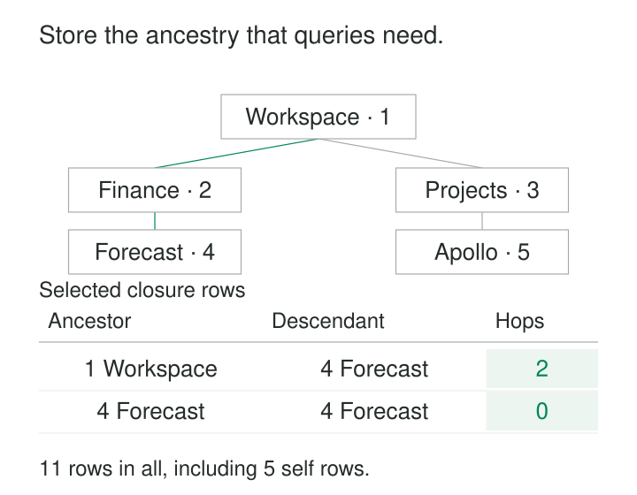

A folder system stores each folder’s parent. That works well until almost every screen needs more: the full breadcrumb, every descendant, the nearest shared ancestor, or a count of everything beneath a department.

Each request walks the same links again. The hierarchy changes occasionally, but its ancestry is rediscovered thousands of times a day.

**Closure Tables store ancestor–descendant relationships explicitly, so common hierarchy queries become ordinary joins and indexed lookups.** The pattern exchanges additional storage and maintenance work for simpler reads across arbitrary depths.

## Store reachability alongside the nodes

This example is a tree: each folder except the root has one parent. An adjacency list records those immediate parent links. A closure table records every reachable ancestor–descendant pair, including a node’s relationship to itself.

A common design has two tables:

| Table | Contents |
|---|---|
| `folder` | Folder identity, attributes, and optionally its immediate parent |
| `folder_closure` | `ancestor_id`, `descendant_id`, and optionally `hops` |

Here, `hops` counts edges between the two nodes. Zero means the same node; one means an immediate parent; two means a grandparent.



Storing all ancestor–descendant pairs for this five-node tree produces eleven closure rows; the illustration shows two of them. Folder IDs are Workspace (1), Finance (2), Projects (3), Forecast (4), and Apollo (5). `(1, 4, 2)` means Workspace contains Forecast through two edges. `(4, 4, 0)` lets queries include Forecast itself without a separate special case.

Bill Karwin’s description of the pattern includes both indirect ancestry and these zero-length self relationships. [Bill Karwin: Moving Subtrees in Closure Table Hierarchies](https://www.percona.com/blog/moving-subtrees-in-closure-table/)

The table stores reachability and distance. It does not duplicate folder names or document contents.

## Example: building a breadcrumb without recursion

Forecast’s breadcrumb is:

**Workspace → Finance → Forecast**

The database can retrieve it directly:

```sql
SELECT f.id, f.name, c.hops
FROM folder_closure AS c
JOIN folder AS f ON f.id = c.ancestor_id
WHERE c.descendant_id = 4
ORDER BY c.hops DESC;
```

For this tree, the result is:

| Folder | Hops to Forecast |
|---|---|
| Workspace | 2 |
| Finance | 1 |
| Forecast | 0 |

Reversing the lookup retrieves descendants: filter by `ancestor_id` and join folders through `descendant_id`. Restricting `hops = 1` returns immediate children; `hops > 0` excludes the starting node.

These queries do not traverse one level at a time. They read relationships already calculated when the structure changed.

However, distance alone does not provide a complete display order for a branching tree. Sibling order remains a separate concern, usually represented by a name, position, or other explicit sorting rule.

## Maintaining the table is part of every structural write

Adding a node requires more than inserting its identity. The system also creates its self row and connects every ancestor of its parent to the new node, increasing each distance by one.

A branch move changes many more relationships.

Suppose Finance moves beneath Projects. Forecast remains beneath Finance. The internal relationships within the Finance branch stay intact, including `(2, 4, 1)`.

The relationships crossing the branch boundary must be replaced:

| Relationship | Before | After |
|---|---|---|
| Workspace → Finance | 1 hop | 2 hops |
| Workspace → Forecast | 2 hops | 3 hops |
| Projects → Finance | Absent | 1 hop |
| Projects → Forecast | Absent | 2 hops |

Notice that Workspace remains an ancestor. Its stored distances still change.

For a tree, the general mechanism removes connections from old external ancestors into the moving subtree, preserves internal connections, and creates connections from the new parent’s ancestors to every node in that subtree. Each new distance combines the distance to the new parent, the connecting edge, and the distance within the subtree. Karwin explains this boundary-based approach in detail. [Bill Karwin: Subtree maintenance](https://www.percona.com/blog/moving-subtrees-in-closure-table/)

The parent change and closure updates must become visible together when readers require an immediately consistent hierarchy.

## Correctness depends on the whole relationship set

A closure table is trustworthy only when it contains exactly the relationships implied by the underlying structure.

For the tree model described here, that means:

- Every node has exactly one self row at distance zero.
- Every reachable ancestor–descendant pair appears once.
- No unreachable pair appears.
- Stored distances match the unique path through the tree.
- Every non-root node has one immediate parent, and cycles are prohibited.

A primary key on `(ancestor_id, descendant_id)` prevents duplicate pairs. Foreign keys prevent references to missing nodes. Neither guarantees that all required relationships exist or that their distances are correct.

If immediate parents remain in the node table, treat those parent links as the authoritative hierarchy. Calculate the closure rows from them, and rebuild from the parent links when necessary. Imports, repairs, and bulk updates must preserve that agreement.

Concurrency matters too. A move validated against one hierarchy can become invalid while another transaction changes it. Coordinated structural writes—using suitable locks or isolation with retries—must protect both validation and maintenance.

The ActiveRecord library `closure_tree` is a verified implementation of this arrangement. It uses a parent column and separate hierarchy table, provides rebuilding from parent relationships, and uses advisory locking to coordinate hierarchy operations. Its documentation also warns that certain update methods bypass hooks required to maintain the hierarchy. [ClosureTree: Implementation and concurrency documentation](https://github.com/ClosureTree/closure_tree)

## Example: rolling category activity up to broader groups

A catalog has this structure:

**Tools → Hand Tools → Spanners and Screwdrivers**  
**Tools → Power Tools → Electric Drills**

For one reporting period, leaf categories record:

| Leaf category | Units sold |
|---|---|
| Spanners | 300 |
| Screwdrivers | 200 |
| Electric Drills | 400 |

Joining these facts to their closure ancestors produces 500 units for Hand Tools and 900 for Tools.

Each leaf contributes to every relevant ancestor. There is no need to write a different query for categories two, three, or six levels deep.

The arithmetic assumes each sale belongs to one leaf category and the measure can be added across those categories. If a product belongs to several branches, the same sale may reach the same reporting group through several category assignments. Deduplication or allocation rules then become part of the metric definition.

TypeORM provides a concrete category implementation through `@Tree("closure-table")`, with repository operations for retrieving ancestors, descendants, and nested trees. The sales figures above are illustrative; the framework support is documented. [TypeORM: Closure-table tree entities](https://typeorm.io/docs/entity/tree-entities/#closure-table)

## The bill grows with depth and movement

Closure tables are useful when ancestry queries are frequent, hierarchies have variable depth, and the cost of repeated traversal matters more than the cost of maintaining derived relationships.

Storage depends strongly on shape. Including self rows, each node contributes one row for itself and one for every ancestor. A chain of 1,000 nodes therefore requires 500,500 closure rows. A root with 999 direct children requires only 1,999.

Indexes add further storage and write work. An ancestor-first key supports descendant lookups; a descendant-first index supports ancestor lookups. Actual index choices should follow the workload.

Inserting beneath a deep parent creates many rows. Moving a large subtree can modify roughly the number of affected ancestors multiplied by the subtree’s size. A small number of SQL statements can still touch a large number of records, hold locks, and generate substantial replication traffic.

Reading a whole tree also remains proportional to the returned data. Eliminating recursion does not make a million-node result cheap.

## Limits that deserve explicit decisions

The simple pair-and-distance model is easiest for trees. In a graph with several paths between two nodes, “distance” needs a definition, such as shortest path. Removing one edge must preserve reachability supported by another path. Tree maintenance algorithms cannot be transferred unchanged.

A current closure table also describes current ancestry. Reorganizing categories and joining old facts through today’s closure can restate historical reports. Historical analysis needs an explicit hierarchy version or effective-time design.

Deleting closure rows alone changes relationships; it does not necessarily delete the underlying entities. Subtree deletion, promotion of children, and detachment require distinct policies.

## Related patterns

[[data-adjacency-lists|Adjacency Lists]] provide compact immediate links and often the source for rebuilding closure. [[data-materialized-paths|Materialized Paths]] encode ancestry in a path rather than separate pairs. Nested sets are another related modeling concept: they encode subtree boundaries for efficient range queries. [[data-separate-source-facts-from-derived-interpretations|Separate Source Facts from Derived Interpretations]] helps distinguish authoritative parent relationships from derived closure rows that can be validated and rebuilt.
