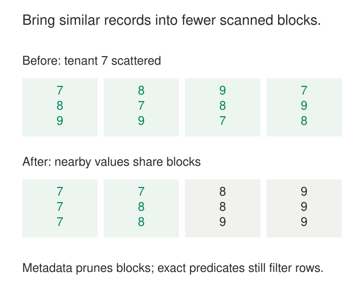

A daily events partition contains millions of records from thousands of tenants. Most support queries ask for one tenant’s activity, but that tenant’s records are scattered throughout the partition. Each query reads large amounts of unrelated data.

The partition boundary is useful: it excludes other days. Inside the selected day, however, arrival order provides little help.

**Place records commonly accessed together near one another in storage, so queries can read fewer blocks, files, or pages.**

“Related” means related to an access pattern: the same tenant, nearby timestamps, similar identifiers, or another frequently filtered dimension. It does not necessarily mean a foreign-key relationship.

Clustering improves physical locality. It leaves the logical rows, keys, and business meaning intact.

## Make storage ranges easier to exclude

Many analytical engines retain summaries such as the minimum and maximum values in a storage block or file.

If every block contains tenant identifiers ranging from 7 to 10, a query for tenant 7 cannot exclude any block using those ranges. If records are grouped by tenant, some blocks contain only values above 7 and can be skipped.

The illustration uses twelve records in four simplified blocks. Before clustering, every block contains tenant 7. After clustering, only two blocks remain candidates.



A candidate block can still contain unrelated records. Clustering reduces the search area; normal filtering determines which rows match.

Locality also helps row-oriented databases. When an index identifies many qualifying rows, placing those rows on nearby heap pages can reduce scattered reads. The mechanism differs from analytical block pruning, but the physical objective is similar.

## Example: tenant locality inside daily partitions

A usage table supports two common queries:

- Activity across all tenants during a date range.
- Activity for one tenant during that range, sometimes restricted to an event type.

Daily partitioning supports the first restriction. Clustering within each partition by `tenant_id, event_type` supports the second.

An illustrative layout might contain:

| Storage group | Tenant range | Event types |
|---|---|---|
| B1 | 100–140 | Several |
| B2 | 141–180 | Several |
| B3 | 181–220 | Several |

A query for tenant 160 can exclude B1 and B3 using the tenant ranges, then apply its event-type predicate within the remaining data.

BigQuery implements clustering through adaptively sized storage blocks organized using selected columns. It can combine partition pruning with block pruning, and maintains clustering within each partition. [BigQuery: Introduction to clustered tables](https://docs.cloud.google.com/bigquery/docs/clustered-tables)

The order of clustering columns matters. With `tenant_id` first, tenant predicates are the strongest match for the layout. A query filtering only `event_type` may benefit less because each tenant contains its own event-type groups.

This is the order in the clustering specification—not the textual order of conditions joined by `AND`. BigQuery’s documentation explicitly distinguishes those two ideas. [BigQuery: Query clustered tables](https://docs.cloud.google.com/bigquery/docs/querying-clustered-tables)

Creating one partition per tenant would express a different design, potentially producing many small partitions. Clustering offers finer locality without requiring that partition explosion.

## Choose a small set of useful dimensions

A good clustering key reflects repeated, sufficiently selective operations.

A high-cardinality identifier can be useful when queries often request one identifier or a narrow range. A low-cardinality field can also help if its values divide a large table into meaningfully distinct regions.

Neither property is sufficient by itself. An identifier that almost never appears in filters provides little pruning value. A status column that is almost always `active` may leave most queries scanning almost everything.

For lexicographic layouts, the leading column establishes the broad organization; later columns refine locality within it. Adding columns does not give every column equal influence.

The best key also depends on existing partitioning. Within a daily partition, clustering by that same date usually adds little discrimination. Tenant or device identifiers may contribute more.

Clustering is especially useful when substantial data remains after coarse partition pruning.

## Example: support several investigative filters

A device-events lakehouse receives support queries by `device_id` and separate investigations by `customer_id`.

Sorting strictly by device identifier favors device lookups. Customer records may remain spread across many files.

Delta Lake provides Z-Ordering as one form of multidimensional clustering:

```sql
OPTIMIZE events
ZORDER BY (device_id, customer_id);
```

This reorganizes records to improve locality across the selected dimensions. Delta’s data-skipping mechanism uses file statistics, including minimum and maximum values, to avoid reading files that cannot match. [Delta Lake: Data skipping and Z-Ordering](https://docs.delta.io/optimizations-oss/)

This requires statistics on the relevant columns. Rearranging records around a column that lacks usable skipping statistics can spend substantial rewrite effort without delivering the intended pruning.

More dimensions also dilute locality. Delta documents decreasing effectiveness as additional Z-Order columns are added.

This example does not imply that Z-Ordering is equivalent to BigQuery’s ordered clustering columns. They implement different layouts. The shared pattern is to arrange data so the engine’s access mechanisms can exploit locality.

Compaction alone does not establish that locality. Combining small files can reduce file-opening overhead while leaving each resulting file full of unrelated identifiers.

## Example: cluster device history in PostgreSQL

A PostgreSQL table stores sensor readings. Applications regularly fetch hundreds of readings for one device over a time interval.

An index on `(device_id, observed_at)` identifies the requested rows. If those rows were inserted among readings from many devices, retrieving their additional columns may still touch many scattered table pages.

PostgreSQL’s `CLUSTER` command physically reorders a table using an existing index:

```sql
CREATE INDEX readings_device_time
ON readings (device_id, observed_at);

CLUSTER readings USING readings_device_time;
```

The resulting locality can help range retrieval that needs table rows. PostgreSQL documents this as a one-time operation: subsequent inserts and updates do not automatically preserve the arrangement.

It also acquires an `ACCESS EXCLUSIVE` lock, blocking other reads and writes while clustering runs. Maintenance therefore needs an appropriate operating window, disk capacity, and a measured benefit. [PostgreSQL: CLUSTER](https://www.postgresql.org/docs/current/sql-cluster.html)

An index-only access path or a small, fully cached table may gain less from this physical rewrite. The relevant question is whether scattered table access is actually an important cost.

## Maintain locality as data changes

New arrivals can spread related values across additional blocks or files. Updates can gradually weaken a previously useful layout.

Maintenance behavior varies by platform. BigQuery performs automatic reclustering in the background. PostgreSQL requires another `CLUSTER` operation to restore its physical arrangement. Delta layouts depend on the optimization features and operations being used. [BigQuery: Automatic reclustering](https://docs.cloud.google.com/bigquery/docs/clustered-tables#automatic_reclustering), [PostgreSQL: Clustering behavior](https://www.postgresql.org/docs/current/sql-cluster.html)

Choose maintenance frequency from observed degradation and rewrite cost. Reorganizing an entire historical table after every small ingestion batch can cost more than the queries save.

Frequently queried recent partitions may deserve more attention than cold history. Supported transactional rewrite mechanisms should publish layout changes safely while preserving readers’ view of the logical data.

## Keep layout separate from correctness

Correct query results must not depend on perfect clustering. Statistics and pruning rules must conservatively retain every storage region that could contain a match.

Clustering also provides no uniqueness constraint, authorization boundary, or guarantee that related tables reside together. It does not automatically remove a distributed join’s shuffle.

Physical order is not a query-result contract. Use `ORDER BY` when consumers require a defined result sequence.

These assumptions keep a performance optimization from becoming an accidental dependency in application behavior.

## Compare savings with maintenance cost

The operating costs include sorting, shuffling, rewriting, temporary storage, and possible interference with ingestion. Frequent updates can increase that burden.

Clustering helps less when queries read most records, predicates do not align with the layout, or the dataset is already small. A very large tenant may still occupy many blocks even under an effective tenant layout.

Measure bytes and files read, buffer accesses, latency, and maintenance consumption across representative queries. Separate layout improvements from warm-cache effects. Fewer candidate blocks do not necessarily produce a proportional runtime improvement.

[[data-partition-by-access-pattern|Partition by Access Pattern]] supplies coarse boundaries. **Compaction** reduces fragmentation but may need clustering to improve locality. [[data-aggregate-fact-tables|Aggregate Fact Tables]] can replace repeated detail scans with summaries. [[data-workload-isolation|Workload Isolation]] protects live work while expensive reorganization runs.

Clustering earns its maintenance cost when recurring operations reach the same logical records through substantially less physical work.
