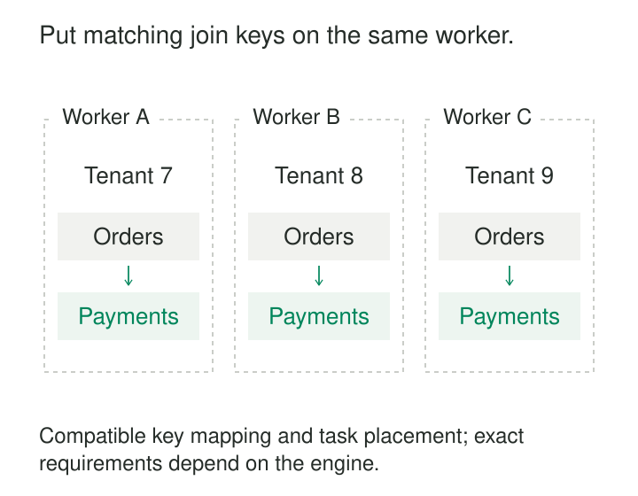

A live dashboard joins orders to payments. Both tables are distributed, and each worker has plenty of computing capacity. Yet the query spends much of its time moving records between workers so matching rows can meet.

**Co-Located Joins arrange related inputs so matching records are already available to the same join task.** Instead of repeatedly redistributing data at query time, the system maintains a compatible placement scheme across the inputs.

The pattern is useful when joins recur, both inputs are substantial, and a stable business key can organize their placement.

## Make locality a shared contract

Partitioning two tables independently does not make their joins local. Both might contain `customer_id`, have sixteen partitions, and still place the same customer’s records differently.

Co-location requires agreement across several layers:

- **Key meaning:** the values used for placement represent the same grouping on both sides.
- **Partition mapping:** matching values map to compatible partitions, including the relevant hashing, ranges, types, and serialization.
- **Execution placement:** matching partitions are assigned to the same worker or join task.
- **Planner knowledge:** the engine recognizes that arrangement and can safely avoid redistribution.

The exact requirements depend on the engine. Some support compatible partition schemes that are not identical; others require a strict match.



The join condition must also establish the necessary relationship between placement keys. Two tables distributed by tenant cannot generally be joined locally on an unrelated product identifier: matching products may occur across many tenants and workers.

Citus implements co-location by placing corresponding hash ranges from related tables together and preserving that relationship during rebalancing. [Citus table co-location](https://docs.citusdata.com/en/stable/sharding/data_modeling.html#table-co-location)

## Example: orders and payments within a tenant

Consider a multitenant application in which order identifiers are unique within each tenant.

| Table | tenant_id | order_id | Other values |
|---|---|---|---|
| orders | T7 | O17 | USD 30 |
| payments | T7 | O17 | payment P51 |
| orders | T8 | O18 | USD 20 |
| payments | T8 | O18 | payment P52 |

Distributing both tables by tenant lets the system keep each tenant’s orders and payments together. Worker A can join T7’s records while worker B independently joins T8’s.

In Citus, the tables can explicitly share a co-location group through the `colocate_with` argument:

```sql
SELECT create_distributed_table('orders', 'tenant_id');

SELECT create_distributed_table(
  'payments', 'tenant_id', colocate_with => 'orders'
);
```

These calls assume the existing table definitions satisfy Citus’s distribution requirements. The argument establishes the relationship between their shard placement. [Citus distribution functions](https://docs.citusdata.com/en/stable/develop/api_udf.html#create-distributed-table)

The query retains the complete business relationship:

```sql
SELECT o.order_id, p.payment_id
FROM orders o
JOIN payments p
  ON p.tenant_id = o.tenant_id
 AND p.order_id = o.order_id
WHERE o.tenant_id = 'T7';
```

Including tenant equality both expresses the correct key scope and makes the shared distribution relationship explicit. Joining only on a locally unique order identifier can connect unrelated tenants’ records.

A tenant-scoped query can be routed to the worker containing the relevant shard. A query spanning tenants may execute local joins across workers and then gather results at the coordinator. Co-location reduces movement of join inputs; returned results still travel. [Citus query processing](https://docs.citusdata.com/en/stable/develop/reference_processing.html)

## Example: matching Kafka partitions inside one stream task

An order-event stream and a payment-event stream must be joined by order identifier. Both streams are large enough that replicating either input everywhere would be expensive.

Kafka Streams requires co-partitioning for its ordinary key-based stream joins. The input topics must have the same partition count and compatible partitioning strategies, so equal keys reach the same partition number. Matching partitions are processed by the same stream task. [Kafka Streams co-partitioning requirements](https://kafka.apache.org/42/streams/developer-guide/dsl-api/#join-co-partitioning-requirements)

For example, order O17 and its payment must both reach partition 3. Having twelve partitions on each topic is insufficient if their producers assign O17 differently.

The contract includes how keys are serialized and partitioned. A producer migration that changes key bytes or routing behavior can break alignment even when the displayed order identifier looks unchanged.

Kafka Streams checks partition counts, but its documentation warns that it cannot verify whether the partitioning strategies match. That remains an application responsibility.

This locality concerns the processing task. The source partitions may reside on different brokers, so ingestion still involves network reads.

Time remains a separate concern. A windowed stream join also needs an appropriate matching interval and late-data policy. Co-partitioning ensures records can meet at the right task; it does not ensure both records have arrived before state expires.

## Example: use existing storage partitioning

A lakehouse repeatedly joins two large tables organized by department and bucketed employee identifier. Reading both tables into a processing engine and repartitioning them again can duplicate work already represented in storage.

Spark’s Storage Partition Join optimization can use partitioning reported by compatible V2 data sources to avoid join shuffles. Its documentation demonstrates this with Iceberg tables partitioned by department and `bucket(8, id)`, joined on department and identifier. [Spark Storage Partition Join](https://spark.apache.org/docs/latest/sql-performance-tuning.html#storage-partition-join)

This is a broader form of locality than permanently keeping two database shards on one server. The engine uses known storage groupings to arrange compatible join work without redistributing all the rows.

Files may still be read over the network from object storage. Sorting, scanning, and later aggregation may still cost substantial time. The saving is the avoided shuffle between execution stages.

The storage layout alone is insufficient: the source must expose usable partitioning information, the query must qualify, and the relevant engine configuration must permit the optimization.

## Locality does not repair the model

A local join can be fast and wrong.

If an order has three payment attempts, joining orders to attempts produces three rows. Summing the order amount afterward counts it three times unless the calculation accounts for that grain.

Likewise, matching records can represent incompatible moments in time. A current customer row joined to a historical transaction may be appropriate for one report and wrong for another. Physical proximity does not establish an as-of relationship or a transaction snapshot.

Nulls, missing matches, duplicate keys, and outer-join behavior retain their normal significance. An implementation must preserve the original join semantics rather than discard inconvenient unmatched records to keep execution local.

## The placement choice favors some workloads

Co-location pays when the same relationships are queried repeatedly and neither input is small enough to broadcast comfortably. Tenant, account, order, or device identifiers often provide useful boundaries.

One layout rarely serves every join. Data organized by customer may still require movement for a product-oriented join. Citus’s modeling guidance explicitly recommends choosing which large relationship to co-locate and considering replicated reference tables for smaller shared dimensions. [Citus distribution guidance](https://docs.citusdata.com/en/stable/sharding/data_modeling.html#real-time-apps)

Skew is the central capacity risk. A tenant responsible for half the traffic can overload its placement group while other workers remain idle. Adding workers does not automatically divide that tenant’s local workload. Splitting a hot key requires a strategy that preserves all required matches, sometimes through additional replication or redistribution.

Maintenance also becomes coupled. Related shards may need to move together. Changing distribution keys, partition counts, or placement rules can require coordinated migration, state rebuilding, and careful handling of writes during transition.

## Verify locality under ordinary change

Inspect actual execution plans and runtime traffic. For Spark Storage Partition Join, the documented successful plan removes the shuffle `Exchange` nodes immediately before the join. For streaming systems, inspect repartition topics, task assignments, and per-partition lag.

Measure the busiest worker, not just cluster averages. Track shuffle bytes, local join memory, output cardinality, and rebalancing or recovery time.

Common mistakes include assuming equal partition counts imply alignment, confusing date partitioning with business-key co-location, and assuming a placement agreement survives independent schema or producer changes.

The strongest implementations make placement an observable system contract that remains valid through ingestion, failover, and rebalancing.

## Nearby patterns

[[data-horizontal-sharding|Horizontal Sharding]] distributes records; co-located joins coordinate that distribution across related inputs.

[[data-broadcast-small-inputs|Broadcast Small Inputs]] brings a complete small input to each worker when replication is affordable.

[[data-cluster-related-records|Cluster Related Records]] improves storage locality within a layout, without necessarily aligning separate inputs across workers.

**Bounded Stream-Stream Joins** adds the time and state-retention rules needed when matching records arrive independently.
