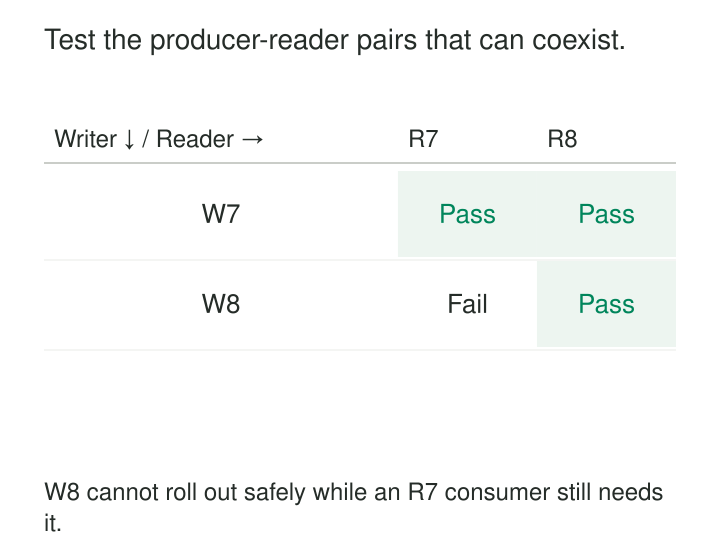

A producer and consumer are updated together in a test environment. Every test passes. The producer reaches production first, where older consumers still run, and processing immediately stops.

The tested combination worked. The deployed combination was different.

[[data-compatibility-checks-in-delivery|Compatibility Checks in Delivery]] make supported producer, consumer, schema, and data-version combinations explicit release conditions. Proposed changes are checked during development and again against the relevant deployment state before promotion.

The purpose is to catch changes that break another system’s supported expectations—even when the changed component is internally correct.

## Ask “compatible with what?”

Compatibility is a relationship between versions, representations, and behaviors.

A new reader may understand old records while an old reader cannot understand new records. A Protobuf change may preserve binary decoding while breaking generated application code. A warehouse model may retain every column type while changing the meaning of a row.

Before checking a candidate, identify:

- Versions currently deployed, including overlapping versions during rollout.
- Consumers and interfaces still covered by the support policy.
- Historical data that replay or recovery must read.
- The deployment sequence and permitted rollback paths.

Use authoritative deployed versions and published contracts as baselines. Comparing only against the development branch can miss consumers running an older release.

A passing result should identify the exact candidate and baseline versions. “Compatible with latest” becomes ambiguous as soon as latest changes.

## Test the combinations the rollout creates

The illustration shows an apparently healthy upgrade. Candidate writer `W8` works with candidate reader `R8`. Existing writer `W7` also works with `R8`.

But `W8` fails with deployed reader `R7`.



Deploying the new reader first may establish a safe forward path. It does not automatically establish a safe rollback path after the new writer starts producing data.

Pact provides a concrete implementation of version-aware deployment checking. Its [Pact Matrix and `can-i-deploy` mechanism](https://docs.pact.io/pact_broker/can_i_deploy) use verification results and recorded deployments to assess a candidate against integrated application versions in an environment.

That evidence depends on accurate deployment records and meaningful tests. An unknown required pairing should leave the decision unresolved, rather than being interpreted as compatible.

## Catch an accepted message that an old handler rejects

Suppose an event’s `status` field is defined as a string. Existing consumers handle `CREATED` and `COMPLETED`. A candidate producer introduces `CANCELLED`.

The schema still permits the value. Deserialization succeeds. An older consumer’s exhaustive application branch raises an error.

A useful delivery check passes representative candidate events through the actual supported consumer handler and verifies the required outcome. It must include the changed status; rerunning fixtures containing only old values establishes little about the new behavior.

Consumer expectations can also be expressed through message contracts. [Pact’s messaging support](https://docs.pact.io/implementation_guides/net/docs/messaging-pacts) lets consumers describe expected message content and metadata, which producers verify. Its documentation explains that messages are simulated during provider verification; the transport itself is outside that test.

The distinction matters. A permissive matcher that accepts any string will not establish that every new status is understood. Test assertions must represent the consumer dependency, and separate integration tests must cover the messaging path.

## Check every representation consumers use

Consider a Protobuf field renamed from:

```protobuf
string customer_id = 1;
```

to:

```protobuf
string buyer_id = 1;
```

Keeping the field number and type preserves its binary representation. Yet generated accessors change, and the default JSON field name changes.

A binary-only check can therefore pass while supported source-code integrations or JSON consumers break.

[Buf’s breaking-change detection](https://buf.build/docs/breaking/rules/) distinguishes these scopes. Its rule categories cover binary wire compatibility, binary-plus-JSON compatibility, and generated-source compatibility at package or file level.

Choose checks from actual usage. If an interface serves both binary messages and JSON exports, protect both. If consumers regenerate client code independently, include the relevant generated-code guarantees.

Run representative serialization and deserialization through supported libraries where practical. Handwritten JSON that resembles a message can bypass the serializer behavior, field-presence rules, or runtime differences that cause the failure.

Successful decoding is one assertion. Correct interpretation is another.

## Exercise existing queries against the candidate model

A public warehouse model renames `customer_name` to `full_name`. The producer’s new queries work, but a scheduled consumer still selects `customer_name`.

Build the candidate in an isolated environment and execute representative supported consumer queries against it using the relevant database engine. A syntax check of the producer’s SQL cannot reveal this dependency.

For a straightforward rename, an overlap interface can expose both names with the same meaning while consumers migrate. If the new field has a different definition, an alias alone is insufficient.

[dbt model versions](https://docs.getdbt.com/docs/mesh/govern/model-versions) provide a mechanism for maintaining model interfaces across breaking changes. Versioning creates a migration path; delivery checks still need to establish that the affected queries and expected results work.

Go beyond column presence. A change from one row per customer to one row per customer address may leave existing queries executable while multiplying totals. Small fixtures should test the promised grain, join behavior, units, and representative calculations.

Compatibility includes preserving supported behavior, not merely avoiding exceptions.

## Include retained data and rollback

Schema evolution needs direction and historical scope. Backward compatibility supports newer readers consuming older data; forward compatibility supports older readers consuming newer data. Transitive policies extend checks across earlier versions.

[Confluent’s compatibility documentation](https://docs.confluent.io/platform/current/schema-registry/fundamentals/schema-evolution.html) describes these policies and their format-specific rules. Its [registry API](https://docs.confluent.io/platform/current/schema-registry/develop/api.html#compatibility) supports testing proposed schemas against a specific version or a subject’s version history before registration.

Match the history to retention and recovery obligations. Passing against the most recent schema does not establish that a year-old archive remains readable.

Rollback needs the same care. Reverting an application does not remove messages already written, restore deleted columns, or reverse a backfill. Test the rollback reader against data created by the candidate.

Where compatibility cannot be maintained, define a staged migration: introduce the new interface, migrate consumers, verify the transition, and retire the old interface after its support obligations end. The required pairings can change, but that change should be deliberate and reviewable.

## Put checks on the path to release

Run inexpensive schema and interface comparisons early, then consumer verification and representative data tests where they provide additional evidence.

Before deployment, confirm that the candidate artifact is the one tested and that relevant production versions and policies have not changed. Concurrent deployments can invalidate an earlier decision.

Missing baselines, unavailable registries, and absent verification results are evidence problems. They should not silently produce a passing status.

Make the check consequential. A report that identifies a breaking change while deployment continues has not enforced compatibility. Any exception should identify the affected interface, owner, migration plan, and limited scope.

Include changes to compatibility configuration in review. Weakening a rule or excluding a dependency can remove protection without changing the data schema itself.

## Bound the matrix without hiding dependencies

Checking every historical application combination is expensive and often unnecessary. Maintain a supported-version policy, then concentrate checks on live consumers, rollout overlaps, rollback candidates, and retained data.

The operating costs include test environments, consumer fixtures, dependency discovery, verification storage, and maintaining old interfaces. Excessively broad suites slow delivery; overly narrow suites provide misleading confidence.

These checks are especially useful when producers and consumers deploy independently, shared models have many users, or data outlives the applications that created it.

They cannot cover undocumented consumers or expectations nobody encoded. Production monitoring and canary records remain necessary to detect configuration differences and untested behavior.

[[data-explicit-data-contracts|Explicit Data Contracts]] defines the expectations being protected. [[data-schema-registries|Schema Registries]] supplies version histories and structural compatibility checks. [[data-publication-quality-gates|Publication Quality Gates]] makes required evidence control promotion. [[data-end-to-end-canary-records|End-to-End Canary Records]] verifies selected journeys after delivery.
