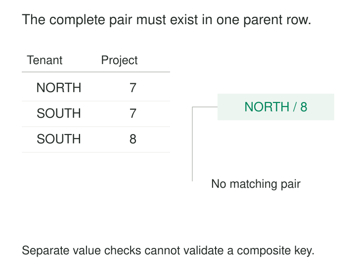

Two organizations use the same application. Each has a project numbered `7`. A report joins tasks to projects using only that number, and tasks appear under both organizations.

The project number was never a complete identity. It needed its tenant.

Composite keys identify records through a combination of fields. They make scope, relationships, and other multi-part identities explicit, helping databases reject duplicates and connect records to the correct parent. Their usefulness depends on carrying the complete combination through storage, references, and queries.

## Identity can belong to a combination

A **composite key** contains two or more columns that identify a record together. Individual values may repeat; the identifying combination must be unique.

For tenant-scoped projects, `(tenant_id, project_no)` can identify one project even though neither component does so alone.

“Composite” describes the key’s structure. It does not determine whether its components are natural business identifiers or generated surrogate identifiers. A relationship between two entities can have a composite key made entirely from their surrogate keys.

The combination can serve as the primary key or remain an alternate key protected by a uniqueness constraint. PostgreSQL supports both multi-column primary keys and multi-column unique constraints. [PostgreSQL: Constraints](https://www.postgresql.org/docs/current/ddl-constraints.html)

The underlying modeling question is: **which combination distinguishes exactly one record at this table’s grain?**



## Example: keep a project inside its tenant

Consider an illustrative project table:

| Tenant | Project number | Project name |
|---|---:|---|
| `NORTH` | 7 | Dispatch |
| `SOUTH` | 7 | Onboarding |
| `SOUTH` | 8 | Renewal |

The primary key is `(tenant_id, project_no)`.

A task belonging to `NORTH` tries to reference project `8`. Checking that tenant `NORTH` exists and that project number `8` exists somewhere would pass. But the pair `(NORTH, 8)` does not exist.

The task table needs a composite foreign key:

```sql
FOREIGN KEY (tenant_id, project_no)
    REFERENCES project (tenant_id, project_no)
```

This requires the values to match together in one project row. PostgreSQL’s documentation uses the same general structure for tenant-scoped users and references to them. [PostgreSQL: Foreign Keys](https://www.postgresql.org/docs/current/ddl-constraints.html#DDL-CONSTRAINTS-FK)

Queries must preserve the same relationship. Joining tasks and projects only on `project_no` discards tenant scope, even when the stored references are valid. The join must match both tenant and project number.

The constraint checks the consistency of the stored relationship. Application authorization remains a separate concern.

## Example: a relationship has two ends

A project can have many members, and a person can belong to many projects. Suppose the application stores one current membership per person and project:

| Project key | Person key | Current role |
|---|---|---|
| `P-55` | `U-9` | Editor |
| `P-55` | `U-12` | Viewer |
| `P-88` | `U-9` | Viewer |

The pair `(project_key, person_key)` identifies the membership.

Making `project_key` unique would allow only one member per project. Making `person_key` unique would allow each person to join only one project. Uniqueness on the pair expresses the intended relationship.

The role is an attribute of that membership under this model’s assumption of one current role. Including it in the key would permit the same person-project pair to appear several times with different roles, changing the rule.

History changes the problem. If a person leaves and later rejoins, the pair cannot identify both membership episodes separately. A history table needs an episode identity, such as a membership identifier or another carefully defined discriminator.

A composite key is useful because it expresses the grain. It cannot compensate for an unresolved choice between current state and historical episodes.

## A real implementation: PostgreSQL’s column catalog

PostgreSQL uses composite identity inside its own system catalogs.

Its `pg_attribute` catalog describes relation attributes, including table columns. The field `attrelid` identifies the containing relation; `attnum` identifies the attribute within that relation.

Attribute number `1` can occur in many tables. A relation identifier also appears in many attribute records. Together, they identify a particular catalog entry.

The PostgreSQL 18 source declares the catalog’s primary-key index on `(attrelid, attnum)`. It also declares a separate unique index on `(attrelid, attname)`, combining the relation identifier with the attribute name. [PostgreSQL source: pg_attribute.h](https://github.com/postgres/postgres/blob/REL_18_STABLE/src/include/catalog/pg_attribute.h)

This illustrates two useful ideas: local identifiers become meaningful within their parent scope, and one table can have more than one identifying combination.

## What must hold for correctness

The combination must reflect an enduring rule, rather than an accidental absence of duplicates in today’s data. Adding a description or import timestamp merely to make rows unique can conceal an incorrect grain.

Every required component must be present. For optional composite references, null handling needs deliberate attention: under common foreign-key semantics, a null component can allow a reference to escape the usual matching requirement. Required relationships should make every component non-null. SQLite documents this behavior explicitly for composite foreign keys. [SQLite: Composite Foreign Key Constraints](https://www.sqlite.org/foreignkeys.html#composite_foreign_key_constraints)

Corresponding fields also need compatible meanings and comparison rules. A source-system identifier must carry its namespace; text identifiers need agreed treatment of case, whitespace, and leading zeros.

References must preserve the intended correspondence. Swapping two similarly typed components can produce plausible values with the wrong meaning.

Finally, changes need a policy. If an identifying component changes, dependent references must remain consistent. Historical reuse of a combination may require assignment intervals or a separate durable identity.

## Keep the tuple intact

A frequent shortcut converts several columns into one concatenated string. Without an unambiguous encoding, different tuples can produce the same result: `(1, 23)` and `(12, 3)` both become `123`.

Separators help only when escaping, nulls, types, and normalization are defined. Hashing the resulting string does not repair an ambiguous encoding.

Within a relational database, separate typed columns and a declared composite constraint usually express the rule more directly. When a tuple must travel through an API or cache, its representation needs to preserve component boundaries.

Another common error is checking for an existing combination in application code before inserting it, without a database uniqueness constraint. Concurrent requests can both observe no match and create duplicates. The maintained constraint must enforce the rule where concurrent writes meet.

## The cost follows the number and width of components

Composite keys are especially useful for identifiers scoped to tenants or parent records, relationships between entities, and records whose identity naturally spans several dimensions.

They also increase the amount of information applications must carry. Foreign keys, joins, update predicates, cache entries, and diagnostic logs need the relevant components. Wide or deeply nested keys can spread through many dependent tables.

Indexes introduce another tradeoff. Reversing `(tenant_id, project_no)` to `(project_no, tenant_id)` preserves the same uniqueness rule, but can change query performance. PostgreSQL’s multi-column B-tree indexes are generally most efficient when predicates constrain the leading columns; the optimizer may also use other strategies depending on the data. [PostgreSQL: Multicolumn Indexes](https://www.postgresql.org/docs/current/indexes-multicolumn.html)

A surrogate primary key can shorten repeated references while a composite unique constraint preserves business uniqueness. That is often useful when the identifying tuple is wide or mutable. The model still needs any constraints required to keep contextual relationships consistent.

Composite keys earn their complexity when the combination communicates and enforces a real identity rule. They become cumbersome when they accumulate fields without a clear account of what one row represents.

## Related patterns

[[data-declare-the-grain|Declare the Grain]] establishes the record that the complete key must identify.

[[data-natural-keys|Natural Keys]] supplies business identifiers whose scope may require several components.

[[data-surrogate-keys|Surrogate Keys]] offers an independent reference while composite constraints preserve domain rules.

[[data-bounded-contexts|Bounded Contexts]] helps explain why an identifier needs its originating scope before it can be interpreted elsewhere.
