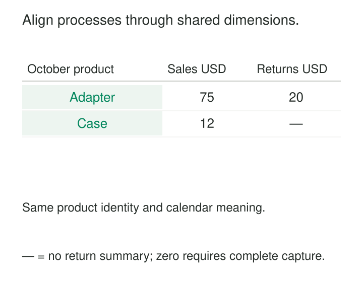

Sales reports show strong growth in Accessories. Returns reports show a sharp increase in Electronics. The operations team suspects a quality problem, but the analysts cannot establish whether they are looking at the same products. Each department maintains its own classifications, customer identifiers, and calendar rules.

[[data-conformed-dimensions|Conformed Dimensions]] make different business processes comparable by giving them consistent ways to identify, describe, filter, and group the things they share.

A sale remains a sale; a return remains a return. Shared product, customer, location, and calendar dimensions provide the common context needed to examine them together.

## Give separate processes common coordinates

A dimension supplies the descriptive context around a measurement: which product, which customer, which place, which period.

Dimensions conform when their shared attributes have compatible definitions and matching domain contents. Reports can then group separate fact tables using those attributes and align the results. This is the basis of integration in Kimball dimensional modeling. [Kimball Group: Conformed Dimensions](https://www.kimballgroup.com/data-warehouse-business-intelligence-resources/kimball-techniques/dimensional-modeling-techniques/conformed-dimension/)

For a product dimension, that agreement might establish that:

- A product identifier refers to one particular sellable item.
- Category codes have the same membership and meaning.
- Category hierarchies follow the same rules.
- Changes in classification follow an explicit historical policy.

One shared physical dimension table makes this agreement easier to maintain. Governed copies and compatible subsets can also conform. The requirement is consistent interpretation wherever the shared attributes appear.

A matching column name provides little assurance by itself. Two systems can both contain `customer_id = 101` while referring to different people. Equally, two different source identifiers can refer to the same product.

*Shared dimensions establish comparable coordinates. Each process keeps its own facts, grain, and measures.*

## Compare sales and returns without multiplying them

Consider an illustrative retailer with these October transactions. All amounts are USD.

| Process | Record | Shared product key | Amount |
|---|---|---:|---:|
| Sale | S1 | 101 — Adapter | 50 |
| Sale | S2 | 101 — Adapter | 25 |
| Sale | S3 | 102 — Case | 12 |
| Return | R1 | 101 — Adapter | 10 |
| Return | R2 | 101 — Adapter | 5 |
| Return | R3 | 101 — Adapter | 5 |

Sales and returns both resolve their source product identifiers to the shared product dimension. Their dates use the same calendar definitions.

To compare activity, aggregate sales by month and product. Independently aggregate returns by those same coordinates. Then align the two summaries:

| Month | Product | Sales amount | Return amount |
|---|---|---:|---:|
| 2026-10 | Adapter | 75 | 20 |
| 2026-10 | Case | 12 | — |

This technique is called **drilling across**: querying separate fact tables and combining results through their common dimension attributes. [Kimball Group: Drilling Across](https://www.kimballgroup.com/data-warehouse-business-intelligence-resources/kimball-techniques/dimensional-modeling-techniques/drilling-across/)

Joining the original fact tables directly on product would pair each of the three Adapter returns with both Adapter sales, producing six combinations. Summing those rows would incorrectly give sales of 225 and returns of 40, rather than 75 and 20. Conformed dimensions support comparison; they do not make a product key identify a particular sale–return relationship. [Kimball Group: Multipass SQL](https://www.kimballgroup.com/data-warehouse-business-intelligence-resources/kimball-techniques/dimensional-modeling-techniques/multipass-sql/)

The combined report should preserve products appearing in either summary. A dash means no return summary, rather than a measured zero. Convert it to zero only after confirming complete return coverage for that scope.

Finally, these figures describe October activity. The return could relate to a September purchase. Calculating the return rate for October’s sales requires a defined sales cohort and a link between returns and their originating sales.

## Conformance can stop at a shared level

Different processes often record information at different levels of detail.

Suppose sales are captured by individual product and day, while targets are established by category and month. The retailer’s October Accessories target is 100 USD. Adapter and Case sales total 87 USD.

The valid comparison is:

| Month | Category | Actual sales | Target |
|---|---|---:|---:|
| 2026-10 | Accessories | 87 | 100 |

The target model needs a category dimension that conforms to the category level of Product, plus a month dimension that conforms to the calendar’s month level. Kimball calls these higher-level representations **shrunken rollup dimensions**. [Kimball Group: Shrunken Rollup Dimensions](https://www.kimballgroup.com/data-warehouse-business-intelligence-resources/kimball-techniques/dimensional-modeling-techniques/shrunken-rollup-dimension/)

There is no product-level target in this example. Attaching the full category target to every product would repeat it. Filtering the comparison to blue adapters would also create an unsupported target comparison unless an explicit allocation rule existed.

Conformance therefore has a scope: these processes agree at month and category. They need not share every attribute or support every drill-down.

## Make identity, roles, and history part of the agreement

Correctness depends on more than distributing a dimension table.

**Identity mappings must be reliable.** Source identifiers should resolve to the intended shared member, including their namespace and relevant effective dates. If separate marts assign their own surrogate keys, equal integers cannot be assumed to match. A governed mapping or common key assignment must establish correspondence.

**Grouping must be unambiguous.** A report that expects one category per product needs a hierarchy that supplies one category under the selected historical policy. Multiple classifications require an explicit choice or allocation mechanism.

**Business roles must remain visible.** A customer dimension can serve sold-to and bill-to roles, but those roles answer different questions. Likewise, a shared calendar can describe order date, shipment date, and return date without making those dates interchangeable.

**History must follow a deliberate perspective.** Imagine that Adapter moves from Electronics to Accessories in November. One mart overwrites its category; another preserves the category recorded when each event occurred. Their October category totals can disagree even though both pipelines loaded correctly.

Type 1 changes overwrite attributes; Type 2 changes preserve versions in separate dimension rows. The report must establish whether it uses historical classifications or restates events under a current classification. [Microsoft: Modeling Dimension Tables](https://learn.microsoft.com/en-us/fabric/data-warehouse/dimensional-modeling-dimension-tables)

With versioned dimensions, a row key identifies a particular version. Comparing an entity across versions may require its durable business identity and an explicit classification rule. Blindly aligning historical surrogate keys can split what readers expect to see as one product.

## A published implementation: AdventureWorksDW

Microsoft’s AdventureWorksDW sample provides an inspectable implementation. Its `FactInternetSales` and `FactResellerSales` tables both reference `DimProduct`, `DimDate`, and `DimSalesTerritory`. Their foreign keys establish shared dimension membership across the two sales channels.

Both fact tables also use the date dimension in order, due, and shipment roles. Meanwhile, Internet sales reference `DimCustomer`, and reseller sales reference `DimReseller`. The model shares useful analytical coordinates while retaining channel-specific participants. These relationships are defined directly in Microsoft’s [AdventureWorksDW installation script](https://github.com/microsoft/sql-server-samples/blob/master/samples/databases/adventure-works/data-warehouse-install-script/instawdbdw.sql).

AdventureWorks is a fictitious sample business. It demonstrates an implemented schema rather than documenting a production organization’s results.

## Pay for the agreement and its upkeep

Conformed dimensions are particularly useful when recurring questions cross process boundaries: sales against inventory, shipments against orders, actuals against plans, or service demand against the installed product base.

Their main benefit is cumulative. Once a new fact table adopts established dimensions, it becomes easier to compare that process with existing ones.

The operating costs are equally real. Someone must own definitions, resolve identity conflicts, approve hierarchy changes, maintain source mappings, and manage historical corrections. A shared classification change can affect many reports. Replicated dimensions require reliable distribution and checks for drift; a centrally served dimension introduces a shared availability dependency.

Useful controls include unique dimension keys, valid fact references, unambiguous effective-date ranges, and agreement checks on shared attributes across copies. Unresolved mappings need visible exception handling so they do not silently disappear from totals.

The pattern can become cumbersome when teams attempt to standardize every descriptive field before delivering anything. Start with the dimensions and attributes required for concrete cross-process questions. Extend the agreement as additional uses justify it.

## Know what the pattern leaves unresolved

Conformed dimensions establish consistent grouping. Measures still need compatible definitions, currencies, units, coverage, and aggregation rules. Shared Product and Date dimensions cannot make inventory balances additive across time or turn bookings into recognized revenue.

Forced agreement can also conceal legitimate differences. A service account, a purchasing organization, and a legal entity may be related without being interchangeable customers.

[[data-shared-business-vocabulary|Shared Business Vocabulary]] supplies the meanings that dimension attributes encode. [[data-identity-crosswalks|Identity Crosswalks]] connect source identifiers to shared members. [[data-star-schema|Star Schema]] organizes each process around facts and descriptive dimensions. [[data-shared-metric-definitions|Shared Metric Definitions]] governs the calculations placed beside one another once those dimensions make comparison possible.
