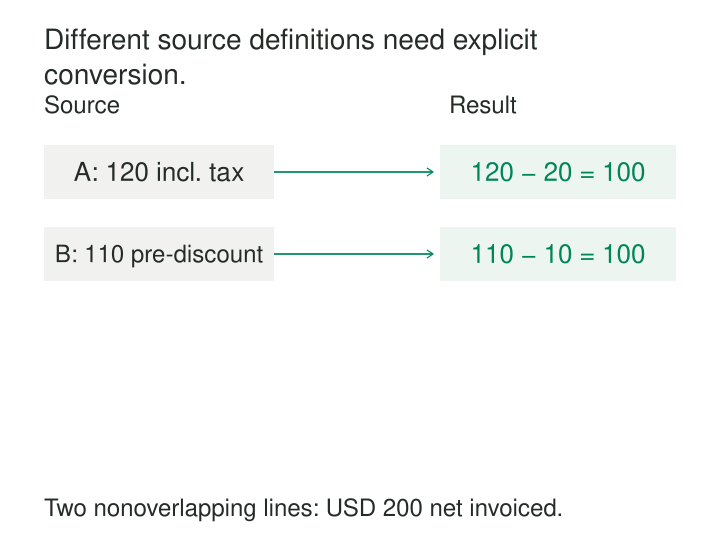

A retailer combines reports from two sales channels. Both contain a column called `revenue`. One includes tax after discounts; the other excludes tax before discounts. Adding them produces a plausible total that represents neither convention.

[[data-conformed-facts|Conformed Facts]] give measurements consistent business and technical definitions wherever they appear, so comparisons and calculations preserve their meaning.

The work begins before naming a column. Teams must agree on what is measured, what is included, which units apply, and how the measurement behaves when aggregated.

## Agree on the measurement behind the number

A fact is a measurement recorded at a declared grain: the quantity on an invoice line, the balance of an account at midnight, or the duration of a completed operation.

When the same measurement appears in separate fact tables, conformance means its technical definition remains consistent. Kimball recommends giving compatible facts identical names and incompatible facts different names so that users and reporting tools can distinguish them. [Kimball Group: Conformed Facts](https://www.kimballgroup.com/data-warehouse-business-intelligence-resources/kimball-techniques/dimensional-modeling-techniques/conformed-fact/)

A useful definition answers several connected questions:

- **Meaning:** Which event or condition does the number measure?
- **Scope:** Which charges, adjustments, records, or populations are included?
- **Representation:** What are the unit, currency, scale, sign, precision, and rounding rules?
- **Time:** Which business date applies, and how are corrections handled?
- **Aggregation:** Across which dimensions can the values be summed or otherwise combined?

A shared name records this agreement. Renaming inconsistent source columns does not establish it.

*Different source calculations can produce conformed facts when they implement the same measurement definition.*

## Translate source conventions into a common fact

Consider two distinct posted invoice lines. Neither includes shipping, and both are denominated in USD.

| Source | Recorded amount | Source convention | Transformation | Net invoiced amount |
|---|---:|---|---|---:|
| Channel A | 120 | After discounts; includes 20 tax | Subtract included tax | 100 |
| Channel B | 110 | Before a 10 discount; excludes tax | Subtract discount | 100 |

The illustrative shared definition is:

> Net invoiced amount is the signed amount of a posted invoice line after discounts, excluding tax and shipping, in the stated currency. Credit lines are negative.

The transformation differs because the sources differ. The resulting fact has the same interpretation in both channel models.

Under this definition, the two lines contribute 200 USD. Adding their original amounts would produce 230, mixing tax-inclusive and pre-discount values.

Correctness depends on the inputs. Channel A must expose the tax actually included in its amount. Channel B must expose the applicable discount. If discounts exist only at invoice level, allocating them to lines introduces another rule that must be consistent and documented.

When the necessary components are unavailable, the pipeline cannot establish an exact conformed value. It should retain the source measurement and expose the limitation. An undocumented estimate creates apparent agreement without the supporting evidence.

Keeping source amounts alongside the derived facts also makes reconciliation possible when someone challenges a total.

## Same definition does not mean safe to add

Conformance establishes meaning. Combining values requires additional conditions.

First, the records must have the intended coverage. If the same invoice appears in both a channel fact table and a consolidated fact table, adding both counts it twice. Perfectly conformed measurements can still overlap.

Second, the grains must support the calculation. Daily and monthly summaries of the same invoiced amount can agree, but combining overlapping summaries repeats activity. Joining invoice lines to multiple shipment rows can multiply amounts before aggregation.

Third, the measurement must permit the operation. Account balances may be comparable across systems while remaining unsuitable for summation across successive dates. Percentages cannot usually be added. Kimball distinguishes additive, semi-additive, and non-additive facts precisely because their aggregation behavior differs. [Kimball Group: Additive, Semi-Additive, and Non-Additive Facts](https://www.kimballgroup.com/data-warehouse-business-intelligence-resources/kimball-techniques/dimensional-modeling-techniques/additive-semi-additive-non-additive-fact/)

Different business events also deserve distinct names. `ordered_quantity`, `shipped_quantity`, and `invoiced_quantity` can all use individual items as their unit while measuring different stages of fulfillment. Comparing them can reveal a backlog. Treating them as interchangeable quantities would conceal it.

## Conform the components of a rate

Two factories report the proportion of inspected units rejected at first inspection.

| Factory | Units inspected | Units rejected | Rejection rate |
|---|---:|---:|---:|
| North | 100 | 5 | 5% |
| South | 20 | 15 | 75% |

Both factories must apply the same meaning of “inspected unit” and “rejected”: first inspections only, the same rejection criteria, and a consistent reporting boundary.

Even then, averaging the displayed percentages produces 40%, which is not the combined rejection rate.

The combined rate is:

`(5 + 15) / (100 + 20) = 16.67%`

The reusable measurements are the conformed numerator and denominator. Summing those components before calculating the rate preserves the contribution of each inspected unit. This follows Kimball’s recommendation to retain additive components where possible and calculate non-additive results after aggregation. [Kimball Group: Non-Additive Facts](https://www.kimballgroup.com/data-warehouse-business-intelligence-resources/kimball-techniques/dimensional-modeling-techniques/additive-semi-additive-non-additive-fact/)

A remaining limitation concerns interpretation: identical measurement rules do not make the factories’ product mixes equally difficult to manufacture. Conformance supports a valid combined calculation; explaining the performance difference may require additional dimensions and analysis.

## A documented implementation: standardized cloud costs

Cloud billing provides a practical implementation of this pattern.

The FinOps Open Cost and Usage Specification, **FOCUS**, defines named cost measurements so that differently structured billing sources can expose consistent concepts. In its version 1.0 definition, `BilledCost` represents the charge basis for invoicing after reduced rates and discounts, without amortizing prepaid purchases. It is expressed in `BillingCurrency`. The specification also requires reconciliation between billed-cost totals and invoices at the billing-account and billing-period scope. [FOCUS: Billed Cost](https://focus.finops.org/docs/specification/v1-0/columns/cost-and-usage/billed-cost/)

Microsoft implements these concepts in its FOCUS cost-and-usage export, including separate `BilledCost` and `EffectiveCost` columns. The latter incorporates the applicable amortized cost of prepaid purchases. [Microsoft: FOCUS Export Schema](https://learn.microsoft.com/en-us/azure/cost-management-billing/dataset-schema/cost-usage-details-focus)

The distinction has operational consequences. Microsoft’s validation guidance maps actual invoiced cost to `BilledCost` and amortized cost to `EffectiveCost`. Choosing whichever column happens to be called “cost” would mix different measurements. [Microsoft: Validate FOCUS Data](https://learn.microsoft.com/en-us/cloud-computing/finops/focus/validate)

Consistent columns still require compatible currencies, periods, and coverage before aggregation. Standardization makes those conditions explicit; it does not eliminate them.

## Maintain definitions as an operating responsibility

Conformed facts are especially useful when consolidating business units, replacing source systems, comparing channels, or publishing measurements through several analytical models.

Their benefit grows with reuse. A new model can adopt an established measurement rather than negotiate its meaning again.

The costs include semantic ownership, source investigation, transformation maintenance, reconciliation, and migration when rules change. Currency conversion may require maintained exchange-rate sources and a policy for selecting rates. Historical corrections may require backfills across several models.

A shared calculation reduces duplicated logic, but several systems can implement the same definition correctly. In that case, common reference examples help detect divergence: ordinary transactions, credits, cancellations, missing components, rounding boundaries, and late corrections.

A changed definition also needs an explicit transition. Teams should decide whether to restate history, introduce a new measurement, or preserve versions with clearly defined applicability. Silently changing a formula can create an apparent business trend that actually reflects a modeling change.

## Preserve differences that matter

The pattern fails when agreement is achieved by hiding distinctions.

Bookings, invoices, and cash receipts measure different events. Estimated and observed values carry different evidential status. Local-currency and reporting-currency amounts require different interpretation. Giving these values one convenient name makes downstream calculations harder to trust.

Conformance can also be unnecessarily expensive for a measurement used in one isolated context. Establish the agreement where recurring comparisons justify its maintenance.

[[data-conformed-dimensions|Conformed Dimensions]] supplies consistent grouping coordinates around these measurements. [[data-declare-the-grain|Declare the Grain]] establishes what each recorded value describes. [[data-make-units-explicit|Make Units Explicit]] prevents representational differences from disappearing inside numbers. [[data-shared-metric-definitions|Shared Metric Definitions]] carries the agreement into broader calculations, filters, and reporting rules built from the underlying facts.
