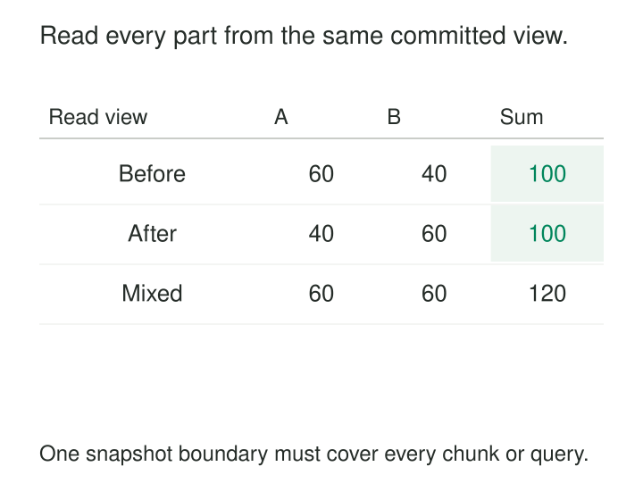

An inventory extraction reads 60 units in bin A. Before it reads bin B, a transaction transfers 20 units from A to B. The second query returns 60 units in B.

The extraction reports 120 units. The warehouse held only 100 before the transfer and 100 afterward.

Each query returned committed data. Together, they combined different database states.

[[data-consistent-snapshot-reads|Consistent Snapshot Reads]] keeps related reads on one stable visibility boundary. It allows an extraction, report, or reconciliation to observe a coherent view while other transactions continue changing the source.

The essential question is whether every read that must agree is using the same snapshot.

## Keep the view stable, rather than stopping time

Many databases implement snapshot reads through multiversion concurrency control, or MVCC. They retain row versions and use transaction visibility rules to determine which versions a reader can see.

A reader can therefore continue seeing an earlier committed version after another transaction updates or deletes the current row. Newer commits remain outside that reader’s established view.

MySQL’s InnoDB documentation describes this directly: ordinary consistent reads use row versions, and under Repeatable Read, successive consistent reads share the snapshot established by the first such read. Under Read Committed, each consistent read establishes a fresh snapshot. [MySQL: Consistent Nonlocking Reads](https://dev.mysql.com/doc/refman/8.4/en/innodb-consistent-read.html)

A snapshot is principally a visibility rule. It does not necessarily involve copying the entire database when the read begins.



## Example: count both bins from the same view

The transfer changes two rows in one source transaction:

| Source state | Bin A | Bin B | Total |
|---|---:|---:|---:|
| Before transfer commits | 60 | 40 | 100 |
| After transfer commits | 40 | 60 | 100 |

An extraction sharing the earlier snapshot reads 60 and 40, even if the second query runs after the transfer commits. One sharing the later snapshot reads 40 and 60.

Both results are coherent. They differ in freshness.

In PostgreSQL, a small extraction can establish transaction-wide snapshot reads explicitly:

```sql
BEGIN TRANSACTION ISOLATION LEVEL REPEATABLE READ READ ONLY;

SELECT quantity FROM inventory_bin WHERE bin_id = 'A';
SELECT quantity FROM inventory_bin WHERE bin_id = 'B';

COMMIT;
```

PostgreSQL Read Committed takes a fresh snapshot for each command. Its Repeatable Read mode uses the snapshot established at the first non-transaction-control statement, keeping subsequent ordinary reads on that view. Simply surrounding queries with `BEGIN` and `COMMIT` does not change the default isolation level. [PostgreSQL: Transaction Isolation](https://www.postgresql.org/docs/18/transaction-iso.html)

The example assumes the transfer itself updates both bins atomically. A stable read cannot repair an application that commits one half of the transfer separately.

## Example: pagination skips a product

A product export orders records by a unique product ID. Its first page returns P1 and P2 from this collection:

`P1, P2, P3, P4`

Another transaction deletes P1. The next query uses an offset of two against the newly visible collection:

`P2, P3, P4`

It returns P4. P3 has been skipped because the preceding rows shifted.

When every page reads the same snapshot, the collection remains stable for the extraction. The snapshot can still expose P1’s earlier version, so the next page returns P3 and P4.

Stable visibility does not eliminate every pagination problem. Queries still need deterministic ordering, including a unique tie-breaker where necessary. An unordered query can return inconsistent page boundaries even against unchanged data.

Keyset pagination can avoid offset shifting and improve efficiency, but it does not automatically freeze mutable records. A product’s category can still change between independently executed pages. Pagination position and snapshot identity solve different problems.

## Example: parallel workers need a shared boundary

A large export assigns customers to one worker and orders to another.

Both workers open Repeatable Read transactions. However, an application creates customer C-900 and their first order between the workers’ snapshot boundaries.

The orders worker can see the order while the customers worker cannot see its customer. Each worker has a stable view; the combined export does not share one.

Starting workers “at roughly the same time” is insufficient. They need a database-supported synchronization mechanism.

PostgreSQL allows one transaction to export its snapshot and other transactions to import it. The exporting transaction must remain open while workers import the snapshot; import also has transaction-level requirements. [PostgreSQL: Snapshot Synchronization](https://www.postgresql.org/docs/18/functions-admin.html#FUNCTIONS-SNAPSHOT-SYNCHRONIZATION)

This is an implemented export technique: PostgreSQL’s parallel `pg_dump` uses synchronized snapshots so its separate worker connections observe the same dataset. [PostgreSQL: Parallel Export](https://www.postgresql.org/docs/18/app-pgdump.html)

A custom parallel extractor needs both shared visibility and complete work allocation. A common snapshot does not prevent overlapping key ranges or omitted partitions.

## Define the boundary and its lifetime

The extraction contract should identify which reads must agree: one statement, one table, several tables, or all workers in a coordinated job.

It should also establish when the snapshot becomes effective. Depending on the engine and mode, this may occur at transaction start, the first consistent read, or an explicit snapshot operation. The job’s wall-clock start timestamp is not automatically the database visibility boundary.

Keep extraction transactions read-only where practical. Some engines make a transaction’s own writes visible alongside its snapshot reads, complicating the assumption that all observed values represent one untouched source view.

Connection management matters too. If a library returns a connection to a pool between pages, the next request may execute in a different transaction. Autocommit can similarly turn a supposed multi-query snapshot into separate transactions.

An exported snapshot identifier is also not necessarily a durable historical bookmark. Its availability can depend on an active transaction. If the view expires or a connection fails, resuming against a fresh snapshot can mix two source states. Recovery must preserve the original view through a supported mechanism or restart the affected extraction.

## Stable reads consume resources

MVCC reduces interference between ordinary readers and writers, but retained versions have a cost.

PostgreSQL cannot reclaim an updated or deleted row version while another transaction might still need to see it. Long-lived snapshots can therefore delay reclamation and increase storage pressure on frequently changing tables. [PostgreSQL: Recovering Disk Space](https://www.postgresql.org/docs/18/routine-vacuuming.html#VACUUM-FOR-SPACE-RECOVERY)

Scans also consume I/O, CPU, memory, and connections. Parallelism may shorten the snapshot’s lifetime while increasing peak source load.

The operating goal is a bounded extraction with enough capacity to finish predictably. Monitor snapshot age, scan progress, source load, and retained-version pressure. An idle transaction holding an old view can remain costly despite doing no useful reading.

A read replica can move extraction work away from the primary, but replication lag changes the freshness of its snapshot. Consistency and freshness remain separate properties.

## What “consistent” does not establish

A stable database view does not validate business rules. Incorrect values and partially completed business processes can exist in committed source data.

Snapshot isolation also does not generally make arbitrary read-and-write workflows serializable. PostgreSQL explicitly distinguishes its stable Repeatable Read view from Serializable isolation. Stronger transaction guarantees may be needed when decisions depend on concurrent activity. [PostgreSQL: Repeatable Read](https://www.postgresql.org/docs/18/transaction-iso.html#XACT-REPEATABLE-READ)

The guarantee has a scope. Independent databases, external APIs, nontransactional storage, and files do not automatically share the same visibility boundary. Schema changes and locking reads can introduce additional engine-specific behavior.

Finally, consistent reads establish source coherence, not destination completeness. A failed export can contain only half of a perfectly consistent view. Publication still requires evidence that all required records and partitions arrived.

The pattern is especially useful for related-table exports, reconciliation, snapshot initialization, and reports assembled from multiple queries. For a single query whose database already provides the required statement-level consistency, a longer transaction may add cost without improving that result.

## Related patterns

[[data-full-snapshot-extraction|Full Snapshot Extraction]] needs both coherent reads and complete coverage.

[[data-snapshot-then-stream|Snapshot Then Stream]] connects a baseline visibility boundary to subsequent changes without a handoff gap.

[[data-cursor-based-incremental-extraction|Cursor-Based Incremental Extraction]] tracks progress; its cursor provides snapshot consistency only when the source contract says so.

[[data-bitemporal-records|Bitemporal Records]] retains historical business and recorded-time information. A temporary database read snapshot does not replace that history.
