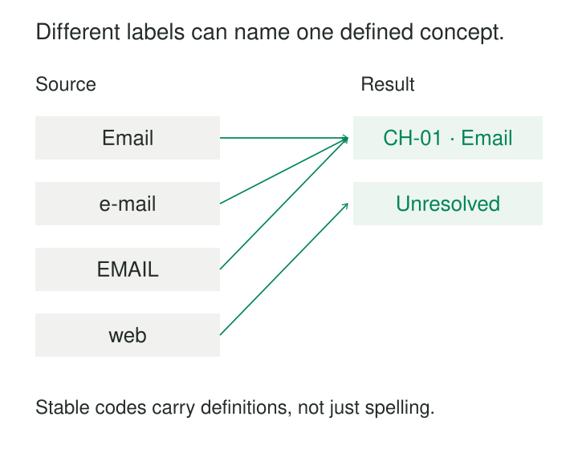

A support dashboard shows separate categories for “Email,” “e-mail,” and “EMAIL.” Someone merges them, then discovers that another system’s “mail” means postal correspondence. Meanwhile, “web” combines contact forms and live chat, which the operations team needs to measure separately.

Controlled vocabularies make categories consistent enough to validate, exchange, search, and compare. They provide agreed concepts, recognizable labels, and rules for assigning them. The work involves deciding which differences matter—and preserving those decisions as systems and language change.

## Give the concept an identity

A controlled vocabulary is a maintained set of concepts permitted for a particular purpose. It might describe contact channels, product materials, cancellation reasons, or contributor roles.

Each concept needs a clear meaning. For categories exchanged across systems or retained over time, give it a stable identifier independent of its displayed name. “Email” might have the local code `CH-01`; changing its capitalization or translating its label should not change which concept a record references.

A useful vocabulary entry typically contains an identifier, a preferred label, a definition or scope note, and any alternative labels that help people find it. Larger vocabularies may also include broader and narrower concepts, translations, sources, and editorial history. W3C’s SKOS model explicitly separates concepts from their labels and supports these relationships and documentation. [W3C: SKOS Primer](https://www.w3.org/TR/skos-primer/)

This gives a vocabulary more substance than a dropdown. The dropdown presents choices; the vocabulary explains what those choices mean.

## Normalize labels without erasing distinctions

Consider an illustrative vocabulary for the channel through which an individual customer message arrived:

| Code | Preferred label | Scope |
|---|---|---|
| `CH-01` | Email | Message received through email |
| `CH-02` | Web form | Message submitted through a website form |
| `CH-03` | Live chat | Message received through an interactive chat session |

In a known email field, “Email,” “e-mail,” and “EMAIL” can map to `CH-01`. Reports group by the code and display the preferred label, so spelling differences no longer fragment the category.

But “web” cannot safely map to either `CH-02` or `CH-03` without more evidence. A source system might use it for both. The mapping must inspect another field, consult a documented source rule, or leave the classification unresolved.

Even “mail” needs context. It may be a valid alias for email in one application and mean physical post in another. A mapping therefore often needs the combination of **source system, source field, and source value**, rather than the value alone.

Preserve the original value alongside the assigned concept and enough mapping information to explain the assignment. That allows later corrections without pretending the source supplied a more precise category than it actually did.

When connecting independently developed vocabularies, distinguish equivalence from approximation. SKOS provides separate relationships for exact and close matches, as well as broader and narrower mappings. A convenient reporting correspondence does not automatically establish identical meaning. [W3C: SKOS Reference](https://www.w3.org/TR/2009/REC-skos-reference-20090818/#mapping)

## Correctness depends on the field as well as the list

A valid code proves that a category exists. It does not prove that someone assigned it correctly.

First, the field needs a precise subject. “Contact channel” could mean the channel of the first message, the latest interaction, or every channel used during a case. The same vocabulary can support these fields, but their assignment rules differ.

Second, the available evidence must support the chosen specificity. A source that records only “digital” cannot reliably distinguish email, forms, and chat. An allowed broad category—or an explicit unresolved classification—is more accurate than a guessed narrow one.

Third, the model must define how many categories may apply. A message might have one arrival channel, while a book can have several subjects. Forcing a single choice into a naturally multiple classification loses information.

Finally, identifiers need a namespace and a stable meaning. `CH-01` identifies a concept within this particular channel scheme; the same string in another scheme may identify something else. Historical records must also remain interpretable when a category stops being available for new assignments.

For a single-choice field, categories need sufficiently clear boundaries to guide selection. A hierarchy alone does not provide that guarantee: broader and narrower relationships do not establish that sibling categories are mutually exclusive or that their counts can be added without overlap.

## Let categories evolve without rewriting history

Suppose a support organization initially records every billing contact as `R-10`, “Billing issue.” Later, it introduces more precise categories such as “Invoice question” and “Payment failed.”

Renaming `R-10` to “Payment failed” would silently change the meaning of old records. Last year’s invoice questions would appear to be payment failures.

A safer design creates new identifiers for the narrower concepts and retains the original category for interpreting existing assignments. The older category may become unavailable for new selections, while remaining readable in historical data.

The reporting consequence matters. New records can be grouped into a broad billing total, but old broad records cannot be distributed among the new categories unless retained evidence supports that reclassification. A vocabulary change cannot recover information that was never captured.

Distinguish editorial changes from conceptual changes. Correcting a spelling usually preserves identity. Changing the membership rule may require a new concept. Record vocabulary releases or effective dates, and retain mapping versions when reproducible historical reporting matters.

## A published implementation: contributor roles

The Library of Congress MARC relator vocabulary provides an established implementation. Its codes describe relationships between names and works in catalog records. The published list includes `aut` for author, `edt` for editor, and `ill` for illustrator. [Library of Congress: Relator Introduction](https://www.loc.gov/marc/relators/relators.html), [Relator Code List](https://www.loc.gov/marc/relators/relacode.html)

An illustrative application could store:

| Person | Work | Role code |
|---|---|---|
| Mira Chen | River Atlas | `aut` |
| Mira Chen | Collected Essays | `edt` |
| Sam Okoro | River Atlas | `ill` |

The role belongs to the contribution relationship. Mira is an author of one work and an editor of another.

The vocabulary supplies more than abbreviations: its term list includes definitions, references from alternative terms, and notes explaining historical changes. For example, “joint author” directs users to “author.” These editorial decisions help different catalogers select compatible values. [Library of Congress: Relator Term List](https://www.loc.gov/marc/relators/relaterm.html)

## The cost is continued editorial work

The technical implementation can be small: an enum, a reference table with foreign keys, or a published vocabulary service. A separate service is useful when independent consumers need coordinated updates, but introduces availability, caching, and release-management costs.

The larger expense is maintaining meaning. Someone must evaluate new terms, settle overlapping definitions, review mappings, maintain translations, and communicate changes to consumers. A vocabulary also needs a workable route for proposing additions. Otherwise, users may select a misleading category simply to complete a form.

Published vocabularies can reduce duplicated effort when their scope fits. They still require interpretation. Getty’s multilingual vocabularies distinguish preferred terms from other valid names and explicitly recognize that appropriate terminology varies with language, historical usage, and context. A preferred display label is an editorial choice with a defined purpose. [Getty: Vocabulary FAQs](https://www.getty.edu/research-conservation/tools-databases/vocabularies/#frequently-asked-questions)

## Use control where consistent categories earn their upkeep

Controlled vocabularies are especially useful for repeated classifications that drive filtering, aggregation, routing, or exchange between organizations. They are less suitable as substitutes for narrative descriptions, emerging observations, or distinctions that people cannot reliably make.

Common failures include maintaining separate lists in each application, matching concepts solely by label, reusing retired codes, and combining unrelated dimensions into one category such as “urgent-email-billing.”

“Other” deserves particular care. It means the known case falls outside the listed categories. It should not quietly absorb missing input, uncertain classification, and failed mappings. Those conditions need distinct handling if they affect interpretation.

A constrained list can make data look orderly while concealing disagreement. Review unresolved assignments and frequently used fallback categories; they often reveal where the vocabulary’s boundaries no longer fit the work.

## Related patterns

[[data-shared-business-vocabulary|Shared Business Vocabulary]] establishes common meanings across a domain; controlled vocabularies apply that agreement to specific classification choices.

[[data-bounded-contexts|Bounded Contexts]] helps determine where a vocabulary’s definitions hold and where translation between models is necessary.

[[data-separate-source-facts-from-derived-interpretations|Separate Source Facts from Derived Interpretations]] preserves what arrived separately from the category assigned to it.

[[data-distinguish-missing-unknown-inapplicable|Distinguish Missing, Unknown, and Inapplicable]] prevents an apparently complete category field from hiding fundamentally different information states.
