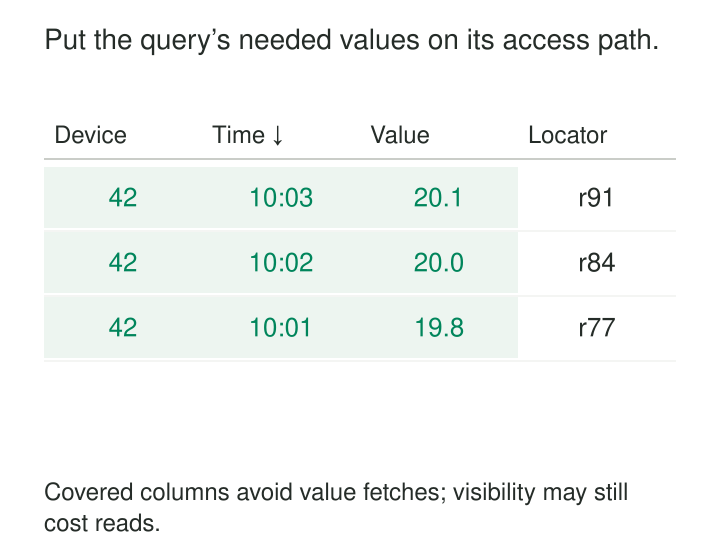

A covering index lets a database answer a particular query using values stored in the index, reducing the need to retrieve full table rows.

The recognizable problem is a query that already uses an index but still performs too much work. A monitoring screen requests the latest hundred readings for one device. The database finds their locations quickly, then follows those locations into the table to retrieve the readings themselves. Under load, those extra accesses compete with ingestion, consume memory bandwidth, and contribute to uneven response times.

The pattern is to carry the small amount of data the query needs alongside the keys used to find it.

## Carry the answer alongside the address

An ordinary secondary index often provides search keys and a way to locate the corresponding table row. A covering index also contains the remaining values needed to answer the query.

**Coverage is a relationship between an index and a query.** An index might cover a screen showing order numbers and dates, yet fail to cover the same screen after someone adds delivery instructions. Columns needed for filtering, joining, or calculating results also matter—not just those listed in `SELECT`. Microsoft’s documentation defines coverage in terms of containing all columns referenced by the query. [SQL Server included columns](https://learn.microsoft.com/en-us/sql/relational-databases/indexes/create-indexes-with-included-columns?view=sql-server-ver17)



The distinction between **search keys** and **included values** matters. Search keys organize the lookup. Included values supply payload after the matching entries have been found.

Adding a field as payload does not make it an efficient search key or establish an ordering by that field. A covering index can still require a large scan. Coverage reduces the cost of obtaining values; a suitable key structure reduces the work required to find the relevant entries.

## Example: a device’s recent readings

Consider a PostgreSQL table containing sensor readings, calibration details, ingestion metadata, and diagnostic text. A live monitoring screen needs only timestamps and measured values:

```sql
SELECT observed_at, reading_value
FROM readings
WHERE device_id = 42
ORDER BY observed_at DESC
LIMIT 100;
```

An index on device and observation time locates the relevant entries. Including the measured value makes the requested data available there too:

```sql
CREATE INDEX readings_recent
ON readings (device_id, observed_at DESC)
INCLUDE (reading_value);
```

The key supports finding one device’s readings in the required order. The included column supplies the displayed value. Larger diagnostic fields remain outside this index.

PostgreSQL’s `INCLUDE` clause explicitly separates payload from search keys. Included columns also do not participate in any uniqueness constraint enforced by that index. [PostgreSQL CREATE INDEX](https://www.postgresql.org/docs/current/sql-createindex.html)

If timestamps can tie and stable pagination matters, add a unique reading identifier to both the ordering and the index keys. Coverage does not resolve ambiguous ordering.

### Coverage does not guarantee a table-free read

PostgreSQL must also establish that a row is visible to the query’s transaction snapshot. Its visibility map can let an index-only scan avoid checking the corresponding table page. When the page is not marked all-visible, the executor must visit the table.

Recently modified pages therefore make an important difference. An index covering a live ingestion query may still produce substantial heap access, while the same index works particularly well over older, settled readings. The index method must also support returning the required values; PostgreSQL B-tree indexes support this capability. [PostgreSQL index-only scans](https://www.postgresql.org/docs/current/indexes-index-only-scans.html)

This is a central operating assumption: having the data in the index makes an index-only execution possible, but the engine’s visibility rules determine how much table access actually disappears.

## Example: a frequently read inventory card

An inventory service stores one row per warehouse and SKU. Its availability card repeatedly asks for the current quantity and update time:

| warehouse_id | sku | quantity | updated_at |
|---|---|---:|---|
| W3 | BOLT-M8 | 128 | 10:42:07 |
| W3 | WASHER-M8 | 640 | 10:42:09 |

A SQL Server implementation could use:

```sql
CREATE NONCLUSTERED INDEX inventory_card
ON inventory (warehouse_id, sku)
INCLUDE (quantity, updated_at);
```

The warehouse and SKU identify the requested entry. Quantity and update time complete the response without requiring a separate lookup into the base table or clustered index for those values. SQL Server implements included columns specifically to support this form of coverage. [SQL Server included columns](https://learn.microsoft.com/en-us/sql/relational-databases/indexes/create-indexes-with-included-columns?view=sql-server-ver17)

The tradeoff is visible in the example itself: quantity changes frequently. Every relevant change must maintain the extra stored quantity and timestamp.

A card read thousands of times between stock changes is a different workload from a counter updated continuously and read occasionally. Both queries can be covered; their economic case differs. Measure the combined read and write workload before adopting the index.

## Example: coverage already present in MySQL

Sometimes the required payload is already there.

Suppose an InnoDB `orders` table has primary key `order_id` and a secondary index on `(customer_id, created_at)`. A customer-history query returns only `order_id` and `created_at`, filtered by customer.

InnoDB secondary index records contain the primary-key columns as well as the explicitly indexed columns. The order identifier is therefore already available in this secondary index. Adding another index merely to carry that identifier may duplicate an existing capability. A long primary key, however, increases the space consumed by secondary indexes. [InnoDB clustered and secondary indexes](https://dev.mysql.com/doc/refman/8.4/en/innodb-index-types.html)

The visibility caveat has an InnoDB counterpart: delete-marked secondary records or pages modified by newer transactions can require clustered-index lookups to obtain the appropriate row version. [InnoDB multiversioning](https://dev.mysql.com/doc/refman/8.4/en/innodb-multi-versioning.html)

Inspect the engine’s physical index contents before designing additional coverage.

## The bill arrives on writes and storage

Included values are another stored copy of data. Wider leaf entries mean fewer entries fit on a page, increasing the index’s storage and memory footprint. Changes to covered fields require index maintenance as well as table maintenance. Microsoft’s design guide explicitly identifies this balance between query speed, storage, and modification cost. [SQL Server index design guide](https://learn.microsoft.com/en-us/sql/relational-databases/sql-server-index-design-guide?view=sql-server-ver17)

This makes narrow, frequently executed queries strong candidates. Repeated existence checks, compact status cards, and recent-history lists often request a stable, small set of fields.

Large documents, long descriptions, and expanding response objects are weaker candidates. Trying to cover `SELECT *` can reproduce much of the table inside another structure. PostgreSQL also warns that excessively large index tuples can cause data insertion to fail. [PostgreSQL CREATE INDEX](https://www.postgresql.org/docs/current/sql-createindex.html)

Deployment has a cost too. PostgreSQL’s ordinary index build blocks writes; concurrent construction avoids that write-blocking behavior but has additional work and operational caveats. Plan index creation as part of operating the live system. [PostgreSQL concurrent index construction](https://www.postgresql.org/docs/current/sql-createindex.html#SQL-CREATEINDEX-CONCURRENTLY)

## Verify the saving under live conditions

The correctness contract remains the database’s normal transaction and isolation behavior. A covering index does not strengthen isolation, reserve a selected work item, or make a read followed by an update atomic.

Its performance assumptions require separate verification:

- The actual query can obtain its required values from the index.
- The search keys suit its predicates and ordering.
- Avoided table access outweighs the larger index and maintenance cost.
- The benefit survives representative concurrent writes.

Inspect actual execution plans and reads, rather than treating index usage as success. On PostgreSQL, examine heap fetches within index-only execution. On SQL Server, check whether base-row lookup operators disappear. Compare response-time distributions alongside ingestion throughput, write latency, and index size.

Common mistakes include putting every output field into the search key, assuming included fields support efficient seeks, and retaining several nearly identical indexes as queries evolve. Another is benchmarking settled data while production queries constantly touch freshly modified rows.

## Nearby patterns

[[data-secondary-access-paths|Secondary Access Paths]] establish alternative ways to find records. Covering indexes extend an access path so it can also supply the requested values.

[[data-cluster-related-records|Cluster Related Records]] improves locality in the underlying storage. Covering indexes can avoid accessing that storage for particular queries.

[[data-vertical-partitioning|Vertical Partitioning]] separates frequently accessed fields from bulky ones in the base model. Covering indexes retain the base model and maintain an additional, query-oriented copy.

[[data-partition-by-access-pattern|Partition by Access Pattern]] narrows the storage regions a query must consider. A covering index can complement that partitioning by reducing row retrieval within the selected regions.
