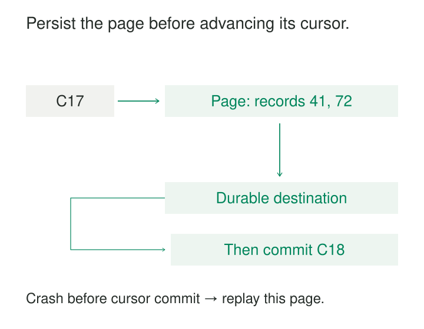

A support platform contains millions of tickets, but only a small fraction change each hour. Reading them all repeatedly is expensive. Remembering the last extraction timestamp seems simpler—until several updates share that timestamp, a request fails halfway through pagination, or the source exposes changes later than expected.

[[data-cursor-based-incremental-extraction|Cursor-Based Incremental Extraction]] resumes from a saved position supplied by the source. Each response provides records and a continuation token or link. The extractor stores the records, commits its progress, and later continues from that position.

The central rule is simple: **a saved cursor must represent data safely accepted downstream, rather than data merely fetched.**

## Know what the cursor promises

A cursor identifies a position according to a particular source protocol. It might represent a place in an ordered list, progress through an export, or a boundary in a change-tracking system.

These meanings are not interchangeable.

A pagination cursor can help traverse existing objects without providing any guarantee that later updates to previously visited objects will be returned. A change-tracking cursor can support ongoing synchronization, but only for the resources, properties, and operations covered by its contract.

For opaque tokens, the client should preserve the supplied value rather than decode it, increment it, or replace it with a locally calculated timestamp. A token’s appearance says little about its guarantees.

The pattern works when the source provides a documented continuation mechanism appropriate to the intended extraction.

## Store the page before advancing

Imagine a feed returning this illustrative response:

| Response component | Value |
|---|---|
| Requested cursor | C17 |
| Records | Record 41, version 3; record 72, version 1 |
| Next cursor | C18 |

C17 and C18 are readable labels here; real tokens may be opaque strings or complete URLs.

If the extractor saves C18 before storing the records, a crash can lose them permanently. On restart, the source is asked to continue beyond data the destination never received.

Reversing that order avoids this failure: store the records durably, then save C18.

A crash between those operations can still cause replay. The destination already has the records, but the saved checkpoint remains C17. Repeating the request may deliver them again.

Consequently, the receiving process needs repeatable writes. An event destination might deduplicate by a source event identifier. A current-state destination might merge by entity identity while applying the provider’s version or ordering rules. An older replay must not overwrite a newer state.

Where supported, records and checkpoint can commit in the same database transaction. When they live in separate systems, durable landing followed by checkpointing usually leaves a replay window that must be handled explicitly.

If raw records are durably secured before transformation, extraction can advance while transformation uses its own recovery state. An extraction checkpoint then proves receipt, not that every report has finished updating.

## Example: Zendesk’s incremental ticket export

Zendesk provides an explicit cursor-based incremental export for tickets. The initial request supplies a starting time. Responses provide an `after_cursor`, and subsequent pages and exports use that cursor.

Its `end_of_stream` flag tells the client when the currently available export has been exhausted. The last cursor is retained for the next scheduled extraction. Zendesk distinguishes this mechanism from ordinary cursor pagination on other endpoints. [Zendesk: Using the Incremental Exports API](https://developer.zendesk.com/documentation/api-basics/working-with-data/using-the-incremental-export-api/)

An illustrative extraction might proceed as follows:

| Request | Returned tickets | End of stream? | Resume position after durable storage |
|---|---|---|---|
| Initial starting time | 501, 502 | No | Cursor A |
| Cursor A | 503 | Yes | Cursor B |
| Cursor B, next scheduled run | 502 updated, 504 | Yes | Cursor C |

Ticket 502 appears again because its state changed. An append-only destination would accumulate multiple representations unless that history were intentional.

The extractor follows the service’s boundary rather than inventing one from its own clock. Zendesk also documents a recent-change exclusion window, illustrating why successful polling does not necessarily mean immediate visibility of every change. [Zendesk export workflow](https://developer.zendesk.com/documentation/api-basics/working-with-data/using-the-incremental-export-api/#incremental-export-workflow)

## Example: Microsoft Graph separates pages from synchronization rounds

Microsoft Graph delta queries expose two distinct continuation concepts.

A `@odata.nextLink` means more pages remain in the current synchronization round. A `@odata.deltaLink` completes that round and supplies the starting point for a future request for changes.

An empty page can still contain a `nextLink`; the extractor must continue. The returned links are opaque and carry query state, so clients follow them rather than reconstructing their parameters. [Microsoft Graph: Delta Query Overview](https://learn.microsoft.com/en-us/graph/delta-query-overview)

This distinction affects checkpoints. A client may retain a resumable page position when supported, while promoting the completed-round token only after all preceding pages are durably handled.

Graph also documents possible replays and synchronization resets. Expired or invalid state can require a full synchronization rather than continuation from the old token. [Microsoft Graph: Limitations](https://learn.microsoft.com/en-us/graph/delta-query-overview#limitations)

## Example: pagination alone misses later edits

Stripe’s v1 list APIs use object identifiers with `starting_after` and `ending_before` to navigate lists, generally in reverse chronological order. These are documented pagination positions. [Stripe: Pagination](https://docs.stripe.com/api/pagination)

Suppose an extractor walks a customer list and stores its final pagination cursor. A customer visited earlier later changes their address.

Continuing farther through the list does not, by itself, establish a method for discovering that edit. Likewise, the word “after” should not be interpreted as “created after my previous extraction”: its meaning follows the list’s documented ordering.

Such pagination can support a full traversal or form part of a larger extraction design. Ongoing synchronization needs an appropriate change feed, update query, event mechanism, or reconciliation strategy.

The reusable lesson is to verify the cursor’s coverage before treating it as an incremental checkpoint.

## Correctness depends on scope and recovery

A saved token belongs to a particular source scope: account, resource, filters, selected properties, and protocol version where relevant. Reusing it after changing that scope can create silent gaps or invalidate the token.

Initialization also needs an explicit decision. Loading existing state and then continuing with changes serves a different purpose from starting “from now.” A new cursor does not automatically recover older records.

Deletion handling must follow the source contract. A feed may return tombstones, deleted-state records, or no deletion information at all. An entity’s absence from an incremental page is not evidence that it was deleted.

Nor is every incremental feed an event history. Some systems return changed entities in their latest state, potentially collapsing intermediate transitions. That can maintain a replica without supporting questions about every status change.

One coordinated writer should own each cursor stream. Concurrent workers must not overwrite newer checkpoints with stale ones or advance beyond unfinished work. Independent streams can run in parallel; a dependent chain of continuation links requires ordered progress.

## Costs and useful limits

The pattern is useful when a source offers dependable incremental exports and repeated full reads would waste bandwidth or processing time. It also makes interrupted work easier to resume.

The recurring costs include API requests, checkpoint storage, duplicate handling, schema adaptation, and recovery from expired state. Smaller pages reduce replay work but increase request overhead. Larger pages can improve throughput while increasing memory use and retry cost.

Token retention creates an operating deadline: the extractor must recover before its saved state becomes unusable, or have a viable reinitialization path. Rate limits and source processing delays place additional limits on freshness.

Useful monitoring includes the last successful checkpoint time, processing failures, source-reported backlog, and downstream lag. An opaque token changing value does not itself prove that reports are current.

## Related patterns

[[data-full-snapshot-extraction|Full Snapshot Extraction]] establishes an initial baseline or repairs a synchronization that can no longer resume.

Field-based incremental extraction is a neighboring technique that tracks progress through comparable field values. Its saved cursor is different from an event-time **Watermark**, which estimates progress in a stream; neither removes the need for explicit late-data rules.

**Change Data Capture** exposes source mutations; a cursor may be the interface used to consume them.

[[data-idempotent-writes|Idempotent Writes]] prevents a replayed page from duplicating destination effects. [[data-transactional-inbox|Transactional Inbox]] records consumption with the business update when messages drive those effects.
