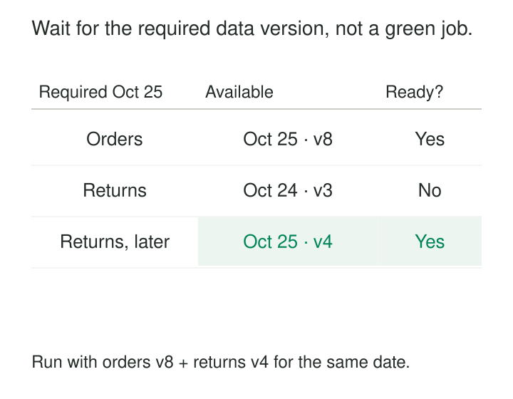

A daily report starts at 06:00 because its two upstream jobs normally finish by 05:30. One morning, orders arrive on time while returns are delayed. The report still runs, combining today’s orders with yesterday’s returns.

Moving the report to 07:00 might hide the problem until the next delay. Depending on upstream task success is also insufficient if a successful task processed the wrong date or published incomplete data.

**Declare dependencies on identified data and its readiness conditions, so downstream work proceeds when the inputs it actually needs are available.**

A data-aware dependency connects an output to particular upstream assets, partitions, and acceptance conditions. Time can still determine deadlines or evaluation frequency, but the clock alone does not establish readiness.

## Depend on the output, not just its producer

A task dependency says, “Run B after task A succeeds.” A data-aware dependency says, “Build this output using these required inputs once they satisfy this contract.”

That distinction matters when several jobs can produce the same asset, one job produces many partitions, or external systems supply data independently of the scheduler.

The dependency needs enough specificity to answer three questions:

- **Which data?** The asset and required partition, date interval, tenant, region, or other scope.
- **What counts as ready?** Publication is complete, required coverage exists, and applicable checks have passed.
- **Which version will be read?** The committed input version selected for this execution.

These conditions can be evaluated through asset events, catalog records, manifests, database checks, or polling. Event-driven scheduling is one implementation technique; the underlying pattern is an explicit relationship between required data and downstream eligibility.

## Example: match the business date across inputs

Consider an illustrative daily activity report for October 25:

| Input | Business date | Version | State |
|---|---|---|---|
| Orders | October 25 | 8 | Committed; checks passed |
| Returns | October 24 | 3 | Committed; checks passed |
| Returns | October 25 | — | Missing |

Both source tables exist. Both producer pipelines have recently succeeded. Nevertheless, the October 25 report is not ready.

Its dependency requires orders and returns for the same target business date. The October 24 returns update cannot satisfy the missing October 25 input.

When returns for October 25, version 4, becomes available and passes the required checks, the report can select the pair: orders version 8 and returns version 4.

Apache Airflow implements asset-aware scheduling: producer tasks declare asset outputs, and successful completion emits updates that can schedule consumers. Failed or skipped producer tasks do not emit those updates. Ordinary multi-asset scheduling waits for each required asset to have an update since the previous consumer run. [Apache Airflow: Asset-Aware Scheduling](https://airflow.apache.org/docs/apache-airflow/stable/authoring-and-scheduling/asset-scheduling.html)

That ordinary update condition does not itself prove that business dates match. Airflow also documents partition-aware asset scheduling, using partition keys and mappings to align upstream events with downstream partitions. The implementation must choose the appropriate mechanism and retain its own readiness requirements. [Apache Airflow: Asset partitions](https://airflow.apache.org/docs/apache-airflow/stable/authoring-and-scheduling/assets.html#asset-partitions)

A legitimately empty returns partition should still be able to become ready. “Published with zero records” and “not delivered” are different states.

## Example: a daily output needs every required hour

A daily aggregation consumes hourly event partitions.

For a UTC day covering `[2026-10-25 00:00, 2026-10-26 00:00)`, the dependency requires twenty-four hourly partitions. At 01:10 the following morning, twenty-three are ready, but the partition beginning at 17:00 is missing.

Checking the newest event timestamp would be misleading: the 23:00 partition might already contain recent data. Recency does not establish coverage.

The daily output waits for the missing hour or follows an explicitly defined partial-output policy. If partial results are allowed, the output must record its missing coverage and remain distinguishable from a complete result.

Dagster models dependencies between partitioned assets. Its default time-window mapping connects a downstream partition to upstream partitions whose windows intersect it, including daily assets depending on hourly assets. Explicit partition mappings support relationships such as depending on the previous day. [Dagster: Dependencies between partitioned assets](https://dagster.io/docs/guides/build/partitions-and-backfills/defining-dependencies-between-partitioned-assets)

The mapping describes which partitions are required; automation rules determine when to execute. Quality and completeness requirements still need appropriate checks.

Calendar semantics belong in that mapping. A local civil day can have a different number of hours around daylight-saving transitions. Hard-coding twenty-four is appropriate for this UTC example, not every daily partition.

## Example: a delivered export is not yet accepted data

A supplier delivers an export as twelve files. The first file appears at 04:00, the last at 04:18, and a manifest identifies the complete delivery.

Starting processing when the directory first exists risks reading only part of the export. Waiting for the manifest improves the signal, but acceptance still requires verifying its listed objects, expected schema, and agreed completeness checks.

Suppose the delivery contains every listed file, but a required identifier column is absent. The delivery is physically present and unusable for its consumer.

The dependency should remain unsatisfied until the relevant version passes its acceptance contract. A repaired delivery receives a distinct version, with checks attached to that version.

Dagster asset checks provide a concrete implementation for testing properties such as schema, nullability, and freshness. Its documentation makes an important distinction: failed checks do not block downstream materialization by default; checks must be configured as blocking where that behavior is required. [Dagster: Testing assets with asset checks](https://dagster.io/docs/guides/test/asset-checks)

This separates three useful states: delivered, published, and accepted. Different consumers may require different acceptance conditions.

## Bind the execution to what passed the gate

Readiness can change between scheduling and execution.

A scheduler verifies version 8, then queues a consumer. Before the consumer starts, version 9 replaces the table. If the consumer reads an unqualified “latest” location, it may use data that was never checked for this run.

A robust design selects and records the input versions as part of the execution plan, then reads those versions through immutable objects, retained snapshots, versioned partitions, or an equivalent consistency mechanism.

Quality results must identify the same versions. A passing check against yesterday’s contents does not certify today’s replacement.

Across multiple sources, individually accepted versions may also need a compatibility rule: a shared business date, extraction cutoff, or release identifier. Choosing the latest version of each source independently does not guarantee a coherent combination.

The assumptions are concrete: readiness records are trustworthy, selected versions remain readable, and the consumer can bind its reads to them. If storage provides only mutable locations, additional locking or snapshot coordination may be necessary.

## Treat events as evidence to evaluate

An update notification is a reason to reconsider readiness. It should not automatically mean that every downstream output can run.

Airflow allows asset events to carry information about a data change, such as row counts and covered date ranges. This provides context for downstream decisions, although the producer remains responsible for reporting accurate information. [Apache Airflow: Asset event information](https://airflow.apache.org/docs/apache-airflow/stable/authoring-and-scheduling/assets.html#attaching-extra-information-to-an-emitting-asset-event)

Publication and notification also have a failure boundary. Data might commit successfully while the producer crashes before announcing it. Conversely, an early notification can arrive before the data is readable.

Publish readiness only after the required commit and checks. Use durable notification mechanisms or reconciliation to recover missing signals. Duplicate events should not create uncontrolled duplicate work.

Corrections need a separate policy: should a revised upstream partition rebuild existing outputs, only mark them stale, or await approval? Declaring a dependency does not settle historical restatement.

## Pay for precision with coordination

Data-aware dependencies are especially useful for irregular arrivals, independently operated producers, partitioned pipelines, and historical processing.

Their costs include readiness metadata, partition-state tracking, checks, event handling, reconciliation, and retained input versions. Large dependency graphs can produce expensive cascades of recomputation.

Waiting also needs an operating policy. Record which requirement is missing, who owns it, and when the output becomes late. An indefinitely blocked report is observable only if its expected deadline remains visible.

[[data-atomic-publication|Atomic Publication]] establishes when data becomes readable as a complete result. [[data-manifest-based-file-ingestion|Manifest-Based File Ingestion]] identifies delivery contents. [[data-freshness-monitoring|Freshness Monitoring]] detects missed expectations. [[data-replayable-backfills|Replayable Backfills]] uses explicit input identities to rebuild outputs later.

Data-aware dependencies connect those mechanisms to a precise execution decision: the required data for this output is ready, and this run knows exactly what it will read.
