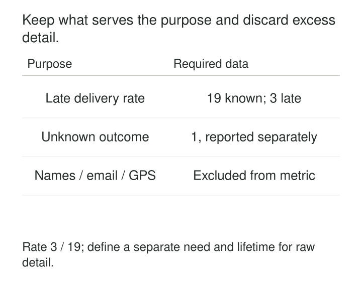

A team wants to measure delivery delays. Its extraction job copies the entire shipment record: customer name, phone number, exact coordinates, delivery instructions, promised time, and actual arrival time.

Only a few fields contribute to the calculation. The others spread into staging tables, development extracts, logs, and backups because keeping everything was easier than deciding what was necessary.

**Data minimization designs collection, processing, and sharing around a specific purpose, using only the information that purpose requires.** It also works with retention controls to prevent yesterday’s justified collection from becoming indefinite accumulation.

The aim is sufficient information with less unnecessary detail, identification, linkage, and duplication.

## Define the purpose before choosing the fields

“Analytics” is too broad to explain why a system needs someone’s precise location history. “Calculate daily delivery lateness by region” supports a much clearer decision about necessary inputs and outputs.

The ICO’s guidance on the UK GDPR describes personal data as needing to be adequate for the purpose, relevant to it, and limited to what is necessary. Adequacy matters: removing information that is essential to a reliable decision also fails the principle. [ICO guidance on data minimisation](https://ico.org.uk/for-organisations/uk-gdpr-guidance-and-resources/data-protection-principles/a-guide-to-the-data-protection-principles/data-minimisation/)

In engineering, minimization has several dimensions:

| Dimension | Design question |
|---|---|
| Fields | Which attributes contribute to the task? |
| Records | Which population or transactions belong in scope? |
| Precision | Does the task require exact coordinates, dates, or amounts? |
| Linkage | Must records be connected to an individual or across contexts? |
| Copies | Which systems genuinely need their own representation? |
| Lifetime | How long does each representation remain necessary? |

A system may minimize well in one dimension and poorly in another. A dataset containing only three fields can still reveal years of an individual’s movements.

W3C’s Privacy Principles similarly recommend limiting transferred data to what serves users’ goals and designing APIs that support appropriately granular requests. [W3C Privacy Principles: Data Minimization](https://www.w3.org/TR/privacy-principles/#data-minimization)

*Minimize the representation while keeping the evidence needed to interpret it correctly.*

## Example: delivery performance without customer profiles

A retailer needs a regional daily report of lateness among completed deliveries. The calculation requires delivery references for deduplication, the region, promised timestamps, and completion timestamps. Customer names, telephone numbers, and precise GPS trails do not contribute.

A restricted calculation produces:

| Day | Region | Completed deliveries | Known outcomes | Late | Unknown |
|---|---|---:|---:|---:|---:|
| 2026-10-26 | North | 20 | 19 | 3 | 1 |

For this defined population, lateness among known outcomes is `3 / 19`, approximately 15.8%. The unknown outcome remains visible. Treating its missing promised timestamp as “on time” would produce a misleading rate.

The report does not need delivery references after aggregation. Detailed inputs may remain necessary for a bounded correction window, while the summary has its own retention decision.

This design depends on explicit assumptions: which deliveries qualify, which timezone defines the day, what counts as late, and how duplicates and corrections are handled. Removing names does not resolve any of those modeling questions.

Aggregation also limits future questions. The summary cannot reconstruct individual journeys, calculate a new lateness threshold, or explain a particular complaint. Those limitations should be understood before discarding the detail.

## Example: selecting one contact instead of uploading an address book

An invitation feature needs the email address of the person a user wants to invite. Uploading the user’s entire contact list collects information about many unrelated people.

A narrower interaction lets the user select the intended recipient and share only the relevant property. The service receives an address for the requested invitation without first building a copy of the address book.

The Contact Picker API demonstrates this approach in a real browser implementation. Chrome documents an on-demand picker through which users select contacts and limited properties to share. The API requires user interaction and a secure, top-level context; applications must check availability. [Chrome’s Contact Picker documentation](https://developer.chrome.com/docs/capabilities/web-apis/contact-picker)

The implementation should request email when email is sufficient, rather than automatically requesting names, telephone numbers, addresses, and icons.

What happens afterward matters too. A selected address needed to send an invitation does not, by itself, justify adding the recipient to an unrelated marketing dataset. Minimizing collection and controlling subsequent use are connected design decisions.

## Example: diagnosing failures without recording request bodies

An API team needs to identify slow operations and investigate errors. Its telemetry initially records full request bodies, including names, addresses, and free-text messages.

For routine monitoring, a more suitable event might contain:

| Attribute | Example |
|---|---|
| Operation | `create_order` |
| Route template | `/orders/{order_id}` |
| Result | `validation_error` |
| Duration | `184 ms` |
| Service version | `2026.10.27.1` |

A route template avoids embedding an individual order identifier in every route label. Request bodies and authorization headers are excluded from routine telemetry.

OpenTelemetry recommends collecting only information that serves an observability purpose and reviewing emitted attributes. Its Collector provides processors for deleting attributes, filtering records, and retaining allowed attributes through redaction. [OpenTelemetry guidance on sensitive data](https://opentelemetry.io/docs/security/handling-sensitive-data/)

Filtering downstream is useful, but preventing capture earlier reduces exposure along the preceding path. Collector queues, application logs, exception messages, and alternate exporters still need attention.

An allowlist of attributes is also insufficient if an allowed field contains arbitrary user text. The value’s meaning and permitted content matter alongside its name.

## Make the limits durable

Minimization erodes when new source fields automatically flow into every destination. Explicit projections and output schemas make additions deliberate. A new field can be assessed against the receiving dataset’s purpose before publication.

These controls need precise interpretation. PostgreSQL publication column lists can reduce the columns normally replicated, but its documentation explicitly warns that they are **not a security boundary against a malicious subscriber**. Data reduction and access enforcement are separate properties. [PostgreSQL logical replication column lists](https://www.postgresql.org/docs/current/logical-replication-col-lists.html)

Retention likewise needs implementation. Temporary extracts should have an owner and expiry behavior, rather than relying on someone remembering to remove them. BigQuery supports table expiration, but expired tables can remain recoverable within the configured time-travel window. Expiry therefore does not mean immediate, irreversible disappearance from every recovery mechanism. [BigQuery table-expiration documentation](https://docs.cloud.google.com/bigquery/docs/managing-tables#updating_a_tables_expiration_time)

Copies, backups, and restore procedures need compatible lifecycle rules. Otherwise, an old restore can reintroduce information removed from the active system.

## Preserve enough information for correctness

Minimization works when the purpose is specific and the retained representation can fulfill it.

Units, grain, definitions, denominators, and missing-value meaning may be essential even when they look like removable detail. A correction process may require stable record references. An investigation may need evidence that explains how a decision was reached.

Sampling requires similar care. A smaller sample can miss rare failures or underrepresent particular groups. Removing every attribute needed to evaluate uneven outcomes can make a model harder to assess responsibly.

Useful verification combines dependency review with representative results: the reduced dataset should still support the intended calculations, corrections, and operational decisions. Once information is discarded, some mistakes cannot be repaired by rerunning a query.

## Costs, tradeoffs, and common mistakes

Minimization can reduce storage, transfer, processing, and exposure. Those savings depend on where reduction occurs; dropping fields after creating several full copies leaves much of the earlier cost intact.

The work also has costs: defining purposes, maintaining projections, testing reduced representations, and managing different lifetimes. Multiple tailored datasets can become more complicated than a single broad table.

The largest tradeoff is lost optionality. Future analysis may require information that was never collected or has expired. A specific, justified investigation can warrant additional collection with a defined scope and end condition. Vague future usefulness is a weak basis for permanent accumulation.

Encryption, masking, and tokenization protect or transform data, but do not automatically make its collection necessary. A stable token can still support extensive behavioral linkage. Small aggregates can still reveal individuals.

## Related patterns

[[data-sensitive-data-segregation|Sensitive-Data Segregation]] keeps necessary sensitive information behind narrower boundaries. Minimization determines which information each workflow needs.

[[data-tokenization|Tokenization]] can reduce exposure of identifying values while preserving required relationships. Its linkage scope should fit the purpose.

[[data-store-additive-components|Store Additive Components]] helps summaries remain useful: retain counts and denominators needed for valid recomputation.

[[data-preserve-raw-inputs|Preserve Raw Inputs]] supports replay and investigation. Combine it with justified scope, restricted access, and bounded retention rather than treating preservation as unlimited collection.
