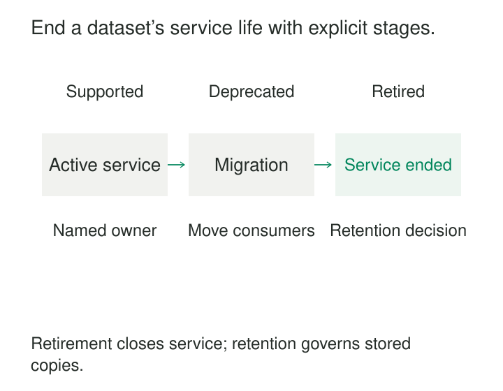

A warehouse contains three customer tables. One is maintained, one has a replacement, and one stopped refreshing six months ago. All three remain discoverable. New reports keep choosing the wrong one because their names and schemas still look plausible.

Deleting the older tables immediately would break unknown consumers. Leaving them indefinitely preserves confusion, operating costs, and unnecessary data.

**Dataset deprecation and retirement provides an explicit lifecycle for ending a dataset’s service: announce the change, resolve dependencies, close the operational interface, and dispose of retained data under the appropriate rules.**

The purpose is a controlled ending. Consumers should understand what changes, producers should stop maintaining obsolete interfaces, and historical copies should have a deliberate fate.

## Separate the lifecycle decisions

Deprecation, retirement, and deletion describe different events.

| State or action | Meaning |
|---|---|
| Supported | Consumers can rely on the documented service commitment |
| Deprecated | Existing use continues under a published transition plan; new dependencies are discouraged or restricted |
| Retired | The operational interface and its service commitment have ended |
| Data disposal | Retained representations are deleted or otherwise disposed of according to policy |

A deprecated dataset may still need normal refreshes, incident response, and corrections until its stated support ends. Deprecation is not permission to let quality deteriorate.

A retired dataset may retain controlled historical records. Conversely, an unnecessary temporary dataset may proceed directly to disposal once dependencies and retention requirements are resolved.

Catalogs can communicate lifecycle state. DataHub, for example, exposes dataset deprecation status and decommission-time metadata. Updating that metadata informs discovery; it does not itself disable the producing pipeline or remove the warehouse object. [DataHub deprecation documentation](https://github.com/datahub-project/datahub/blob/master/docs/api/tutorials/deprecation.md)

*The interface’s service lifecycle and the stored data’s retention lifecycle need separate decisions.*

## Example: replacing a customer summary with subscription detail

A billing team replaces `customer_subscription_summary_v1`, which has one row per customer, with `subscriptions_v2`, which has one row per subscription.

For one customer, the representations differ:

| Dataset | Customer | Subscription | Monthly amount |
|---|---|---|---:|
| Summary v1 | C17 | — | USD 50 |
| Subscriptions v2 | C17 | S1 | USD 30 |
| Subscriptions v2 | C17 | S2 | USD 20 |

A consumer that sums monthly amounts may migrate easily. A consumer that counts rows to count customers will change its result.

The deprecation notice therefore needs more than a replacement link. It should explain grain, keys, units, changed definitions, available history, freshness, permissions, migration examples, and the intended retirement date.

A compatibility view can aggregate subscriptions back to customers if it faithfully preserves the old contract. Silently redirecting the old name to subscription detail would conceal a breaking change.

dbt model versions provide a concrete mechanism for exposing different model interfaces while consumers migrate. Its documentation treats a shared model as an API whose changes need deliberate coordination. [dbt model versions](https://docs.getdbt.com/docs/mesh/govern/model-versions)

Migration evidence should test actual consumer behavior. Matching overall totals does not establish that counts, filters, joins, or historical comparisons remain correct.

## Example: the quarterly consumer missing from a quiet month

An inventory dataset shows no reads in the last 30 days. The owner proposes retirement.

A dependency review finds a quarterly planning export. Its next scheduled run is six weeks away. The quiet month reflected the business calendar, rather than abandonment.

Usage history needs an observation period appropriate to known schedules. Combine runtime evidence with declared lineage, orchestration definitions, BI dependencies, code references, export configurations, and confirmation from accountable consumer owners.

The evidence also has technical limits. BigQuery does not emit `TableDataRead` events for queries served from cached results, and parent jobs can differ from the child jobs that perform reads. A simplistic audit-log count can therefore miss relevant activity. [BigQuery audit-event limitations](https://docs.cloud.google.com/bigquery/docs/reference/auditlogs#data_access_data_access)

The planning team migrates its export, validates the output, and confirms the next required production run. If that cannot happen before retirement, the dataset owner must explicitly resolve the dependency through an extension, a bounded exception, or another agreed arrangement.

Silence is not consumer approval. A retirement decision needs evidence proportionate to the consequence of being wrong.

## Example: ending an experiment without a successor

A campaign experiment ends. Its daily participant extract has no continuing operational purpose and no replacement dataset.

The owner identifies the final successful release, records its coverage and limitations, and confirms which results must remain reproducible. Any justified historical evidence receives a named owner, restricted access, and an expiry or review date.

The operational extract then retires. Its schedule, automatic triggers, export tasks, and backfill configuration are removed or disabled. Otherwise, a later rerun can recreate an object that someone has already deleted.

The retirement notice remains discoverable and explains that no successor exists. Consumers should not have to infer whether a missing table was intentionally removed or accidentally broken.

Physical disposal follows its own controls. BigQuery table expiration, for example, can delete a table automatically, but an expired table can remain recoverable within its configured time-travel window. [BigQuery table-expiration documentation](https://docs.cloud.google.com/bigquery/docs/managing-tables#updating_a_tables_expiration_time)

Ending the operational service therefore does not establish immediate disappearance from every recovery mechanism or exported copy.

## Make the transition concrete and usable

A useful deprecation announcement identifies the exact dataset, responsible owner, reason, replacement or absence of one, migration instructions, support commitment, and retirement date with an unambiguous timezone.

The replacement needs to be usable when the migration window begins: accessible, documented, sufficiently populated, and supported. A technically deployed table that lacks required history or permissions does not provide a complete migration path.

Make the status visible where dependencies are created: catalogs, documentation, model references, and relevant delivery checks.

dbt’s `deprecation_date` can generate warnings for references to models approaching or past deprecation. Its documentation also states that deprecated models can continue to build until disabled or removed, and that deprecation does not automatically drop their physical relations. [dbt deprecation behavior](https://docs.getdbt.com/reference/resource-properties/deprecation_date)

Communication and execution need to meet. A date field is one input to the lifecycle, not the whole mechanism.

## Close the operating paths

Retirement should remove or restrict the old operational access path and stop the machinery that sustains it. That includes scheduled builds, event triggers, replication, exports, automatic refreshes, and recovery procedures that might republish it.

Stopping refreshes while leaving a formerly live interface available can create a particularly dangerous failure: queries still succeed with stale data. If a historical snapshot remains accessible, expose it explicitly as historical, with its final coverage and service limits.

Do not reuse the retired name for unrelated semantics. Preserve a notice or catalog record linking the old identifier to its retirement decision and any successor.

Recovery also needs an explicit boundary. Restoring yesterday’s table may be mechanically possible but operationally invalid if consumers expect current data. Reopening service may require catch-up, reconciliation, access restoration, and renewed quality checks.

Once those conditions cannot be met within an acceptable recovery window, a forward repair may be more realistic than rollback.

## Verify the ending and its costs

Useful completion evidence includes resolved dependencies, exercised migration paths, documented exceptions, disabled production paths, and an assigned disposition plan for retained copies.

After retirement, monitor failed access attempts, unexpected writes, and recreated objects. These can reveal missed dependencies or automation. An unexpected attempt needs investigation; it does not automatically justify reopening the dataset.

The pattern has operating costs. Parallel support consumes storage, compute, and engineering attention. Migration work consumes consumer capacity. Long exceptions can preserve obsolete interfaces indefinitely, while arbitrary deadlines can force unreliable replacements.

It is most useful when datasets have multiple consumers, overlapping successors, unclear usage, or substantial maintenance costs. Small temporary outputs can use a lighter process, provided ownership, dependencies, and disposal remain clear.

Retirement is complete when the agreed service has ended and remaining obligations have owners—not merely when a table has vanished.

## Related patterns

[[data-published-deprecation-windows|Published Deprecation Windows]] establishes the notice period and transition commitments within the broader lifecycle.

**Versioned Dataset Interface** lets old and new contracts coexist during migration.

[[data-named-dataset-stewardship|Named Dataset Stewardship]] provides an accountable contact for consumer questions, exceptions, and closure decisions.

[[data-classification-based-retention|Classification-Based Retention]] determines the fate of historical records after the operational interface retires.
