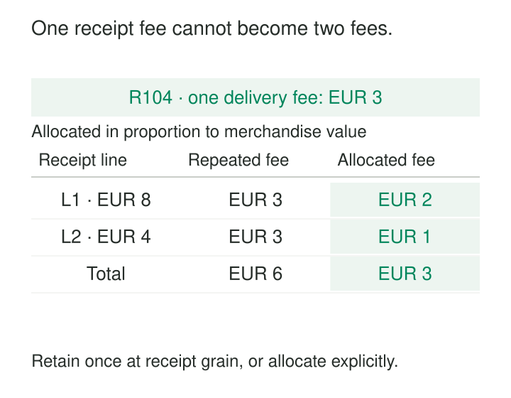

A report looks reasonable until someone adds a product breakdown. Revenue stays correct, but delivery fees double. Another dashboard reports forty thousand “customers,” although its source contains several purchases per person. Nothing has crashed. The queries run successfully. The records simply represent something different from what the calculations assume.

**Grain is the precise business meaning of one row.** Declaring it makes that meaning explicit before deciding which measurements, relationships, and calculations belong in a dataset:

> One row represents…

The rest of the model must honor that statement. It determines which measurements belong together, what counts as a duplicate, and how records can be combined without changing their meaning.

## A business statement before a technical key

“One row per customer” sounds clear until the business keeps several addresses, accounts, or historical versions for each person.

A more useful declaration might be:

> One row represents one customer account in its current state.

Or:

> One row represents one version of a customer account, valid during a specified date range.

The second declaration describes an *effective-dated* record. Those datasets answer different questions. Updating an existing row may be correct in the first and destructive in the second.

For a sales dataset, the declaration might be:

> One row represents one merchandise line recorded on a completed receipt.

That is more informative than listing `receipt_id` and `line_number`. The identifiers implement the distinction; the declaration explains it. Ralph Kimball emphasizes that grain should describe the business measurement represented by a record, rather than merely enumerate its keys. [Declaring the Grain](https://www.kimballgroup.com/2003/03/declaring-the-grain/).

Column names alone can also mislead. Microsoft illustrates this with a sales-target table containing date and product keys: if the dates represent the first day of each month, the observations are monthly product targets, not daily measurements. [Star schema guidance](https://learn.microsoft.com/en-us/power-bi/guidance/star-schema).

The declaration gives the columns their interpretation.

## A receipt-level fee does not become a line-level fact

Consider an illustrative grocery delivery receipt. It contains €8 of apples, €4 of bread, and one €3 delivery fee.

The merchandise lines have a clear grain: one row per receipt line. Their amounts can be added to produce €12 of merchandise sales.

The delivery fee belongs to the receipt as a whole.

The illustration compares repeating that fee with allocating it in proportion to merchandise value: the €8 line receives €2, and the €4 line receives €1.

Copying the fee onto both merchandise records creates two appearances of the same measurement. Summing that column reports €6.

There are several defensible designs. A receipt-level dataset can hold the original fee. A separate line-level dataset can hold merchandise measurements. Alternatively, a business rule can allocate the fee across the lines.

Proportional allocation by merchandise value would assign €2 to the apples and €1 to the bread. These amounts sum to €3, but they are **allocated delivery fees**, not separately observed charges.

That distinction matters. Equal allocation would produce €1.50 per line; allocation by weight could produce another result. Product profitability depends partly on which rule is chosen.

Grain helps identify the mismatch. It does not choose the allocation policy.

## Daily stock balances describe moments

Now consider a warehouse dataset with this declaration:

> One row represents the closing quantity of one product at one location on one business date.

For product P-12, an illustrative extract contains:

| Business date | Location | Closing quantity |
|---|---|---:|
| Monday | North | 8 |
| Monday | South | 12 |
| Tuesday | North | 6 |
| Tuesday | South | 9 |

Across locations, Monday’s closing quantity is twenty units. Tuesday’s is fifteen.

Adding every row produces thirty-five. That is neither the closing stock on either day nor the quantity sold. The same physical units may have appeared in both snapshots.

With complete daily observations, the average of the two daily totals is 17.5 units. Calculating sales would require additional evidence, such as stock movements and their classifications.

This is a second lesson: **consistent grain does not make every aggregation valid**. Balance measurements are commonly semi-additive: they can be summed across some dimensions, but require different treatment across time. [Additive, Semi-Additive, and Non-Additive Facts](https://www.kimballgroup.com/data-warehouse-business-intelligence-resources/kimball-techniques/dimensional-modeling-techniques/additive-semi-additive-non-additive-fact/).

The declaration also needs operational precision. “Closing” requires a cutoff and time-zone convention. Missing snapshots need a policy. An absent row cannot automatically be treated as zero stock.

## Google Analytics: expanding items changes the output grain

Google Analytics’ BigQuery export provides a documented example of nested observations.

Its schema includes event-level ecommerce measurements, such as shipping value, alongside a list of items nested inside each event. This repeated `items` structure contains item attributes, quantities, and item revenue. [BigQuery Export schema](https://support.google.com/analytics/answer/7029846?hl=en).

At the logical event level, one purchase event can contain several item elements. Expanding that array into a flat result produces a row for each item element within the event.

An illustrative purchase containing three item elements therefore produces three output rows. Event-level shipping value, if selected alongside each item, appears three times. Summing it after expansion repeats the receipt-fee error.

Google’s query examples distinguish calculations performed over events from item analysis that explicitly expands the `items` array. [Basic queries for Analytics event data](https://developers.google.com/analytics/bigquery/basic-queries).

Nested storage can preserve both levels without pretending they are interchangeable. The important moment is the transformation: after expansion, grouping, or joining, what does one output row represent?

That question applies even when the original dataset has excellent documentation.

## Make the declaration enforceable

A useful grain statement should lead to concrete checks.

**Identify records at the declared level.** For receipt lines, the relevant identity might combine the source system, receipt identifier, and line number. Product alone is insufficient: the same product can occur on several lines.

**Check logical uniqueness.** A generated row identifier makes every physical record distinguishable, but does not prevent two records from representing the same receipt line.

**Specify the treatment of change.** Does a corrected source line replace the previous version, create a new version, or produce an adjustment? All three can be valid, but each implies different record meanings.

**Verify relationship cardinality.** Joining a line to one applicable product description should preserve its row count. Matching several historical product versions can multiply it. A valid grain declaration cannot protect a query that ignores the time conditions of its joins.

**Attach measurements at the appropriate level.** Receipt totals, line quantities, unit prices, and customer lifetime values may all be useful. Their presence in the same extract does not give them the same aggregation behavior.

These checks turn a sentence in documentation into an operating agreement.

## Detail has a cost

Kimball recommends beginning with the lowest captured grain because it preserves flexibility for questions that were not anticipated during design. Summary datasets remain useful, but they support a narrower set of questions. [Grain](https://www.kimballgroup.com/data-warehouse-business-intelligence-resources/kimball-techniques/dimensional-modeling-techniques/grain/).

More detailed data usually means more records, storage, processing, and correction work. It may also require tighter access controls.

The finest imaginable detail is not always available. A system that records one daily total cannot supply individual transactions merely because the target model declares transaction grain. Nor does a line containing five identical units necessarily provide five independently identifiable observations.

A practical design often preserves suitable source detail and creates explicitly named summaries for frequent queries. Each summary receives its own declaration.

The pattern is especially useful before combining datasets, publishing reusable models, defining metrics, or changing a pipeline’s output. It costs little to write the declaration early; repairing consumers after an unnoticed grain change can be expensive.

## Mistakes that survive plausible totals

A frequent mistake is mixing detail and subtotal rows in an ordinary fact table. Summing everything then counts the same activity twice. Specialized structures can handle multiple levels, but consumers need explicit rules.

Another is using `DISTINCT` to repair an inflated result. Two legitimate receipts can have identical amounts. Removing repeated values may conceal duplication while discarding real observations.

A subtler mistake is assuming that smaller records are automatically better. Excessive fragmentation can make data harder to interpret without adding genuine evidence.

Declaring the grain establishes what the dataset claims. Completeness, accuracy, and valid calculations still require separate verification.

## Related patterns

[[data-model-around-business-processes|Model Around Business Processes]] identifies the activity being represented. Declare the Grain specifies the observation within it.

[[data-periodic-snapshots|Periodic Snapshots]] establish a repeated observation of state, with explicit time boundaries.

Allocation is a related modeling concept: it distributes a measurement to a finer grain through a documented rule.

[[data-drill-across|Drill Across]] compares separate datasets after each has been summarized to a compatible reporting level.
