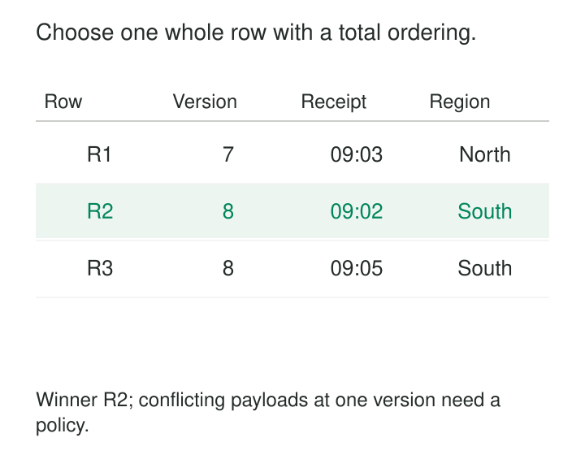

An overlapping extract delivers several records for the same customer. One contains a newer source version; another arrived later; a third is a retry of an earlier delivery.

A developer removes duplicates by customer ID. The result contains one row per customer, so the uniqueness check passes. Yet the retained address changes between runs.

**Deduplicate with an Explicit Winner defines which records compete and why one survives.** It replaces accidental selection with a documented precedence rule, preserving enough evidence to explain the result.

Uniqueness is only the first requirement. The surviving record must also be appropriate for the model.

## Define the competition before choosing the winner

A deduplication rule needs three parts:

| Part | Question it resolves |
|---|---|
| Grouping identity | Which records represent the same intended output? |
| Eligibility | Which candidates are acceptable under the contract? |
| Precedence | Which acceptable candidate should survive? |

The grouping identity determines the output grain.

For repeated deliveries of an immutable event, it might be source plus event ID. For a current-customer projection, it might be source plus customer ID. For preserved customer history, it may also include a source version.

Those are different operations. Collapsing all customer versions is appropriate for a current-state projection but destroys a history table.

Keys must include their namespace where necessary. Customer `17` from two tenants should not become one group merely because the identifier strings match. Missing identities need explicit handling; grouping all null keys together can collapse unrelated records.

## Source order can disagree with arrival order

Consider these illustrative candidates for customer C17:

| Capture | Source version | Region | Original receipt |
|---|---:|---|---|
| R1 | 7 | North | 09:03 |
| R2 | 8 | South | 09:02 |
| R3 | 8 | South | 09:05 |

The source contract establishes that higher versions supersede lower ones. R2 and R3 have equivalent business payloads.

For a current-state projection, the rule is:

1. Prefer the highest source version.
2. Among equivalent deliveries of that version, prefer the earliest original receipt.
3. Resolve remaining equivalent ties using a stable capture identifier.

R2 wins. Selecting the latest arrival would choose R3 unnecessarily; selecting the earliest arrival without considering version could retain an obsolete state in other batches.



Receipt time here selects a representative delivery. It does not establish which source state is newer.

## Express the whole rule in the query

A window function makes precedence inspectable. This Snowflake-style example assumes validated, non-null identities and ordering fields, with conflicting equal-version payloads already handled:

```sql
SELECT source_system, customer_id, source_version,
       region, capture_id
FROM validated_candidates
QUALIFY ROW_NUMBER() OVER (
    PARTITION BY source_system, customer_id
    ORDER BY source_version DESC,
             first_received_at ASC,
             capture_id ASC
) = 1;
```

Snowflake documents filtering window-function results through [`QUALIFY`](https://docs.snowflake.com/en/sql-reference/constructs/qualify).

The ordering must distinguish candidates whenever selecting between them would change an observable result. PostgreSQL explicitly notes that `row_number` assigns tied rows in an unspecified order. See its [window-function tutorial](https://www.postgresql.org/docs/current/tutorial-window.html).

PostgreSQL’s `DISTINCT ON` has the same need for explicit precedence: its documentation warns that the retained first row is unpredictable without appropriate ordering. See the [`SELECT` reference](https://www.postgresql.org/docs/current/sql-select.html#SQL-DISTINCT).

A final output sort cannot repair an arbitrary winner chosen earlier.

## A tie-breaker does not settle a contradiction

Suppose R2 says South and R3 says East, while both claim source version 8.

A stable capture ID can make the choice repeatable. It cannot establish which region is correct.

The conflict needs an explicit response: reject the group, quarantine it, apply a documented authority rule, or publish a flagged provisional result. Quietly choosing one conceals a violated source assumption.

Eligibility rules also deserve scrutiny. If the newest record fails validation, falling back to an older record may be useful, but it changes the meaning to “latest acceptable state.” Consumers should know that the projection may be stale.

Select a complete winning row unless the model deliberately constructs a composite record. Independent expressions such as `MAX(updated_at)` and `MAX(region)` can combine values from different candidates into a record that never existed.

## Repeated delivery differs from repeated business activity

Consider an illustrative order event E901 delivered twice because a publisher retried. Both deliveries contain the same immutable business payload.

Grouping by source and event ID can retain one business event while preserving delivery metadata separately. Earliest durable receipt is a reasonable representative when the copies are equivalent.

Now consider two purchases with identical customer, amount, and timestamp values but different transaction IDs. They may be legitimate separate purchases. Deduplicating by visible payload would erase one.

A content hash can identify identical bytes. It cannot establish that two identical payloads represent the same business occurrence.

Delta Lake documents a practical implementation boundary: its merge-based log deduplication example requires the incoming dataset to be deduplicated within itself before merging against existing data. See [Delta Lake’s deduplication guidance](https://docs.delta.io/delta-update/).

The merge handles destination reconciliation; the incoming winner rule remains a separate responsibility.

## Source authority can outrank freshness

An illustrative organization receives an address from a billing system and another from a CRM system.

Before choosing, the model must establish whether both fields describe the same concept. A billing address and a preferred contact address may both be valid. They should not compete merely because both are called `address`.

If the records genuinely compete for one defined attribute, the contract might prefer a verified authoritative source, then the latest applicable record within that source.

Versions from unrelated systems are generally not comparable. Version 12 in CRM does not automatically supersede version 8 in billing.

Combining attributes from different winners is a broader survivorship design, often associated with golden records. It needs attribute-level provenance and rules explaining why each value was selected.

## Deduplication must survive the next batch

Choosing one winner per incoming batch does not establish one winner across history.

A later batch can contain an older candidate than the one already stored. The pipeline must compare against retained state or recalculate the affected group using the necessary history.

The precedence rule and its inputs must remain stable across replay. Replacing original receipt time with the current processing time can change which record wins. Regenerating tie-break identifiers has the same problem.

Deletion markers also belong in precedence. Filtering them out before selecting the newest state can expose an older live record and effectively undo a deletion.

Streaming implementations add a retention boundary. Spark documents using watermarking to bound duplicate-tracking state in its [`dropDuplicates` guidance](https://spark.apache.org/docs/latest/api/python/reference/pyspark.sql/api/pyspark.sql.DataFrame.dropDuplicates.html). Such limits need to match the pipeline’s stated lateness and recovery behavior; bounded state does not provide unlimited historical duplicate detection.

## Keep evidence and measure the cost

A useful deduplication result retains the winner’s identity, source position, rule version, and provenance. Losing candidates can remain in raw storage or an exception dataset rather than disappearing without explanation.

Verification should cover conflicting ties, null keys, stale arrivals, repeated batches, and shuffled input order. A one-row-per-key check cannot detect a consistently wrong winner.

Operational metrics should distinguish equivalent retries, superseded versions, conflicting payloads, and unresolved identities. A sudden increase in conflicts may reveal a source defect that a generic duplicate count would hide.

The computation itself can require sorting, distributed shuffles, and substantial state. Highly repeated keys can create processing hotspots. Retaining losing candidates also consumes storage.

The pattern is especially useful for CDC preparation, overlapping extracts, current-state projections, and reconciliation before merge. It is unsuitable for blindly collapsing historical versions or legitimate repeated events.

[[data-declare-the-grain|Declare the Grain]] defines which records compete. [[data-deterministic-transformations|Deterministic Transformations]] makes selection reproducible. [[data-merge-and-upsert|Merge and Upsert]] reconciles winners with stored state. [[data-golden-records|Golden Records]] extends selection into explicit survivorship across sources.

A dependable winner is one the pipeline can explain—not merely the row that happened to remain.
