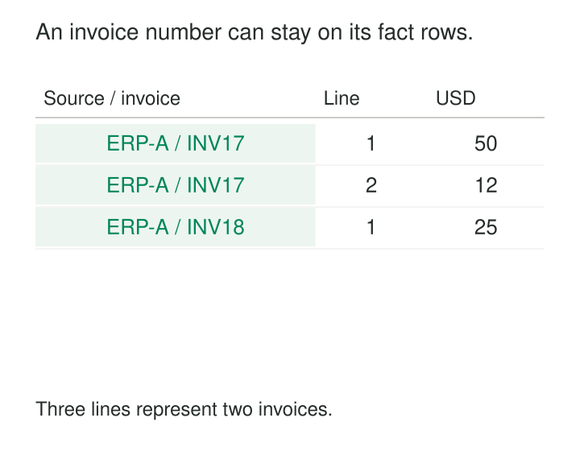

An analyst needs to find the invoice behind an unusual sales total. The warehouse contains dates, customers, products, quantities, and amounts—but the invoice number disappeared during modeling. Another team preserved it by creating an Invoice dimension containing nothing except invoice numbers.

Both designs miss a simpler possibility: keep the useful identifier directly on the fact rows.

[[data-degenerate-dimensions|Degenerate Dimensions]] preserve business identifiers for grouping, filtering, and tracing facts when those identifiers have no remaining descriptive attributes that justify an associated dimension table.

## Keep the identifier after distributing the context

An operational invoice typically has a header and several lines. The header contains the invoice number, customer, date, and other information shared by its lines.

In a dimensional model, Customer and Date provide their own descriptive context. Product describes each item. Their keys can appear directly on the invoice-line facts. After distributing that context, the invoice number may be all that remains of a potential Invoice dimension.

The number still matters: it connects the lines belonging to one business document. Kimball calls this a degenerate dimension because the dimension has been reduced to its identifier, without an associated dimension table. [Kimball Group: Degenerate Dimensions](https://www.kimballgroup.com/data-warehouse-business-intelligence-resources/kimball-techniques/dimensional-modeling-techniques/degenerate-dimension/)

“Degenerate” describes this simpler structure. It does not imply poor data quality or an incomplete design.



*The identifier preserves document membership. Other dimensions supply the descriptive context.*

## Group invoice lines without changing their grain

Consider these illustrative invoice-line facts. All amounts are net line amounts in USD.

| Source | Invoice number | Line | Product | Quantity | Net amount |
|---|---|---:|---|---:|---:|
| ERP-A | INV-17 | 1 | Adapter | 2 | 50 |
| ERP-A | INV-17 | 2 | Case | 1 | 12 |
| ERP-A | INV-18 | 1 | Adapter | 1 | 25 |

The grain remains **one row per invoice line**. `invoice_number` repeats because several lines belong to the same invoice.

A document-level summary requires no Invoice dimension:

```sql
SELECT
    source_system,
    invoice_number,
    SUM(net_line_amount) AS invoice_net_amount
FROM fact_invoice_line
GROUP BY source_system, invoice_number;
```

The results are 62 USD for INV-17 and 25 USD for INV-18.

There are three line rows and two invoices. Counting rows answers a different question from counting distinct document identities. Neither calculation requires creating another physical dimension table.

The identifier also provides a practical route back to the operational document. A support analyst investigating INV-17 can retrieve both lines, inspect their product and customer context, and compare them with the source invoice. Kimball identifies this operational traceability, along with grouping related rows, as a principal use of degenerate dimensions. [Kimball Group: Another Look at Degenerate Dimensions](https://www.kimballgroup.com/2003/06/design-tip-46-another-look-at-degenerate-dimensions/)

## Establish identity at the right scope

The pattern works only when the identifier retains its intended meaning.

Invoice numbers may be unique within a source system, legal entity, store, register, or numbering year. Two sources can both issue INV-17. Grouping only by the displayed number would incorrectly combine them.

The effective document identity must therefore include the necessary namespace. In the example, that is `(source_system, invoice_number)`. Other businesses may need additional components.

Document identity also differs from line identity. A candidate uniqueness rule might include source, invoice, and line number. If the source records revisions or multiple events per line, that combination may still be insufficient. The declared grain determines which additional distinctions matter.

A technical fact-row surrogate key can coexist with these identifiers. It uniquely identifies a warehouse row; the business document number groups rows into something users recognize.

Finally, preserve identifier semantics during ingestion. Leading zeros, prefixes, and case may distinguish valid identifiers. Treating every numeric-looking reference as an arithmetic number can erase meaningful differences.

## Carry several business references when they help

A shipment-line fact may retain several degenerate dimensions:

| Shipment line | Order number | Shipment number | Bill of lading | Shipped quantity |
|---|---|---|---|---:|
| S41-1 | O-17 | S-41 | B-900 | 4 |
| S42-1 | O-17 | S-42 | B-901 | 6 |

Grouping by order shows that O-17 has shipped ten units. Filtering by shipment identifies the four-unit or six-unit dispatch. The bill-of-lading reference helps locate the associated transport document.

These identifiers answer different operational questions without necessarily requiring separate dimensions. Kimball explicitly describes shipment facts carrying multiple transaction references in this way. [Kimball Group: Degenerate Dimension Examples](https://www.kimballgroup.com/2003/06/design-tip-46-another-look-at-degenerate-dimensions/)

Their presence does not make arbitrary joins safe. Joining these shipment rows to several invoice lines using only O-17 can multiply rows and amounts. Document references establish a business connection; a correct calculation still needs compatible grains, sufficiently precise matching keys, or independently aggregated results.

## A published implementation: Wide World Importers

Microsoft’s Wide World Importers sample implements this arrangement in its warehouse schema.

The published loading script defines sales facts with a `WWI Invoice ID` stored alongside customer, stock-item, invoice-date, and salesperson keys. Order facts similarly retain `WWI Order ID`, and movement facts can retain invoice and purchase-order identifiers.

These fields preserve operational references while descriptive information resides in dimensions such as Customer, Stock Item, and Employee. The implementation can be inspected in Microsoft’s [Wide World Importers warehouse loading script](https://github.com/microsoft/sql-server-samples/blob/master/samples/databases/wide-world-importers/sample-scripts/load-sample-data-using-polybase/load-sample-data-using-polybase.sql).

Wide World Importers is a sample business. It provides a concrete schema implementation rather than evidence of production outcomes.

## Avoid turning every header into a dimension

The common modeling mistake is to reproduce an operational header table as a large analytical dimension and require every line-level query to pass through it.

For ordinary dimensional analysis, relevant header context can instead be represented by dimension keys directly on the line facts. Kimball recommends this approach for header-and-line transactions, retaining the transaction number as a degenerate dimension. [Kimball Group: Modeling Header/Line Transactions](https://www.kimballgroup.com/2007/10/design-tip-95-patterns-to-avoid-when-modeling-headerline-item-transactions/)

That recommendation does not authorize copying every header value onto every line. A ten-dollar invoice-level handling charge repeated on three lines becomes thirty dollars when summed. Header-level measures need their own appropriate grain or an explicit allocation rule.

Likewise, a degenerate dimension is not a general container for leftover text. Product descriptions, customer classifications, and evolving business attributes need deliberate modeling. The identifier belongs on the fact because its grouping or tracing function is useful.

## Balance simplicity against storage and reporting costs

The pattern is useful for transaction detail, document reconciliation, drill-through reports, basket analysis, and process tracking. It avoids maintaining a separate identifier-only warehouse dimension and its loading dependencies.

The retained identifier still has costs. Long strings and many distinct values consume storage and reporting-model memory. Indexes or other access structures may be needed for frequent document lookups. Large identifier lists can also make poor report slicers.

Physical optimization depends on the engine and workload. A reporting layer may derive a separate table to expose order and line fields conveniently. Microsoft documents such a Power BI arrangement, including a one-to-one relationship at order-line grain. This is a presentation choice rather than a requirement to maintain an identifier-only dimension in the underlying warehouse. [Microsoft: One-to-One Relationship Guidance](https://learn.microsoft.com/en-us/power-bi/guidance/relationships-one-to-one)

## Recognize what line-level identifiers cannot represent

Distinct document counts describe documents present in the selected facts. Filtering to Adapter counts invoices containing Adapter. Adding distinct invoice counts across products can count the same invoice repeatedly.

A line fact also cannot represent a document with no lines. If reporting must include empty, abandoned, or otherwise absent documents, another fact structure may be necessary.

And when a document develops useful descriptive attributes, lifecycle history, or relationships that deserve independent analysis, its modeling needs may extend beyond a degenerate dimension.

[[data-declare-the-grain|Declare the Grain]] establishes what each row represents. **Namespace Identifiers** prevents document-number collisions. [[data-composite-keys|Composite Keys]] combines the components needed for document or line identity. [[data-transaction-fact-tables|Transaction Fact Tables]] provides the event-level structure in which these identifiers most commonly appear.
