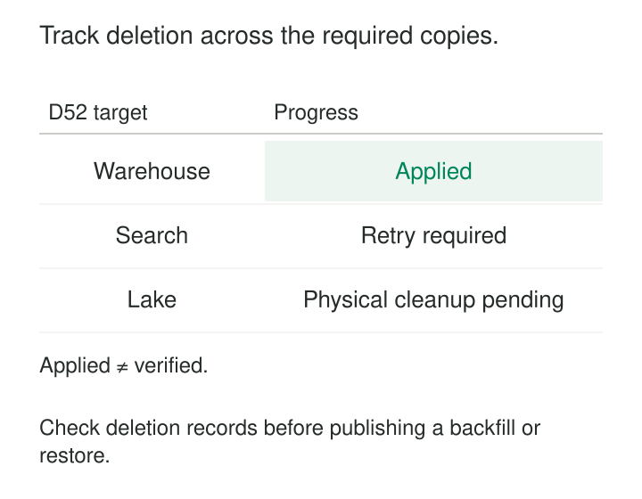

A customer record disappears from the application database. The support search still finds it. A warehouse extract still contains its email address. Two weeks later, a backfill reads an older snapshot and recreates the record that everyone believed was gone.

The database deletion succeeded. The system-wide deletion did not.

**Deletion propagation carries an approved removal decision through the copies and derived representations within its scope, tracks the outcome at each destination, and prevents older inputs from recreating the removed data.**

It is useful wherever data moves: replicas, warehouses, indexes, caches, object stores, exports, and recovery systems. Its purpose is to make deletion a dependable lifecycle operation rather than a local command with uncertain consequences.

## Give deletion an identity, scope, and durable record

A deletion request needs more meaning than “remove customer C17.”

It should identify the relevant namespace, account or entity, records or attributes, applicable time boundary, policy, and exceptions. Deleting an obsolete address differs from removing an account’s analytical history. Removing one person’s data should not automatically cascade into shared records belonging to others.

Before deleting the mapping between source and destination identifiers, resolve the identifiers needed to find the relevant copies. Otherwise, deleting the identity crosswalk first can make downstream records harder to locate.

A durable deletion record then connects the decision to its execution:

| Component | Purpose |
|---|---|
| Request identifier | Recognize retries of the same operation |
| Identity and scope | Find the intended records without over-deleting |
| Source position or record version | Identify the updates covered by the deletion |
| Required destinations | Define what completion covers |
| Destination outcomes | Track application, verification, failures, and exceptions |

Suppose deletion request D52 covers customer C17. Record the source position or record version covered by that deletion. An older update must not recreate C17; genuinely new activity must follow the policy for that account lifecycle. This establishes the request’s ordering boundary.

The deletion record itself needs restricted access and justified retention. It should preserve the minimum information required for execution and protection against replay, rather than becoming another archive of deleted payloads.

*Applied and verified are separate milestones. One successful destination does not complete a request whose other required destinations remain pending.*

## Example: a delete event reaches the warehouse but misses search

A customer-profile service supplies both a warehouse table and a search index through change data capture.

Request D52 removes profile C17. The warehouse applies the delete. Search is temporarily unavailable, so its consumer retries.

The request remains incomplete. Publishing the event proves that the producer emitted a message; it does not prove that both destinations removed their records.

Debezium illustrates an important implementation detail. Its event-flattening transformation can preserve deletion information as tombstones or rewritten delete records, or drop deletion records entirely, depending on configuration. A pipeline must choose a representation that its downstream consumers actually interpret as deletion. [Debezium event-flattening documentation](https://debezium.io/documentation/reference/stable/transformations/event-flattening.html)

A field such as `__deleted=true` does nothing unless the destination handles it correctly.

Now suppose an older profile update arrives after D52. A consumer that blindly upserts every message can recreate C17. The destination needs an ordering rule—such as a source sequence combined with a retained deletion boundary—and must reject superseded writes consistently.

That boundary must identify the relevant record lifecycle. Reusing a business identifier for a new account should not accidentally revive the old account or permanently block legitimate new activity.

## Example: removing a contribution from derived analytics

An engagement dataset contains:

| Event | Customer | Duration |
|---|---|---:|
| E1 | C17 | 40 seconds |
| E2 | C28 | 60 seconds |
| E3 | C17 | 20 seconds |

Its daily summary contains three events totaling 120 seconds.

Suppose the approved deletion scope requires removing C17’s contributions from this dataset and its summary. Deleting the two detail rows leaves the summary stale. Recomputing from the remaining records produces one event totaling 60 seconds.

An incremental correction could subtract two events and 60 seconds, but applying that correction twice would corrupt the result. The correction therefore needs deduplication or another idempotent mechanism.

Some measures require broader recomputation. Distinct counts, quantiles, and model features cannot always be repaired by subtracting a stored number. The destination must understand its transformation, not simply forward the source key.

A record can disappear from query results while its old values remain inside a storage file. If that file also contains records the table still needs, removing the old values may require rewriting it. Historical snapshots can retain additional copies that need their own cleanup.

Apache Iceberg retains historical snapshots for time travel; files remain while retained snapshots reference them. Snapshot expiration removes unused historical files. [Iceberg maintenance documentation](https://iceberg.apache.org/docs/latest/maintenance/)

Expiring old snapshots alone cannot remove a file that remains required by the current table; any necessary rewrite and historical cleanup must both be included in the plan.

Whether a genuinely anonymous aggregate must change depends on the approved scope and applicable requirements. Deletion propagation implements that decision; it should not silently invent one.

## Example: a restored backup must not undo deletion

A backup taken on 1 October contains C17. D52 removes the relevant records on 15 October. On 1 November, an outage requires restoring the older backup.

If restoration immediately exposes the recovered database, the system brings C17 back into use.

A safer recovery design restores into an isolated environment, obtains the applicable deletion records from a trustworthy source that survives the rollback, and reapplies them before publication. It also coordinates with deletions arriving during recovery, so the final publication step does not race against new requests.

The same rule applies to rebuilding an index or backfilling a warehouse partition from older inputs.

For UK GDPR erasure, the ICO explains that backup systems need consideration alongside live systems. Where immediate overwriting is unavailable, its guidance discusses placing backup data beyond use until replacement under an established schedule, with clear communication about what happens. [ICO guidance on erasure and backups](https://ico.org.uk/for-organisations/uk-gdpr-guidance-and-resources/individual-rights/individual-rights/right-to-erasure/)

A deletion ledger must therefore remain useful for the relevant recovery and replay horizon. Expiring its protective records while older recoverable copies still exist can reopen the problem.

## Follow actual replication behavior

“Replicated” does not necessarily mean “deletions propagate.”

Amazon S3, for example, does not replicate delete markers by default. Delete-marker replication can be enabled, but lifecycle-generated delete markers are not replicated through that mechanism. [S3 delete-marker replication](https://docs.aws.amazon.com/AmazonS3/latest/userguide/delete-marker-replication.html)

Every destination needs an explicit contract covering deletion representation, timing, retries, historical versions, and completion evidence.

Maintain an inventory of downstream consumers, including exports and external recipients where relevant. Dataset-level lineage helps discover dependencies, but it may not identify which rows or transformed identifiers correspond to a particular request.

An unregistered copy is a coverage gap. Three acknowledgments from three known targets cannot establish that no fourth copy exists.

## Verify outcomes without recreating the payload

A useful status model distinguishes accepted, delivered, applied, verified, blocked, and failed work.

Verification should check the intended access paths and storage layers: direct queries, search results, caches, historical versions, and physical cleanup where required. A successful API response or committed offset is evidence of one step, not proof of the whole outcome.

Retries need to be harmless. Removing an already absent row can succeed, while repeated aggregate corrections require explicit protection. Persistent failures need an owner and escalation path.

Holds and other preservation requirements should appear as scoped exceptions with authority and review conditions. They must not silently convert every affected request into “complete.”

Keep evidence such as request identifiers, target identifiers, operation versions, timestamps, and verification results. Avoid copying the original sensitive content into error logs or deletion receipts.

## Costs, limits, and related patterns

Deletion propagation adds consumer tracking, reliable delivery, ordering controls, reconciliation, file rewrites, and recovery testing. Physical cleanup can conflict with long rollback windows. Historical events may themselves contain old values and need separate lifecycle controls.

The pattern is most effective when deletion support is part of every dataset’s interface from the beginning. Retrofitting it across undocumented extracts and unmanaged exports is substantially harder.

[[data-deletion-tombstones|Deletion Tombstones]] represent absence in a stream; propagation ensures destinations apply that meaning.

[[data-idempotent-writes|Idempotent Writes]] make retries safe, including destination-specific corrections.

[[data-replayable-backfills|Replayable Backfills]] need applicable deletion decisions incorporated before rebuilt data becomes visible.

[[data-classification-based-retention|Classification-Based Retention]] determines when scheduled disposal should occur. Deletion propagation carries that decision through the systems holding the affected information.
