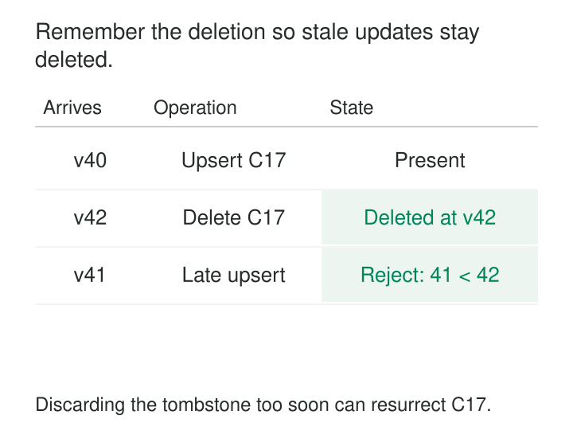

A customer disappears from the operational database, but remains in the warehouse and search index. The incremental pipeline keeps copying inserts and updates. It never receives anything explaining that this customer should be removed.

Later, a backfill makes the problem worse: an old customer record reappears after someone has already deleted it downstream.

**Deletion Tombstones make removal an explicit piece of data.** A tombstone identifies what was deleted and, where needed, preserves enough ordering information to prevent older values from restoring it.

Absence becomes something the system can communicate, reconcile, and remember.

## Make removal travel through the pipeline

An incremental feed cannot usually infer a deletion from silence. A key that stops appearing might be unchanged, excluded by a filter, temporarily unavailable, or deleted.

A tombstone resolves that ambiguity by declaring removal for a specific identity and scope. In an application-level change feed, it might contain:

| Field | Illustrative value |
|---|---|
| Dataset | `crm.customers` |
| Key | `C17` |
| Operation | `DELETE` |
| Source version | `42` |
| Event ID | `E942` |

The consumer uses the dataset and key to locate the affected record. The operation determines the action; the version helps establish whether the deletion supersedes another change.

The representation varies. A warehouse might retain a compact deletion ledger. A distributed database might store an internal timestamped marker. A messaging platform might assign deletion semantics to a keyed record with a null value.

These implementations share an idea, but their ordering and cleanup rules differ.



## A late update must not undo a newer deletion

Consider an illustrative customer projection receiving these changes:

| Arrival order | Source version | Operation |
|---|---:|---|
| First | 40 | Upsert C17 |
| Second | 42 | Delete C17 |
| Third | 41 | Delayed upsert C17 |

A consumer that physically deletes C17 and forgets its version has a problem. When version 41 arrives, there is no existing row against which to compare it. An ordinary upsert can recreate the customer.

A retained marker says: “C17 was deleted at version 42.” The late update is rejected.

The essential rule is small:

```text
atomically:
    if change.version > last_seen[change.key]:
        apply_upsert_or_delete(change)
        last_seen[change.key] = change.version
```

The comparison, data change, and ordering-state update must act as one protected operation. Otherwise concurrent workers can both pass the comparison and apply changes in the wrong order.

This mechanism requires versions that are comparable for the same entity. A source sequence or suitable change position can provide that ordering. Processing timestamps from different machines generally cannot establish it reliably.

Repeated delivery of version 42 should leave the same deleted state. A genuinely newer creation may be valid, but key reuse needs an explicit rule—especially if a recreated entity resets its version counter. An incarnation identifier can distinguish the new entity from its predecessor.

## A CDC delete and a Kafka tombstone have different jobs

Debezium’s PostgreSQL connector provides a documented example. A database deletion produces a structured change event with operation `d` and an `after` field of null. The connector normally follows it with another record using the same key and a null message value. See [Debezium’s delete and tombstone events](https://debezium.io/documentation/reference/stable/connectors/postgresql.html#postgresql-delete-events).

The structured event describes the source deletion. The following null-valued record supports Kafka’s compaction protocol.

For a compacted Kafka topic, a record with a key and a null payload is a tombstone. Background compaction can remove earlier records for that key and eventually remove the marker itself. This is asynchronous cleanup, as described in [Kafka’s log-compaction design](https://kafka.apache.org/43/design/design/#log-compaction).

The entire message value must be null. A JSON object containing `"after": null`, or the text string `"null"`, is a different representation.

Transformations therefore matter. Debezium’s event-flattening transformation can drop deletes, retain tombstones, or rewrite deletions into records containing a deletion flag. Its [delete-handling options](https://debezium.io/documentation/reference/stable/transformations/event-flattening.html) must match what the destination understands.

Kafka compaction also follows log order rather than interpreting an application’s business-version field. Appending a stale non-null value after a tombstone can make that value the latest record. Correct sequencing still belongs to the surrounding pipeline.

## A replica needs evidence that absence is intentional

Apache Cassandra demonstrates the same principle inside a distributed database.

Imagine three replicas containing a value. One becomes unavailable. The other two receive a deletion.

If deletion simply erased their copies, the returning replica would still hold the value. Reconciliation could spread that old value back into the cluster. A timestamped tombstone provides evidence that the older value has been superseded.

Cassandra writes deletion markers through its storage path and retains them through a grace period. Eligible markers are later removed during compaction, subject to additional conditions involving the older data they suppress. The [Cassandra tombstone documentation](https://cassandra.apache.org/doc/latest/cassandra/managing/operating/compaction/tombstones.html) describes both this mechanism and the risk of resurrected “zombie” data.

The grace period supports recovery and repair; it does not make prolonged replica failure harmless. Purging evidence before replicas have safely reconciled can undermine the deletion.

## Retention defines the recovery boundary

Keeping markers forever is expensive. Removing them too early can make deletion unreliable.

The retention decision must account for the oldest state that can legitimately return: a lagging consumer, disconnected replica, retry queue, replay job, or historical backfill. Retaining a marker for seven days provides little protection against an uncontrolled import of last year’s records.

Kafka exposes a specific setting, `delete.retention.ms`, governing tombstone retention for compacted topics. Its documentation also relates this setting to the time available for a consumer scanning from the beginning to observe deletion markers. See [Kafka topic configuration](https://kafka.apache.org/43/configuration/topic-configs/#delete.retention.ms).

A consumer with existing local state can retain a deleted row if it misses the relevant marker. Recovery may require rebuilding or resnapshotting rather than simply continuing from an old position.

For application-level ledgers, cleanup similarly needs a defensible boundary: older inputs are no longer accepted, or recovery processes explicitly reconcile against current authoritative state. A TTL by itself cannot establish that boundary.

## Define exactly what deletion means

A tombstone needs a stable, correctly scoped key. Customer `17` in one tenant must not delete customer `17` in another. Key changes also require attention: removing the old identity and creating the new one are distinct effects.

Deletion scope matters just as much. Removing a product from the current catalog does not automatically mean removing historical sales. A warehouse might remove a current-state record while preserving transaction facts and applying a separate policy to descriptive attributes.

Tombstones also differ from keeping an entire row with `is_deleted = true`. That approach can be useful, but it retains the row’s other contents and requires readers to respect the flag.

Neither a marker nor eventual compaction proves that every copy has been erased. Backups, exports, caches, and derived datasets have their own lifecycles.

## The cost of remembering absence

Tombstones add writes, retained metadata, reconciliation work, and cleanup operations. Storage engines may inspect many markers during reads; compaction consumes resources while reclaiming space. Application-level ledgers need indexing and monitoring.

The pattern is useful wherever copies can outlive their source: CDC pipelines, search projections, caches, replicated databases, and offline synchronization. A single authoritative database with no downstream copies may need only ordinary transactional deletion.

[[data-log-based-change-data-capture|Log-Based Change Data Capture]] supplies source deletions. **Idempotent Processing** makes repeated delete delivery safe. [[data-snapshot-then-stream|Snapshot Then Stream]] must coordinate baseline rows with subsequent removals. [[data-historical-restatement|Historical Restatement]] needs rules preventing older data from reversing newer deletions.

The lasting design decision is when the system can safely forget that something was deleted—and what prevents older copies from becoming authoritative afterward.
