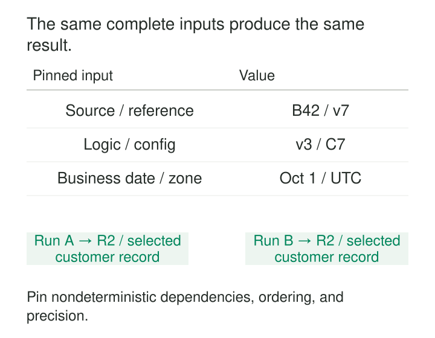

A pipeline runs twice against what appears to be the same input. The first run selects one customer record; the second selects another. A historical report changes even though nobody changed its business rules.

The code may contain no obvious randomness. Its hidden inputs might be the current date, an updated reference table, an unspecified tie, or the order in which distributed workers return rows.

**Deterministic Transformations produce the same defined result from the same complete inputs and rules.** They make replay, debugging, comparison, and historical rebuilding dependable by removing accidental choices from execution.

The challenge is defining “the same” precisely enough.

## Treat context as an input

A transformation depends on more than its main source table. Its effective inputs can include:

| Dependency | What must be identifiable |
|---|---|
| Source data | Snapshot, file versions, or bounded source positions |
| Transformation | Code and dependency versions |
| Reference data | Applicable lookup versions |
| Business context | Reporting date, cutoffs, thresholds |
| Execution settings | Timezone, collation, numeric behavior |
| Randomized operations | Algorithm and reproducibility controls |

A run specification records these dependencies. The transformation then uses explicit values rather than silently consulting whatever happens to be current.



Recording dependencies is necessary but insufficient. The operators themselves must behave consistently, and the referenced inputs must remain retrievable.

The result also needs a definition. Two tables can contain identical records while their files have different names, compression metadata, or row layouts. Reproducing logical values is a different promise from reproducing identical bytes.

## A “latest record” needs a complete ordering

Consider two illustrative customer changes:

| Customer | Updated timestamp | Source sequence | Record |
|---|---|---:|---|
| C17 | 10:00:00 | 101 | R1 |
| C17 | 10:00:00 | 102 | R2 |

A query selecting one row per customer using only `updated_at DESC` leaves a tie. Either record can receive the first row number.

PostgreSQL explicitly documents that `row_number` assigns tied rows in an unspecified order. See its [window-function tutorial](https://www.postgresql.org/docs/current/tutorial-window.html).

If the source sequence establishes precedence, the transformation can express that rule:

```sql
row_number() over (
    partition by customer_id
    order by updated_at desc nulls last,
             source_sequence desc,
             source_record_id desc
)
```

This example assumes non-null sequences and a unique, stable record identifier. The final ordering must distinguish any rows whose selection would change the result.

A tie-breaker also needs meaningful justification. Choosing the lexicographically greatest identifier makes selection repeatable, but it does not prove that the selected record is authoritative. Contradictory records may require a quality failure or reconciliation instead.

The same issue appears in “first purchase,” representative addresses, top-ranked products, and deduplication. Each needs an explicit selection rule.

## A reporting date should survive replay

An illustrative activity model classifies customers using a rolling 30-day window. It filters against `CURRENT_DATE`.

Running the same retained events next month produces different classifications. That is reasonable for a current-state view, but unsuitable for reproducing last month’s report.

A historical transformation should receive an explicit `as_of_date` and derive its window from that value. The run records the date, timezone, and boundary convention.

A customer can then be inactive as of one reporting date and active as of another without either execution being nondeterministic. The declared input changed.

Database guarantees have scope. PostgreSQL classifies current-time functions as stable within a transaction, while distinguishing that behavior from functions that return the same result for the same arguments indefinitely. See [function volatility categories](https://www.postgresql.org/docs/current/xfunc-volatility.html).

Execution timestamps remain useful for operations. Keep them distinguishable from business timestamps, and exclude them from comparisons intended to establish identical business results.

## Reference data can change yesterday’s answer

Suppose an illustrative conversion model processes a 100-unit amount using a reference rate of 1.10. It produces 110 units in the reporting currency.

A replay reads the same transaction but joins the latest rate table, now containing 1.12. The result becomes 112.

The arithmetic is deterministic. The lookup input changed.

Reproducing the earlier result requires the same reference-data version and selection rule. That may involve an immutable snapshot or an effective-dated lookup. Effective dates alone may be insufficient when a reference value was later corrected: reproducing what was known at the original run can also require recorded-time history.

This applies beyond rates. Identity crosswalks, product classifications, geographic mappings, and calibration tables can all change a transformation’s interpretation.

Live API responses introduce the same dependency. Capturing an identifiable response for later reuse can make the transformation reproducible; calling the service again generally cannot guarantee the same evidence.

## Real engines expose the problem

Delta Lake documents a concrete implementation concern: a `MERGE` can make multiple passes over its source. Nondeterministic expressions in that source can produce different rows between passes.

Its documented solution automatically materializes the source for the merge in supported versions, making those passes consistent. See [Delta Lake’s merge guidance](https://docs.delta.io/delta-update/).

That mechanism establishes consistency within the operation. A separate merge tomorrow can still evaluate a different current date or read changed reference data. Reproducing independent runs requires control of those dependencies too.

Distributed collection functions provide another example. Spark documents that the order returned by [`collect_list`](https://spark.apache.org/docs/latest/api/python/reference/pyspark.sql/api/pyspark.sql.functions.collect_list.html) can be nondeterministic after a shuffle. If array order matters, the transformation must establish it explicitly using a complete ordering key.

Sorting the final output cannot repair a different record chosen earlier.

## Precision, randomness, and runtime still matter

Floating-point arithmetic is approximate, and different aggregation orders can change low-order digits. Exact decimal types with declared precision, scale, and rounding are often appropriate when exact decimal results are required. PostgreSQL distinguishes these behaviors in its [numeric-type documentation](https://www.postgresql.org/docs/current/datatype-numeric.html).

Randomness also needs scope. A fixed seed may reproduce a sequence under a controlled algorithm and execution arrangement, but it does not automatically guarantee identical row assignments across changed partitions or runtimes.

For stable cohorts, a documented mapping from a stable entity key can be more dependable than assigning random values during each execution. Generated identifiers similarly need stable derivation or a preserved mapping when downstream relationships must survive rebuilding.

Runtime upgrades can change parsing, timezone rules, collation, or numerical behavior. Reproducibility claims should identify their supported environment rather than assume every implementation is interchangeable.

## Determinism and idempotence solve different problems

A deterministic transformation can still append the same output twice.

**Determinism** concerns reproducing the result from fixed inputs. **Idempotent processing** concerns repeated application leaving the destination in the intended state.

A dependable replay usually needs both. It must calculate the same records and publish them through a replacement, merge, or deduplication mechanism that does not duplicate their effects.

Incremental processing introduces another requirement: the result must be independent of legitimate batching and arrival patterns where the contract promises that equivalence. A deterministic calculation over an incomplete lookback window can consistently produce the wrong answer.

Useful verification therefore compares repeated executions, varies row ordering or partitioning where relevant, exercises ties, and checks incremental results against an equivalent bounded rebuild. Comparisons must preserve meaningful duplicates and use declared numeric tolerances where exact equality is not promised.

## The cost of reproducibility

Pinned snapshots and reference versions consume storage and cataloging effort. Complete ordering can require expensive sorts. Controlled runtimes and retained external responses add operational work.

The pattern is especially valuable for backfills, historical reports, shared models, difficult debugging, and pipelines expected to recover by replay. Some products intentionally reflect the present moment; their clock and mutable context should still be explicit.

Determinism does not establish correctness. A mistaken conversion can be perfectly repeatable. Its value is that a changed result becomes explainable through changed inputs, rules, or a violated guarantee.

[[data-preserve-raw-inputs|Preserve Raw Inputs]] retains the starting evidence. [[data-as-of-joins|As-of Joins]] selects temporal context. **Idempotent Processing** protects repeated publication. [[data-historical-restatement|Historical Restatement]] governs replacing earlier results after intentional corrections.

A reproducible pipeline can explain both why two runs agree and which declared change caused them to differ.
