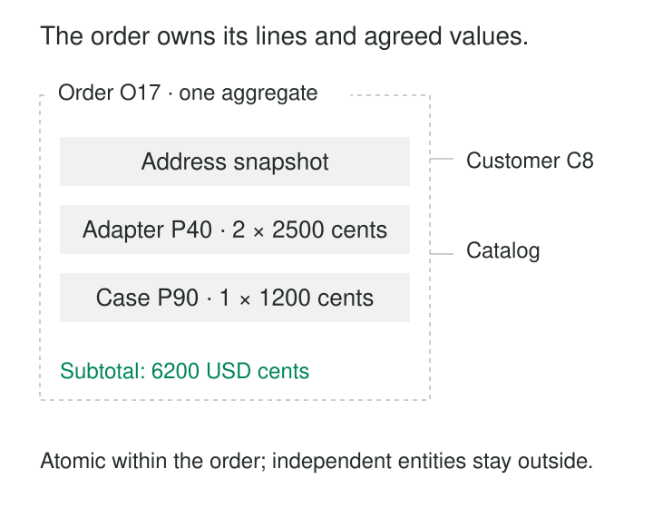

A checkout update changes an order’s quantities, delivery address, and subtotal. The application saves those pieces separately. A failure leaves three adapters on the order but a subtotal calculated for two.

Another team responds by embedding everything: customer profile, product catalog entries, payments, shipments, and the customer’s entire order history. The document becomes expensive to load and difficult to update safely.

**Document Aggregates group a bounded set of owned data into one document, so the application can read and change a meaningful business unit together.** The boundary follows ownership, lifecycle, and consistency rules, informed by the operations the system performs.

## Give the document a business boundary

An **aggregate** is a group of domain objects governed as one unit. Its **root** provides identity and controls changes that must preserve the group’s rules.

An order and its lines are a familiar example. The order owns the lines: their quantities and agreed prices describe this particular order. The products those lines reference have independent identities and lifecycles.

Martin Fowler describes aggregates through this distinction between the root and its owned components. [Martin Fowler: DDD Aggregate](https://martinfowler.com/bliki/DDD_Aggregate.html)

A document can provide a convenient storage boundary for that unit. MongoDB, for example, supports atomic writes that modify multiple fields within one document. [MongoDB: Atomicity and Transactions](https://www.mongodb.com/docs/manual/core/write-operations-atomicity/)

The correspondence is a design choice. An aggregate can also span relational tables. Conversely, a nested JSON response may combine several independent aggregates for display; nesting alone does not establish ownership.

## Example: an order owns its commercial details

The illustrated draft order contains two lines:

| Line | Product reference | Quantity | Agreed unit price |
|---|---|---|---|
| 1 | P-40, Adapter | 2 | USD 25.00 |
| 2 | P-90, Case | 1 | USD 12.00 |

Its items subtotal is USD 62.00, represented here as `6200` US cents.

Changing the adapter quantity requires recalculating the subtotal. Those changes can be validated and written together within the order document. A line identifier remains useful inside the aggregate, especially when later operations must identify a particular line.

The order references customer C-8 and products P-40 and P-90. Their current profiles and catalog descriptions remain separate.

Some copied values have a different purpose. An agreed unit price records the terms of this order. A confirmed delivery address records where this order should go. Updating the customer’s profile or the catalog’s current price should not silently rewrite those historical agreements.

That is deliberate snapshotting. A copied product description intended to stay current would instead require a synchronization policy.

## Atomic storage still needs valid updates

An atomic write guarantees that its changes succeed or fail together. It does not guarantee that the resulting order obeys business rules.

The write must still enforce rules such as positive quantities, unique line identifiers within the order, compatible currencies, and a subtotal matching the accepted pricing calculation. The application or database validation mechanism must reject invalid states.

Concurrent updates need attention too. Suppose two users read version 7. One changes quantities; the other changes the address. If both replace the document without checking its version, the later replacement can overwrite the earlier change.

An optimistic concurrency rule makes the expected version part of the write condition. The update succeeds only if the stored version is still 7, and changes it to 8 in the same operation. A conflict requires reloading and reconsidering the command.

MongoDB documents this expected-value filtering approach and explains how updates filtered only by identity can overwrite one another. [MongoDB: Concurrent updates](https://www.mongodb.com/docs/manual/core/write-operations-atomicity/)

Retries also need appropriate semantics. Repeating an operation that sets an address differs from repeating one that increments a quantity. Atomicity does not make a retried business command automatically safe.

## Embed ownership; reference independent lives

Embedding works best when the contained data has a bounded size, belongs primarily to one root, and participates in its operations.

Shared products, accounts, organizations, and inventory often need references because they are used and changed independently. Frequently copying their live attributes into many documents creates update fan-out and disagreement.

MongoDB’s embedding guidance explicitly supports contained relationships and children viewed through their parent, while noting that grouping is less useful when operations frequently need only a subset. [MongoDB: Embedded Data](https://www.mongodb.com/docs/manual/data-modeling/embedding/)

The boundary also limits what one document write can guarantee. Saving an order does not reserve stock in a separate inventory record or charge a payment provider.

If order acceptance requires coordinated stock reservation, the system needs an explicit mechanism: perhaps a supported transaction across records, or a reservation workflow with pending and failed states. The order document alone cannot enforce a rule involving independently stored inventory.

## Example: a customer profile with bounded contact details

A customer profile might contain:

| Field | Example |
|---|---|
| Customer ID | C-8 |
| Preferred contact | Email |
| Contact methods | One email address and two telephone numbers |
| Addresses | Delivery and billing addresses |

These details are commonly retrieved together and maintained through the profile. A single document avoids repeatedly reconstructing that small group of information.

Azure Cosmos DB’s official modeling guide demonstrates this arrangement with a person document containing addresses and contact details. It recommends embedding for contained, bounded data commonly accessed together. [Microsoft: Data modeling in Azure Cosmos DB](https://learn.microsoft.com/en-us/azure/cosmos-db/modeling-data)

The boundary should stop before the customer’s unlimited history. Orders can reference the customer while remaining separate documents. Customer identity does not imply that every order, support case, and interaction belongs inside the profile.

Nor should a shared address record automatically become an owned value. The design must distinguish a profile’s address value from an independently managed location used by several parties.

## Example: a blog post whose comments keep growing

A post starts with a title, body, and three embedded comments. The design looks convenient: one read returns everything.

A popular post eventually attracts hundreds of thousands of comments. New comments arrive independently, moderation targets individual comments, and readers request them in pages. The original document boundary no longer matches the workload.

A better arrangement keeps comments separately, each referencing the post. Microsoft’s Cosmos DB guide uses an expanding comments array to illustrate why unbounded children should be separated. [Microsoft: When not to embed](https://learn.microsoft.com/en-us/azure/cosmos-db/modeling-data#when-not-to-embed)

The post might still embed a bounded preview of its five most recent comments. That preview is a read projection with a refresh policy. It does not make the post the authoritative storage location for the complete comment history.

## The costs move into size, contention, and maintenance

Document aggregates help with orders, quotations, bounded configuration sets, and profiles where ownership and consistency align with common access patterns.

They reduce reconstruction work and can localize validation. Their costs grow when the boundary becomes too broad.

Large documents consume more storage, memory, and transfer bandwidth. Nested indexes add maintenance work. Physical write costs depend on the database and operation; a partial-update API does not eliminate every cost associated with a large record.

A heavily updated root can also become a contention point. Independent writers modifying unrelated children may repeatedly conflict through a shared version check. That can signal that some children deserve independent boundaries.

Growth must fit the platform’s limits. MongoDB documents a 16 MiB BSON document size limit, making an unlimited array a correctness concern as well as an operational one. [MongoDB: Document size limit](https://www.mongodb.com/docs/manual/data-modeling/embedding/)

Schema flexibility still requires evolution rules. Readers may encounter older document shapes, and migrations must preserve the aggregate’s invariants. Schema versions, defaults, validation, and controlled backfills make those changes manageable.

Analytics introduces another grain: expanding order lines produces line records, while order-level values remain at the root. Summing a repeated order subtotal after expansion would overcount it.

## Related patterns

[[data-declare-the-grain|Declare the Grain]] distinguishes one aggregate from its nested children and their analytical rows. [[data-normalized-relations|Normalized Relations]] offers a complementary way to manage shared, independently changing facts. [[data-separate-source-facts-from-derived-interpretations|Separate Source Facts from Derived Interpretations]] distinguishes authoritative values, calculated totals, and cached previews. [[data-model-lifecycle-states-explicitly|Model Lifecycle States Explicitly]] defines which aggregate changes are valid as an order moves from draft through confirmation and fulfillment.
