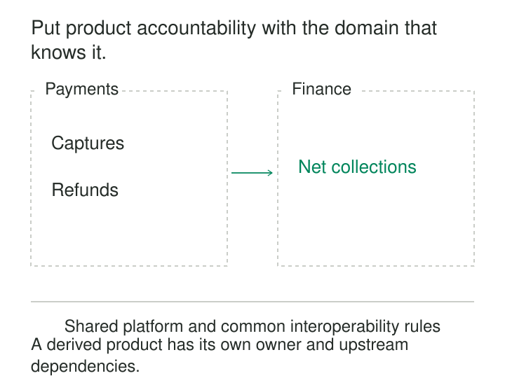

A shipment report loses half its records. The central data team checks the pipeline and finds that the source application changed how split shipments are represented.

The application team says the database is working correctly. The reporting team cannot interpret the new records. The pipeline team can move the data but cannot decide what it means.

Everyone owns a component. Nobody owns the data people depend on.

**Domain-Owned Data Products give a business domain continuing responsibility for publishing useful, trustworthy data to other teams.** Ownership includes meaning, quality, operation, support, and change—not simply creating a table or supplying an extract.

## Put responsibility close to understanding

A domain is a coherent area of business responsibility, such as fulfillment, payments, or product catalog management.

Teams working in that domain are often best placed to explain its events, identities, lifecycle states, and exceptions. The pattern connects that knowledge to responsibility for analytical data consumed elsewhere.

This combines two principles from Zhamak Dehghani’s data-mesh formulation: domain-oriented ownership and treating data as a product. Her formulation also includes a shared platform and federated governance, which help distributed ownership function across an organization. [Data Mesh Principles and Logical Architecture](https://martinfowler.com/articles/data-mesh-principles.html)

The product is designed around consumers’ needs. Its delivery might use tables, event streams, files, or APIs. Several interfaces can belong to one product when they serve a coherent purpose under the same ownership.

Physical infrastructure can remain shared.

## Ownership needs authority and capacity

An owner’s name in a catalog is useful only if it leads to somebody who can resolve questions and improve the product.

The owning team needs authority over definitions, priorities, interfaces, and lifecycle decisions. It also needs engineering capacity to implement changes and an operating arrangement for incidents.

Google Cloud’s data-mesh guidance distinguishes responsibilities for business definitions, technical interfaces, and production support. It treats these as functions that organizations can arrange to fit their circumstances. Accountability therefore need not require a separate full-time job for every product. [Data-mesh architecture and functions](https://docs.cloud.google.com/architecture/data-mesh)

In practice, ownership should answer three questions: who decides what the product means, who can change its implementation, and who responds when its promises fail?

Those answers must survive staff changes and reorganizations.

## Give consumers something dependable

A product should let a prospective consumer determine whether it is suitable without reconstructing the producer’s internal systems.

| Consumer question | Product responsibility |
|---|---|
| What does this represent? | Purpose, definitions, grain, keys, and examples |
| How do I use it? | Discoverable interfaces and an access process |
| Can I rely on it? | Quality evidence, freshness expectations, and known limitations |
| What happens when it changes? | Compatibility policy and migration notices |
| Where do I get help? | A maintained support route and accountable team |

These are continuing responsibilities. A polished description does not compensate for stale data or unanswered incidents.

Dehghani’s original account describes product ownership in terms of consumer needs, measurable usefulness, and responsibility for dataset evolution and retirement. [Domain data as a product](https://martinfowler.com/articles/data-monolith-to-mesh.html)

## Example: fulfillment publishes shipment lines

Suppose a fulfillment team publishes `fulfillment.shipment_lines`.

Its declared grain is one row per shipment line:

| shipment_id | line_id | order_id | quantity |
|---|---:|---|---:|
| S41 | 1 | O17 | 4 |
| S42 | 1 | O17 | 6 |

The product explains that an order can have several shipments. Quantities represent dispatched units; returns are represented separately. Shipment timestamps describe dispatch events, rather than ingestion time.

Consumers can now calculate shipped quantities without guessing how the operational application stores split shipments.

The fulfillment team maintains the mapping when its source system changes. It checks shipment-line uniqueness, investigates missing warehouses, and communicates changes that affect interpretation.

If a shared ingestion service fails, the platform team may repair that service. Fulfillment still coordinates the product’s response: affected coverage, expected recovery, and whether consumers should continue using the available data.

The distinction prevents an infrastructure diagnosis from becoming the end of the conversation.

## Example: finance owns a derived product

A payments domain publishes captured-payment and refund facts. Finance consumes those products to publish daily net collections.

For an illustrative day and currency:

| Component | Amount, USD cents |
|---|---:|
| Captured payments | 10,000 |
| Completed refunds | 2,000 |
| Net collections | 8,000 |

Finance defines this particular measure as captured amounts minus completed refunds, grouped by their agreed processing dates. It explicitly states that the measure excludes fees and is not recognized revenue.

Payments owns the meaning and delivery of its published payment events. Finance owns the derived calculation, cutoff policy, validation, and consumer-facing support for net collections.

Finance must also handle upstream corrections, preserve identifiers needed for reconciliation, and avoid multiplying payment amounts when joining several refunds to one payment. The existence of upstream products does not remove downstream modeling work.

If a refund arrives late, the products’ correction policies determine which published periods change. Neither team can resolve that question merely by declaring the other team the owner.

This demonstrates why product ownership follows responsibility for meaning. A team can consume several products and own a new interpretation built from them.

## A documented example: shared products support forecasting

Zalando’s inventory-optimization engineering account describes demand forecasting built from curated sales and availability data products.

The article states that multiple engineering teams build and maintain these products on a centrally governed lakehouse. The forecasting pipeline then prepares time-series data and engineers features for its own modeling purpose. [Zalando’s inventory-optimization system](https://engineering.zalando.com/posts/2025/06/inventory-optimisation-system.html)

This illustrates two useful boundaries: shared products can support specialized downstream work, and distributed product development can coexist with common storage and governance.

The account does not imply that every dataset is universally reusable or that downstream feature engineering disappears. Consumers still shape inputs around their own decisions.

## Share capabilities and interoperability rules

Domain ownership becomes expensive if every team must build ingestion frameworks, deployment systems, catalogs, access management, and monitoring from scratch.

A shared platform can provide those capabilities while domain teams maintain their products. Zalando separately documents centrally operated services such as Airflow for its data teams, illustrating this division between common infrastructure and distributed use. [Zalando’s technology-platform services](https://engineering.zalando.com/posts/2021/06/zalando-tech-radar-scaling-contributions.html)

Products also need conventions that make composition possible: identifier namespaces, timestamp semantics, currency and unit representation, discovery metadata, and ways to express quality and service expectations.

Dehghani describes federated governance as balancing domain decisions with shared rules for interoperability, supported by automated platform enforcement. [Federated computational governance](https://martinfowler.com/articles/data-mesh-principles.html#FederatedComputationalGovernance)

Shared rules need not force every domain to use one universal business model. “Customer” can have different meanings in payments and marketing, provided the distinctions and identity mappings are explicit.

## Avoid distributing the same unresolved problems

The pattern works only when domain teams have the knowledge, skills, funding, and incentives to serve consumers.

Assigning ownership without capacity creates a new queue. Giving teams autonomy without compatible interfaces creates new integration work. Measuring success by the number of registered products encourages publication without sustained usefulness.

Boundaries also require judgment. A business capability may span several applications, while one application may support several domains. Copying the current application inventory or organizational chart can produce fragmented responsibilities.

Ownership should include a viable support arrangement, dependency management, and a roadmap informed by consumers. A product with no continuing use may need retirement rather than indefinite maintenance.

## Know when the operating model earns its cost

Domain-owned products are particularly useful when many teams exchange data, business meanings change frequently, and centralized interpretation has become a bottleneck.

The costs include distributed engineering expertise, product management, support, duplicated processing, and coordination across dependencies. Shared infrastructure reduces some of that expense but cannot eliminate it.

A small organization with closely collaborating specialists may operate effectively through one data team. Domain ownership can still clarify business decisions without requiring a broad restructuring.

The practical test is whether consumers can discover, understand, and depend on the product—and whether its owner can keep those commitments.

## Related patterns

[[data-bounded-contexts|Bounded Contexts]] help identify where a domain’s meanings and responsibilities are coherent.

[[data-explicit-data-contracts|Explicit Data Contracts]] make consumer commitments concrete enough to validate and manage.

[[data-stable-logical-interfaces|Stable Logical Interfaces]] let a domain improve its implementation while preserving supported consumer behavior.

[[data-operational-service-objectives|Operational Service Objectives]] turn reliability expectations into measurable outcomes that product owners can act on.
