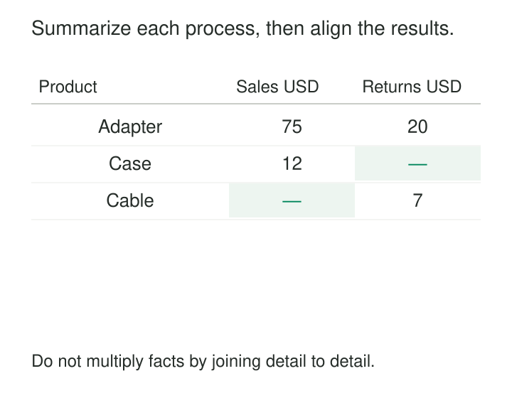

Sales and returns live in separate fact tables. An analyst joins them by product and month to compare activity. The report runs successfully—but its totals are inflated. Each sale has matched several returns, and each return has matched several sales.

[[data-drill-across|Drill Across]] compares separate business processes by summarizing each independently to a common reporting grain, then aligning the resulting answers through conformed dimensions.

It lets sales remain sales and returns remain returns while bringing their measurements into one report.

## Align answers at a common grain

Kimball defines drilling across as querying separate fact tables with identical conformed grouping attributes, then merging the result sets on those attributes. Reporting tools sometimes call this stitching or multipass querying. [Kimball Group: Drilling Across](https://www.kimballgroup.com/data-warehouse-business-intelligence-resources/kimball-techniques/dimensional-modeling-techniques/drilling-across/)

The mechanism has three parts:

1. Choose the shared reporting coordinates, such as month and product.
2. Summarize each process independently at those coordinates.
3. Combine the summaries using the complete common key.

Each summary must contain at most one row per matching key. That turns a potentially many-to-many join between observations into a one-to-one alignment of results.

The stages can run inside one SQL statement, through several database queries, or within a semantic layer. “Multipass” describes the logical separation; it does not require repeatedly transferring raw data to an application.



*The comparison joins shared reporting coordinates. It does not pair individual business events.*

## Compare sales and returns without multiplying them

In the illustrative October dataset shared with [[data-conformed-dimensions|Conformed Dimensions]], Adapter has two sales lines worth 50 and 25 USD, and three return lines worth 10, 5, and 5 USD.

Joining those lines directly by month and product creates six combinations. Summing the joined rows produces 225 USD of sales and 40 USD of returns. The correct amounts are 75 and 20.

This is the fanout problem addressed by Kimball’s multipass SQL guidance: independently create the process summaries, then merge their results. [Kimball Group: Avoiding Fact-to-Fact Joins](https://www.kimballgroup.com/data-warehouse-business-intelligence-resources/kimball-techniques/dimensional-modeling-techniques/multipass-sql/)

With shared month and product keys already resolved, the structure is:

```sql
WITH s AS (
    SELECT month_key, product_key, SUM(amount) AS sales_amount
    FROM sales_input
    GROUP BY month_key, product_key
), r AS (
    SELECT month_key, product_key, SUM(amount) AS return_amount
    FROM returns_input
    GROUP BY month_key, product_key
)
SELECT month_key, product_key, sales_amount, return_amount
FROM s
FULL OUTER JOIN r USING (month_key, product_key);
```

The complete comparison includes Case, which has sales but no return summary, and Cable, which has returns but no sales summary.

Using `SUM(DISTINCT amount)` on the original join is not a reliable repair. Two legitimate transactions can have the same amount; deduplicating their values would discard real activity.

## Make the shared coordinates genuinely shared

Matching column names or integer values is insufficient.

A product key must identify the same product in both summaries. Month must follow the same calendar boundaries and time-zone policy. Region must use compatible membership rules. Historical classifications must follow the report’s intended perspective.

These are conformance requirements: shared dimension attributes provide consistent grouping meanings and domain values across processes. [Kimball Group: Conformed Dimensions](https://www.kimballgroup.com/data-warehouse-business-intelligence-resources/kimball-techniques/dimensional-modeling-techniques/conformed-dimension/)

Local surrogate keys may need mapping before alignment. Human-readable names can also collide or change, so stable canonical keys are generally safer matching coordinates.

The summary grain must match completely. If sales retains month, product, and store while returns retains only month and product, merging on month and product repeats the return total across stores. Aggregate sales to the common grain, or obtain the missing return detail through a justified relationship.

Any dimension joins used while preparing the summaries must also preserve the underlying facts. Summarizing after an accidental dimension fanout merely hides the duplication inside a smaller result.

## Compare actuals with plans at the level plans exist

A second illustrative business records actual sales by day and individual product, but sets targets by month and product category.

For October, Accessories has actual sales of 8,700 USD and a target of 10,000 USD.

Drill Across first summarizes actual sales to month and category. The target query independently returns its one row at that same grain. Aligning the results supports a variance of −1,300 USD.

The target cannot simply be attached to every product or day. Doing so would repeat it.

A request for daily performance or blue-product performance therefore needs a deliberate response. The actuals may support that detail while the target does not. A business-approved allocation could create a finer-grained target, but drilling across does not invent one.

This is why the common grain is a constraint on the report, rather than merely a convenient choice of join columns.

## Preserve absence and distinguish it from zero

The choice of merge determines which coordinates survive.

A full outer join preserves keys found in either process. A left join preserves those found in the chosen primary process. An inner join retains only their intersection.

None is universally correct. A reconciliation report often needs unmatched rows because they reveal missing or exceptional activity. A report explicitly restricted to products sold during the period may intentionally use sales as its population.

An absent return summary does not automatically mean zero returns. It could mean no activity, incomplete ingestion, an excluded partition, or an unresolved product mapping. Convert absence to zero only when coverage supports that interpretation.

Likewise, October sales and October returns describe activity during October. The returns may relate to earlier purchases. Calculating the return rate of October’s sales requires an originating-sale relationship and a defined cohort.

## A documented implementation: Looker merged results

Google Looker provides a concrete implementation of independently querying and aligning results from different Explores.

Its documentation demonstrates merging product counts and inventory-item counts by product category. For Jeans, the separate queries return nine products and sixteen inventory items; the merged report places those measurements together on the matching category row. [Google Cloud: Looker Merged Results](https://docs.cloud.google.com/looker/docs/merged-results)

Its merge semantics matter. Looker’s documented Merged Results feature behaves like a left join: categories appearing only in an added query do not appear unless represented in the primary query.

That is a valid implementation of result alignment, but its preserved population must match the reporting requirement. A comprehensive reconciliation may instead require a shared dimension population or another merge strategy.

The documentation also describes row limits and execution considerations. A merge of truncated source results cannot establish a complete comparison.

## Keep measurement and timing assumptions visible

Correct alignment does not automatically make measurements interchangeable.

Sales amount, shipment value, and cash received describe different events. Cross-process calculations need compatible units, currency, inclusion rules, and sign conventions.

Derived measures also need their underlying components. If comparing rates across larger groups, preserve and combine their numerators and denominators rather than averaging displayed percentages.

Each process should use the intended date role. Order Month, Shipment Month, and Payment Month can share one calendar while answering different questions.

Finally, consider data cutoffs. A current sales summary beside yesterday’s return summary can create an apparent discrepancy. Use compatible cutoffs where possible, and expose the relevant as-of times when sources cannot provide a coordinated snapshot.

## Pay for separate computation and governed integration

Drill Across is useful for sales versus returns, orders versus shipments, actuals versus plans, and other comparisons across processes with different atomic grains.

It avoids manufacturing one enormous fact table solely to put several measures on the same report. Independent summaries can also reduce the amount of data that must be merged.

The costs include separate scans, grouping work, dimension governance, mapping maintenance, and reconciliation. Large reporting grains can still create expensive intermediate results. Frequently reused aggregate fact tables may reduce that work.

Common failures include matching incomplete keys, applying inconsistent filters, losing unmatched rows, and mistaking a shared time period for a shared event population.

[[data-conformed-dimensions|Conformed Dimensions]] supplies the shared coordinates. [[data-declare-the-grain|Declare the Grain]] makes each summary’s uniqueness explicit. [[data-conformed-facts|Conformed Facts]] governs measurements intended to have the same interpretation. [[data-store-additive-components|Store Additive Components]] preserves calculations that remain correct when the aligned results are rolled up further.
