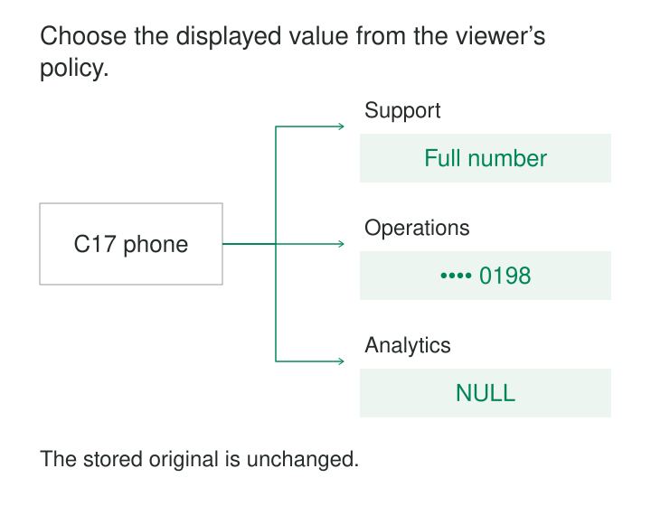

A support agent needs a customer’s phone number to resolve a delivery problem. An operations colleague only needs to confirm its last four digits. A reporting analyst needs neither.

Giving everyone the original exposes unnecessary information. Maintaining separate copies for every audience creates more pipelines, permissions, and refresh work.

**Dynamic Masking applies a policy when data is queried, returning an original, partial, or substituted value according to the caller’s authorized context.** The protected source remains unchanged.

The pattern serves different information needs through controlled representations of shared data.

## Change the returned value at the access boundary

A masking policy connects a protected field, trusted execution context, and a transformation.

The context may include roles, entitlements, or other approved attributes. The transformation might return the original value, a constant, `NULL`, a partial string, or a suitable pseudonymous representation.

Snowflake implements dynamic masking through policies attached to table or view columns and evaluated at query time. Its documentation distinguishes this behavior from modifying stored values. [Snowflake Dynamic Data Masking](https://docs.snowflake.com/en/user-guide/security-column-ddm-intro), [Snowflake column-level security](https://docs.snowflake.com/en/user-guide/security-column-intro)

The caller still needs permission to query the data. Row-level restrictions still determine which records are accessible.

Masking also differs from column denial. A denied column causes an authorization failure; a masked column can remain queryable through a permitted representation.

## Choose what each task needs to preserve

A mask changes the usefulness of the field as well as its visibility.

| Representation | What it preserves | Important consequence |
|---|---|---|
| `NULL` | No usable field value | Changes non-null counts and ordinary joins |
| Shared placeholder | A recognizable display shape | Different originals can become indistinguishable |
| Partial string | Selected characters | Reveals that fragment and may create collisions |
| Deterministic pseudonym | Linkage within its defined scope | Enables correlation and may permit guessing |
| Original | Full information | Requires the appropriate entitlement |

There is no universally best mask. The choice depends on the consumer’s task and the information that task is allowed to reveal.

Keeping a column’s name and type does not preserve its analytical meaning.

## Example: reporting without phone values

Suppose a customer table contains:

| Customer | Stored phone |
|---|---|
| C17 | `202-555-0198` |
| C18 | `202-555-0142` |
| C19 | `NULL` |

A reporting context receives `NULL` for the protected phone field on every accessible row.

The query can still retrieve permitted customer attributes, but a calculation counting non-null phone values now returns zero. That does not mean the source has no phone numbers.

The dataset documentation therefore distinguishes a masked representation from source missingness. A report intended to measure contact-data completeness needs a separately authorized measure or interface with explicitly approved disclosure.

Replacing phone values with one constant creates another problem. Grouping by phone collapses different customers into the same group; joining two tables on that constant can create many false matches.

Full substitution works well when the field is unnecessary to the task. It becomes misleading when consumers continue treating the substitute as business data.

## Example: show enough to recognize a record

An operations workflow displays `***-***-0198` so a colleague can recognize a phone suffix without receiving the whole number.

SQL Server provides configurable partial-string masks that preserve selected prefixes or suffixes and insert padding between them. This is a documented implementation mechanism for such representations. [SQL Server masking functions](https://learn.microsoft.com/en-us/sql/relational-databases/security/dynamic-data-masking?view=sql-server-ver17#overview-of-dynamic-data-masking)

The workflow must not treat the suffix as a unique identifier. Two customers can have numbers ending in `0198`. A partially masked value is also unsuitable for dialing or identity verification merely because it looks familiar.

Formatting needs attention. Short strings, international formats, invalid values, and source nulls should have defined outcomes. Otherwise a mask designed around one expected format may reveal a different amount of information elsewhere.

The fragment itself remains disclosed information. Its usefulness for recognition is precisely why it may also be useful for correlation.

## Example: preserve a permitted join

An analyst needs to connect orders and refunds by customer, but does not need the original customer identifier.

A consistent masked identifier can preserve that relationship. Customer C17 must receive a compatible representation on both sides of the join, under the same masking context.

BigQuery documents a SHA-256 masking rule intended for join use. It also warns that deterministic hashing permits guessing attacks when candidate originals can be enumerated. Hashing an identifier therefore does not automatically make it anonymous. [BigQuery masking rules](https://docs.cloud.google.com/bigquery/docs/column-data-masking-intro#data_masking_rules)

Compatibility requires agreement on source values, types, normalization, transformation, and scope. A join between a clear identifier and its masked form will not match simply because both columns are called `customer_id`.

Before choosing this approach, decide whether cross-dataset linkage is itself permitted. Preserving linkage can expose relationships that a null mask would conceal.

Also verify whether the selected transformation is stable across queries. A representation designed to support one query may be unsuitable as a durable downstream key.

## Understand where the engine applies the mask

“Applied at query time” does not describe identical behavior across platforms.

Snowflake documents applying masking expressions wherever the protected column is referenced, including joins, filters, ordering, and grouping. Consequently, masking can change which results a query produces, beyond the displayed value. [Snowflake query-time behavior](https://docs.snowflake.com/en/user-guide/security-column-intro#masking-policies-at-query-runtime)

Microsoft explicitly warns that SQL Server users with sufficient ad hoc query permissions can infer underlying values despite dynamic masking. Its guidance describes masking as limiting exposure through application queries and reducing accidental disclosure, rather than preventing every inference. [SQL Server masking limitations](https://learn.microsoft.com/en-us/sql/relational-databases/security/dynamic-data-masking?view=sql-server-ver17#security-note-bypassing-masking-using-inference-or-brute-force-techniques)

The intended threat model and actual engine behavior must agree. For stronger separation, column denial, restricted query interfaces, or separately prepared datasets may be more appropriate.

A successful masked display proves only that one display path behaved as expected.

## Test identities and calculations together

Tests should exercise the actual roles, service accounts, views, and applications involved.

Verify clear, partial, and fully substituted results. Include callers with several entitlements, missing context, changed roles, source nulls, malformed values, and values that collide after masking.

Then test representative calculations: counts, distinct counts, joins, filters, grouping, and ordering. A mask can satisfy its visibility requirement while breaking an important report.

Identity propagation is an essential assumption. If every application query runs under one unrestricted service identity, the engine cannot automatically distinguish the end users behind it.

Shared sessions and connection pools also need reliable context handling. A previous request’s role or entitlement must not determine the next request’s representation.

## Follow exports, caches, and derived tables

Dynamic masking leaves the original available in the protected source. Copies need their own assessment.

SQL Server documents that copying or exporting through a caller without unmask privileges can materialize masked values in the destination. That creates a fixed masked copy rather than a dynamically changing representation. [SQL Server copying and exports](https://learn.microsoft.com/en-us/sql/relational-databases/security/dynamic-data-masking?view=sql-server-ver17#best-practices-and-common-use-cases)

Conversely, a privileged export may contain originals. The source policy should not be assumed to govern the resulting file.

Caches must preserve the authorization boundary so that one audience cannot receive another audience’s clear result. Derived tables need explicit expectations about whether they contain originals, substitutes, or approved aggregates.

## Budget for a continuing policy service

Dynamic masking is useful for shared operational and analytical datasets where audiences need different representations of the same fields.

Its costs include policy evaluation, entitlement management, assignment coverage, testing, troubleshooting, and explaining context-dependent results. Complex masking functions and lookups can affect query performance. Platform capabilities and editions also matter; Snowflake requires Enterprise Edition or higher for its dynamic masking feature. [Snowflake availability](https://docs.snowflake.com/en/user-guide/security-column-ddm-intro)

Version policy changes and review their effect on consumers. Changing a mask can change query results without changing the table schema.

The pattern works when identities are trustworthy, policy assignments cover the intended paths, and consumers understand the representation they receive. It cannot compensate for unrestricted access to originals elsewhere.

## Related patterns

[[data-row-and-column-level-access|Row- and Column-Level Access]] establishes record scope and field authorization; masking supplies a permitted field representation.

[[data-policy-as-code|Policy as Code]] makes masking decisions testable, versioned, and traceable.

[[data-stable-logical-interfaces|Stable Logical Interfaces]] provide maintained boundaries whose contracts include context-dependent visibility.

[[data-distinguish-missing-unknown-inapplicable|Distinguish Missing, Unknown, and Inapplicable]] helps prevent masked nulls or placeholders from being misinterpreted as source facts.
