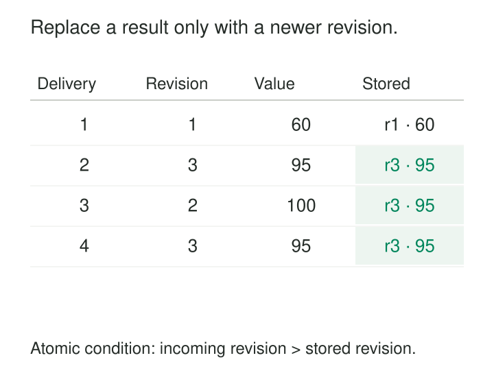

An operations team wants to see purchase activity immediately. Waiting for every delayed event makes the dashboard unhelpful. Publishing the first available total as permanent makes it misleading.

The useful compromise is a result that arrives promptly and can be revised safely.

**Early Results With Corrections publishes provisional answers before all relevant input is expected to arrive, then updates those answers as evidence changes.** It requires both a computation that can revise results and a consumer contract that understands those revisions.

The goal is timely visibility with an explicit path toward a more complete answer.

## Treat a result as something that evolves

A result has an identity independent of its current value.

For a purchase summary, that identity might be store, currency, and event-time interval. New observations can change the amount associated with that identity without creating another business result.

A useful lifecycle distinguishes:

- **Early results**, produced while the interval is still developing.
- **Results at an event-time progress boundary**, when the watermark indicates expected completeness.
- **Subsequent corrections**, accepted while the configured revision policy remains open.
- **Closure**, when the live computation stops accepting further changes under that policy.

Apache Beam directly supports this arrangement through composite triggers: early firings before the watermark passes a window end, a firing at that boundary, and late firings afterward. [Apache Beam trigger documentation](https://beam.apache.org/documentation/programming-guide/#triggers)

These phases describe processing status. A watermark crossing does not establish that every valid fact has arrived, and closure remains relative to the declared policy.



## A provisional total can decrease

Consider an illustrative net-activity summary for store S7, in EUR, for `[10:00, 10:05)`.

A purchase of `60` arrives first. Another purchase contributes `40`. A refund of `5`, timestamped within the same interval, arrives late.

The pipeline publishes:

| Revision | Phase | Complete current total |
|---|---|---:|
| R1 | Early observations | 60 |
| R2 | Initial watermark-based firing | 100 |
| R3 | Accepted late refund | 95 |

All three rows describe the same result identity. The current view should eventually show `95`.

The refund is a new fact about the interval, but R3 is a replacement summary. Adding `60 + 100 + 95` would count earlier evidence repeatedly.

The decrease also matters. A consumer that accepts only increasing values would preserve an incorrect `100`. Corrections can raise or lower totals, change categories, remove rows, or alter membership.

This example assumes the calculation includes valid refunds in net activity, all amounts share a currency, repeated input is handled, and the refund arrives within the live acceptance horizon.

## Choose an update protocol consumers can apply

Several protocols can represent changing results.

| Protocol | Example transition | Consumer responsibility |
|---|---|---|
| Complete replacement | `100 → 95` | Replace the value for the result key |
| Delta | `−5` | Apply the contribution once |
| Retraction and addition | Remove `100`, add `95` | Apply both changes correctly |

Complete replacements are often convenient for dashboards and current-state tables. Deltas can be efficient for additive calculations, but need protection against missing or repeated changes. Retractions support computations where an earlier output must be explicitly removed.

Flink’s dynamic-table model documents both retract streams and upsert streams. Upsert encoding requires a unique key that the consumer understands; retractions explicitly withdraw previous rows. [Apache Flink dynamic-table documentation](https://nightlies.apache.org/flink/flink-docs-release-2.3/docs/concepts/sql-table-concepts/dynamic_tables/)

An append-only log can carry any of these messages, provided its consumers interpret them. Merely appending successive summaries to a table does not produce a correct current view.

Sink capabilities constrain the choice. Spark Structured Streaming distinguishes Update mode, which writes changed aggregate results, from Append mode, which can wait for watermark-based finalization before writing window results. Its documentation notes that some sinks cannot support the required fine-grained updates. [Spark Structured Streaming documentation](https://spark.apache.org/docs/latest/streaming/apis-on-dataframes-and-datasets.html)

## Make repeated and reordered delivery harmless

Suppose a consumer receives the complete replacements in this order:

```text
R1 = 60
R3 = 95
R2 = 100
R3 = 95 again
```

“Last message received wins” leaves the result vulnerable to stale updates. A later retry of R2 could overwrite the corrected answer.

One application-level contract uses an ordered revision per result:

```text
atomically, for the result key:
    if incoming.revision > stored.revision:
        replace value, revision, and status
```

This works because each message contains the complete value for its revision. Receiving R3 before R2 is safe. The same rule would be insufficient for deltas: skipping an earlier delta could lose part of the calculation.

Revision ordering must remain meaningful across retries, recovery, and rebuilds. A counter that resets after deployment can make old results appear newer. Historical rebuilds need an explicit promotion or generation policy so they cannot accidentally overwrite a newer interpretation.

Equal revisions should carry the same payload. Different values under the same revision indicate a broken contract and deserve investigation.

## A provisional rate needs its evidence beside it

A service has processed twenty requests, four of which failed. Its early error rate is `20%`.

More observations arrive. The interval eventually contains one hundred requests and five failures, producing `5%`.

The initial calculation was correct for the evidence available. It was not necessarily representative of the whole interval: failures might arrive faster than successful requests.

A useful display therefore presents the rate with context:

> **20% errors · 20 observed requests · provisional**

The result should preserve numerator and denominator so corrections can update both. Publishing only a percentage makes downstream recombination difficult and can conceal changing sample size.

The same provisional result may need different treatment by different consumers. A dashboard can show it immediately. An automated alert may require sufficient evidence, a sustained condition, or policy closure before acting.

Kafka Streams documents final-result suppression for cases where intermediate window results would cause inappropriate actions, while allowing other branches to receive continuous updates. [Kafka Streams final-window-results documentation](https://kafka.apache.org/41/streams/developer-guide/dsl-api/#windowing)

## Carry corrections through the whole path

Correcting the processor’s internal state is only the first step.

A dashboard cache may continue serving R2. An exported report may retain the first result. A downstream aggregate may add every revision as another contribution. Each boundary must preserve or deliberately resolve the update protocol.

Keys can change too. If accepted late activity merges two sessions, the correction may require removing two earlier session results and publishing one replacement. Updating only the new row leaves superseded results visible.

Closure also needs representation. A final status may need publication even when the numeric value is unchanged. If revisions can later occur through historical restatement, the contract should explain how those updates relate to live closure.

Useful result fields include identity, revision, value, status, computation time, and definition version. Avoid presenting a numerical “percentage complete” unless the system has a defensible way to calculate it.

## Spend latency and revision traffic deliberately

This pattern is useful for operational dashboards, provisional usage summaries, monitoring, and other decisions that benefit from partial information and can accommodate updates.

Frequent early emissions increase computation, writes, network traffic, cache invalidation, and consumer work. Retaining correction state increases storage, checkpoint size, and recovery costs. Material changes may also require explanation to users.

Emission policies can reduce churn: publish periodically, after enough additional observations, or when a meaningful value change occurs. They should still define how status changes and closure become visible.

Partial data must also be interpretable. A fast answer from only the fastest sources can systematically misrepresent a population. Showing provisional status helps communicate uncertainty, but does not repair biased input.

Verification should include downward corrections, repeated delivery, stale revisions, deletions, and convergence against a bounded recomputation over the same accepted input. The consumer-visible answer is the outcome that matters.

## Related patterns

[[data-watermarks|Watermarks]] provides the event-time progress used to distinguish early and later firings.

[[data-allowed-lateness|Allowed Lateness]] bounds the live opportunity for delayed contributions.

[[data-merge-and-upsert|Merge and Upsert]] can materialize complete replacement revisions under stable keys and ordering rules.

[[data-historical-restatement|Historical Restatement]] repairs results after the live correction horizon closes.
