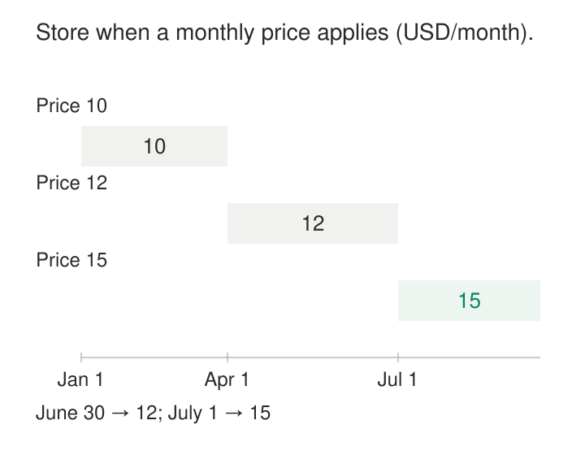

A subscription company enters a new price on June 10, scheduled to begin July 1. Customers should still receive June’s price today, while quoting systems should already be able to answer questions about July.

A single “current price” field cannot represent both states safely. Updating it immediately applies the change too early; waiting until July leaves the future agreement outside the model.

[[data-effective-dated-records|Effective-Dated Records]] attaches a validity period to a value, rule, or relationship. Consumers select the record that applies at the requested business date or time.

Martin Fowler describes this as **Effectivity**: explicitly marking when information is effective and using that period to retrieve the appropriate state. [Martin Fowler: Effectivity](https://martinfowler.com/eaaDev/Effectivity.html)

## A record makes a claim over an interval

An effective-dated record combines three things:

- **Scope:** the entity or relationship being described.
- **Content:** the value, assignment, or rule that applies.
- **Validity:** when that content applies in the business.

For a subscription price, scope might include plan, market, and currency. For a team assignment, it might include team and role.

The dates describe business applicability. They need not match insertion time. A record entered today can apply next month, or correct information about last month.

SAP HANA’s application-time period tables explicitly support this distinction, representing past, present, or future business validity independently of system timestamps. [SAP: Application-time period tables](https://help.sap.com/docs/SAP_HANA_PLATFORM/6b94445c94ae495c83a19646e7c3fd56/2e37d6a82f7b48ccbfcc5a1a6ce490f5.html)

## Example: store a future price without activating it early

Consider this illustrative schedule for one plan in one market, priced in USD per month:

| Monthly price | Valid from | Valid to |
|---:|---|---|
| $10 | January 1, 2026 | April 1, 2026 |
| $12 | April 1, 2026 | July 1, 2026 |
| $15 | July 1, 2026 | Open end |

All three rows can exist on June 10. A lookup for June 30 returns $12; a lookup for July 1 returns $15.



*Illustrative schedule viewed as of June 10, 2026. Interval starts are inclusive and ends are exclusive.*

The consumer asks for an applicable date:

```sql
SELECT monthly_price, currency
FROM plan_price
WHERE plan_id = :plan_id
  AND market = :market
  AND currency = :currency
  AND valid_from <= :as_of_date
  AND (valid_to > :as_of_date OR valid_to IS NULL);
```

An open end means “continues until further notice” under this model’s convention. It does not establish that the row applies now: its start might still be in the future.

Likewise, selecting the row with the greatest start date can accidentally select a scheduled change.

## Make the boundary convention explicit

A practical convention uses **half-open intervals**:

**The start belongs to the interval; the end does not.**

The $12 price applies from April 1 up to July 1. July 1 belongs to the $15 interval.

Adjacent records can therefore share a boundary without applying simultaneously. There is no need to invent a final instant such as 23:59:59.999. IBM Db2’s `BUSINESS_TIME` periods use this inclusive-exclusive convention and require the end to follow the start. [IBM: BUSINESS_TIME periods](https://www.ibm.com/docs/en/db2/12.1.x?topic=tables-business-time-period)

Choose temporal precision deliberately. Calendar dates suit rules defined by business days. Intraday changes require timestamps and an agreed time-zone interpretation. Converting a local business date to an arbitrary UTC midnight can change its meaning.

Use the same boundary convention in queries, imports, validation, and user-facing descriptions.

## Example: date the relationship, not just the person

A team changes its lead on April 1:

| Team | Role | Person | Valid from | Valid to |
|---|---|---|---|---|
| T-7 | Lead | P-17 | January 1 | April 1 |
| T-7 | Lead | P-33 | April 1 | Open end |

The effective-dated object is the **assignment**. Neither person begins or ends their existence at the transition.

If the business permits one lead per team, overlapping lead assignments for T-7 are invalid. The same person might legitimately lead another team simultaneously. Ordinary team membership might also allow several people at once.

Consequently, “no overlaps” must be scoped to the actual business rule. Applying it to person alone, or to every relationship indiscriminately, rejects legitimate arrangements.

Fowler’s employment example makes the same broader point: overlapping relationships can be meaningful when a person holds two employments concurrently. [Martin Fowler: Effectivity](https://martinfowler.com/eaaDev/Effectivity.html)

## Prevent ambiguity without inventing continuity

For a single-valued schedule, enforce at most one applicable record per business scope and instant.

An ordinary unique key on scope plus start date is insufficient. Two records can have different starts and still overlap for weeks.

Prefer database enforcement where available. An application that checks for conflicts and then inserts can race with another writer performing the same check. PostgreSQL documents exclusion constraints that reject overlapping ranges for the same resource. [PostgreSQL: Constraints on ranges](https://www.postgresql.org/docs/18/rangetypes.html#RANGETYPES-CONSTRAINT)

Non-overlap establishes **at most one match**. It does not guarantee a match exists.

A gap can represent a legitimate period of inactivity, an unavailable offering, or missing information. Decide whether continuous coverage is required and validate it separately. Do not silently fill every gap by carrying the previous value forward.

Where overlapping rules are intentional, such as a general rule and a specific exception, define explicit precedence rather than allowing an arbitrary matching row to win.

## Backdated changes reshape the timeline

Suppose the company learns in June that a temporary price should have applied throughout May.

Correcting only one date or appending a row can leave overlapping records. The accepted timeline may need three intervals: the original price before May, the temporary price during May, and the original price afterward.

Apply that restructuring atomically so readers do not encounter a partially edited schedule. Preserve unrelated future changes.

The harder question is what happens to decisions already made from the old timeline. Recomputing an earlier transaction against today’s corrected schedule may produce a different result. Retaining the value or rule version actually used on the transaction can preserve evidence of that decision.

If both “what applies according to our current understanding” and “what we believed when we acted” must remain queryable, add recording history. Fowler’s **Bitemporal History** distinguishes business-effective history from the history of knowledge about it. [Martin Fowler: Bitemporal History](https://martinfowler.com/articles/bitemporal-history.html)

Effective dates alone do not preserve both perspectives.

## A documented implementation: Db2 business-time tables

IBM Db2 provides application-period temporal tables with a declared `BUSINESS_TIME` period.

Its documentation demonstrates product availability scoped by product and supplier. A temporal key permits several suppliers to offer the same product concurrently while preventing one supplier from having overlapping price records for that product. [IBM: Creating an application-period temporal table](https://www.ibm.com/docs/en/db2/11.1.0?topic=aptt-creating)

Db2 also supports updates for a specified portion of business time. When an update affects only part of an existing interval, the database can split records to preserve the unaffected portions. [IBM: UPDATE — FOR PORTION OF BUSINESS_TIME](https://www.ibm.com/docs/en/db2/12.1.x?topic=statements-update)

These are concrete mechanisms for maintaining schedules. The application still supplies authoritative dates, scope, and correction policies.

## Time-aware data creates time-aware responsibilities

The pattern supports scheduled prices, organizational assignments, product availability, eligibility rules, and other information whose applicability changes over time.

Its costs include additional rows, interval-aware queries, overlap enforcement, correction handling, and temporal joins. Suitable indexes matter as histories grow.

A less obvious operating cost is activation. A cache of “current records” can become stale when midnight passes even though no database row changes. Refresh or invalidate it when a scheduled boundary is crossed.

Common mistakes include treating insertion timestamps as effective dates, equating open-ended with current, omitting part of the business scope, and joining historical activity to today’s applicable record.

[[data-version-dimension-rows-scd-type-2|Version Dimension Rows — SCD Type 2]] uses validity intervals to connect facts with dimension versions. [[data-relationships-with-attributes|Relationships with Attributes]] provides a natural home for dated assignments. [[data-calendar-dimensions|Calendar Dimensions]] helps interpret business dates consistently. **Bitemporal Modeling** adds the second timeline required when corrections must preserve what was known before.
