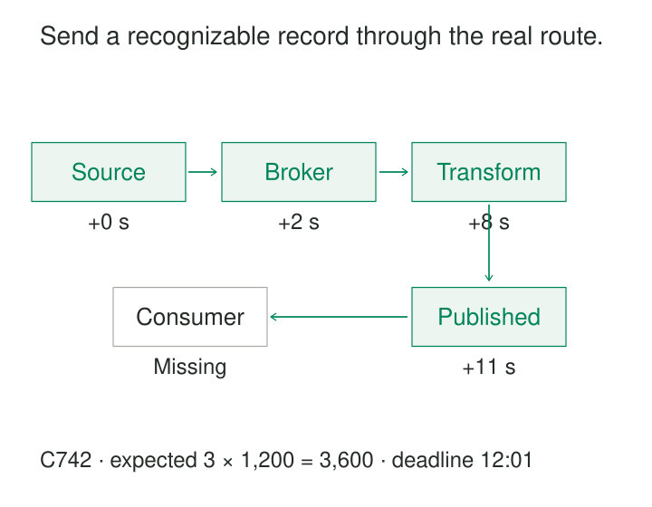

Every component reports healthy. The database accepts writes, the message broker has available capacity, and the transformation job keeps completing. Yet the customer-facing report has stopped changing.

Each component is answering a local question. Nobody has checked whether a new record can complete the journey.

[[data-end-to-end-canary-records|End-to-End Canary Records]] send identifiable synthetic records through a production data path and verify their expected results at the consumer boundary. They provide a continuing test of delivery, timeliness, and selected transformation behavior—even when ordinary business traffic is quiet.

The purpose is to observe an outcome: **can a known input become the correct, visible result within the promised time?**

## Define the journey before sending the record

A useful canary has a specific starting point, destination, expected result, and deadline.

For a database replication pipeline, the journey might begin with a committed source transaction and end with a query against a serving replica. For an analytics product, it might extend through extraction, transformation, publication, and the API used by the dashboard.

The starting point determines the coverage. Injecting directly into a broker bypasses source application writes and extraction. Reading the warehouse primary bypasses downstream replication, caches, and access controls.

Give each probe a unique identity, preserve enough lineage to recognize its derived output, and calculate the expected answer independently. A transformation may change the record’s shape or aggregate it with others, so success need not mean finding an unchanged copy.

Producer acknowledgment is useful evidence. It is only one milestone.

## Give a quiet stream something recognizable to carry

An order-processing stream normally updates a serving table within one minute. During quiet periods, an unchanged table could mean either no orders or a stalled pipeline.

An illustrative canary uses a reserved synthetic tenant:

| Field | Value |
|---|---|
| Probe identity | C742 |
| Quantity | 3 |
| Unit price | 1,200 minor currency units |
| Expected derived amount | 3,600 minor currency units |

The injector submits the record through the normal write interface. The checker queries the normal serving interface until it finds the expected result or the deadline expires.

Checking the value matters. Finding `C742` with an amount of `36` would demonstrate delivery while exposing a unit-conversion error. Checking only the maximum arrival timestamp would miss it.

LinkedIn documented a production implementation of this general mechanism in its [2016 introduction of Kafka Monitor](https://www.linkedin.com/blog/engineering/open-source/open-sourcing-kafka-monitor). Producers embedded sequence numbers and timestamps; consumers measured message loss, duplication, and end-to-end latency. LinkedIn also described monitoring mirrored paths across Kafka clusters.

That implementation illustrates an important boundary: a Kafka produce-and-consume probe measures the messaging path it traverses. Extending the assertion to a transformed serving result requires additional observation.

## Exercise changes, not just inserts

A change-data-capture pipeline can deliver inserts correctly while mishandling updates or deletions.

A lifecycle canary creates a synthetic entity, changes a recognizable attribute, and deletes it:

| Operation | Expected downstream observation |
|---|---|
| Insert version 1 | Entity appears with version 1 |
| Update to version 2 | Updated value becomes visible |
| Delete | Entity disappears, or receives the contractually required deletion state |

Verify each stage before advancing when the target is a current-state table. Sending all three operations immediately can make a correct pipeline appear to have missed the insert because the checker first reads after deletion.

Use a fresh identity for each lifecycle. Reusing one permanent identifier can hide stale results and repeatedly exercise the same partition.

Connector heartbeats provide narrower evidence. The [Debezium PostgreSQL documentation](https://debezium.io/documentation/reference/stable/connectors/postgresql.html) describes heartbeat messages and source-side heartbeat queries, including their role in advancing acknowledged log positions during low activity. Those mechanisms are useful, but their existence does not establish that an application’s transformed output is visible to its consumer. A lifecycle canary must explicitly observe that destination.

## Follow publication through the consumer read

A warehouse can publish a correct new table while a dashboard continues reading an old replica or cached result.

For an hourly report, include a new probe in the eligible input period and define when that report should expose its result. The checker reads through the report’s normal access path and verifies the probe identity, derived value, and relevant release information.

In the illustration, `C742` reaches the published store at 12:00:11. It remains missing through the consumer interface at 12:01:00. The journey has missed its deadline, even though upstream milestones passed.

Use credentials and request behavior representative of the intended consumer class. An administrator querying the primary directly may succeed while ordinary readers remain blocked by permissions or stale routing.

[Amazon CloudWatch Synthetics](https://docs.aws.amazon.com/AmazonCloudWatch/latest/monitoring/CloudWatch_Synthetics_Canaries.html) provides scheduled scripts that exercise endpoints and APIs through customer-like routes. Such a framework can host the consumer check; the application still needs to implement probe injection, correlation, expected-result assertions, and deadlines.

For scheduled batches, measure against the appropriate publication deadline. A record submitted just after the extraction cutoff should not be judged against the batch it was never eligible to enter.

## Preserve the path without polluting the business

Canaries must remain recognizable without becoming ordinary business activity.

A reserved synthetic tenant or explicit provenance field can keep their results separate from customer totals. Carry that distinction through joins, aggregations, exports, and downstream consumers. Exclusion should be deliberate and tested.

At the same time, routing canaries into a special fast path weakens the signal. A dedicated test topic may share brokers while bypassing the actual transformation, permissions, and publication workflow.

Choose the boundary consciously. A synthetic tenant processed by shared production logic offers useful coverage, but it may still exercise different routing or configuration from another tenant.

Prevent unintended external effects such as charges, shipments, or customer notifications. Recognize synthetic identities through controlled configuration rather than an unrestricted caller-supplied flag.

Retain enough probe history for diagnosis. Cleanup should occur after the observation and investigation period, and should preserve the monitoring verdict. An expired record must not erase evidence that it arrived late.

## Track missing probes individually

A monitor that records only “last successful canary time” can conceal gaps. A recent success might hide several missing probes on another route.

Maintain an expectation ledger that distinguishes scheduled probes, injection outcomes, confirmed acceptance, observations, and deadlines. If a write times out ambiguously, retain that uncertainty and retry with the same logical identity where the write contract supports it.

Useful outcomes include:

- Correct result observed within the deadline.
- Result observed with incorrect content or multiplicity.
- Accepted probe not observed by the deadline.
- Injection failed or acceptance remains unknown.
- Checker unavailable or probes no longer being scheduled.

An overdue probe establishes a deadline failure; it does not immediately establish permanent data loss. Preserve late arrivals as late successes without rewriting the original timeliness verdict.

Monitor the injector and checker themselves. Silence from a stopped probe generator must not leave the dashboard green.

Use a consistent observation clock for elapsed time where possible. Comparing timestamps from different machines requires accounting for clock differences.

## Cover the routes that can fail independently

One successful canary demonstrates that one payload completed one route. It cannot establish that all partitions, schemas, regions, tenants, or business records are healthy.

Rotate probes across meaningful routing dimensions, and report those dimensions separately. Add payload variants when particular transformations matter. Keep individual probe identifiers in logs or the expectation ledger rather than creating an unbounded monitoring time series for every record.

A later canary also does not prove that every earlier business record arrived. That inference requires ordering and completeness guarantees the pipeline may not provide.

The recurring costs include writes, storage, polling queries, cleanup, and maintenance of expected outcomes. Frequent probes improve detection time but can create disproportionate query costs. Detection delay includes the wait until the next probe, its allowed delivery time, and the checker’s polling interval.

This pattern is especially useful for quiet pipelines, asynchronous chains, and products whose internal health metrics do not reveal consumer visibility. It complements production reconciliation and quality checks rather than replacing them.

[[data-freshness-monitoring|Freshness Monitoring]] measures whether useful data remains timely. [[data-source-to-target-reconciliation|Source-to-Target Reconciliation]] checks broader completeness and agreement. [[data-run-ledgers|Run Ledgers]] preserve probe expectations and outcomes. [[data-publication-quality-gates|Publication Quality Gates]] can use canary evidence when the probe genuinely covers the candidate release and its required consumer path.
