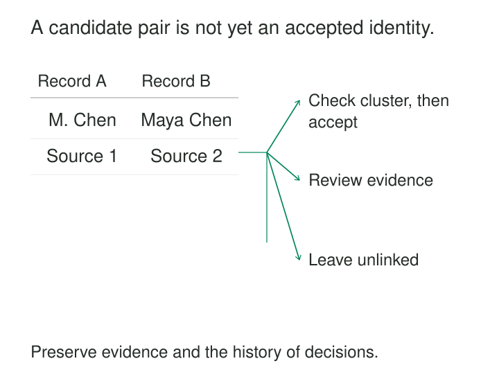

“Maya Chen” appears in the CRM. “Maia Chen” appears in the webshop. Their dates of birth agree, their addresses use different abbreviations, and neither record carries an identifier recognized by the other system.

They might describe one person. A similar name and shared address might also belong to different people.

Entity Resolution determines which records refer to the same real-world entity when reliable shared identifiers are absent or incomplete. It supports deduplication, migration, integrated reporting, and search. Its task is to turn imperfect evidence into explicit, reviewable identity decisions.

## Decide what “the same” means first

An entity might be a person, household, organization, account, product, or physical asset. These boundaries matter. Two people sharing a household are related; two accounts held by one person remain separate accounts.

Entity resolution can identify duplicates within one dataset or link records across datasets. It produces accepted links, unresolved candidates, or groups of records believed to describe one entity.

Choosing the best address or preferred name is a separate task. Resolution establishes which records belong together; attribute reconciliation decides how their differing values should be represented.

An **Identity Crosswalk** can preserve the accepted mappings. Entity resolution supplies the decisions that populate it.

## Find plausible pairs before weighing them

Comparing every record with every other record becomes expensive quickly. A million records contain almost half a trillion distinct pairs.

Most systems therefore generate a smaller candidate set through **blocking**: comparing records that share selected features, such as a postcode, birth year, or normalized name fragment. Several passes can find candidates through different routes.

Blocking is a retrieval step. Sharing a blocking value does not establish a match. Conversely, a true pair excluded by every blocking rule never reaches the scoring stage. Splink’s documentation explicitly describes this tradeoff between comparison volume and missed links. [Splink: Blocking](https://moj-analytical-services.github.io/splink/demos/tutorials/03_Blocking.html)

Candidate records then receive field-level comparisons: exact agreement, partial agreement, disagreement, or missing information.

Deterministic rules can accept combinations known to be reliable. Probabilistic methods weigh how likely an agreement pattern is among matching records compared with unrelated records. A rare matching value can carry more evidence than a common one; Splink supports term-frequency adjustments for this purpose. [Splink: Term-Frequency Adjustments](https://moj-analytical-services.github.io/splink/topic_guides/comparisons/term-frequency.html)

Decisions usually need room for uncertainty: accept sufficiently supported links, decline insufficiently supported links, and review or defer ambiguous cases. The boundaries depend on validated performance and the consequences of each error.

## Example: a typo is evidence to investigate

Consider these illustrative person records:

| Source record | Name | Birth date | Address |
|---|---|---|---|
| `crm:17` | Maya Chen | 1990-04-12 | 12 Oak Rd, Apt 1 |
| `shop:882` | Maia Chen | 1990-04-12 | 12 Oak Road, Apt 1 |
| `crm:43` | Maya Chen | 1988-11-03 | 12 Oak Rd, Apt 2 |

Normalizing “Road” and “Rd” makes the first two addresses comparable. Their birth dates agree, and the names differ slightly. These observations support a candidate link.

The third record shares a name and building, but its apartment and birth date differ. A name-only rule would miss those distinctions.

The outcome still depends on source reliability. A mistyped birth date is possible; an address can be shared or outdated. The fields do not independently prove identity.

An authoritative historical reference could settle the first pair. Without further evidence, the system may retain it for review. Two missing email addresses would add no positive agreement.

Normalization should preserve original values and meaningful distinctions. Removing apartment numbers might increase apparent agreement while making person-level resolution worse.

## Example: plausible pairs can create an impossible cluster

A product catalog contains:

| Record | Description | Power |
|---|---|---:|
| A | White USB-C charger | 20 W |
| B | White USB-C charger | Unknown |
| C | White USB-C charger | 30 W |

The entity being resolved is a saleable product variant, and power is a distinguishing specification.

A resembles B. B resembles C. If both pairs are accepted and all connected records are grouped together, A and C enter the same cluster despite their conflicting specifications.

The missing value in B provides no basis for choosing either variant. It should not silently bridge them.

This is a general clustering problem: pairwise similarity does not guarantee that the resulting group is coherent. Systems need checks appropriate to the entity, such as incompatible identifiers, conflicting specifications, or implausible cluster growth.

Where the task requires one-to-one matching, independently accepting each record’s highest-scoring partner is also insufficient. Competing matches need resolution under the overall relationship constraints.

## A documented implementation: Census 2021 linkage

The Office for National Statistics linked England and Wales Census 2021 records to the independently collected Census Coverage Survey.

Its published account describes a combination of deterministic rules, probabilistic linkage, machine-learning-assisted candidate retrieval, and clerical review. Conflicting candidates and difficult cases entered a dedicated review system rather than being resolved solely by their highest score.

The project also sampled accepted and unmatched records to estimate false links and missed links. ONS reported estimated person-linkage precision and recall of approximately **99.96%** for that project. A team of 50 clerical matchers supported the work. [ONS: Linkage Methods for Census 2021](https://www.ons.gov.uk/peoplepopulationandmigration/populationestimates/methodologies/linkagemethodsforcensus2021inenglandandwales)

The example illustrates a complete operating process: candidate generation, scoring, conflict resolution, review, and evaluation. The measured result belongs to that dataset and workflow.

## The assumptions behind a credible result

Records need comparable meanings and time contexts. A current address and an address from ten years earlier can disagree while describing the same person. A business identifier must be interpreted within its namespace and assignment history.

The data must also contain enough distinguishing evidence. Some cases are underdetermined: no algorithm can recover a distinction absent from the available records.

Statistical assumptions require attention. The classic Fellegi–Sunter model commonly assumes comparison outcomes are independent conditional on match status. Correlated comparisons, such as city and postcode, can count overlapping evidence too strongly when modeled independently. [U.S. Census Bureau: Record-Linkage Modeling](https://www2.census.gov/library/working-papers/2025/adrm/csrm/RRS2025-04.pdf)

A score displayed as a probability needs validation against observed outcomes. String similarity alone does not establish a probability of shared identity.

Finally, validation data must represent the sources and difficult cases the system will encounter. Review only the easiest accepted matches and the evaluation will overlook important errors.

## Balance false merges, missed matches, and operating cost

A **false link** combines different entities. A **missed link** leaves records of one entity disconnected. Their costs vary by application, so one threshold cannot serve every purpose.

Precision measures how many accepted links are correct. Recall measures how many true links were found. Match rate measures coverage, not correctness; ONS explicitly cautions against treating it as a linkage-quality measure. [ONS: Data Linkage and Matching Policy](https://www.ons.gov.uk/aboutus/transparencyandgovernance/datastrategy/datapolicies/datalinkageandmatchingpolicy)

Operating costs include standardization, candidate generation, model estimation, review queues, evaluation samples, and correction work. Permissive blocking can explode comparison volume; strict blocking can conceal missed links.

Published outputs also need stable identity management. Recomputing clusters should not arbitrarily renumber every entity downstream. Preserve source references, evidence, model and rule versions, review decisions, and enough lineage to reverse incorrect merges.

Human review adds cost and judgment, rather than certainty. Reviewers need clear entity definitions, access to relevant evidence, and quality checks.

## Where the pattern helps—and stops

Entity resolution helps when identifiers are fragmented and several imperfect attributes provide useful evidence. Where trustworthy shared identifiers already exist, a validated direct join is usually simpler.

Common mistakes include treating fuzzy name matching as the whole solution, counting missing values as agreements, ignoring identifier reuse, evaluating only pair scores, and deleting source records after a merge.

Quality can deteriorate as source completeness or naming conventions change. Monitor candidate volumes, unresolved cases, error estimates, and cluster structure. A larger number of matches may reflect a weaker decision rule rather than better resolution.

## Related patterns

[[data-identity-crosswalks|Identity Crosswalks]] preserves accepted mappings for reuse.

**Namespace Identifiers** gives source identifiers their assigning scope.

[[data-declare-the-grain|Declare the Grain]] establishes which entity is being resolved.

[[data-separate-source-facts-from-derived-interpretations|Separate Source Facts from Derived Interpretations]] keeps original records distinct from revisable identity claims.
