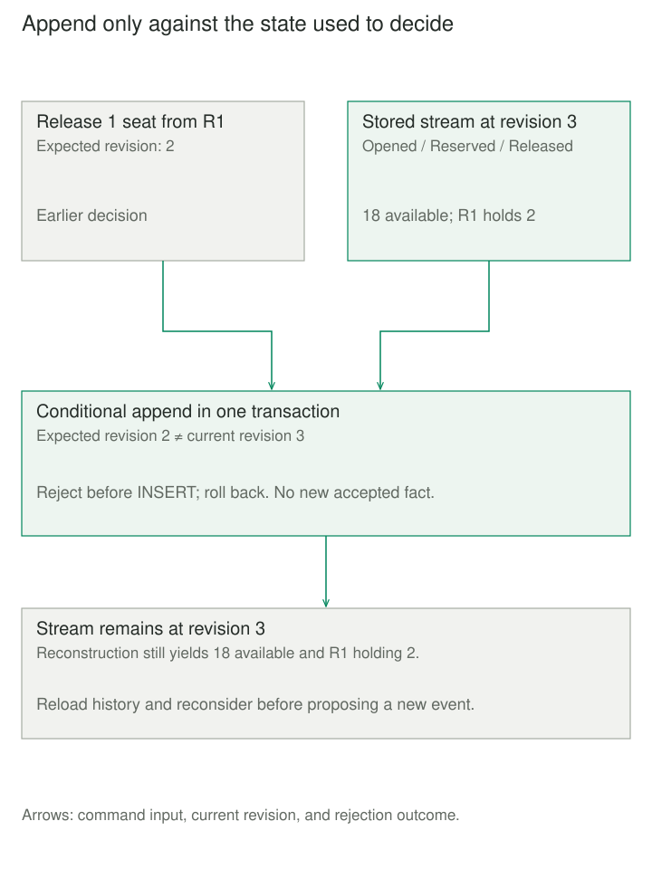

## Purpose and problem

A booking system says eighteen seats remain. Yesterday it showed seventeen. A customer asks why their reservation changed, but the database contains only the latest quantities. An audit table might explain edits, yet it leaves operational state and history as two representations to reconcile.

The application needs current availability and a dependable account of accepted changes. It may also need to reconstruct an earlier state or build a new view without inventing missing history. Recording messages beside an independently authoritative state table does not solve that problem by itself.

## Core idea

**Keep the accepted facts; derive the state.** Event Sourcing makes an ordered history sufficient to reconstruct the modeled application state. Current objects and query views are interpretations of that record.

A command requests **reserve three seats**. An event records **three seats were reserved for R1**. Rejected requests add no accepted event. Replay applies recorded outcomes; it does not resubmit old requests against today's policies.

Event-sourced persistence is descriptive shorthand. Event-driven messaging and an audit log do not necessarily make events authoritative. CQRS separates command and query models; Event Sourcing chooses how state is recorded. Either can exist without the other.


## How it works

### Decide, append, then acknowledge

A command handler loads a stream, reconstructs state, and checks the proposed action. It conditionally appends accepted events against the revision used for that decision. The append and revision check must be atomic; otherwise two valid-looking reservations can overbook one pool. A conflict requires reloading and reconsidering the command, not blindly resubmitting a stale event.

Each stream needs identity, ordered positions, event types, compatible schema versions, and sufficient business data. Timestamps provide context, but alone do not establish order. A stream's concurrency boundary does not enforce rules spanning independent streams. Successful acknowledgment must have a defined persistence boundary.

### Reconstruct without repeating effects

Replay needs compatible, deterministic interpretation: no current clock, random choice, or uncontrolled external lookup. Capture necessary outcomes or versioned inputs. Rebuilding availability must not send yesterday's confirmations again. Live delivery and command retries need their own deduplication; event history alone supplies neither.

Projections make queries convenient. Asynchronous ones can lag and need repeat-safe updates, checkpoints, and recovery. Snapshots shorten replay by retaining state at a known position; they remain replaceable optimizations. A daily analytical snapshot serves a different purpose.



## Worked example

### Twenty seats, three accepted facts

The stream first records twenty seats, then reserves three for R1: replay at revision two yields seventeen available. Releasing one of R1’s seats adds a third fact. An additional release using the old revision is rejected; reopening and replaying yields eighteen available and two still held by R1.

Follow the expected-revision check in `execute` and state reconstruction in `replay`; the database setup supports that ordered record.

Save `event_store.py` and `demo.py` together; run `python3 demo.py` with Python 3.11+. This bounded SQLite example retains the reservation identity needed to validate releases. Quantities are whole physical seats, 1–1000; pool and reservation IDs use 1–64 ASCII letters, digits, underscores, or hyphens.

The caller owns a dedicated, initially idle connection and closes it. `BEGIN IMMEDIATE` serializes SQLite writers before the revision check. The context commits or rolls back, and the function returns only after commit. This implementation is intentionally small: full replay on each command, one event per append, and fixed version-one interpretation.

```python
import re
import sqlite3


class Conflict(Exception):
    pass


def identifier(value):
    if not isinstance(value, str) or not re.fullmatch(r"[A-Za-z0-9_-]{1,64}", value):
        raise ValueError("Invalid identifier")
    return value


def connect(path):
    db = sqlite3.connect(path, isolation_level=None, timeout=5)
    try:
        db.execute("""CREATE TABLE IF NOT EXISTS events (
            pool TEXT NOT NULL, revision INTEGER NOT NULL CHECK (revision > 0),
            kind TEXT NOT NULL, schema INTEGER NOT NULL,
            quantity INTEGER NOT NULL, reservation TEXT NOT NULL,
            PRIMARY KEY (pool, revision)
        )""")
        for verb in ("UPDATE", "DELETE"):
            db.execute(f"""CREATE TRIGGER IF NOT EXISTS no_{verb}
                BEFORE {verb} ON events BEGIN
                SELECT RAISE(ABORT, 'Append only'); END""")
    except BaseException:
        db.close()
        raise
    return db


def history(db, pool):
    return db.execute("""SELECT revision, kind, schema, quantity, reservation
        FROM events WHERE pool=? ORDER BY revision""", (identifier(pool),)).fetchall()


def replay(events):
    capacity, held = 0, {}
    for position, (revision, kind, schema, quantity, reservation) in enumerate(events, 1):
        if revision != position or schema != 1:
            raise ValueError("Unsupported history")
        if type(quantity) is not int or not 1 <= quantity <= 1000:
            raise ValueError("Invalid quantity")
        if kind == "Opened" and position == 1 and reservation == "":
            capacity = quantity
        elif capacity and kind in ("Reserved", "Released"):
            identifier(reservation)
            before = held.get(reservation, 0)
            after = before + (quantity if kind == "Reserved" else -quantity)
            if after < 0:
                raise ValueError("Release exceeds reservation")
            held[reservation] = after
        else:
            raise ValueError("Invalid event sequence")
        if sum(held.values()) > capacity:
            raise ValueError("Insufficient seats")
    return capacity, held


def execute(db, pool, expected, action, quantity, reservation=""):
    pool = identifier(pool)
    if type(expected) is not int or expected < 0:
        raise ValueError("Invalid expected revision")
    kinds = {"open": "Opened", "reserve": "Reserved", "release": "Released"}
    if action not in kinds:
        raise ValueError("Unknown action")
    db.execute("BEGIN IMMEDIATE")
    with db:
        events = history(db, pool)
        if len(events) != expected:
            raise Conflict("Stream changed; reload and reconsider")
        event = (expected + 1, kinds[action], 1, quantity, reservation)
        replay([*events, event])  # Fixed v1 semantics validate the proposed fact.
        db.execute("INSERT INTO events VALUES (?, ?, ?, ?, ?, ?)", (pool, *event))
    return expected + 1
```

The initial state exists only as events. The demo reconstructs position two, appends a release, rejects a stale proposal, closes the connection, and rebuilds from disk:

```python
from contextlib import closing
from pathlib import Path
from tempfile import TemporaryDirectory
from event_store import connect, execute, history, replay, Conflict


with TemporaryDirectory() as directory:
    path = Path(directory) / "events.sqlite"
    with closing(connect(path)) as db:
        execute(db, "POOL-1", 0, "open", 20)
        execute(db, "POOL-1", 1, "reserve", 3, "R1")
        capacity, held = replay(history(db, "POOL-1"))
        print("revision 2 available:", capacity - sum(held.values()))
        execute(db, "POOL-1", 2, "release", 1, "R1")
        try:
            execute(db, "POOL-1", 2, "release", 1, "R1")
        except Conflict:
            print("stale append rejected")
    with closing(connect(path)) as db:
        events = history(db, "POOL-1")
        capacity, held = replay(events)
        print("reopened:", len(events), capacity - sum(held.values()), held["R1"])
```

Output is `revision 2 available: 17`, `stale append rejected`, and `reopened: 3 18 2`: revision three, eighteen seats available, two held by R1. Replay performs no I/O. Unknown schemas and broken sequences fail visibly rather than silently skipping facts.

The triggers prevent accidental updates/deletes, not administrator tampering. Production authentication, backups, schema migration, request deduplication, notifications, snapshots, and asynchronous projections are outside this example. For example, retrying a reserve with a newly read revision can reserve again.

## When to use it

Use Event Sourcing when explaining accepted changes, reconstructing earlier states, or rebuilding new interpretations is central enough to justify long-term history ownership. It fits selected boundaries, not necessarily an entire application.

For simple current-state CRUD, an ordinary database plus an adequate audit trail is often sufficient. Publishing events for integration does not require changing persistence strategy.

## Tradeoffs and common mistakes

History creates a lasting compatibility obligation. Preserve old event meaning through version-aware handlers or upcasters; changing today's command policy must not rewrite yesterday's accepted facts. Append explicit corrections or releases. Rebuilding cannot undo an email already sent.

Storage, replay time, projection lag, backup restoration, and access control need operating plans. Minimize sensitive event payloads and design retention deliberately. Append-only behavior is an application contract, not proof of tamper resistance or unlimited retention suitability.

A stream records only facts captured by its application. Reconstructing an earlier report also needs the interpretation and reference data used then. Historical positions and business-effective time answer different questions.

## Related patterns

- [[cqrs|CQRS]] separates command and query models; Event Sourcing supplies a possible authoritative history for them.
- [[domain-event|Domain Event]] names a business occurrence without requiring its use as authoritative persistence.
- [[optimistic-offline-lock|Optimistic Offline Lock]] checks an earlier observation before saving; expected-revision appends apply a related concurrency principle to event streams.
- [[data-bitemporal-records|Bitemporal Records]] distinguishes effective time from recorded time. Stream revision alone does not provide both perspectives.

## Sources

- [Fowler: Event Sourcing](https://martinfowler.com/eaaDev/EventSourcing.html) establishes reconstruction from events and discusses external interactions and changing interpretations.
- [Microsoft: Event Sourcing](https://learn.microsoft.com/en-us/azure/architecture/patterns/event-sourcing) covers authoritative streams, concurrency, projections, schema evolution, and operating costs.
- [EventSourcingDB: Writing Events](https://docs.eventsourcingdb.io/getting-started/writing-events/) demonstrates transactional writes and conditional appends with a library-book example.
- [Axon: Snapshots](https://docs.axoniq.io/axon-framework-reference/development/snapshotting/) describes reconstruction checkpoints as a performance aid.
- [SQLite: Transactions](https://www.sqlite.org/lang_transaction.html) and [Python: sqlite3](https://docs.python.org/3/library/sqlite3.html) document this example's transaction and connection behavior.

The seat-pool scenario, executable code, and illustrations are original teaching material.
