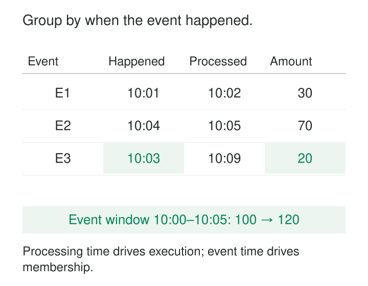

A customer buys something at 23:58 while their phone is offline. The purchase reaches the platform at 00:07.

A pipeline that groups purchases by arrival time puts it into the following day. A replay next week might put it into another reporting period entirely. The purchase has stayed the same; the machinery’s timing has changed.

**Event-Time Processing evaluates records according to the time their relevant business event occurred.** It keeps window membership, temporal relationships, and historical analysis anchored to the event while making explicit decisions about delayed and out-of-order arrivals.

The challenge is deciding how long to wait, when to publish, and what to do when another piece of the past arrives.

## Give each timestamp a clear job

A record can carry several useful times:

| Timestamp | What it describes |
|---|---|
| Event time | When the chosen business occurrence happened |
| Ingestion time | When a receiving system accepted the record |
| Processing time | When a particular operator processed it |

These are different observations. An ingestion timestamp can help diagnose transport delays. Processing time can drive operational timers. Event time determines which business interval the record belongs to.

The event timestamp itself needs a definition. An order can have placement, payment, shipment, and cancellation times. A sales analysis and a fulfillment analysis may correctly use different ones.

Event time is also a claim supplied by a source. Its usefulness depends on clock quality, timestamp precision, timezone interpretation, and whether the producer recorded the intended occurrence.

## Separate membership, progress, and publication

Three mechanisms work together.

**Window assignment determines where a record belongs.** A five-minute window might cover `[10:00, 10:05)`: it includes 10:00 and excludes 10:05.

**Watermarks describe progress through event time.** They signal that earlier timestamps are expected to be sufficiently complete for an operator to move forward. Flink explicitly allows records to arrive behind a watermark, so a watermark should be understood together with the source assumptions and late-data policy. [Apache Flink event-time documentation](https://nightlies.apache.org/flink/flink-docs-stable/docs/concepts/time/)

**Triggers determine when results are emitted.** A system can publish provisional results quickly, publish when the watermark passes a window boundary, and issue further results for accepted late data. Apache Beam documents these as separate choices that balance completeness, latency, and cost. [Apache Beam model basics](https://beam.apache.org/documentation/basics/)

Assigning event timestamps does not automatically sort the entire stream. Operators use timestamps and retained state to perform particular computations despite arrival disorder.

## A delayed purchase changes an earlier result

Consider three illustrative purchases, with all times in UTC:

| Event | Event time | Processing time | Amount |
|---|---|---|---:|
| E1 | 10:01 | 10:02 | 30 |
| E2 | 10:04 | 10:05 | 70 |
| E3 | 10:03 | 10:09 | 20 |

All three belong to the event-time window `[10:00, 10:05)`. E3 arrives last but belongs between the other two in event time.

Suppose the pipeline publishes `100` after the watermark passes the window’s end. E3 then arrives while the configured policy still retains that window and accepts updates. The revised total becomes `120`.

Beam’s windowing model supports allowed lateness and triggers for late results. Retaining a window gives the pipeline an opportunity to incorporate delayed records; the trigger and accumulation settings determine what it emits. [Apache Beam programming guide](https://beam.apache.org/documentation/programming-guide/)

The output contract matters as much as the calculation. A revised total of `120` should replace the previous total under the same window key, or be represented through an explicit change protocol. Adding both totals produces `220`. A delta-based contract would instead emit the additional `20`.

Once the window’s state has been retired, another delayed event needs a defined route: a correction workflow, historical rebuild, quarantine, or documented exclusion. Moving it into the current window would change its meaning.

## Late activity can merge sessions

Event-time processing can change grouping boundaries, not just totals.

Suppose a visitor generates activity at 09:00 and 09:40. With a thirty-minute inactivity gap, the observed activity forms two sessions.

A delayed event timestamped 09:20 then arrives. It sits twenty minutes from each neighboring event, connecting them into one session—provided the relevant state and late-data policy still permit the merge.

Flink documents both event-time session windows and the possibility that late events bridge previously separate windows. [Apache Flink window documentation](https://nightlies.apache.org/flink/flink-docs-stable/docs/dev/datastream/operators/windows/)

A downstream session table must therefore support more than incrementing a counter. It may need to replace earlier session records, revise identifiers or boundaries, and correct aggregates built from them. An append-only sink containing every emitted session result can overcount unless consumers understand those revisions.

## Join an event to the history it belongs to

A product costs `100` until 12:00 and `120` afterward. A purchase occurs at 11:58 but arrives at 12:07.

A lookup against the current price returns `120`. An event-time temporal join selects the version effective at 11:58 and returns `100`.

This requires retained price history, an unambiguous product key, and timestamps that represent the intended effective changes. Attaching an event timestamp to the purchase cannot reconstruct missing reference history.

Flink provides event-time temporal joins against versioned tables and documents an order-to-currency-rate example. Its implementation depends on correctly configured watermarks on both inputs and a matching key for the versioned table. Completed temporal-join results are not automatically revised by subsequent reference changes. [Apache Flink temporal-join documentation](https://nightlies.apache.org/flink/flink-docs-release-2.3/docs/sql/reference/queries/joins/)

A later correction to an old price therefore needs an explicit restatement policy.

## Make lateness an operating decision

Lateness is measured against event-time progress, not simply the number of wall-clock minutes since an event occurred.

In Flink’s window model, allowed lateness extends retention beyond the window end. A five-minute window ending at 10:05 with ten minutes of allowed lateness can retain state until event-time progress passes roughly 10:15. That progress may move slowly during an outage or rapidly during replay. [Apache Flink window documentation](https://nightlies.apache.org/flink/flink-docs-stable/docs/dev/datastream/operators/windows/)

Framework settings also differ. Spark documents a one-sided watermark-delay guarantee for supported aggregations: sufficiently recent data is protected from being dropped, while older data may or may not still be processed. A delay threshold is not a universal promise that every older record disappears immediately. [Spark Structured Streaming guide](https://spark.apache.org/docs/latest/streaming/apis-on-dataframes-and-datasets.html)

Choose policies from observed source behavior and the consequences of incomplete results. A live dashboard may tolerate provisional numbers. A settled report may require a correction path after streaming state expires.

## Account for clocks, quiet partitions, and state

Common failures begin with timestamps. A device clock set far into the future can distort a watermark strategy based on maximum observed event time. Invalid timestamps need explicit handling; silently replacing them with processing time changes the analytical contract.

Progress across partitions also matters. Flink combines parallel watermarks conservatively, so a quiet input can hold back downstream progress. Its idleness handling can exclude inactive inputs from that calculation, while watermark alignment can restrain fast inputs to reduce excessive buffering. Neither mechanism proves that a quiet source has delivered everything. [Apache Flink watermark-generation documentation](https://nightlies.apache.org/flink/flink-docs-stable/docs/dev/datastream/event-time/generating_watermarks/)

Longer retention increases state size, checkpoint storage, recovery time, and update traffic. Shorter retention produces earlier closure at the cost of more exclusions or historical corrections.

Event-time processing also leaves other correctness problems intact. Duplicate delivery still needs deduplication. Equal timestamps may need sequence information. Reproducible replay still depends on inputs, reference history, code, and consistent acceptance rules.

Use this pattern when the business question depends on when events happened: activity sessions, usage intervals, operational measurements, or historical enrichment. Processing-time calculations remain useful when the question concerns the operation of the pipeline itself.

## Related patterns

[[data-half-open-time-intervals|Half-Open Time Intervals]] makes window membership precise at boundaries.

[[data-as-of-joins|As-of Joins]] selects the historical reference version applicable to an event.

[[data-deduplicate-explicit-winner|Deduplicate with an Explicit Winner]] handles repeated or conflicting records that timestamps alone cannot resolve.

[[data-historical-restatement|Historical Restatement]] repairs results when valid corrections arrive beyond the streaming retention horizon.
