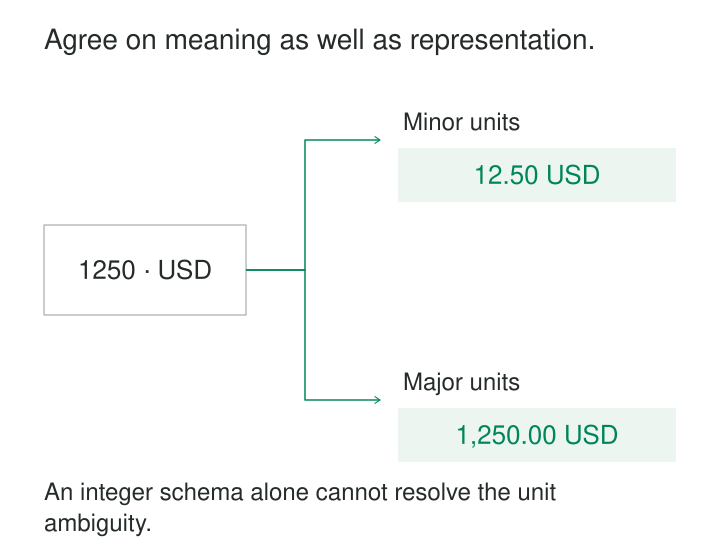

A producer changes an amount from cents to dollars. The column remains an integer, the schema check passes, and every downstream total becomes wrong.

Elsewhere, an order table quietly changes from one row per order line to one row per shipment. Queries still run, but split shipments now multiply joins and distort counts.

The interfaces remained readable. Their meaning changed.

[[data-explicit-data-contracts|Explicit Data Contracts]] make the agreement between data producers and consumers visible, versioned, and testable. They describe the data’s structure, meaning, behavior, and operational expectations—and identify who maintains those promises.

The purpose is to let producers evolve their systems while giving consumers a dependable basis for using the resulting data.

## Describe what consumers may rely on

A contract belongs at a sharing boundary: an event stream, public warehouse model, file delivery, API, or feature dataset.

It should answer the questions that otherwise become undocumented assumptions:

| Concern | What needs to be explicit |
|---|---|
| Structure | Fields, types, required values, and supported representations |
| Meaning | Business definitions, units, grain, and interpretation of missing values |
| Identity | Key scope, uniqueness, versioning, and duplicate handling |
| Behavior | Updates, deletions, ordering, corrections, and replay |
| Service | Availability, freshness, completeness, and measurement boundaries |
| Change | Compatibility policy, migration process, ownership, and support |

The required depth depends on the interface. A daily file and a continuously updated table need different promises.

Bitol’s [Open Data Contract Standard](https://bitol.io/) provides a concrete framework covering schema, quality expectations, service levels, stakeholders, and roles. A structured format helps tools discover and validate the agreement. Adopting the format still leaves teams responsible for deciding what each promise means and how to enforce it.

## Separate a valid shape from an agreed meaning

Suppose a payment event contains `amount = 1250` and `currency = USD`.

A schema can establish that the amount is an integer and the currency is text. It cannot infer whether the producer intended 12.50 USD or 1,250 USD.

The contract should state the unit. A clearer field name, such as `amount_minor`, makes that interpretation harder to overlook. For multiple currencies, define the applicable scale rather than assuming every currency uses two decimal places.

Meaning extends beyond units. Does the event represent an authorization, a successful capture, or a refund? Can the same payment generate several captures? Is its identifier globally unique or scoped to a merchant?

An illustrative capture contract might promise one logical event per capture, stable event identifiers across redelivery, and at-least-once delivery. Consumers then know that counting received messages is insufficient; they must account for repeated delivery.

[Confluent’s data-contract implementation](https://docs.confluent.io/platform/current/schema-registry/fundamentals/data-contracts.html) combines schemas with metadata, domain rules, and migration rules. Configured rules can validate values during supported serialization or deserialization paths. Support varies by client and processing system, so enforcement coverage needs verification.

A rule requiring a positive amount still cannot detect every unit mistake. Test the producer against independently known transactions. The contract supplies the interpretation; fixtures verify that the implementation maps business facts into it correctly.

## Protect the grain of a shared table

A public order model promises:

> One row per `(order_id, line_number)`, representing the quantity ordered on that line.

An order for ten units therefore produces one row.

A producer later rebuilds the model from shipment data. Two shipments of four and six units now produce two rows with the same order-line identifier. The columns retain their names and types.

The contract reveals two violations: the declared grain changed, and the promised key is no longer unique. Without those declarations, consumers may discover the change only after a join multiplies their results.

[dbt model contracts](https://docs.getdbt.com/docs/mesh/govern/model-contracts) implement build-time checks on a model’s declared shape, including column names and data types. Constraint support and enforcement vary by platform. A declared primary key therefore needs verification that uniqueness is actually enforced or separately tested.

Grain also needs examples and business review. A unique replacement identifier could make every shipment row structurally distinct while leaving the model incompatible with its promised order-line meaning.

The producer can expose shipments through a separate interface or introduce a new model version. dbt’s [model-versioning mechanism](https://docs.getdbt.com/docs/mesh/govern/model-versions) supports maintaining versions so consumers have a migration path.

## Contract for the delivery, not just its rows

A daily inventory file has valid columns, nonnegative quantities, and no duplicate keys. It still omits an entire warehouse.

A row-level schema cannot establish delivery completeness.

The contract should identify the expected warehouse population, covered business date, source cutoff, publication deadline, and evidence that the delivery is complete. A warehouse with no inventory may need an explicit completion record so zero rows remain distinguishable from a missing feed.

For example, consumers might depend on a reconciled prior-business-day snapshot by 08:00 Europe/Berlin. The contract must define the business calendar and what happens when a supplier misses its cutoff.

Separate mandatory publication conditions from service objectives. “Never publish duplicate inventory keys” is a release condition. “Publish by the deadline for at least 99% of scheduled deliveries” is an operational target.

The agreement also needs a failure response: hold the candidate, expose a clearly dated previous release, or mark the product unavailable. Silently publishing a partial file leaves consumers unable to distinguish absence from zero.

## Check changes before they reach consumers

Version the agreement alongside the implementation, and review proposed changes against supported consumers and retained history.

Compatibility has direction. **Backward compatibility** lets newer readers process older data; **forward compatibility** lets older readers process newer data. Transitive checks extend comparison across earlier versions. The precise rules depend on the representation, as described in [Confluent’s schema-evolution documentation](https://docs.confluent.io/platform/current/schema-registry/fundamentals/schema-evolution.html).

Structural compatibility is only part of the decision. Changing cents to dollars, redefining “active customer,” shortening retention, or removing a delivery guarantee can break consumers without changing a field type.

For a breaking change, introduce an explicit migration: a new version or interface, an overlap period, representative examples, and a retirement date. Notify affected consumers and verify migration where practical.

Keep contract versions distinct from dataset releases. Many daily releases may conform to the same contract. Validation evidence should identify both, so approval of one candidate cannot accidentally authorize another.

## Make each promise enforceable somewhere

Different promises require different controls.

Validate message structure at ingestion. Check uniqueness and referential relationships over the appropriate dataset scope. Verify semantic mappings with reviewed fixtures. Measure service objectives through operational evidence. Enforce retention and access promises through the systems that manage storage and permissions.

Attach consequences to failures. A check that merely writes a warning does not enforce a publication requirement.

Consumers should also honor their side of the agreement: handle permitted nulls, tolerate documented redelivery, and use identifiers within their declared namespace. A consumer that assumes stronger guarantees has created an additional dependency the producer never promised.

Assign an accountable owner and a working support route. Keep declarations, generated documentation, validators, and monitoring aligned. A contract copied into several tools can drift into several incompatible agreements.

## Spend the coordination where stability matters

Contracts are especially useful across team boundaries, for widely reused datasets, and where changes create expensive downstream consequences.

Their costs include design discussions, validation compute, compatibility testing, consumer discovery, and maintaining old versions during migrations. Applying elaborate contracts to every temporary intermediate model can slow useful experimentation.

Keep the shared interface stable while allowing internal implementation freedom. Start with the promises consumers actually depend on, and expand when incidents or new uses expose missing assumptions.

A contract can faithfully encode the wrong definition. It can also become stale, or describe guarantees that some write paths bypass. Review and operational evidence remain necessary.

[[data-shared-business-vocabulary|Shared Business Vocabulary]] supplies agreed meanings. [[data-declare-the-grain|Declare the Grain]] makes row interpretation precise. [[data-schema-validation-boundaries|Schema Validation at Boundaries]] enforces structural requirements. [[data-publication-quality-gates|Publication Quality Gates]] connect required contract evidence to the decision to release data.
