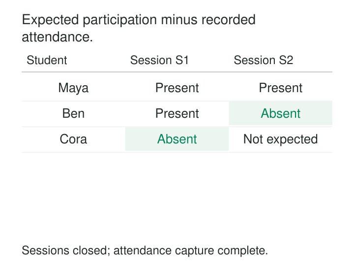

A training coordinator needs to know who attended each session and which expected participants never appeared. The warehouse contains scores and course fees, but neither answers the question. Attendance has no necessary amount, quantity, or duration. Its meaning is simply that a particular person participated in a particular session.

**Factless Fact Tables record occurrences, eligibility, or relationships through combinations of dimension keys, without requiring a numeric measurement column.** Counting and comparing those rows produces useful measures.

The row itself is the observation. “Student 101 attended session S1” is a fact even when there is nothing meaningful to sum.

## Let the combination carry the meaning

A conventional fact table might store a quantity or amount alongside its dimension keys. A factless table can store only the keys needed to identify a meaningful combination.

For attendance, that might be `student_key` and `session_key`. The Session dimension can provide the date, course, location, and instructor.

Two common forms serve different purposes:

| Form | What a row asserts |
|---|---|
| Occurrence | A particular event or participation happened |
| Coverage | A combination was eligible, scheduled, offered, or otherwise within scope |

Kimball describes both event-based factless tables and coverage tables used to analyze what did not happen. [Kimball Group: Factless Fact Tables](https://www.kimballgroup.com/data-warehouse-business-intelligence-resources/kimball-techniques/dimensional-modeling-techniques/factless-fact-table/)

Identifiers may be numeric, but their values are not measurements. Summing student keys would have no business meaning. Counting well-defined attendance rows does.

## Example: counting attendance at the right grain

Suppose session S1 records Maya and Ben attending. Session S2 records Maya attending.

The attendance table has three rows. It represents:

- Three student-session participations.
- Two distinct students.
- Two sessions with recorded attendance.

These counts answer different questions. Calling all three “attendance” would make reports ambiguous.

The grain here is **one student’s confirmed attendance at one scheduled session**. A student who scans a badge twice still contributes one attendance row. Raw badge scans can remain separate observations, with their own event identifiers.

A session key must identify a specific occurrence. Using only course and calendar date would collapse separate morning and afternoon sessions.

A uniqueness rule on student and session protects this grain. A warehouse-generated row identifier alone would not prevent the same participation from being loaded twice.

## Define the expected set before declaring absence

Attendance rows identify who was observed. To identify missing attendance, the system also needs the expected student-session combinations.



In this example, coverage contains five expected participations. Three have matching attendance. The remaining two are S1/Cora and S2/Ben.

For sessions that are closed and whose capture has been reconciled, an existence comparison finds those unmatched combinations:

```sql
SELECT c.student_key, c.session_key
FROM fact_expected_attendance AS c
JOIN dim_session AS s
  ON s.session_key = c.session_key
WHERE s.session_status = 'closed'
  AND s.capture_status = 'complete'
  AND NOT EXISTS (
    SELECT 1
    FROM fact_attendance AS a
    WHERE a.student_key = c.student_key
      AND a.session_key = c.session_key
  );
```

Both keys matter. Matching only by student would make Maya’s attendance at one session appear to satisfy every session.

Here, complete capture means the attendance feed has been reconciled for that session. It does not mean everyone attended.

The resulting participation rate is 3/5, or 60%. That differs from the proportion of distinct students who attended at least once: two of three.

## Missing activity needs trustworthy coverage

An unmatched row becomes evidence of non-participation only under explicit assumptions.

The coverage table must accurately describe the expected population. Canceled sessions, withdrawn enrollments, exemptions, and schedule changes need appropriate treatment.

The occurrence feed must also be complete enough for the conclusion. An unprocessed file, failed badge reader, or late correction can produce the same missing row as a genuine absence. Until capture is reconciled, the result is better described as unresolved or not yet recorded.

Coverage and activity must use compatible identities, session definitions, and time boundaries. Historical reports should use the enrollment or eligibility that applied then, rather than silently substituting today’s roster.

These requirements make the denominator a modeled business object. It cannot reliably be reconstructed from participants alone.

## Example: promoted products with no sales

A retailer wants to find products that were promoted in a store but had no qualifying sales that day.

A coverage table records **one promoted product-store-day**:

| Product | Store | Date |
|---|---|---|
| Adapter | Central | October 1 |
| Case | Central | October 1 |
| Adapter | Riverside | October 1 |

Sales activity contains Adapter at Central and Case at Central. The unmatched coverage row is Adapter at Riverside.

Kimball presents promoted items without sales as a standard coverage-table use case. [Kimball Group: Factless tables for simplification](https://www.kimballgroup.com/2011/04/design-tip-133-factless-fact-tables-for-simplification/)

The comparison uses existence, even if the sales table contains many transaction lines. Joining and counting those lines would measure sales activity rather than promoted combinations.

“No qualifying sale” also needs a definition. A sale followed by a return can produce zero net sales while still representing sales activity. An existence question and a net-amount question require different logic.

If several promotions overlap, this grain records that the product-store-day was covered. Campaign-specific attribution requires a finer grain and a defensible way to associate sales with campaigns.

## Verified implementation: AdventureWorks sales reasons

Microsoft’s AdventureWorksDW sample includes `FactInternetSalesReason`, containing three columns:

- `SalesOrderNumber`
- `SalesOrderLineNumber`
- `SalesReasonKey`

There is no amount or quantity column. The table associates sales lines with sales reasons. [Microsoft: AdventureWorksDW schema](https://github.com/microsoft/sql-server-samples/blob/master/samples/databases/adventure-works/data-warehouse-install-script/instawdbdw.sql)

A line associated with two reasons produces two relationship rows. Counting them measures reason assignments. Counting distinct sales-line identities measures participating sale lines.

This distinction matters when the bridge is joined to sales amounts. A line with two reasons can appear twice, repeating its amount. An existence filter can select qualifying sales without that multiplication; allocating amounts across reasons requires an additional business rule.

Microsoft’s Power BI guidance likewise identifies identifier-only bridges as factless fact tables used to represent many-to-many relationships. [Microsoft: Many-to-many dimension relationships](https://learn.microsoft.com/en-us/power-bi/guidance/relationships-many-to-many#relate-many-to-many-dimensions)

AdventureWorks is a published sample implementation; the schema demonstrates the mechanism without implying a particular company’s deployed design.

## Small rows can still create large workloads

Factless tables are useful for attendance, visits, communications, eligibility, availability, assignments, and similar questions where occurrence or membership is the measurement.

Their rows are often narrow, but counts can be enormous. A coverage table built from every product, store, and date can grow far beyond the combinations the business actually permits.

Generate coverage from real schedules, assortments, contracts, or eligibility rules. For long-lived relationships, effective-dated intervals may be more economical than materializing every day, provided queries handle interval boundaries and overlaps correctly.

Operating costs include deduplication, dimension lookups, historical roster maintenance, completeness reconciliation, and recomputing results after late activity arrives. Indexes or clustering should support the keys used in existence checks and common reporting periods.

A narrow schema reduces stored measurements; it does not remove these responsibilities.

## Keep the measurement honest

Adding a constant `1` column can make summation convenient, but it does not resolve duplicate events or an unclear grain. `COUNT(*)` is meaningful only when one row represents exactly what the report claims to count.

Likewise, counting rows after a many-to-many join can inflate occurrences. Counting distinct people can conceal that error while answering a different question.

Factless modeling also should not discard meaningful measurements. If an event has a duration, score, or quantity needed for analysis, retain it at the appropriate grain. The pattern is useful because some observations need no numeric payload—not because numeric facts are undesirable.

## Related patterns

[[data-declare-the-grain|Declare the Grain]] defines what one occurrence or coverage row means. [[data-associative-entities|Associative Entities]] gives relationships an explicit representation. [[data-distinguish-missing-unknown-inapplicable|Distinguish Missing, Unknown, and Inapplicable]] prevents incomplete capture from becoming a false business conclusion. [[data-shared-metric-definitions|Shared Metric Definitions]] keeps participation counts, distinct populations, and coverage rates consistent across reports.
