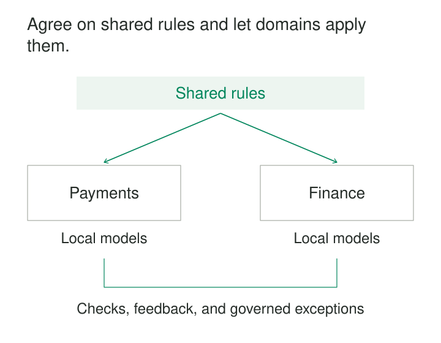

Orders, billing, and customer support each publish customer data. Their datasets are documented, their pipelines work, and their teams respond to questions.

Then somebody joins them.

Customer `42` means different people in different systems. Timestamps use different conventions. Access classifications have similar names but different effects.

Local ownership has improved delivery without establishing how the parts work together.

**Federated Governance distributes decision-making between domain teams and a shared governing structure.** Domains retain authority over their business context, while participating in common rules for interoperability, protection, and dependable consumption.

The purpose is to make independent ownership compatible with shared use.

## Decide where each decision belongs

Federation requires an explicit division of authority.

Domain teams understand local business rules, exceptions, and consumers. Some decisions, however, affect everyone who combines or accesses their data. Those decisions need a shared process and an accountable authority.

Zhamak Dehghani’s data-mesh formulation describes a federation of domain and platform representatives that balances local autonomy with common interoperability rules. Its computational aspect emphasizes implementing suitable rules through the platform. [Federated computational governance](https://martinfowler.com/articles/data-mesh-principles.html#FederatedComputationalGovernance)

The arrangement needs more than a meeting. Participants must know which decisions are binding, who resolves disputes, and which decisions remain delegated to domains.

A useful starting question is: **who bears the consequences if every domain makes this choice differently?**

| Decision | Typical allocation |
|---|---|
| Meaning of a domain-specific lifecycle state | Domain |
| Identifier exchange and namespace conventions | Shared |
| Internal transformation design | Domain, within applicable constraints |
| Sensitivity categories and access-policy framework | Shared |
| Product-specific quality rules and service targets | Domain, with consumer agreement |
| Required quality reporting and evidence format | Shared |

The allocation should reflect the organization’s actual dependencies and decision rights.

## Example: agree how identities cross boundaries

Suppose Orders identifies a shopper as `42`, while Billing uses `42` for an unrelated billing account.

A federation establishes that exchanged identifiers must include their namespace:

| Namespace | Identifier | Meaning |
|---|---|---|
| `shopper` | `42` | A shopper account |
| `billing_account` | `42` | A billing account |

The domains retain their internal identifiers and models. A separately owned mapping explains relationships between shopper and billing accounts where those relationships are known.

This shared rule makes accidental joins less likely. It does not claim that a shopper and a billing account are interchangeable or that the relationship is always one-to-one.

Orders decides how shopper lifecycle states work. Billing decides how account states work. Shared governance establishes how their identities can be interpreted and connected across boundaries.

The federation standardizes the interaction that requires agreement without taking over every local modeling decision.

## Example: shared access categories, delegated classification

An organization defines a common sensitivity vocabulary and a policy for which groups may access each category.

Domain stewards classify their datasets and fields. The platform applies the corresponding controls. The shared authority defines who may change classifications and how disputed cases are reviewed.

AWS Lake Formation provides a documented implementation mechanism. LF-Tags can be assigned to catalog resources, including databases, tables, and columns, and permissions can be expressed using those tags. Administration can delegate tag-management responsibilities. [Lake Formation tag-based access control](https://docs.aws.amazon.com/lake-formation/latest/dg/tag-based-access-control.html), [Delegated tag management](https://docs.aws.amazon.com/lake-formation/latest/dg/lf-tag-considerations.html)

Two assumptions matter. The classification must be accurate, and access must pass through controls that enforce the policy.

A catalog label alone provides neither assurance. Copied files, alternative query routes, and older grants need consideration. Lake Formation specifically documents that permissions obtained through tag-based and named-resource grants are combined as a union. Narrowing one grant path therefore does not necessarily remove broader access through another. [Lake Formation permission considerations](https://docs.aws.amazon.com/lake-formation/latest/dg/lf-tag-considerations.html)

Federation connects the classification decision, delegated responsibilities, and enforcement behavior.

## Example: common quality evidence, different service targets

Orders publishes updates within minutes. Inventory publishes a daily stock position. Finance publishes a daily collections summary.

Requiring every product to refresh every five minutes would ignore their purposes. Allowing every team to describe freshness differently would make their reliability difficult to assess.

The federation instead agrees on a common way to describe service targets, measurement boundaries, observed results, and known limitations.

Inventory might commit to a complete release by 08:00 UTC, with an explicit expected warehouse population. Its domain team defines stock-specific checks and maintains the publishing implementation.

A shared publication rule could require every product to have a named owner, a declared interface contract, and current validation evidence. An implementation could submit that evidence to a policy engine.

Open Policy Agent supports this separation: software supplies structured input, OPA evaluates policy, and the integrating software enforces the decision. OPA does not independently inspect the warehouse or establish that submitted evidence is truthful. [Open Policy Agent](https://www.openpolicyagent.org/docs)

Google Cloud’s data-mesh architecture similarly distinguishes domain stewardship from governance engineering, including shared metadata standards, policy implementation, and monitoring of annotations. [Data-mesh governance functions](https://docs.cloud.google.com/architecture/data-mesh)

## Make common rules executable where practical

A policy becomes operational when the relevant system can evaluate and act on it.

Some rules fit naturally into delivery checks: required ownership metadata, recognized classification values, or interface compatibility. Others belong at access time or during ongoing operation.

Keep the business policy separate from its implementation details. “Restricted datasets require an approved access route” is an obligation. A particular catalog tag or authorization query is one mechanism for implementing it.

Tests should cover permitted cases, prohibited cases, missing metadata, and misleading combinations. OPA provides policy-testing facilities that support explicit test cases. [OPA policy testing](https://www.openpolicyagent.org/docs/policy-testing)

Automation reduces repeated interpretation. It cannot settle every disagreement about business meaning, appropriate classification, or acceptable service tradeoffs.

Those judgments need a documented route back to responsible people.

## Govern the policies themselves

Shared rules change, and those changes can affect many products at once.

A policy needs an owner, rationale, scope, revision history, effective date, and a plan for applying changes. Review the impact before enforcement, especially where existing products would become nonconforming.

Record which policy revision produced an important decision. OPA bundles can carry revision identifiers, and its decision logs can record the bundle revision used during evaluation. These are useful mechanisms for explaining why an access or publication decision differed between runs. [OPA bundles](https://www.openpolicyagent.org/docs/management-bundles), [OPA decision logs](https://www.openpolicyagent.org/docs/management-decision-logs)

Policy distribution also needs observation. Publishing a new revision does not prove that every enforcement point has adopted it.

## Give exceptions a bounded path

A legacy product may be unable to satisfy a new rule immediately. A domain may also uncover a valid case the shared policy did not anticipate.

An exception should identify the affected scope, reason, responsible owner, expiry or review date, and any interim controls. The designated authority must be able to accept or reject it.

Repeated exceptions are evidence about the policy or platform. They may reveal an unrealistic obligation, missing capability, or unresolved dependency.

An undocumented bypass makes the governing arrangement unreliable. An exception process that never reaches a decision makes it unusable.

Federation needs both a way to accommodate justified differences and a way to close them.

## Budget for coordination and enforcement

This pattern is useful when independently owned products must work together across several domains.

It requires representatives with real authority, domain participation, platform capacity, and resources for implementing common decisions. Without those conditions, governance becomes a set of obligations that nobody can fulfill.

Operating costs include policy maintenance, testing, evidence collection, classification review, exception handling, and coordination. A shared platform can reduce duplicated work, but it also becomes a dependency requiring support.

Common failures include central review of every routine change, local disregard for shared obligations, and elaborate automation built on inaccurate metadata. Excessive standardization can also erase useful distinctions between business contexts.

For a small organization with a few closely collaborating teams, a simpler shared decision process may suffice. The value of federation comes from resolving consequential decisions at the right scope, not from the size of its committee.

## Related patterns

[[data-domain-owned-data-products|Domain-Owned Data Products]] establish the local responsibility that federated governance coordinates.

[[data-named-dataset-stewardship|Named Dataset Stewardship]] provides people who interpret requirements, maintain metadata, and raise unresolved issues.

[[data-controlled-vocabularies|Controlled Vocabularies]] give shared policy categories consistent meanings across domains.

[[data-publication-quality-gates|Publication Quality Gates]] turn selected governance obligations into checks before data becomes available to consumers.
