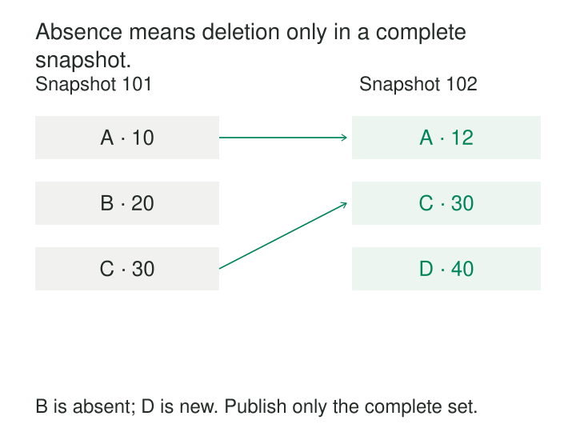

A product table changes throughout the day, but its `updated_at` column is unreliable. Some applications maintain it; others do not. Deleted rows disappear entirely. An extraction that asks for “everything changed since yesterday” gradually drifts away from the source.

For a modest catalog, the simplest dependable approach may be to read the whole table again.

[[data-full-snapshot-extraction|Full Snapshot Extraction]] copies every record within a declared source scope on each run. It establishes a fresh baseline without depending on a change watermark or a complete change feed. Its correctness depends on knowing what “everything” includes, whether the read represents a consistent state, and whether the extraction actually finished.

## Full describes coverage

The scope might be one table, several related tables, or every product belonging to a particular tenant. It should specify the selected columns, filters, permissions, and treatment of inactive records.

“Full” means all records in that scope, rather than only records believed to have changed.

It does not automatically mean a consistent point-in-time view. A process can read every page while the source changes underneath it, producing a collection of records that never existed together.

Nor does extraction prescribe destination behavior. A full extract can replace a current-state table, become a retained historical version, or feed a comparison process. Microsoft Fabric’s Copy job, for example, explicitly offers a full-copy mode that copies all source data on every run. How that data is written remains a separate concern. [Microsoft Fabric: Copy Modes](https://learn.microsoft.com/en-us/fabric/data-factory/incremental-copy-job#copy-modes-full-copy-incremental-copy)

## Example: refreshing a small product catalog

A retailer extracts its European product catalog each night. Two successive successful snapshots contain:

| Product | Snapshot S-101 price | Snapshot S-102 price |
|---|---:|---:|
| A | 10 | 12 |
| B | 20 | Absent |
| C | 30 | 30 |
| D | Absent | 40 |

Each run reads the complete catalog. S-102 includes unchanged product C as well as updated A and newly added D.

For a current-state destination, publishing S-102 replaces the previous product set. An upsert that only inserts and updates would leave B behind, so it would not produce an exact mirror.

For a historical destination, both snapshots can be retained under separate run identifiers. Comparing stable product keys reveals the observed differences.

B’s absence requires interpretation. If both runs cover the same authoritative scope, it establishes that B is no longer present in that scope. It does not reveal the exact disappearance time or whether the business deleted, archived, or otherwise excluded the product.

If S-102 stopped halfway through pagination, absence would establish nothing. Treating that partial extract as complete could incorrectly remove valid products.

## Example: every row, but the wrong combination

An order has a header total of 100 and line items totaling 100. During extraction, the application atomically changes both to 120.

The extractor reads the header before that transaction commits and the lines afterward:

| Extracted component | Observed value |
|---|---:|
| Order header total | 100 |
| Sum of order lines | 120 |

No rows are missing. The problem is that the reads describe different source states.

A database snapshot or suitable transaction isolation can keep the reads on one consistent view. In PostgreSQL, successive queries under Read Committed can observe different committed states, while Repeatable Read uses a stable transaction snapshot. These guarantees are database-specific and must be checked for the extraction mechanism being used. [PostgreSQL: Transaction Isolation](https://www.postgresql.org/docs/18/transaction-iso.html)

PostgreSQL’s `pg_dump` is a documented implementation of consistent database export during concurrent use. Its parallel export coordinates workers through synchronized snapshots so different connections observe the same dataset. [PostgreSQL: pg_dump](https://www.postgresql.org/docs/18/app-pgdump.html)

Parallel reads therefore need more than nonoverlapping key ranges: when point-in-time consistency matters, they also need a shared read boundary.

An API cursor may merely record pagination position. Unless the provider guarantees otherwise, it should not be assumed to freeze the underlying collection. Where consistent reads are unavailable, describe the result honestly as an observation gathered over an extraction interval.

## Build a candidate before replacing the published set

A reliable pipeline writes into an isolated run while readers continue using the previous successful version.

The run records its scope, schema, extraction start and completion times, and source snapshot identifier or cutoff when one exists. A completion record identifies the expected files, partitions, or pages and their successful receipt.

Validation checks whether the extraction fulfilled its contract. Depending on the source, that can include key uniqueness, required columns, page completion, source control totals, and relationships between tables. A source row count is strongest when measured against the same frozen view; a separate count taken later may legitimately differ.

Counts alone are insufficient. The example catalog has three rows in both snapshots despite an addition and a disappearance.

Once accepted, the candidate becomes the published version through an atomic table replacement or a consistent switch to a versioned dataset. The exact mechanism depends on the destination. Readers should see one complete run, with the previous version remaining available until publication succeeds.

Retry behavior matters too. Appending the same snapshot twice can duplicate the entire dataset. Resuming half an extraction is safe only if the source still provides the same frozen view or the extraction protocol otherwise guarantees correct reconstruction.

## Example: establishing a baseline for change capture

A new replica needs existing customer records before it can apply subsequent changes. Starting with only today’s change stream would omit customers that already existed and have not changed.

A full snapshot supplies the baseline. Change data capture then maintains it.

The difficult part is the handover. Copying the table and afterward starting a stream “from now” leaves a gap in which changes can be missed.

Debezium’s PostgreSQL connector documents a coordinated approach: its initial snapshot records a transaction-log position, scans the captured tables, records successful completion, and then streams changes from that position. Its isolation configuration determines the consistency guarantees during the read. [Debezium: PostgreSQL Snapshots](https://debezium.io/documentation/reference/stable/connectors/postgresql.html#postgresql-snapshots)

This illustrates a useful division of labor: a full extraction establishes state, while a change stream maintains that state. Consumers still need appropriate ordering and duplicate-handling behavior.

## Simpler change logic, greater recurring work

Full extraction is useful for small reference tables, sources without reliable change metadata, initial loads, and rebuilding a destination whose incremental state has become suspect.

Its main tradeoff is repeated work. Reading 50 GB each day moves roughly 1.5 TB over 30 days before compression, even if little changes. Keeping every extract also multiplies storage consumption.

Source scans consume I/O, CPU, connections, or API quotas. Parallelism can shorten elapsed time while increasing peak load. Long consistent reads can also impose engine-specific retention or locking costs. A read replica may reduce contention, but its replication lag becomes part of the freshness contract.

The relevant measure is whether the extraction finishes within the required freshness window without unacceptable source impact. A successful nightly job that takes twenty hours may provide little useful freshness.

## What a snapshot cannot tell you

Repeated snapshots observe states, not every transition between them. A record created and deleted between runs may never appear. An attribute can change twice and return to its original value without leaving evidence in either extract.

A stable row key is necessary for reliable comparisons, though not for simply storing a complete copy. Changed filters, permissions, or source retention can also make two successful extracts incomparable.

Common mistakes include clearing the live destination before extraction succeeds, treating an empty response as an empty source, and assuming that a timestamp attached to an output file proves point-in-time consistency.

## Related patterns

**Incremental Extraction** reduces repeated reading by selecting changes, provided the change-selection mechanism is trustworthy.

**Change Data Capture** captures ongoing mutations and often uses a full snapshot for initialization.

**Snapshot Comparison** derives observed additions, modifications, and disappearances between comparable complete extracts.

[[data-periodic-snapshots|Periodic Snapshots]] models business measurements at regular intervals. A full source extraction may supply its inputs, but does not itself define the analytical snapshot’s grain or measures.
