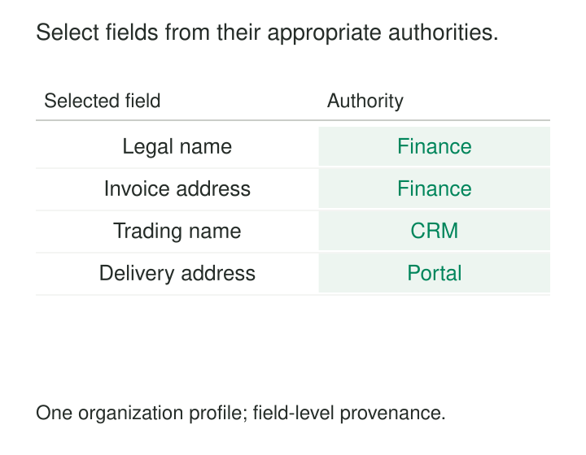

Finance has a supplier’s approved legal name. The CRM has its current trading name. A supplier portal has a recently verified delivery address. Choosing whichever record arrived last would discard useful information—and might replace current details with an old record exported yesterday.

Golden Records provide a maintained, trusted profile assembled from records already linked to the same entity. They select values according to explicit rules, preserve where those values came from, and give consumers a consistent profile for a defined purpose.

The difficult part is deciding what “trusted” means for each attribute.

## Resolve identity, then select values

A golden record brings together contributions associated with one entity. **Entity resolution** determines which records belong together; **survivorship** determines which contributed values should appear in the resulting profile.

These decisions are related but separate. Correctly linking two supplier records does not establish which address is current. Selecting a well-formed address cannot repair a mistaken identity merge.

Survivorship rules commonly consider source authority, validity, completeness, and recency. Those criteria need business definitions: which source is responsible for this field, which checks establish validity, and which timestamp represents meaningful freshness? IBM’s MDM guidance explicitly treats source quality and the dates information was updated or verified as survivorship considerations. [IBM: Deciding on Criteria for Data Survivorship](https://www.ibm.com/docs/en/imdm/12.0.0?topic=data-deciding-criteria-survivorship)

The result can be stored as a materialized record or calculated as a view. In either case, it should remain connected to its source contributions and selection rules.

## Example: trust different sources for different fields

Three records have been confirmed to describe organization `ORG-731`. Under this illustrative organization’s governance rules, Finance maintains approved legal and invoicing information, CRM maintains trading names, and the supplier portal maintains verified delivery details.

The resulting profile might contain:

| Profile attribute | Selected value | Selected source |
|---|---|---|
| Legal name | North Supplies Ltd | Finance |
| Trading name | NorthWorks | CRM |
| Invoice address | 8 Market St | Finance |
| Delivery address | 42 Dock Rd | Supplier portal |

No single source contributes the entire profile.

The two addresses also serve different purposes. Combining them into one generic `address` field would create a conflict where the business actually has two valid facts.

Selection should retain the contributing source record, relevant verification or effective date, and the rule that chose the value. A consumer can then understand why the invoice address differs from the delivery address.

These source priorities are local decisions. Finance is authoritative here because responsibility and controls have been assigned to it; the department’s name does not make every value it holds inherently superior.

If two eligible delivery addresses remain equally supported, the profile can expose a conflict, retain multiple appropriately labeled addresses, or await review. A complete-looking record is not worth an invented decision.

## Example: select a measurement as a coherent group

A product’s approved net-weight measurements arrive from two sources:

| Source | Value | Unit | Measurement date | Received date |
|---|---:|---|---|---|
| Catalog | 500 | g | 2026-09-01 | 2026-10-20 |
| Quality system | 0.52 | kg | 2026-10-12 | 2026-10-13 |

Assume both measurements concern the same product version and use comparable measurement conditions. The stated policy prefers the latest approved net-weight measurement.

Under that policy, the selected measurement is **0.52 kg**, or **520 g** after an explicit conversion.

The catalog record arrived later, but its measurement is older. Using ingestion time as freshness would select the wrong contribution under the stated rule.

Selecting each column independently creates another failure: choosing `0.52` from Quality and `g` from Catalog would produce **0.52 g**, which neither source reported.

Value and unit must travel together. The same principle applies to currency and amount, address components, and other attributes whose meaning depends on a coherent group. IBM Product Master supports survivorship rules for attributes or groups of attributes, illustrating this distinction in an implemented product. [IBM: Data Survivorship Feature](https://www.ibm.com/docs/en/product-master/12.0.0?topic=dashboard-automating-sdp)

Normalization can make contributions comparable, but it must preserve their meaning and provenance.

## A published implementation: Reltio’s operational values

Reltio documents a concrete implementation that separates merging from survivorship.

Its consolidated entity retains source crosswalks and their associated attribute values. Survivorship rules determine the **Operational Values** returned when the entity is retrieved. Depending on the rule, an attribute can expose one or several selected values.

The documented design calculates those values during retrieval rather than requiring one permanently stored winning row. It also retains the association between contributed values and their crosswalks, including support for returning values to their original entity during an unmerge. [Reltio: Design Survivorship Rules](https://docs.reltio.com/en/objectives/resolve-potential-matches/potential-matching-at-a-glance/potential-matching-navigation/design-survivorship-rules)

Reltio also supports different survivorship rules for different user roles. This demonstrates why a trusted profile needs an explicit consumption context. Applications must know which profile they requested when interpreting differences between results.

The reusable mechanism is the separation of source contributions, identity links, and value-selection policy.

## What must hold for the profile to be trustworthy

**The contributing records must describe the intended entity.** A false merge can produce a plausible profile assembled from different people, organizations, or products. Provenance makes the mistake traceable but does not prevent it.

**Attributes must mean the same thing before they compete.** Legal name and trading name, invoice address and delivery address, or gross weight and net weight should not enter one undifferentiated contest.

**Authority must apply at the right scope.** A source may be authoritative for one attribute, region, product family, or time period. A blanket source ranking can suppress better evidence outside that scope.

**Dates must be interpreted consistently.** Business-effective time, verification time, source modification time, and ingestion time answer different questions. Future-effective information should not automatically become the current value.

**Absence and removal must be distinguishable.** A blank field may mean “not supplied,” “unknown,” or an explicit instruction to withdraw a previous value. Treating all blanks as harmless can resurrect a withdrawn contact detail; treating them all as deletion can erase valid information.

Finally, rules need defined handling for ties, invalid contributions, and missing eligible values. Sometimes the correct result is an unresolved field.

## Maintain decisions as the evidence changes

A golden record is useful when several sources contribute overlapping master data and consumers need a consistent, explainable profile. Typical situations include supplier onboarding, customer service, product catalogs, and system migrations.

Its operating costs include source integration, validation, rule ownership, conflict review, provenance storage, and downstream change propagation. Materialized profiles require refresh and invalidation work; computed profiles require dependable retrieval and predictable performance.

Manual overrides need a recorded reason, responsible owner, and review conditions. Otherwise, yesterday’s correction can become a permanent barrier to newer evidence.

Rule changes also change profiles. Retaining only today’s selected values cannot reproduce what a report or application saw last month. Historical requirements may call for profile snapshots or recoverable source contributions and versioned rules.

Publishing selections back to source systems adds another responsibility: preventing feedback loops in which a copied golden value returns as supposedly independent corroboration.

## Common mistakes and limits

“Latest wins” is attractive because it is simple. It works only when the chosen timestamp and source update behavior represent the freshness that matters.

“Most sources agree” can also mislead when several sources copied the same original mistake. More copies do not necessarily provide more independent evidence.

Choosing one entire source record can lose valuable fields. Choosing every field independently can create an incoherent profile. The model needs both attribute-level authority and rules for related groups.

Golden records do not eliminate uncertainty or legitimate contextual differences. Preserve alternative contributions and make unresolved conflicts visible. The profile should remain explainable when a user asks why a particular value was selected.

## Related patterns

[[data-entity-resolution|Entity Resolution]] establishes which source records describe the same entity.

[[data-identity-crosswalks|Identity Crosswalks]] preserves the identifiers connecting those contributions.

[[data-separate-source-facts-from-derived-interpretations|Separate Source Facts from Derived Interpretations]] keeps reported values distinct from survivorship decisions.

[[data-make-units-explicit|Make Units Explicit]] protects measurements whose meaning depends on their units and related context.
