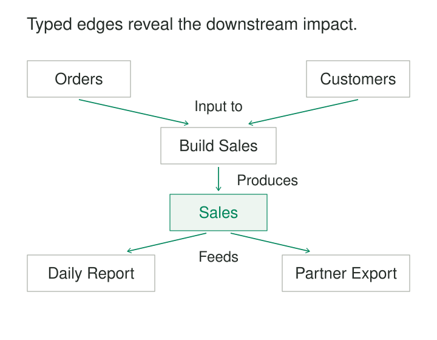

A source table changes. The engineering team needs to know which transformations consume it, which datasets those transformations produce, and which reports depend on the results.

The catalog lists owners and immediate dependencies, but the answer crosses several kinds of object and several steps. A report can depend on many datasets; a dataset can feed many reports. A single parent column cannot express the network.

**Graph Relationships make connections explicit so the system can answer questions about neighborhoods, dependencies, and paths.** Entities become nodes; meaningful connections become edges. Queries follow selected edges according to the business question.

The pattern is useful whenever the answer depends on how things connect across several steps.

## Give every connection a meaning

A graph model separates entities from their relationships.

A node might represent a dataset, job, person, organization, component, or location. A relationship describes a particular connection between nodes: a job produces a dataset, a person directs a company, or an assembly uses a component.

In a property graph, relationships can also carry attributes such as quantities, effective dates, and provenance. Neo4j implements this model with typed, directed relationships that can have properties. [Neo4j: Graph database concepts](https://neo4j.com/docs/getting-started/appendix/graphdb-concepts/)

A relational implementation can represent the same ideas through relationship tables. A graph database is one storage choice; the modeling pattern does not require one.

Useful relationship types state something specific. `PRODUCES`, `SUPPLIES`, and `MEMBER_OF` support different interpretations. A generic `CONNECTED_TO` edge hides those distinctions and makes traversal rules harder to define.

The arrows here follow data flow. A model using `DEPENDS_ON` would normally point from the consumer toward its dependency instead. Either convention can work when its meaning is explicit and consistently applied.

## Example: tracing downstream data dependencies

The illustrated lineage graph contains these relationships:

| Source | Relationship | Target |
|---|---|---|
| Orders dataset | INPUT_TO | Build Sales job |
| Customers dataset | INPUT_TO | Build Sales job |
| Build Sales job | PRODUCES | Sales dataset |
| Sales dataset | INPUT_TO | Daily Report job |
| Sales dataset | INPUT_TO | Partner Export job |

Starting at Orders, a downstream traversal follows the allowed relationship types and reaches Build Sales, Sales, Daily Report, and Partner Export.

If the question asks for potentially affected jobs, the result contains three jobs. If it asks for every reachable entity, it includes the Sales dataset too.

OpenLineage provides a verified foundation for this kind of model. Its specification distinguishes datasets, jobs, and individual runs, and captures input and output datasets through lineage events. A backend can combine those observations into a lineage graph. The edge names above are an illustrative projection, rather than prescribed OpenLineage relationship names. [OpenLineage: Object Model](https://openlineage.io/docs/spec/object-model/)

The distinction between definition and execution matters. “This job declares this input” and “this particular run observed this input” support different conclusions. A current dependency graph should have an explicit policy for incorporating old runs, changed definitions, and missing observations.

Reachability identifies potential impact. It does not prove that every downstream output changed.

## Decide what one relationship represents

A relationship needs a grain just as a table does.

Does `SUPPLIES` mean an organization is an approved supplier, supplied something once, or currently supplies a particular component under a contract? Those claims need different attributes and identities.

The endpoints alone may not identify the relationship. Two organizations can have several agreements. A person can hold several appointments at the same institution. Collapsing these into one edge can discard dates, responsibilities, or evidence.

Conversely, importing the same source record repeatedly should not create duplicate relationships. Stable relationship identifiers or a well-defined uniqueness rule make ingestion repeatable.

For a relational implementation, separate typed relationship tables may provide clearer foreign-key and domain constraints than one unrestricted edge table.

When a relationship involves several participants—such as buyer, supplier, product, and agreement—a transaction or agreement node can preserve which participants belong together. Several disconnected pairwise edges may lose that context.

## Example: a component reached through two paths

A kit contains two modules and one bracket. Each module contains three brackets.

| Assembly | Component | Quantity per assembly |
|---|---|---|
| Kit | Module | 2 |
| Module | Bracket | 3 |
| Kit | Bracket | 1 |

There are two paths from Kit to Bracket: one direct and one through Module.

A reachability query answers that Bracket is required. A quantity calculation must preserve both paths, multiply quantities along each, and add their contributions:

**2 × 3 + 1 = 7 brackets per kit.**

Deduplicating the bracket node before calculating would lose information. Counting paths would produce two, which is also different from the required quantity.

PostgreSQL’s recursive-query documentation demonstrates this mechanism for component relationships, multiplying quantities during traversal and summing contributions afterward. It also shows that relational SQL can process connected structures. [PostgreSQL: Recursive Queries](https://www.postgresql.org/docs/current/queries-with.html#QUERIES-WITH-RECURSIVE)

This calculation assumes compatible component versions and quantity units, and an assembly structure without cycles. A cycle here is a modeling error; cycles in a friendship network may be entirely legitimate.

## Correct paths require correct identities and time

Graph traversal amplifies identity mistakes. Merging two people because they share a name joins their neighborhoods and can create many false paths. Splitting one organization across duplicate nodes hides real connections.

Node identifiers therefore need clear scope, and entity resolution needs evidence. Relationship endpoints must refer to the intended entities.

Time is equally important. Suppose someone directed a company in 2018, while a separate ownership relationship began in 2024. A path combining those records does not establish that both relationships held simultaneously. Queries about a particular period must consider the overlapping validity of every relationship on the path.

Provenance should accompany important relationships. A declared dependency, observed execution, registry record, and inferred similarity are different kinds of evidence.

Missing connections also need careful interpretation. In an incomplete graph, the absence of an edge can mean “not recorded,” rather than “does not exist.”

## Verified implementation: ICIJ’s Offshore Leaks database

The International Consortium of Investigative Journalists uses a graph to let readers explore connections among offshore entities, people, intermediaries, and addresses.

ICIJ states that its Offshore Leaks database is powered by Neo4j. It also publishes separate CSV files for node types and relationships, alongside database exports. This makes the graph structure available for independent exploration. [ICIJ: Database downloads and structure](https://offshoreleaks.icij.org/pages/database)

Its user guide demonstrates moving from a company to related shareholders, beneficiaries, addresses, and other companies. The practical value comes from following several meaningful connections across records. [ICIJ: How to use the database](https://offshoreleaks.icij.org/pages/howtouse)

Interpretation still depends on edge meaning. Sharing an address is a different relationship from ownership. A visual path can reveal a lead for investigation while leaving the underlying claims distinct.

## Traversal costs grow with the neighborhood

Graph Relationships help with lineage, component reuse, network investigation, dependency analysis, and questions involving several relationship types.

Their operating costs depend heavily on connectivity. A query starting from one indexed node may remain small. The same query can become expensive when it reaches a high-degree hub or explores many alternative paths.

Traversal rules should specify direction, allowed types, time filters, stopping conditions, and whether the result needs unique nodes or distinct paths. Cyclic graphs require an appropriate revisit policy. Avoiding repeated nodes suits some discovery questions but can discard alternative paths needed by other calculations.

Indexes support finding starting nodes and filtering properties. Traversal consumes additional memory and processing; distributed storage can add network traffic when paths cross partitions. Relationship ingestion, identity reconciliation, provenance storage, and deletion maintenance add continuing operational work.

A graph model also needs schema discipline. Uncontrolled relationship vocabularies make equivalent facts look different, while overly broad relationship types make different facts look equivalent.

## Related patterns

[[data-associative-entities|Associative Entities]] give relationships their own records and identities. [[data-relationships-with-attributes|Relationships with Attributes]] places quantities, dates, and evidence on the appropriate connection. [[data-entity-resolution|Entity Resolution]] protects the node identities on which traversal depends. [[data-closure-tables|Closure Tables]] precompute reachability when repeated ancestry queries justify additional storage and maintenance.
