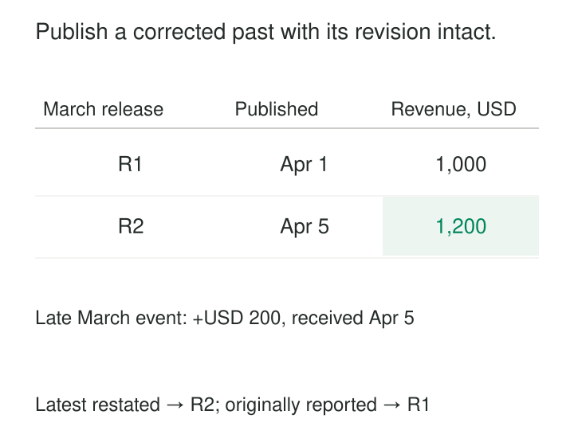

March’s dashboard showed sales of 1,000 when the report was published on April 1. Four days later, a missing March transaction arrives for 200.

Leaving March unchanged preserves the published number but understates activity. Quietly replacing it with 1,200 improves completeness but leaves yesterday’s presentation apparently inconsistent with today’s dashboard.

[[data-historical-restatement|Historical Restatement]] recalculates previously reported periods when new evidence, corrected relationships, or revised calculation rules change their results. It treats the correction as an identifiable revision, with an explanation of what changed and enough retained history to reproduce earlier reports.

The aim is to improve the current account of the past while keeping earlier publications understandable.

## One business period, multiple releases

A historical result has more than a business date. It also depends on the information and rules used to produce it.

“March sales” might mean the result published on April 1 or the latest corrected result available today. Both describe March, but they answer different questions.

A useful restatement model therefore identifies the business period, the release or revision, the source-data cutoff, and the calculation version. These can be recorded per dataset release rather than repeated on every row.

Restatement differs from simply rerunning a job. A rerun might reproduce the same result. A restatement intentionally replaces or supplements an earlier published interpretation.

## Example: a transaction arrives after publication

Consider the delayed sale:

| Item | Business date | Available to warehouse | Amount |
|---|---|---|---:|
| Previously reported March sales | March | By April 1 | 1,000 |
| Sale S-992 | March 31 | April 5 | 200 |
| Restated March sales | March | By April 5 | 1,200 |

The sale belongs to March according to the metric’s event-date rule. Its arrival in April does not make it April activity.

The pipeline incorporates S-992 once, recalculates March, and publishes revision R2. The reconciliation is straightforward: R1 plus the newly included transaction equals R2.

The correction may reach beyond the monthly total. A year-to-date measure changes, as may growth rates, customer rankings, and materialized aggregates. Correcting the detailed fact table alone leaves those outputs inconsistent.

A retry must not add another 200. Stable transaction identity and repeatable replacement or merge logic remain necessary. Recording that a restatement ran does not prevent duplicate processing.

## Example: a backdated assignment changes attribution

A salesperson’s March transactions total 600. The warehouse originally assigned all of them to North.

In April, an authoritative correction establishes that the salesperson moved to South on March 15:

| Transaction | Event date | Amount | Original region | Corrected region |
|---|---|---:|---|---|
| T-10 | March 10 | 250 | North | North |
| T-20 | March 20 | 350 | North | South |

Company sales remain 600. North decreases by 350, and South increases by 350.

The correction requires reconstructing the effective-dated assignment and linking affected transactions to the appropriate dimension version. Overwriting the salesperson’s region everywhere would incorrectly move the March 10 transaction too.

Kimball explicitly identifies this case: retroactive changes to Type 2 dimension attributes can require new dimension rows and restatement of associated facts. [Kimball: Late Arriving Dimensions](https://www.kimballgroup.com/data-warehouse-business-intelligence-resources/kimball-techniques/dimensional-modeling-techniques/late-arriving-dimension/)

This example also shows why checking only the grand total is insufficient. A restatement can preserve totals while substantially changing their distribution.

## Example: the metric definition changes

Suppose March conversion was reported as 20 purchases divided by 100 visits: 20%.

The organization later adopts a definition excluding internal test visits. Twenty of March’s visits were internal tests, and none produced purchases. Under the revised definition, March conversion becomes 20 divided by 80: 25%.

The underlying events have not changed. The interpretation has.

This should be labeled as a definition revision, with the old and new definitions retained. Otherwise, readers may mistake the increase for improved commercial performance.

For comparable trends, the organization might recompute the full historical series under the new definition. If older data cannot reliably identify test visits, that limitation should remain visible rather than being concealed by an apparently continuous chart.

dbt’s documentation describes the corresponding implementation problem: changing an incremental model’s logic can leave newly processed rows inconsistent with historical rows. It provides a full-refresh mechanism for rebuilding the model and its downstream dependencies. That rebuild supplies a technical mechanism; release labeling and historical preservation remain design responsibilities. [dbt: Rebuilding Incremental Models](https://docs.getdbt.com/docs/build/incremental-models#how-do-i-rebuild-an-incremental-model)

## Find the affected scope before rebuilding

A correction begins with an impact boundary: which identities, business intervals, rules, and downstream outputs can change?

For a late transaction, the initial scope may be one day. A corrected customer identity can affect years of transactions. A revised running balance can affect every subsequent period. A rolling 30-day metric can carry one corrected day into many later windows.

The processing method should follow that scope. Rebuilding affected partitions is often simpler than calculating adjustment deltas. Applying deltas can be cheaper for additive measures, but becomes difficult for distinct counts, medians, rankings, and overlapping populations.

A replacement must also remove results that should no longer exist. An upsert that only inserts and updates can leave an obsolete category or withdrawn record behind.

Before publication, the candidate revision should reconcile against the previous release. Useful evidence includes changed record counts, total differences, attribution movements, and examples traced to their source corrections. Agreement with an expected arithmetic difference helps explain the change; it does not independently prove source completeness.

Publish the corrected outputs as a coherent revision. Readers should not unknowingly combine restated details with an old summary. Depending on the platform, this may involve a transactional replacement, a versioned dataset selected through a release pointer, or coordinated publication across several systems.

## Preserve what earlier readers actually saw

There are two distinct capabilities: computing today’s best historical result and reproducing an earlier release.

Reproduction requires retained outputs or a reconstructable combination of source versions, dimension history, calculation code, configuration, and relevant reference data. A code commit alone cannot recover source records that were overwritten.

The St. Louis Fed’s **ALFRED** provides a concrete implementation of this distinction. It archives economic data with information about original releases and subsequent revisions. Its observation API supports vintage dates for retrieving data as it existed on specified historical dates. [ALFRED documentation](https://fred.stlouisfed.org/docs/api/fred/alfred.html), [FRED vintage-date parameters](https://fred.stlouisfed.org/docs/api/fred/series_observations.html#vintage_dates)

Retention needs an explicit horizon. A database’s temporary time-travel feature may support operational recovery without preserving a report for years.

## Costs, useful situations, and limits

Historical restatement is useful when delayed evidence, retroactive corrections, identity repairs, or calculation defects would otherwise leave historical analysis misleading. Planned methodology changes can also justify a restated series.

Its costs include historical scans, additional storage, validation, downstream refreshes, and communication. Broad corrections can compete with regular processing. Small corrections can become expensive when many dependent datasets have copied the original result.

Common failures include silently overwriting published numbers, repairing only one layer, and applying today’s attributes to every past event. Another is treating every current change as a historical correction: a customer moving today does not establish that earlier transactions belonged to the new location.

Restatement also cannot recover evidence that was never retained. Where reporting policy requires closed periods to remain fixed, a later-period adjustment and a separately restated analytical series may serve different purposes. Their labels and reconciliation should make that distinction clear.

## Related patterns

[[data-bitemporal-records|Bitemporal Records]] separates when information applies from when it became known, supporting both corrected history and earlier knowledge states.

[[data-as-of-joins|As-of Joins]] associates facts with the effective dimension versions required during reconstruction.

[[data-separate-source-facts-from-derived-interpretations|Separate Source Facts from Derived Interpretations]] preserves evidence so revised logic can produce a new interpretation.

[[data-shared-metric-definitions|Shared Metric Definitions]] makes the calculation version explicit, helping readers distinguish changed business activity from changed measurement.
