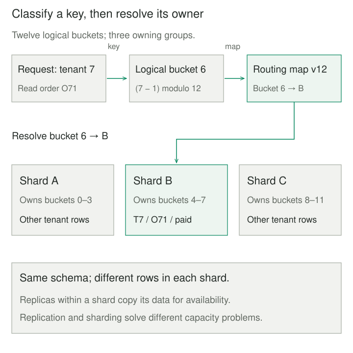

## Purpose and problem

An order database outgrows one machine. Indexes and query tuning have helped, but its write throughput and storage still approach the host’s limits. Copying the database to read replicas helps some reads; every replica still holds the same data and must receive its writes.

The team needs more capacity while keeping ordinary tenant requests predictable. Dividing records between machines introduces another question: which machine owns a particular order, especially while the distribution changes?

## Core idea

**Sharding distributes different rows of the same logical dataset across independently operated storage groups and routes work to their owners.** Each shard holds a subset, usually with the same schema. A shard can itself be replicated for availability.

The mental model is **key → logical partition → owning shard**. Separating logical buckets from physical placement lets the system move selected buckets without changing how keys are classified. It supplies indirection, not a migration protocol.

Horizontal partitioning describes dividing rows; sharding places those partitions across independently operated stores. Partitioning inside one database does not necessarily add machines. Vertical partitioning separates columns; replication copies data.



## How it works

### Choose placement around the workload

A range scheme preserves useful adjacency but can concentrate writes at the newest range. Hashing spreads many distinct keys but scatters range reads. A directory records explicit assignments and adds metadata that must remain available and authoritative.

Choose keys using query locality, cardinality, value frequency, and load. Tenant-keyed orders and order lines can share placement, making tenant joins and transactions local. Citus documents this approach. A global search without a useful key may instead contact many shards and merge their results, as MongoDB’s router does.

More shards do not divide an indivisible hot tenant. Measure requests, bytes, and processing cost, not just row counts. Independently generated identifiers need a global allocation strategy or a namespace such as `(tenant_id, order_id)`. Changing a shard key can require moving records.

### Own routing and transitions

A database router, library, or application can resolve ownership. Clients may cache placement, but storage participants must reject or redirect obsolete ownership claims during handoff. A refreshed router alone cannot prevent a paused old writer from resuming.

A live migration needs copying, capture of concurrent changes, validation, and a coordinated traffic switch before retiring old data. Vitess provides a concrete resharding workflow with validation and traffic switching. Having two physical copies during migration does not mean both may independently accept authoritative writes.

Transactions, ordering, and uniqueness within one shard do not automatically extend across shards. Cross-shard operations need explicit coordination or different business semantics. Backups and restores also need a defined consistency boundary. Routing is not authorization: validate tenant access before using a caller-supplied key.

## Worked example

### Move one bucket, preserving its identity

An order service initially sends tenant 7 to B. Adding D should move selected data, rather than reclassifying every key using a new server count. This Python 3 program models a fixed twelve-bucket directory, routed reads/writes, and a **quiesced** move: all requests pause during `move_bucket`.

Save as `sharding.py` and run `python3 sharding.py`. Tenant IDs are positive integers; order IDs and stored states are trusted strings. The cyclic numeric classifier is deliberately simple, not a production hash. Tuple keys separate tenants; string values avoid shared mutable payloads.

```python
class StaleRoute(Exception):
    pass


def bucket(tenant):
    if type(tenant) is not int or tenant < 1:
        raise ValueError("tenant must be a positive integer")
    return (tenant - 1) % 12


class Cluster:
    def __init__(self):
        self.version = 12
        self.owners = list("AAAABBBBCCCC")
        self.groups = {name: {} for name in "ABCD"}

    def catalog(self):
        return self.version, tuple(self.owners)

    def table(self, target, version, tenant):
        if version != self.version or target != self.owners[bucket(tenant)]:
            raise StaleRoute("refresh routing metadata")
        return self.groups[target]

    def put(self, target, version, tenant, order, state):
        self.table(target, version, tenant)[tenant, order] = state

    def get(self, target, version, tenant, order):
        return self.table(target, version, tenant)[tenant, order]

    def move_bucket(self, number, target):
        # Single caller; no reads/writes overlap this operation.
        if type(number) is not int or not 0 <= number < 12:
            raise ValueError("invalid bucket")
        if target not in self.groups:
            raise ValueError("unknown group")
        source = self.owners[number]
        if source == target:
            return
        moved = {k: v for k, v in self.groups[source].items()
                 if bucket(k[0]) == number}
        if moved.keys() & self.groups[target].keys():
            raise ValueError("destination contains conflicting rows")
        self.groups[target].update(moved)
        self.owners[number] = target
        self.version += 1
        for key in moved:
            del self.groups[source][key]


if __name__ == "__main__":
    cluster = Cluster()
    version, owners = cluster.catalog()
    owner = owners[bucket(7)]
    cluster.put(owner, version, 7, "O71", "paid")
    print("before", version, owner, bucket(7),
          cluster.get(owner, version, 7, "O71"))
    cluster.move_bucket(6, "D")
    try:
        cluster.put(owner, version, 7, "O71", "shipped")
    except StaleRoute:
        print("stale route rejected")
    version, owners = cluster.catalog()
    owner = owners[bucket(7)]
    print("after", version, owner, bucket(7),
          cluster.get(owner, version, 7, "O71"))
    print("old copy", (7, "O71") in cluster.groups["B"])
```

The output is `before 12 B 6 paid`, `stale route rejected`, `after 13 D 6 paid`, and `old copy False`. The middle numbers identify catalog version, storage group, and bucket. The stale write changes nothing; a fresh read reaches the moved record. Other buckets retain their owners.

The shared `table` check models authoritative validation for both reads and writes. Its global version invalidates all old routes, a deliberately coarse policy. Real systems often track individual partition versions. This in-memory program has no concurrent migration, durability, crash recovery, network, replication, or distributed transaction protocol. An interrupted move is not safe recovery; production movement requires an engine-supported protocol.


### A different workload: telemetry

Timestamp ranges keep time scans local, but monotonically increasing timestamps direct new writes toward the newest range. Hashing device IDs can distribute ingestion across many devices while making all-device time scans fan out. One extremely busy device remains a hotspot unless its key space can be subdivided without breaking required ordering.

## When to use it

Use sharding when measured storage or throughput limits require horizontal capacity and a stable key can keep important work local. Plan growth, failure handling, and migration before the first shard fills.

Keep one database when indexing, archiving, query changes, or a larger host meet requirements. Read replicas may suffice for read pressure. Cross-shard joins on nearly every request can erase the expected gain.

## Tradeoffs and common mistakes

Sharding adds routing metadata, connections, replicas, deployment coordination, and migration work. Balance storage and traffic separately; monitor the hottest shard and migration lag. Global queries can inherit the slowest participant’s latency or fail when a required shard is unavailable.

Avoid `hash(key) % server_count` as a casual growth strategy: changing the count remaps many keys. Stable buckets, consistent hashing, or managed ranges reduce placement churn but still require moving data safely. Neither extra capacity nor shard-local ACID guarantees global consistency or automatic recovery.

## Related patterns

[[data-partition-by-access-pattern|Partition by Access Pattern]] chooses useful data divisions; sharding distributes ownership of such divisions across stores.

[[data-read-replicas|Read Replicas]] copies records to additional readers. It can complement sharding inside each shard.

[[data-leases-with-fencing-tokens|Leases with Fencing Tokens]] rejects stale resource owners. A routing version needs equivalent authoritative enforcement to protect a handoff.

[[saga|Saga]] coordinates business steps across local transactions with compensation. It does not turn cross-shard work into one isolated transaction.

## Sources

- [Microsoft: Sharding](https://learn.microsoft.com/en-us/azure/architecture/patterns/sharding) — horizontal distribution, placement strategies, virtual partitions, and operational tradeoffs.
- MongoDB: [Sharding](https://www.mongodb.com/docs/manual/sharding/) and [routing with mongos](https://www.mongodb.com/docs/manual/core/sharded-cluster-query-router/) — shard replicas, routing metadata, targeted operations, and scatter/gather.
- [MongoDB: Choose a shard key](https://www.mongodb.com/docs/manual/core/sharding-choose-a-shard-key/) — cardinality, frequency, monotonicity, and query locality.
- [Citus: Choosing a distribution column](https://docs.citusdata.com/en/stable/sharding/data_modeling.html) — tenant co-location and local relational work.
- [Vitess: Resharding](https://vitess.io/docs/24.0/user-guides/configuration-advanced/resharding/) — copying, data validation, traffic switching, and cleanup.

The retained order and telemetry scenarios, executable directory model, stale-route experiment, and diagrams are original teaching material.
