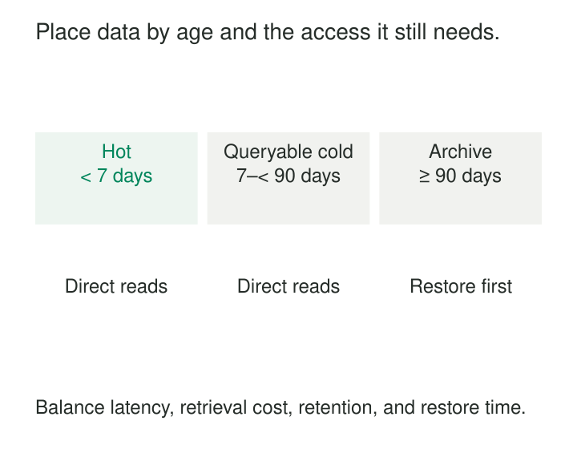

A monitoring platform keeps years of events on the same fast storage used for today’s dashboards. Most queries examine the last few hours, yet old records consume an increasing share of the storage budget. Deleting them would save money, but investigations and backfills still need the detail.

**Hot-Cold Tiering places data on storage suited to its access requirements.** Frequently accessed or actively changing data receives fast capacity. Less active data moves to cheaper capacity, with an explicit policy for querying or restoring it.

The pattern preserves access to history without giving every retained byte the same performance budget.

## Temperature describes access, not importance

“Hot” usually means frequently read, actively written, or subject to a demanding response-time requirement. “Cold” means less frequently accessed and able to tolerate a different service level.

Those labels are relative. Cold data might remain directly queryable on slower disks, be fetched transparently from object storage, or require an asynchronous restoration operation.

These are materially different contracts:

| Placement | Typical access contract |
|---|---|
| Hot | Fast interactive reads and active writes |
| Cold, queryable | Direct queries with different latency or cost |
| Archived | Restore or stage data before reading |

An archive can be highly important even when rarely accessed. Temperature should not imply expendability.

The diagram’s age boundaries are examples, not provider defaults. A useful policy combines age with observed demand, update behavior, retrieval requirements, and exceptions.

## Age is a convenient signal, not the whole policy

Recent events often receive more attention, making age-based movement practical. But an old product catalog may remain heavily queried, while yesterday’s diagnostic payload may already be cold.

Elastic’s guidance makes this distinction explicitly: time-series data can progress through temperature tiers, whereas content such as a product catalog may retain similar access needs throughout its life. [Elasticsearch data tiers](https://www.elastic.co/docs/manage-data/lifecycle/data-tiers)

The policy must also define its clock. Event time, ingestion time, last modification, and last access answer different questions. A six-month-old event arriving today can already satisfy an event-age threshold despite being newly ingested.

Choose the unit of movement deliberately: objects, files, table parts, chunks, or index shards. Mixed-age units can keep substantial cold data on hot storage or move still-active records prematurely.

Avoid repeated movement near a boundary. A minimum residence period or separate promotion and demotion criteria can prevent oscillation when demand fluctuates.

## Example: keep older logs searchable

A monitoring team needs fast recent searches and occasional investigations across several months.

Elasticsearch supports hot, warm, cold, and frozen tiers. Recent time-series data enters the hot tier; lifecycle policies can move older indices according to the deployment’s requirements. Cold storage can use fully mounted searchable snapshots, while frozen storage uses partially mounted snapshots. [Elasticsearch tier behavior](https://www.elastic.co/docs/manage-data/lifecycle/data-tiers)

Searchable snapshots retain the search interface while changing the storage mechanism. Partially mounted indices keep a local cache and fetch missing data from the snapshot repository. A repeated investigation can therefore behave differently from its first search. [Elastic searchable snapshots](https://www.elastic.co/docs/deploy-manage/tools/snapshot-and-restore/searchable-snapshots)

The team still queries historical logs, but it measures historical-search latency separately from its live dashboard.

The repository remains part of the active serving system. Applying an unrelated object lifecycle rule can break that arrangement: Elastic explicitly prohibits moving repository objects into unsupported Glacier classes or enabling optional Intelligent-Tiering archive tiers. [Elastic S3 repository restrictions](https://www.elastic.co/docs/deploy-manage/tools/snapshot-and-restore/s3-repository#s3-storage-classes)

“Stored cheaply in S3” does not establish compatibility with the query engine.

## Example: archive raw inputs with an explicit restore path

A data platform retains raw exports for rare historical reconstruction. Routine transformations use recent data, while old exports can tolerate delayed retrieval.

Amazon S3 offers storage classes with different access characteristics. Standard-IA provides immediate access with retrieval charges; Glacier Flexible Retrieval and Deep Archive require restoration before their contents can be read. Glacier Instant Retrieval has a different, immediate-access contract despite sharing the Glacier name. [S3 storage classes](https://docs.aws.amazon.com/AmazonS3/latest/userguide/storage-class-intro.html)

For Flexible Retrieval and Deep Archive, restoration creates a temporary accessible copy for a specified period. The archived object remains, and storage charges apply to both the archive and temporary copy while it exists. [Restoring S3 objects](https://docs.aws.amazon.com/AmazonS3/latest/userguide/restoring-objects.html)

A historical backfill therefore needs a small workflow: identify the required objects, request restoration, wait for readiness, process them, and track when restored access expires.

The catalog should retain object identifiers, schema versions, checksums, and source boundaries. A request awaiting restoration must return an explicit pending state. Reporting zero records would confuse inaccessible data with nonexistent data.

## Example: move database data between volumes

A self-managed ClickHouse deployment stores recent measurements on fast disks and older measurements on cheaper volumes while retaining one logical table.

ClickHouse supports TTL movement rules using `TO DISK` and `TO VOLUME`, referencing disks and storage policies configured for the deployment. Its documentation demonstrates age-based hot/warm/cold placement and inspecting active parts to verify their location. It also notes that this manual configuration is not the applicable model for ClickHouse Cloud. [ClickHouse storage-tier movement](https://clickhouse.com/docs/concepts/features/operations/delete/ttl#implementing-a-hotwarmcold-architecture)

A movement rule is different from a deletion rule. Both can be expressed through TTL facilities, so the intended action must be explicit.

The application can continue querying the table without managing separate hot and cold tables itself. Operationally, however, the team still needs to observe movement progress and storage pressure. Becoming eligible for movement is not proof that movement has completed.

## Preserve one logical dataset during movement

Tiering is correct when moving data preserves its logical contents and the promised access behavior.

For a custom implementation, a common sequence is to copy a defined source version, validate the destination, publish its location through authoritative metadata, and retire the source only when safe.

Concurrent changes complicate that sequence. If records can change during copying, the destination needs a consistent snapshot and catch-up mechanism, or the source unit must become immutable. A checksum of yesterday’s copy does not account for today’s correction.

During overlap, queries must not count both copies. During cutover, they must not miss the unit entirely. Routing should follow committed location metadata rather than infer physical placement solely from record age.

Historical corrections need a policy too. Options include restoring and rewriting the affected unit or maintaining a versioned correction layer that readers apply correctly. Assuming “old means immutable” merely hides that decision.

## Price the complete access path

The storage price is only part of the bill. Include transitions, requests, retrieval, network transfer, temporary copies, restoration compute, and operational work.

Minimum storage durations can make rapid movement expensive. S3 also documents that per-object transition charges can outweigh savings for small objects; its current default lifecycle behavior generally excludes objects below 128 KB unless configured otherwise. [S3 lifecycle considerations](https://docs.aws.amazon.com/AmazonS3/latest/userguide/lifecycle-transition-general-considerations.html)

Compacting small files before tiering can improve those economics, provided it preserves the required retrieval granularity.

Measure representative retrievals, including an unusually broad investigation. A large backfill or incident can make months of cold data suddenly active. Rate limits and workload isolation may be needed to protect live processing.

## Know when the pattern pays

Tiering works best when access is concentrated in a working set, historical detail remains valuable, and consumers accept differentiated retrieval behavior.

It helps less when historical queries are frequent, updates remain widespread, or every retained record needs the same low-latency access.

Common mistakes include equating cold with offline, treating age as proof of inactivity, and retaining bytes without the metadata, software compatibility, permissions, or encryption keys needed to read them.

Placement, retention, and backup are separate policies. Moving a record should not silently delete its detail, and a cheaper serving location does not automatically provide an independent recovery copy.

## Nearby patterns

[[data-partition-by-access-pattern|Partition by Access Pattern]] creates useful movement and retrieval boundaries.

[[data-small-file-compaction|Small-File Compaction]] reduces object overhead before data enters lower-cost storage.

[[data-atomic-publication|Atomic Publication]] makes location changes visible without gaps or duplicate counting.

[[data-replayable-backfills|Replayable Backfills]] turns retained historical data into usable inputs, including restoration and version tracking.
