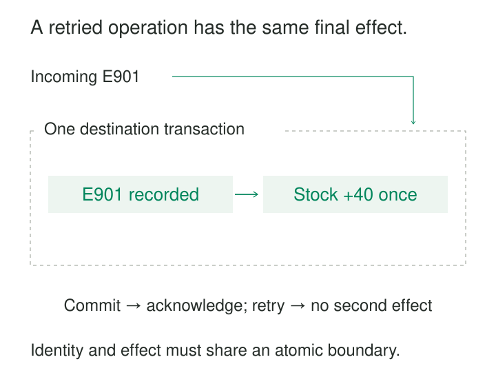

A pipeline sends a write to a database. The database commits it, but the connection breaks before the acknowledgment reaches the pipeline.

The writer now faces an awkward uncertainty: did the operation fail, or did only the reply fail?

Retrying is necessary for reliable delivery. Retrying carelessly can duplicate rows, apply an increment twice, or create a second external object.

Idempotent Writes make repeated attempts at the same logical operation produce the intended effect once. They turn an uncertain outcome into something the system can safely resolve through repetition.

## Identify the operation, not the attempt

Some writes are naturally idempotent. Setting a particular field to a particular value again leaves that field unchanged. Other writes need explicit duplicate protection: “add 40 units” changes the result every time it executes.

For those operations, the destination needs a stable identity that survives retries.

| Identifier | What it identifies |
|---|---|
| Entity key | The object being changed |
| Operation ID | One intended change |
| Attempt ID | One execution or transmission attempt |

An order may receive many legitimate updates. Using only its order ID as an idempotency key would suppress those later updates. Generating a new operation ID for every retry would allow duplicates through.

A useful identity might be `(source_system, event_id)` or `(pipeline_generation, batch_id)`. Its scope must distinguish independent operations while recognizing every retry of the same one.

The payload must remain consistent too. Reusing an operation ID with different input should produce a conflict or investigation signal. Otherwise, an apparent duplicate can conceal corrupted or incorrectly identified data.

## Receive 40 units without receiving them twice

A warehouse receives 40 units against event E901. Stock starts at zero.

The destination records E901 and adds 40 units in one transaction. The transaction commits, but its confirmation is lost. The pipeline retries E901.

The destination recognizes the committed operation and leaves stock at 40.



The operation record and business effect must commit together.

If the marker commits first and the process crashes before updating stock, a retry may incorrectly skip the unfinished receipt. If stock commits first and the marker is written separately, a retry may add the units again.

Concurrency matters as well. Two workers can both observe “E901 does not exist” before either writes it. A separate existence check is insufficient. A unique operation key and transactional coordination must decide which worker owns the effect.

A second legitimate receipt, E902, should add another 40 units even if every descriptive field matches E901. Identical content does not necessarily mean identical intent.

For immutable event storage, the mechanism can be simpler: enforce uniqueness on the source and event ID, then insert only previously unseen events. A duplicate with conflicting content still needs detection.

## Replace state without moving it backward

An order projection receives complete snapshots:

| Order | Version | Status |
|---|---:|---|
| O42 | 11 | Paid |
| O42 | 12 | Shipped |
| O42 | 12 | Shipped, retried |

Writing version 12 twice should leave the projection at version 12.

But a delayed retry of version 11 exposes another problem. A plain upsert can overwrite “shipped” with “paid.” The write may be safe to repeat in isolation while remaining unsafe when interleaved with newer operations.

For a current-state projection, an atomic version guard can prevent that regression:

```sql
INSERT INTO order_state AS stored (order_id, version, status)
VALUES ('O42', 12, 'shipped')
ON CONFLICT (order_id) DO UPDATE
SET version = EXCLUDED.version,
    status = EXCLUDED.status
WHERE EXCLUDED.version > stored.version;
```

This assumes `order_id` has a unique constraint and versions are non-null and authoritative. PostgreSQL supports this conflict-handling mechanism, including a condition evaluated against the existing and proposed rows. [PostgreSQL `INSERT` documentation](https://www.postgresql.org/docs/current/sql-insert.html)

Equal versions should describe equal state; conflicting payloads at the same version deserve a separate check.

The shortcut also assumes each message contains a complete replacement for the projected state. Dependent changes such as “subtract three” cannot generally skip intervening versions. Nor should a current-state projection stand in for processing every transition when those transitions trigger required actions.

Idempotency controls repetition. Versioning and ordering control which distinct operation should prevail.

## Retry an external creation request

A customer synchronization job creates a customer object through an external API. The server creates it, but the client times out.

Looking up the customer by email and creating one if absent can still race with another worker. A provider-supported idempotency key gives the receiving service a direct way to recognize the original request.

Stripe provides a documented implementation. For its API v1, the client supplies an idempotency key when creating or updating an object. Once endpoint execution begins, Stripe saves the first response and returns that saved response for subsequent requests using the same key, including saved `500` responses. It rejects reuse with different parameters. [Stripe idempotent requests](https://docs.stripe.com/api/idempotent_requests)

The synchronization job must persist the key before sending and reuse it after a restart. Creating a fresh random key after each timeout defeats the mechanism.

This protection has a lifetime. Stripe documents that API v1 keys can be removed once they are at least 24 hours old; reuse after pruning can initiate a new request. Retry and reconciliation policies must respect the provider’s contract. Its API v2 has different response semantics, so the API version matters.

A local “sent” flag cannot independently make a remote operation idempotent. The remote boundary needs its own duplicate protection or a reliable reconciliation mechanism.

## A whole batch can have an identity

The same idea applies to bulk ingestion.

Delta Lake supports `txnAppId` and monotonically increasing `txnVersion` values for idempotent table writes. A microbatch writer can reuse the application identity and batch version when retrying a write, allowing Delta to recognize an already committed transaction. [Delta Lake idempotent table writes](https://docs.delta.io/delta-streaming/#idempotent-table-writes-in-foreachbatch)

These identifiers describe a particular write unit. Reusing one identity for several different intended writes to the same table can suppress legitimate work.

Restarting from a new checkpoint also requires care: batch numbering can restart, so Delta documents using a new application identity in that situation. This avoids accidental suppression of new work; it does not automatically deduplicate business records replayed under the new identity.

## Make the guarantee match the boundary

Correctness depends on stable operation identity, consistent input, atomic duplicate handling, and durable records of completed effects.

Those records must survive as long as a retry can legitimately return. Expiring them earlier turns a previously recognized operation into an apparently new one. Delta, for example, exposes transaction-identifier retention through `delta.setTransactionRetentionDuration`. [Delta table properties](https://docs.delta.io/table-properties/)

The protected effect must also be explicit. Updating a row safely does not automatically protect a notification, webhook, or message emitted by a trigger. Each additional destination introduces another failure boundary.

Idempotency does not guarantee eventual success. A permanently failing operation still needs intervention. It also does not make several independent destinations commit atomically, although it can make recovery from partial completion safer.

## Costs and useful situations

Idempotent writes are especially valuable with at-least-once delivery, timeouts, worker restarts, checkpoint replay, scheduled reruns, and uncertain external responses.

Their operating costs include unique indexes, operation ledgers, retained responses or payload fingerprints, additional transactional writes, and contention on frequently updated keys. Repeated requests still consume network, lookup, and coordination resources even when their business effects are suppressed.

Useful signals include duplicate attempts recognized, conflicting payloads, rejected stale versions, expired-key replays, and operations left unresolved.

A complete implementation should withstand both an acknowledgment lost after commit and two workers attempting the same operation concurrently. These failures test the boundary where a simple duplicate check becomes a durable guarantee.

## Related patterns

[[data-merge-and-upsert|Merge and Upsert]] supplies destination operations that can support repeatable writes when keys and update rules are appropriate. [[data-stateful-stream-deduplication|Stateful Stream Deduplication]] suppresses repeated events earlier in a pipeline, while destination protection covers failures around the final write.

[[data-per-key-ordering|Per-Key Ordering]] governs distinct operations that depend on sequence. [[data-transactional-outbox|Transactional Outbox]] connects a committed database change to publication; idempotent consumers make repeated delivery from that outbox safe.
