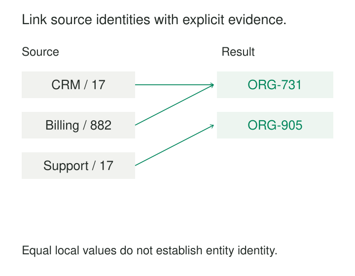

The CRM calls an organization `17`. Billing calls it `882`. Support has another organization numbered `17`, which belongs to someone else. Joining on the numbers loses some relationships and invents others.

Identity Crosswalks preserve explicit mappings between identifiers that refer to the same entity. They let systems retain their own identifiers while enabling reconciliation, migration, and analysis across boundaries.

The central challenge is establishing what “the same entity” means, then maintaining evidence for that decision as records change.

## Store the identity decision

A crosswalk can directly connect identifiers from two systems or map several identifiers to a common entity ID.

The second form creates a shared reference point:

| Identifier namespace | Local value | Common organization ID |
|---|---|---|
| `crm/org` | `17` | `ORG-731` |
| `billing/org` | `882` | `ORG-731` |
| `support/org` | `17` | `ORG-905` |

These illustrative mappings say that the CRM and Billing identifiers refer to one organization, while Support’s `17` refers to another.

The common ID provides continuity without requiring every source to adopt it. Kimball describes a related warehouse technique: integrating disparate source identifiers through a durable key, with source qualification to prevent collisions. [Kimball Group: Durable “Super-Natural” Keys](https://www.kimballgroup.com/2012/07/design-tip-147-durable-super-natural-keys/)

A useful crosswalk retains more than two identifiers. It records the link’s status, supporting evidence or provenance, assignment method, relevant validity period, and when the decision was recorded. These details make mappings explainable and correctable.

## Example: connect records without changing their sources

Suppose the organization register contains an authoritative link between CRM organization `17` and Billing organization `882`. The crosswalk accepts both identifiers under `ORG-731`.

An invoice arriving with `(billing/org, 882)` resolves to `ORG-731`. A CRM interaction carrying `(crm/org, 17)` resolves to the same organization. Each record retains its original identifier alongside the resolved reference.

This allows reporting by common organization identity while preserving a route back to the source.

A similar organization name might suggest another candidate match, but it should not automatically become an accepted crosswalk entry. Names can be shared, abbreviated, outdated, or attached to different organizational levels.

The crosswalk also leaves source attributes intact. Choosing which address or legal name to display is a separate reconciliation decision. Agreement about identity does not imply agreement about every attribute.

## Define what the links actually claim

An identity crosswalk needs a consistent entity boundary. A person, household, customer account, department, and legal organization cannot be substituted for one another simply because their records overlap.

If a billing account covers several organizations, linking that account to each organization describes an account relationship. Treating those links as identity equivalence would incorrectly merge the organizations.

For accepted mappings at a given time, one qualified identifier assignment should resolve to one entity at the declared grain. Many identifiers may resolve to that entity, including several identifiers from the same source when duplicates or aliases exist. Reverse lookup therefore need not return exactly one identifier.

Matching and cross-reference exchange are separate responsibilities. IHE’s PIXm profile provides transactions for retrieving patient identifiers across domains, while explicitly leaving the cross-referencing algorithms and human decisions outside the profile’s scope. An interoperable interface does not establish the accuracy of its mappings. [IHE: PIXm Overview](https://profiles.ihe.net/ITI/PIXm/volume-1.html)

Candidate relationships also require care when forming clusters. Similarity between A and B, followed by similarity between B and C, does not establish that all three describe one entity. A weak link can contaminate an otherwise reliable cluster.

## Example: resolve a reused identifier by time

A plant uses asset label `M-42` for one machine, then assigns it to a replacement after disposal:

| Namespace and value | Physical asset ID | Valid from | Valid until |
|---|---|---|---|
| `plant-1/asset`, `M-42` | `ASSET-100` | 2020-01-01 | 2025-01-01 |
| `plant-1/asset`, `M-42` | `ASSET-900` | 2025-01-01 | Open |

Here, intervals include their start and exclude their end.

A maintenance event dated December 2024 belongs to `ASSET-100`, even if it arrives in February 2025. Looking up only the current mapping would attach it to the replacement machine.

Correct resolution requires a trustworthy event date and non-overlapping assignment intervals. If the date is missing or the assignment history is uncertain, the crosswalk cannot safely choose a physical asset.

It is also useful to distinguish **when a mapping applied** from **when the system learned it**. A corrected assignment recorded in February may apply from January. Retaining both times supports questions about current understanding and what an earlier report knew.

Overwriting the mapping destroys that distinction.

## A real implementation: NCBI’s article ID crosswalk

NCBI’s PMC ID Converter is a concrete implementation of identifier cross-referencing. It returns related publication identifiers, including PMCIDs, PubMed IDs, DOIs, and manuscript identifiers.

Its documented example associates:

| Identifier scheme | Value |
|---|---|
| PMCID | `PMC1193645` |
| PMID | `14699080` |
| DOI | `10.1084/jem.20020509` |

A consumer holding one identifier can retrieve the related identifiers and connect records that would not match through literal equality.

The service also documents important boundaries. It returns related IDs only when the article is in PubMed Central, and it supports version-specific identifiers and information. An absent result therefore does not establish that two publications differ; it may reflect the service’s coverage. [NCBI: PMC ID Converter API](https://pmc.ncbi.nlm.nih.gov/tools/id-converter-api/)

Version handling matters whenever “same work” and “same version” answer different questions. A crosswalk must preserve those distinctions rather than flatten every related identifier into unconditional equivalence.

## Operate the crosswalk as maintained data

Crosswalks are useful during migrations, acquisitions, master-data integration, and reporting across systems with independent identifier schemes. They are especially valuable when several consumers would otherwise repeat the same matching work.

Their operating costs include source feeds, mapping lookups, review of ambiguous cases, evidence retention, correction workflows, and downstream reprocessing. Changes can affect many reports and dependent records.

Quality should be measured through both false links and missed links. A high match rate can conceal widespread incorrect associations. The UK Office for National Statistics explicitly distinguishes match coverage from linkage quality and recommends assessing precision and recall. [ONS: Data Linkage and Matching Policy](https://www.ons.gov.uk/aboutus/transparencyandgovernance/datastrategy/datapolicies/datalinkageandmatchingpolicy)

Accepted, rejected, disputed, and unresolved decisions should remain distinguishable. A similarity score can support a decision, but its interpretation depends on the method and validation; a number alone does not establish identity.

Corrections need to be reversible and traceable. If two entities were wrongly merged, retain enough source information to separate them and identify affected outputs. Consumers also need a defined policy for receiving mapping changes.

## Common mistakes and limits

Joining on unqualified local values recreates collisions that the crosswalk was meant to prevent. Repeated processing should reuse accepted assignments rather than create a fresh entity ID each time.

A missing mapping means “not resolved here.” It does not necessarily mean “new entity.” Sources may be incomplete, delayed, or outside the crosswalk’s coverage.

Business mergers also require explicit semantics. Organizations becoming related or one succeeding another does not automatically make their historical identities identical. Use relationship types appropriate to the change.

Finally, identity alignment does not make every join safe. Combining several invoices with several support interactions at organization level can multiply rows. Each dataset still needs an appropriate grain and aggregation strategy.

## Related patterns

**Namespace Identifiers** preserves the assigning scope of each external identifier.

**Durable Identity** provides continuity across changing identifiers.

[[data-separate-source-facts-from-derived-interpretations|Separate Source Facts from Derived Interpretations]] keeps original references distinct from identity decisions.

[[data-declare-the-grain|Declare the Grain]] establishes which kind of entity the crosswalk links and how resolved records can safely be combined.
