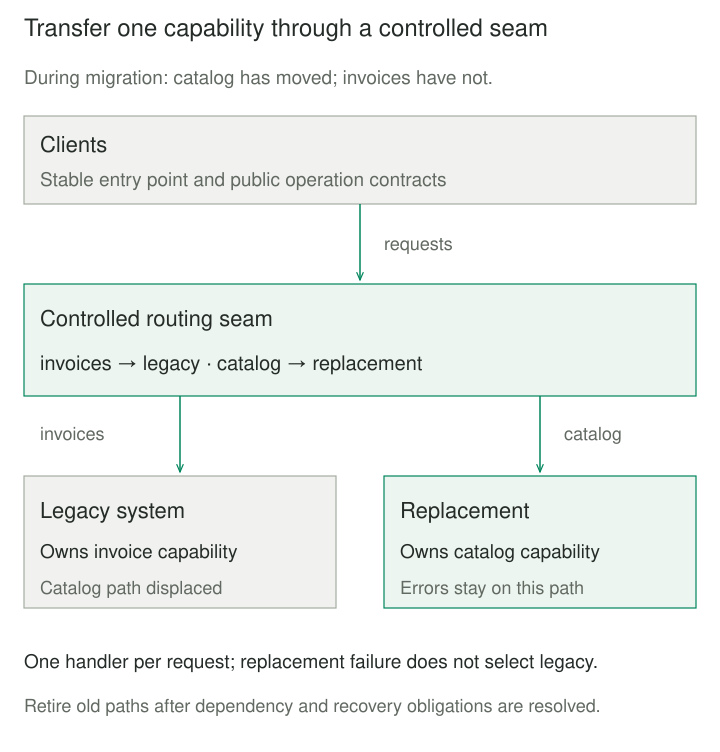

## Purpose and problem

A warehouse platform's replacement is almost ready. “Almost” lasts a year: another consumer appears, an undocumented correction rule emerges, and the old system keeps changing. Meanwhile, the business needs improvements now. A single replacement date concentrates both technical uncertainty and operational risk.

The team needs useful progress before it understands or rebuilds everything. It must also preserve coherent behavior while implementations coexist. Moving arbitrary requests or events is easy; transferring responsibility without losing state, breaking consumers, or leaving two competing authorities is harder.

## Core idea

**Find a seam, replace a coherent slice, then shrink the old system's responsibility.** A Strangler Fig migration introduces new implementation around an existing system and progressively transfers behavior into it. Clients reach the appropriate implementation through a controlled boundary while the remainder continues working.

Martin Fowler originally called this **Strangler Application**, later **Strangler Fig Application**, and now **Strangler Fig**. Incremental change is a wider idea: a rolling deployment of equivalent instances alone does not describe progressive displacement of legacy responsibilities. Strangler Fig also does not require microservices; the replacement can be another modular application.



## How it works

### A seam is more than an HTTP proxy

A facade can intercept requests, but a scheduler, module interface, topic-routing rule, or published dataset interface can also form the seam. Discover actual dependencies before choosing a slice: a workflow, tenant cohort, dataset, or business capability. Preserve the inputs, outputs, meanings, and invariants that must travel together.

Migration owners decide when a slice is ready. Candidate execution and comparisons provide evidence about behavior, performance, and compatibility; they do not confer production authority. A controlled routing or ownership record makes the handover explicit. Monitor both implementations and the seam itself, which can become a bottleneck or single point of failure.

State needs its own transition. Backfill history, catch up changes to an identified boundary, and establish which implementation may write or publish. Two unrelated writes are not an atomic synchronization mechanism. In-flight work may require a pause or fencing that rejects stale publishers after authority changes. A configuration switch by itself cannot stop a worker already executing.

Preserve authentication, authorization, and observability through the seam. Only trusted migration control should change its rules. Internal callers, jobs, exports, and database access can bypass an apparent front-door boundary; inventory them before declaring the legacy capability retired.

## Worked example

### Move catalog traffic before invoices

A client uses catalog and invoice operations. The replacement is ready for catalog first, so both systems must remain usable. This complete Python 3 program models dispatch through one stable entry point. Handlers return invented read-only fixtures; `price_cents` is an integer USD amount. It models routing and failure propagation, not a live network, data synchronization, or concurrent ownership protocol.

```python
class Seam:
    def __init__(self, legacy):
        self.routes = dict(legacy)

    def move(self, capability, replacement):
        if capability not in self.routes:
            raise KeyError(capability)
        if not callable(replacement):
            raise TypeError("replacement must be callable")
        self.routes = {**self.routes, capability: replacement}

    def handle(self, capability, resource_id):
        handler = self.routes[capability]
        return handler(resource_id)


calls = []


def endpoint(name, fields):
    def handle(resource_id):
        calls.append(name)
        return {"id": resource_id, **fields}
    return handle


def failed_catalog(resource_id):
    calls.append("failed new catalog")
    raise TimeoutError("replacement unavailable")


if __name__ == "__main__":
    old = {
        "catalog": endpoint("old catalog", {"price_cents": 2500}),
        "invoices": endpoint("old invoices", {"status": "open"}),
    }
    new_catalog = endpoint("new catalog", {"price_cents": 2500})
    seam = Seam(old)
    seam.handle("catalog", "P17")
    seam.handle("invoices", "I9")
    print("before:", calls)

    calls.clear()
    seam.move("catalog", new_catalog)
    assert seam.handle("catalog", "P17") == {"id": "P17", "price_cents": 2500}
    seam.handle("invoices", "I9")
    assert calls == ["new catalog", "old invoices"]
    print("during:", calls)

    calls.clear()
    seam.move("catalog", failed_catalog)
    try:
        seam.handle("catalog", "P17")
    except TimeoutError:
        assert calls == ["failed new catalog"]
        print("failure: no implicit fallback")
    else:
        raise AssertionError("expected replacement failure")

    calls.clear()
    seam.move("catalog", new_catalog)
    seam.move("invoices", endpoint("new invoices", {"status": "open"}))
    seam.handle("catalog", "P17")
    seam.handle("invoices", "I9")
    print("after:", calls)
```

Run `python3 strangler_fig.py`. The call lists are initially `['old catalog', 'old invoices']`, during migration `['new catalog', 'old invoices']`, and finally `['new catalog', 'new invoices']`. The failure line is `failure: no implicit fallback`.

The routing table changes without changing the caller's interface. Handler selection happens once per call. A failed new handler does not silently retry against old code: for writes, a timeout could follow a successful update, and the old store might already be stale. Restoring the working fixture here is an explicit test action, not evidence of production rollback safety. Even after both routes move, the example does not establish that jobs, stored procedures, or other legacy dependencies can be removed.

### The slice must include state

For a tenant balance stream, move the tenant's complete history and later corrections, not a random percentage of its events. Catch the replacement up to a known checkpoint before transferring publishing authority. Cross-tenant balances may require a larger slice. The ownership matrix below makes that separate decision visible.


Uber's [Hive-to-Spark SQL migration](https://www.uber.com/us/en/blog/how-uber-migrated-from-hive-to-spark-sql-for-etl-workloads/) illustrates a workflow seam: shadow-validate a workflow, translate subsequent runs to Spark, then update its submitted source. Stripe's [subscription migration](https://stripe.com/blog/online-migrations) separately demonstrates backfill, read comparison, and staged read/write transitions. These are documented migration techniques, not claims that every engine or schema migration is a Strangler Fig application.

## When to use it

Use Strangler Fig when replacement is substantial, useful seams can be established, and the legacy system can keep operating during a period of coexistence. It helps when incremental value and learning matter more than a single wholesale switch.

A small system with tightly coupled state may be better served by a rehearsed, bounded cutover. If no calls or integration points can be intercepted, first create a feasible seam. The pattern cannot guarantee zero downtime, cheap migration, or rapid decommissioning.

## Tradeoffs and common mistakes

**Coexistence is work.** Duplicate infrastructure, adapters, comparisons, synchronization, and operational procedures consume attention. Changing business definitions during an engine replacement confuses the evidence. Agree which behavior is being preserved and which changes are intentional.

**Rollback needs current data.** Stopping further migration is different from reversing completed handovers. After the replacement accepts writes, the old store may be stale or unable to represent new states. Maintain a reconciliation path or accept forward repair. Switching routes cannot retract notifications or exports already consumed.

**Progress must end in retirement.** Easy slices can move while difficult dependencies remain indefinitely. Give each slice acceptance and retirement conditions. Remove displaced code and temporary machinery once recovery obligations and remaining dependencies are resolved; retain a facade only when it still has a clear responsibility.

## Related patterns

[[data-expand-migrate-contract|Expand-Migrate-Contract]] introduces a replacement interface, moves consumers, and removes the old interface. It can structure an individual Strangler Fig slice.

[[data-shadow-pipelines|Shadow Pipelines]] exercise candidates without granting production authority.

[[data-parallel-run-comparison|Parallel-Run Comparison]] supplies behavioral evidence for a handover; equal samples alone do not establish complete compatibility.

[[facade|Facade]] simplifies access to a subsystem. A migration facade additionally steers responsibility between old and new implementations and has a transition lifecycle.

## Sources

- Martin Fowler, [Strangler Fig](https://martinfowler.com/bliki/StranglerFigApplication.html) and [Original Strangler Fig Application](https://martinfowler.com/bliki/OriginalStranglerFigApplication.html): established name, gradual displacement, seams, and transitional architecture.
- [Microsoft Azure Architecture Center](https://learn.microsoft.com/en-us/azure/architecture/patterns/strangler-fig) and [AWS Prescriptive Guidance](https://docs.aws.amazon.com/prescriptive-guidance/latest/cloud-design-patterns/strangler-fig.html): routing, coexistence, dependencies, data considerations, and operational limits.
- [Uber's migration account](https://www.uber.com/us/en/blog/how-uber-migrated-from-hive-to-spark-sql-for-etl-workloads/) and [Stripe's online migrations](https://stripe.com/blog/online-migrations): the attributed implementation examples above.

The catalog/invoice simulation, tenant-cohort scenario, and SVG compositions are original Patternverse teaching examples, developed from the existing Incremental Replacement article.
