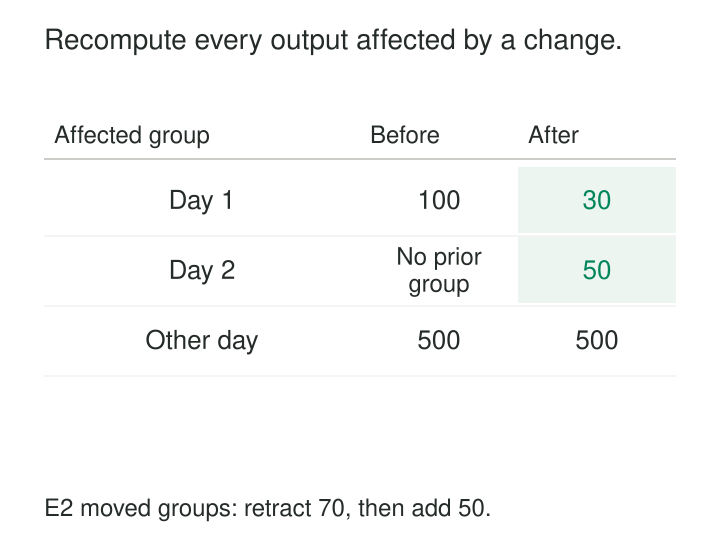

A daily sales model rebuilds several years of transactions every hour. Most records have not changed. The warehouse repeatedly scans, joins, and aggregates the same history to discover a small amount of new information.

Processing only new rows seems like an obvious improvement—until an old sale is corrected, a refund arrives late, or a customer changes region.

**Incremental Transformation maintains an existing result by processing changes and their consequences.** It reuses previously computed state while updating the parts that can no longer be trusted.

The governing requirement is simple: after applying the changes, the maintained result should match the same transformation over the complete current inputs, using the same rules and reporting context.

## Find the affected output, then update it

An incremental transformation has three distinct responsibilities:

1. Detect relevant input changes.
2. Determine which output records, groups, or partitions those changes affect.
3. Update that scope safely.

The second step is often the hardest.

A changed transaction might affect one output row. Moving that transaction between reporting days affects two daily groups. Updating a shared classification can affect thousands of otherwise unchanged records.

Incremental extraction supplies new information. Incremental transformation determines what that information invalidates.

The unit of recomputation need not equal the unit of change. A single changed row can justify rebuilding an entire customer history, reporting partition, or session.

## A corrected sale changes two days

Consider an illustrative daily sales model:

| Sale | Reporting day | Amount |
|---|---|---:|
| E1 | Day 1 | 30 EUR |
| E2 | Day 1 | 70 EUR |

Day 1 initially totals 100 EUR.

A correction changes E2 to 50 EUR and moves it to day 2. The correct result becomes:

| Reporting day | Updated total |
|---|---:|
| Day 1 | 30 EUR |
| Day 2 | 50 EUR |

Processing only E2’s new representation can create the day 2 total, but leaves day 1 overstated unless the old contribution is also removed.

There are two common solutions. The transformation can retract the old contribution and add the new one, provided it maintains sufficient state and handles repeated delivery safely. Alternatively, it can identify both affected days and recompute their complete current contents.

The second approach reads unchanged E1 because E1 contributes to an affected result.

Before-and-after information is valuable here. Delta Lake’s [change data feed](https://docs.delta.io/delta-change-data-feed/) provides insert, delete, update-preimage, and update-postimage records, together with commit metadata. Such information helps identify both old and new grouping keys.

Deletion introduces another edge case. If removing a sale leaves a group empty, the old target row may need deletion. A merge that only inserts or updates returned groups can leave that obsolete result behind.

## Choose a maintenance strategy that fits the model

Different transformations need different update mechanisms:

| Strategy | Appropriate setting |
|---|---|
| Append | Immutable new records with controlled duplicate handling |
| Merge by key | New and revised output rows with stable identities |
| Replace affected partitions | Complete recomputation of bounded groups or periods |
| Apply deltas | Aggregates with sufficient state for additions and retractions |

dbt documents append, merge, delete-and-insert, partition overwrite, and microbatch approaches in its [incremental strategy guide](https://docs.getdbt.com/docs/build/incremental-strategy).

A strategy does not establish correctness by itself. Merging an aggregate calculated from only the changed transactions can overwrite a complete historical total with a partial one.

Likewise, replacing a partition requires its complete intended contents. Supplying only changed rows would erase unchanged records.

Aggregate state also matters. An average can be maintained from sum and count. Removing the current minimum, or maintaining an exact distinct count, can require additional state or recomputation.

## A changed dimension can invalidate unchanged facts

An illustrative sales product groups transactions by each customer’s **current** region. Customer C17 moves from North to South.

No transaction changes, but all of C17’s contributing sales now belong to a different regional group under this definition.

A process watching only the sales table misses the change. Correct maintenance must observe the customer dependency, locate affected transactions, and revise both regional results.

A different product might classify sales by the customer’s region when each sale occurred. That requires a temporal relationship. A new current region may leave past sales unchanged, while a correction to historical region dates can still invalidate them.

The transformation’s semantics determine its dependency scope.

This principle applies to exchange-rate tables, identity crosswalks, product categories, and allocation rules. A small reference table can cause a large update because many facts depend on it.

## A rolling window changes when time advances

An illustrative seven-day activity model can change even when no new events arrive.

As the reporting date advances, older events leave the window. Their contributions must be removed. Treating the source table as the only changing input leaves the result stale.

The reporting clock therefore belongs to the dependency model. Maintenance can process newly eligible and newly expired intervals, or recompute the bounded window.

The same issue appears in expiring subscriptions, overdue classifications, and age-based cohorts. These are state changes driven by time and rules, rather than new source rows alone.

For reproducible comparison, both incremental execution and the reference rebuild must use the same reporting date and boundary conventions.

## Frameworks help, but their guarantees have scope

dbt’s incremental models let authors select records for processing and configure keys for updating existing outputs. Its [configuration guide](https://docs.getdbt.com/docs/build/incremental-models) explains that a `unique_key` identifies the output grain and supports matching existing rows.

That setting does not prove the key is unique, identify every affected group, or automatically implement source deletions. Those responsibilities still depend on the model and strategy.

Databricks materialized views provide another documented implementation: the engine can detect changes and incrementally maintain supported queries with batch-equivalent semantics. Eligibility and refresh policies determine whether it uses incremental processing or a full recomputation. See [incremental refresh for materialized views](https://docs.databricks.com/aws/en/ldp/incremental-refresh).

Automatic maintenance reduces implementation work. It still requires understanding supported operations, retained inputs, and possible refresh costs.

## Protect progress, retries, and corrections

Reliable maintenance needs a complete change boundary. A timestamp filter is useful only if every relevant change is represented and late changes remain discoverable. An overlapping window handles bounded lateness; it cannot guarantee discovery of arbitrarily old corrections.

Each run should identify the source interval or versions it processes. Target publication and progress advancement must coordinate so a crash cannot skip unapplied changes. Reprocessing an interval must either produce the same replacement result or deduplicate its effects.

Concurrent runs also need coordination. Two correct calculations can publish incompatible states if they use different source boundaries or overwrite each other’s results.

Logic changes require special treatment. Applying a corrected rule only to newly changed rows can leave one target containing several historical definitions. A targeted backfill or full rebuild may be necessary.

Similarly, adding a column does not populate historical values automatically. dbt explicitly documents this limitation for its schema-change settings in the [incremental-model guide](https://docs.getdbt.com/docs/build/incremental-models#what-if-the-columns-of-my-incremental-model-change).

## Verify savings against a trusted reference

Incremental logic should be checked against an equivalent bounded rebuild. Useful cases include repeated delivery, late updates, deletions, changed grouping keys, changed lookups, and empty groups.

The comparison needs consistent source snapshots and reporting context. Otherwise, differing inputs can look like a maintenance defect.

Operating measurements should distinguish changed input rows from affected output scope and actual data scanned. A tiny change can trigger expensive joins, partition rewrites, or broad reclassification. Checkpoints, retained change history, and maintenance state add their own storage and monitoring costs.

The pattern is valuable when historical computation is expensive and the affected scope is usually limited. Small datasets, global rankings, frequently changing rules, or widespread dependency changes may make full rebuilding simpler or cheaper.

[[data-log-based-change-data-capture|Log-Based Change Data Capture]] supplies detailed changes. [[data-deletion-tombstones|Deletion Tombstones]] communicate removals. [[data-deterministic-transformations|Deterministic Transformations]] provide a reproducible reference calculation. [[data-historical-restatement|Historical Restatement]] governs broader corrections.

The useful optimization is the smallest scope that restores the complete intended result.
