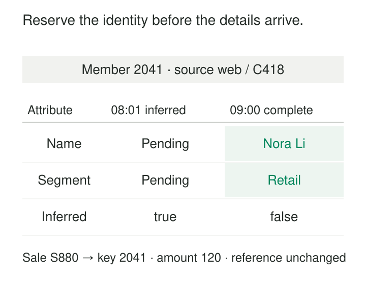

A sale reaches the warehouse at 08:01. It contains a customer number, a product number, and an amount. The customer’s descriptive record will arrive with the next CRM extract at 09:00.

The transaction is ready to report, but its customer dimension row does not exist. Holding the sale back makes revenue reporting stale. Loading it against a shared “Unknown customer” row loses the customer-specific connection unless someone repairs the fact later.

[[data-inferred-dimension-members|Inferred Dimension Members]] provides a third option: create a minimal dimension row for the known source identifier, give it a surrogate key, and complete its attributes when the authoritative details arrive.

The inference is modest: a transaction references this member, so the warehouse reserves a place for it. It does not guess the customer’s name, location, or segment.

## Establish identity before description

An inferred member contains enough information to connect future data to the same dimension row:

- A source identifier, including its namespace where necessary.
- A warehouse surrogate key.
- Explicitly unresolved descriptive attributes.
- An indicator that the member awaits completion.

The fact references that surrogate key immediately. When dimension details arrive, the loader finds the inferred member and fills the existing row.

Kimball describes this approach for facts that arrive before their dimensional context: retain the unresolved natural key in a placeholder row, then populate its descriptive attributes using a Type 1 overwrite. [Kimball: Late Arriving Dimensions](https://www.kimballgroup.com/data-warehouse-business-intelligence-resources/kimball-techniques/dimensional-modeling-techniques/late-arriving-dimension/)

The stable key is the mechanism. Completing one dimension row can supply context to many existing facts without changing their foreign keys.

## Example: revenue arrives before the customer profile

An illustrative sale, S-880, references customer `C-418` in the `web` source system. The customer lookup fails, so the loader creates this row:

| Customer key | Source | Customer ID | Name | Segment | Inferred |
|---:|---|---|---|---|---|
| 2041 | web | C-418 | Pending | Pending | Yes |

The sale loads with `customer_key = 2041` and an amount of 120. Another sale for the same source customer arrives for 80. It reuses key 2041.

The dashboard can now show total revenue of 200, with that amount assigned to a visible “Pending customer details” segment.

At 09:00, the CRM extract supplies the missing description:

| Customer key | Source | Customer ID | Name | Segment | Inferred |
|---:|---|---|---|---|---|
| 2041 | web | C-418 | Nora Li | Retail | No |

Both facts still reference 2041. After the relevant reports refresh, the 200 appears under Retail. The transaction amounts have stayed the same; their descriptive context has improved.

That distinction matters to users. Revenue may be available before revenue *by customer segment* is complete.

## A specific unresolved member differs from “Unknown”

An inferred member preserves a particular identity. A shared unknown member represents a broader absence of information.

If two source customers, `C-418` and `C-419`, are awaiting details, they need separate inferred rows. Combining them under one placeholder prevents a later dimension update from identifying which facts belong to which customer.

Conversely, a transaction with no customer identifier cannot support a customer-specific inferred member. It may require a designated missing or anonymous member, or a separate repair process.

Missing, inapplicable, invalid, and awaiting-description states deserve distinct treatment. Microsoft’s dimensional modeling guidance explicitly distinguishes special members for missing, unknown, inapplicable, and error conditions. [Microsoft Fabric: Special Dimension Members](https://learn.microsoft.com/en-us/fabric/data-warehouse/dimensional-modeling-dimension-tables#special-dimension-members)

A lookup failure alone is insufficient evidence to create an inferred row. A malformed identifier or a broken lookup connection requires diagnosis.

## Example: a new product crosses two source systems

A retailer receives sales for product `P-73` before the merchandising feed supplies its category. The warehouse reserves product key 611 and temporarily reports those sales under “Category pending.”

A second acquired business also uses `P-73`, but for a different product. Resolving both records by the bare product code would combine unrelated sales.

The matching identity must therefore include the source namespace—for example, `(retail_eu, P-73)` versus `(retail_us, P-73)`—or use an established identity crosswalk.

When the European product description arrives, it completes key 611 only. Whether the two source products ultimately represent the same commercial item is a separate identity decision.

This example exposes a correctness assumption: the identifier used to create the placeholder must also identify the authoritative record that completes it. Reused identifiers, inconsistent normalization, and changing source keys require additional rules.

## Completion needs its own loading path

Creation and completion should be repeatable and safe under concurrency.

Two workers may encounter the same missing customer simultaneously. A naive “look up, then insert” sequence can create duplicate inferred rows. The warehouse needs a concurrency-safe way to reserve one key for the unresolved identity, using supported constraints, coordinated writes, or another atomic resolution mechanism.

In a Type 2 dimension, the same source identifier legitimately appears in several historical versions. A blanket uniqueness rule on that identifier would be wrong. Uniqueness must reflect the model’s versioning rules and prevent duplicate reservations without prohibiting valid history.

Completion should update the reserved row, retain its surrogate key, and clear its inferred status once the required authoritative context is available. Partial updates should preserve already known values rather than replace them with absent fields.

This behavior has a documented implementation in SQL Server Integration Services. Its Slowly Changing Dimension transformation provides an **Inferred Member Updates** output for completing minimal records. The wizard supports identifying inferred members through a Boolean indicator or designated null attributes. [SSIS transformation](https://learn.microsoft.com/en-us/sql/integration-services/data-flow/transformations/slowly-changing-dimension-transformation?view=sql-server-ver17), [SSIS inferred-member options](https://learn.microsoft.com/en-us/sql/integration-services/data-flow/transformations/inferred-dimension-members-slowly-changing-dimension-wizard?view=sql-server-ver17)

An explicit indicator is useful when legitimate completed records can also contain null attributes.

## Example: late details reveal two historical versions

An employee’s expense records arrive on June 10 and June 20. Both reference an inferred employee member.

On June 25, the HR feed reveals that the employee belonged to Operations until June 15 and Sales from June 15 onward.

Filling the placeholder with the latest department, Sales, would misclassify the June 10 expense. The incoming data describes two business states, not merely a missing name.

The loader must establish the effective-dated versions and associate each expense with the version covering its event time. Depending on the existing mapping, some fact keys may need correction. Kimball specifically distinguishes retroactive Type 2 changes from simple placeholder completion and notes that associated facts may require restatement. [Kimball: Late Arriving Dimensions](https://www.kimballgroup.com/data-warehouse-business-intelligence-resources/kimball-techniques/dimensional-modeling-techniques/late-arriving-dimension/)

The promise of unchanged fact keys applies when completing the placeholder supplies the correct context for its linked facts. It cannot substitute for missing historical evidence.

## Temporary incompleteness has an operating cost

The pattern trades delayed facts for temporarily incomplete descriptions. It works well when transaction freshness matters, source identifiers are dependable, and dimension feeds normally catch up.

Operating costs include additional lookup and insert activity, concurrency handling, reconciliation, and monitoring. Useful signals include unresolved-member age, resolution rate, and the amount of business activity attached to pending members. Ten unresolved customers carrying half the day’s revenue deserve more attention than hundreds with negligible activity.

Completion can also require refreshing cached reports and rebuilding materialized aggregates grouped by the newly supplied attributes. A correct dimension update does not automatically repair every downstream copy.

Common mistakes include inventing plausible defaults, creating a new surrogate key on completion, and leaving inferred members unresolved indefinitely. Assigning “Standard” as a guessed customer tier can silently contaminate analysis.

Where incomplete context makes the intended use unacceptable, holding affected facts for review may be preferable. Preserving the earlier “what was known then” view also requires an audit or recorded-time history beyond the completed dimension row.

## Related patterns

[[data-surrogate-keys|Surrogate Keys]] provides the stable reference that makes later completion inexpensive.

**Namespace Identifiers** prevents source-local identifiers from colliding when placeholders are created.

[[data-version-dimension-rows-scd-type-2|Version Dimension Rows — SCD Type 2]] handles genuine historical changes that cannot be resolved through simple completion.

[[data-distinguish-missing-unknown-inapplicable|Distinguish Missing, Unknown, and Inapplicable]] keeps “details expected later” separate from other forms of absent information.
