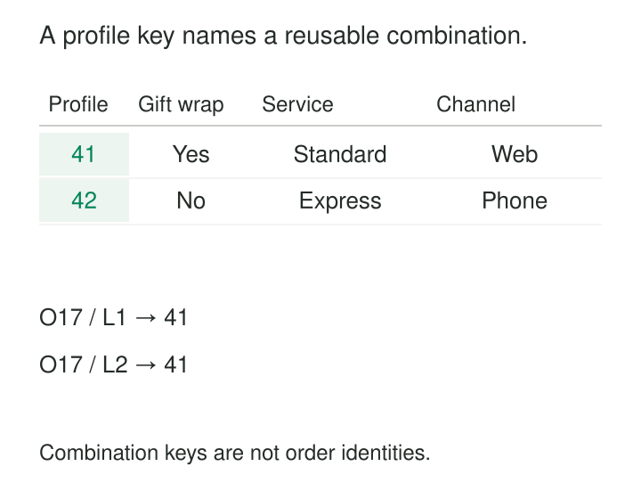

An order model has accumulated a collection of small attributes: gift wrapping, delivery service, order channel, signature requirement, and several processing flags. Each matters to analysts, but creating a separate dimension for every two-value field produces a forest of tiny tables. Leaving them scattered across the fact table creates another kind of clutter.

[[data-junk-dimensions|Junk Dimensions]] collect small categorical attributes into a shared profile table. Each row represents one combination of values, and each fact row stores the key of its applicable combination.

The purpose is to give useful transaction context a manageable home without pretending that every flag represents a separate business entity.

## Model a combination, not a new entity

“Low cardinality” means an attribute has relatively few distinct values. Yes/No flags, small status lists, and short classifications are common candidates.

A junk dimension combines several such attributes that do not naturally belong in the model’s established dimensions. It often receives a business-facing name such as **Order Profile**, **Transaction Characteristics**, or **Processing Context**. Kimball explicitly describes transaction profile dimensions as a common form of this pattern. [Kimball Group: Junk Dimensions](https://www.kimballgroup.com/data-warehouse-business-intelligence-resources/kimball-techniques/dimensional-modeling-techniques/junk-dimension/)

Its surrogate key identifies a combination. It does not identify an order, customer, or process instance. Thousands of unrelated transactions can reference the same profile.

The attributes need not imply a hierarchy or causal relationship. Their grouping is a practical modeling decision, grounded in their usefulness together and the manageable number of combinations.

*Each profile is stored once. Facts retain their own identities, grain, and measurements.*

## Give order characteristics a reusable profile

Consider an illustrative order-line model. Three attributes describe the order when it was placed:

| Profile key | Gift wrap | Delivery service | Order channel |
|---:|---|---|---|
| 41 | Yes | Standard | Web |
| 42 | No | Express | Phone |

Order O17 has two lines, worth 50 and 12 USD. Both inherit its gift-wrapped, standard-service, web profile, so both reference key 41. Order O18 has one line worth 25 USD and references key 42.

To report net amounts for gift-wrapped orders, the query filters the profile dimension to `Gift wrap = Yes` and follows its key to the facts. The resulting amount is 62 USD.

No information has been collapsed into an opaque business category. Analysts can still filter by gift wrapping, delivery service, or channel independently. The surrogate key simply provides a compact reference to their combination.

The fact grain remains one order line. Counting the selected fact rows produces two lines, while counting distinct orders produces one order. The profile dimension changes neither interpretation.

A new order with the same characteristics reuses key 41. A new combination requires another profile row.

## Keep the attributes at compatible grains and times

Small value lists alone do not make attributes suitable companions.

All attributes in a profile must have a well-defined value for the fact row at the relevant observation time. In the example, the profile describes the order at placement. An order-level gift preference can be inherited by every line only if it actually applies to every line.

Suppose gift wrapping is instead selected independently for individual products. The profile must then resolve at line level. If signature requirement belongs to a shipment, attaching it to an order line with several shipments requires another decision about grain.

Mutable status introduces a similar issue. “Express delivery requested at placement” and “delivery currently delayed” describe different observations. Combining them without a time policy can produce a profile whose meaning changes between refreshes.

Entity attributes also need their proper homes. Customer industry belongs with customer context; product category belongs with product context. A junk dimension is useful for transaction characteristics that lack a better location, not as a general destination for spare columns.

## Count combinations before creating them

Three independent binary attributes have eight possible combinations. Twenty have 1,048,576.

That multiplication is the pattern’s principal limit. Each individual flag can remain small while the combined dimension becomes large.

There are two construction approaches. A small, stable set can be generated in advance by combining the attributes’ value lists. Alternatively, the dimension can contain only combinations actually encountered in source records. Kimball’s current technique description favors observed combinations, while its detailed implementation guidance explains both approaches. [Kimball Group: Junk Dimensions](https://www.kimballgroup.com/data-warehouse-business-intelligence-resources/kimball-techniques/dimensional-modeling-techniques/junk-dimension/), [Creating and Maintaining Junk Dimensions](https://www.kimballgroup.com/2009/06/design-tip-113-creating-using-and-maintaining-junk-dimensions/)

In the order example, only two of eight possible combinations have appeared. Prebuilding all eight is inexpensive; retaining two observed rows is also reasonable.

A prebuilt row does not establish that a combination is legitimate. Business validation must still reject impossible or prohibited combinations. An observed combination likewise proves occurrence, not correctness.

## Preserve combinations and keys during loading

For each incoming fact, the load process determines the complete attribute tuple and looks up its profile key. If an allowed combination is new, it creates the profile before assigning that key to the fact.

The combination must be unique. Duplicate profile rows make lookups ambiguous and can multiply query results. Concurrent loads therefore need a coordinated insertion process or equivalent uniqueness protection.

Keys must remain stable across refreshes. Rebuilding the dimension with newly assigned row numbers can make existing facts point to different combinations.

The combination itself should retain its meaning. Changing profile 41 from “Gift wrap = Yes” to “No” would reinterpret every fact referencing it. A corrected transaction should reference the appropriate profile instead.

Missing information needs explicit treatment. Unknown gift wrapping is different from No. If delivery service and channel are known, preserve them rather than replacing the entire tuple with a generic unknown profile.

Adding an attribute requires a historical policy too. Older facts cannot truthfully acquire `Signature required = No` merely because the source never captured that field.

## Published healthcare designs show both approaches

Margy Ross describes an unnamed healthcare design that used separate junk dimensions for claims-processing context, payment context, and contractual context. One dimension had more than a trillion theoretical combinations but only tens of thousands observed. Generating every possibility would have served little purpose. [Kimball Group: De-Clutter With Junk Dimensions](https://ralphkimball.com/wp-content/uploads/2020/08/Kimball-Design-tip-48.pdf)

The separation is instructive: the designers created several coherent context groups rather than one enormous miscellaneous table.

Warren Thornthwaite’s published implementation example combines hospital admission type and care level. Its four admission types and three care levels yield twelve possible combinations. The accompanying SQL demonstrates both generating combinations and deriving them from source observations, followed by resolving fact rows to the corresponding surrogate keys. The SQL is illustrative; Ross’s healthcare organization is not named. [Kimball Group: Creating, Using, and Maintaining Junk Dimensions](https://www.kimballgroup.com/2009/06/design-tip-113-creating-using-and-maintaining-junk-dimensions/)

## Trade fewer tables for more combination management

Junk dimensions help when a model contains numerous small classifications that analysts regularly filter together. They can reduce fact-table references and give report authors a recognizable place to find transaction characteristics.

Microsoft includes the pattern in its Power BI star-schema guidance, identifying consolidation of small dimensions and reduced field-list clutter as design objectives. [Microsoft: Junk Dimensions](https://learn.microsoft.com/en-us/power-bi/guidance/star-schema#junk-dimensions)

The operating costs move into profile management: value normalization, combination lookup, new-row insertion, stable keys, and schema evolution. Adding one attribute can expand the combination space and require changes to every loading pipeline that assigns profiles.

Storage and query benefits depend on the engine. One integer key may replace several wider codes, but packed flags in a columnar system may already compress well. The extra join also has a cost. Measure the workload rather than assuming consolidation guarantees faster queries.

When combinations grow rapidly, split the attributes into useful groups or retain independently meaningful dimensions. Transaction identifiers, free text, and large value domains are usually poor additions.

[[data-controlled-vocabularies|Controlled Vocabularies]] defines the allowed attribute values. [[data-declare-the-grain|Declare the Grain]] establishes where each characteristic applies. [[data-surrogate-keys|Surrogate Keys]] gives combinations stable references. [[data-degenerate-dimensions|Degenerate Dimensions]] serves a different need: keeping a transaction identifier directly on facts when it has no associated descriptive dimension.
