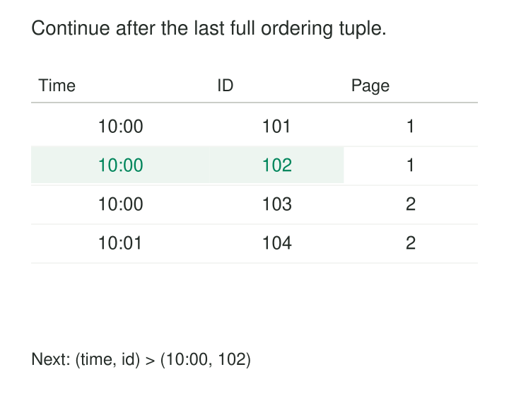

A customer export returns its first thousand rows quickly. Later pages become progressively slower because each request tells the database to skip everything already traversed.

Meanwhile, a deletion near the beginning shifts the remaining rows. The next offset lands one record too far forward.

[[data-keyset-pagination|Keyset Pagination]] continues from an ordered value rather than a row count. Instead of asking “skip the first 50,000 records,” it asks “return the next records after this key.”

Also called *seek pagination*, the pattern makes sequential traversal efficient when the database can locate the boundary through a suitable index. Its correctness depends on a complete ordering key and a clear contract for concurrent changes.

## Remember a position in the order

A keyset cursor contains the values defining the last returned row’s position.

For ascending customer IDs, a page ending at ID 420 continues with `customer_id > 420`, ordered by customer ID. Gaps in the IDs do not matter. The next existing value might be 421 or 700.

The ordering need not use the primary key alone. It can use a timestamp followed by an identifier, provided the complete combination establishes a unique order.

Uniqueness applies to the result being paginated. An order ID that is unique in the orders table may repeat after joining orders to line items. Paginating orders and paginating joined line items are different contracts.

## Example: a deletion does not shift the boundary

Suppose the ordered customer IDs are:

`10, 20, 30, 40, 50`

With a page size of two, the first page returns 10 and 20.

Customer 10 is then deleted. An offset-based second request skips two rows in the current collection, now `20, 30, 40, 50`, and returns 40 and 50. Customer 30 disappears from the traversal.

A keyset request asks for IDs greater than 20 and returns 30 and 40. Deleting a lower key has not changed that boundary.

The cursor can retain the value 20 even if customer 20 is subsequently deleted. The query compares values; it need not find the previous row again.

Microsoft’s EF Core documentation demonstrates this ID-based approach and explains its resistance to changes below the saved boundary. [EF Core: Keyset Pagination](https://learn.microsoft.com/en-us/ef/core/querying/pagination#keyset-pagination)

## Example: timestamps need a tie-breaker

An order export sorts by creation time. Three orders share the same timestamp:

| Order ID | Created at |
|---:|---|
| 101 | 10:00:00 |
| 102 | 10:00:00 |
| 103 | 10:00:00 |
| 104 | 10:01:00 |

The first page returns 101 and 102.

Saving only `10:00:00` creates a dilemma. Continuing with a later timestamp skips order 103. Including the same timestamp repeats earlier rows without identifying where to resume.

The cursor must retain both values: `(10:00:00, 102)`.



In PostgreSQL, the continuation query can express that boundary directly:

```sql
SELECT order_id, created_at, amount
FROM orders
WHERE tenant_id = :tenant_id
  AND (created_at, order_id) > (:last_created_at, :last_order_id)
ORDER BY created_at ASC, order_id ASC
LIMIT :page_size;
```

The comparison means “a later creation time, or the same time with a larger order ID.” PostgreSQL compares these row values from left to right. [PostgreSQL: Row Constructor Comparison](https://www.postgresql.org/docs/18/functions-comparisons.html#ROW-WISE-COMPARISON)

The first page omits the continuation predicate. It should not invent a starting value unless that value is genuinely outside the permitted key domain.

jOOQ provides documented framework support through its synthetic `seek()` clause, including translation of compound key comparisons for supported databases. [jOOQ: SEEK Clause](https://www.jooq.org/doc/latest/manual/sql-building/sql-statements/select-statement/seek-clause/)

## Make the index match the traversal

The potential performance benefit comes from locating the saved boundary and reading forward, rather than repeatedly processing a growing prefix.

PostgreSQL documents that rows skipped by `OFFSET` still have to be computed. It also explains how an index matching `ORDER BY` can retrieve a limited result without sorting or scanning the entire matching collection. [PostgreSQL: LIMIT and OFFSET](https://www.postgresql.org/docs/18/queries-limit.html), [Indexes and ORDER BY](https://www.postgresql.org/docs/18/indexes-ordering.html)

For the tenant-scoped order query, a candidate index is `(tenant_id, created_at, order_id)`: the tenant is constrained by equality, followed by the traversal columns. Leading equality conditions and subsequent range conditions matter to multicolumn B-tree access. [PostgreSQL: Multicolumn Indexes](https://www.postgresql.org/docs/18/indexes-multicolumn.html)

This is not a guarantee of constant-time pages. Additional filters, joins, sparse qualifying rows, wide payloads, and table lookups can still dominate execution. The query plan must show that the intended access path is being used.

## The cursor preserves comparison semantics

A cursor must carry every ordering value with sufficient precision. Rounding a timestamp while serializing it can move the continuation boundary.

It should also remain associated with the query’s scope: tenant, filters, ordering, and any snapshot identity. Reusing a cursor after changing those conditions can produce an unrelated traversal.

Sort direction must match the predicate. For a wholly descending ordering, continuation normally uses `<`. Mixed ascending and descending fields require comparisons matching each component; blindly reversing one tuple operator is insufficient.

Nulls need deliberate handling. Specifying `NULLS LAST` does not make an ordinary comparison against a null cursor value behave like a complete pagination rule. PostgreSQL row comparisons can evaluate to unknown when the deciding pair contains nulls. Prefer non-null traversal fields or define explicit null-aware continuation semantics. [PostgreSQL comparison rules](https://www.postgresql.org/docs/18/functions-comparisons.html#ROW-WISE-COMPARISON)

## Example: a mutable sort field moves a row

A synchronization job orders customers by `(updated_at, customer_id)`.

After customer C-10 has been returned, another transaction updates it, moving its ordering value beyond the current cursor. It can appear again later. That may be useful for synchronization, but it is not a duplicate-free snapshot.

Conversely, an unseen record whose ordering value moves behind the cursor can be missed. A newly visible row can also appear behind the boundary—for example, when identifier allocation precedes transaction commit.

Keyset pagination prevents offset shifting; it does not freeze source visibility or establish commit order.

A complete point-in-time export therefore needs consistent snapshot reads. A continuously maintained replica needs a suitable change-selection and recovery protocol. Merely paging through increasing IDs will not detect updates to old rows or report their deletions.

An upper boundary can make a traversal finite, but choosing the maximum visible ID alone does not resolve late commits below that boundary.

## Navigation and operating costs

The pattern is useful for long exports, chunked processing, activity feeds, and interfaces that move sequentially through results.

It does not naturally answer “go directly to page 8,000.” Random access requires previously stored boundaries, another indexing scheme, or an offset-based operation. Exact total counts are also a separate query and may cost more than retrieving a page.

A common implementation requests one extra row to determine whether another page exists. The continuation cursor must come from the last row actually returned, not the extra lookahead row.

For extraction jobs, save progress only after the page is durably accepted. A crash before checkpointing can replay records, so receiving writes must tolerate retries.

Indexes consume storage and add maintenance work to source writes. Cursor construction, versioning, and validation add application complexity. These costs are worthwhile when sequential traversal is common and deep offsets are expensive; small, rarely accessed lists may not justify the additional machinery.

## Related patterns

[[data-cursor-based-incremental-extraction|Cursor-Based Incremental Extraction]] may expose a keyset as its continuation token, although provider-issued cursors can carry different guarantees.

[[data-chunked-snapshotting|Chunked Snapshotting]] uses ordered boundaries to divide and resume large reads.

[[data-consistent-snapshot-reads|Consistent Snapshot Reads]] keeps successive pages on one source view when point-in-time completeness matters.

**Idempotent Processing** handles repeated records caused by retries or intentionally overlapping extraction.
