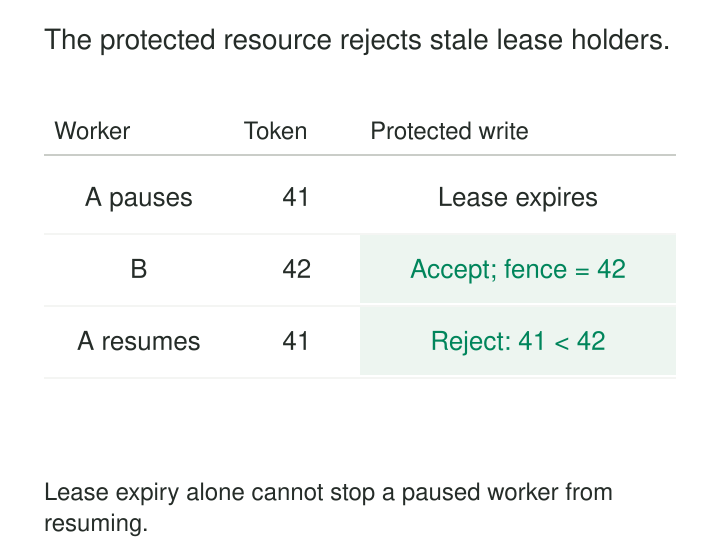

A pipeline worker acquires a lease to rebuild a daily partition. Halfway through, its process pauses long enough for the lease to expire. Another worker takes over and publishes the replacement.

Then the first worker resumes. It still has its computed result, its database connection, and instructions to publish. Unless the destination can distinguish old authority from new authority, it may overwrite the replacement with stale work.

**Use a lease to assign temporary ownership, and attach an increasing fencing token to every protected mutation. The destination rejects tokens older than the newest one it has accepted.**

The lease enables takeover when an owner disappears. The token makes that takeover enforceable when the old owner returns—or when its delayed requests finally arrive.

## Expiration does not stop a process

A lease grants ownership for a limited period, usually with renewal while the owner remains healthy.

Expiry allows another worker to acquire ownership. It does not terminate the previous worker, cancel its network requests, or revoke connections it already holds.

Checking the lease immediately before writing leaves a race: the worker can pause after the check, or its write can be delayed in transit. Even a correct coordination service cannot make that client-side check and an independent destination write happen atomically.

Martin Kleppmann’s explanation of distributed locking uses this failure sequence to motivate fencing: the resource receiving writes must participate in rejecting obsolete owners. [Martin Kleppmann: How to do distributed locking](https://martin.kleppmann.com/2016/02/08/how-to-do-distributed-locking.html)



## Carry authority to the mutation boundary

Each new ownership term receives a token greater than previous terms for the protected resource. Tokens might be called generations or epochs.

Suppose worker A receives token `41`. After its lease expires, worker B receives `42`. Both workers may execute code, but the destination can distinguish their authority.

A basic destination rule is:

```text
atomically, for the protected resource:
    if request.token < highest_token:
        reject as stale
    highest_token = max(highest_token, request.token)
    apply the mutation
```

The comparison, remembered token, and mutation must share one atomic boundary. Checking a token, releasing a database lock, and then performing the write recreates the race.

Equal tokens remain eligible in this version because one ownership term may perform multiple operations. Deduplication and ordering within that term require additional controls.

The guarantee is precise: **after the destination accepts token 42, it will reject subsequent mutations carrying token 41.** Lease expiry alone does not make the destination aware of the handover.

Where takeover must fence the old owner before substantive work begins, the new owner can first install its higher token through an atomic destination operation, then read authoritative state and proceed. That installation becomes the destination’s handover boundary.

## Example: protect publication of a rebuilt partition

Two workers rebuild `sales/day=2026-10-25`.

Worker A holds token 41 and writes candidate files into its private output location. Its lease expires during a long pause. Worker B acquires token 42, computes a replacement, and publishes it.

The publication record might contain:

| Resource | Highest token | Published manifest |
|---|---:|---|
| `sales/2026-10-25` | 42 | `manifest-B` |

When A resumes, it attempts to replace the publication record with `manifest-A`, carrying token 41. The destination rejects the operation atomically, leaving `manifest-B` visible.

This arrangement permits duplicate computation while protecting the authoritative publication. Candidate files can remain isolated until cleanup.

The boundary must include every authoritative mutation. If A can directly delete B’s files or overwrite shared objects without a token check, fencing only the publication pointer is insufficient. Private immutable outputs and controlled garbage collection make the protected surface smaller.

A higher token also does not prove that its candidate contains newer or correct business data. Input-version checks and validation remain necessary before publication.

## Example: stop an old consumer from replacing a checkpoint

A stream partition changes owners after a stalled consumer loses its lease.

The replacement consumer establishes token 72, restores state, and eventually commits checkpoint C12. An old consumer with token 71 later attempts to save C11.

| Request | Token | Checkpoint | Decision |
|---|---:|---|---|
| Replacement consumer | 72 | C12, next offset 1200 | Accept |
| Previous consumer, delayed | 71 | C11, next offset 900 | Reject |

The fencing check prevents an obsolete owner from replacing the authoritative checkpoint.

However, a checkpoint includes more than an offset. Operator state, source position, and output progress still need a consistent recovery boundary. A valid token cannot make an inconsistent checkpoint safe.

Nor does this protect an independent external sink automatically. If the old consumer can still send unfenced writes there, it can continue causing effects despite losing permission to update the checkpoint.

Each destination requiring protection must enforce ownership itself, or participate in a protocol that provides equivalent protection. Checking once in a gateway and forwarding an unconditional request to another system leaves delayed downstream effects possible.

The etcd repository includes an executable demonstration of this problem: one client loses its lease, another writes, and the resumed client’s obsolete version is rejected by the example storage service. It illustrates resource-side validation rather than treating the lock alone as sufficient. [etcd: Distributed-locking demonstration](https://github.com/etcd-io/etcd/blob/main/contrib/lock/README.md)

## Implementations expose the same responsibility

Hazelcast’s `FencedLock` supplies monotonically increasing tokens when ownership changes. Its documentation describes a paused client losing its session, another client acquiring ownership, and an external resource rejecting the resumed client’s older token.

The application must pass and enforce that token at the external resource. Using the lock API around an ordinary unconditional write does not add fencing to that write.

Configuration matters too: Hazelcast documents weaker guarantees in its CP subsystem’s default unsafe mode; the required CP configuration must be enabled for the intended consistency guarantees. [Hazelcast: FencedLock](https://docs.hazelcast.com/hazelcast/5.6/data-structures/fencedlock)

Google’s Chubby paper describes a related mechanism called a *sequencer*, containing the lock identity, mode, and generation. Clients pass sequencers to protected services, which validate them and reject invalid requests. The paper also explains passing a lock-acquisition count with writes to reject delayed requests from older owners. [Mike Burrows: The Chubby lock service](https://storage.googleapis.com/gweb-research2023-media/pubtools/4444.pdf)

These implementations put the decisive check where protected operations take effect.

## Preserve the ordering across failures

Correctness depends on several assumptions.

Tokens must come from a trustworthy authority and increase across ownership changes. Random UUIDs identify owners but do not order them. Ordinary wall-clock timestamps can move backward or collide.

Token generation must remain safe across coordinator failover, restoration, and resource recreation. Reusing an old token namespace can make obsolete authority appear current.

The destination must retain its highest accepted token durably, including across restart and failover. Releasing a lease should not erase that memory while delayed requests remain possible.

Finally, token scope must match resource scope. A fence for one partition should not accidentally authorize writes to another, and every mutation covered by the ownership claim must pass through enforcement.

## What fencing does—and what it costs

Fencing is useful for partition ownership, singleton publishers, compaction coordinators, and workers that may resume after reassignment.

It does not provide exactly-once execution. Repeating an increment twice with the same valid token can still apply it twice. It also does not order concurrent operations within one ownership term or make writes across independent systems atomic.

Operating costs include lease renewal traffic, a reliable coordination service, durable token metadata, and destination-side transactional checks. Short leases accelerate takeover but increase ownership churn during pauses; long leases delay recovery. Coordination outages may prevent new ownership even while workers remain capable of computing.

[[data-idempotent-writes|Idempotent Writes]] handles repeated operations. [[data-checkpoint-and-resume|Checkpoint and Resume]] defines consistent recovery state. [[data-atomic-publication|Atomic Publication]] makes completed results visible together. Fencing complements them by ensuring that an obsolete owner cannot replace protected state after newer authority has been established.
