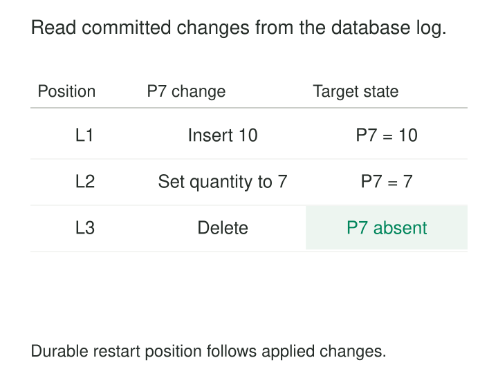

An order changes from Pending to Shipped, a customer corrects their address, and an obsolete product is deleted. A warehouse needs those changes quickly, but repeatedly scanning the operational tables consumes resources and still risks missing short-lived states.

An `updated_at` filter helps only when every writer maintains it correctly. It also cannot find a row that has disappeared.

[[data-log-based-change-data-capture|Log-Based Change Data Capture]], or log-based CDC, reads changes from the database’s transaction or replication log and turns them into records that downstream systems can consume. It uses the database’s record of mutations to maintain another representation of the data.

Its usefulness depends on preserving the meaning of those mutations through initialization, delivery, recovery, and application.

## Turn database mutations into a usable feed

Databases maintain logs for durability, recovery, or replication. A CDC mechanism interprets supported log records and exposes changes for selected tables.

The resulting records typically identify the source table, affected row, operation, available row values, and a source position. Transaction and schema metadata may also be available.

PostgreSQL, for example, implements logical decoding by translating its write-ahead log into an application-readable representation. Debezium’s MySQL connector reads the binary log and emits row-level insert, update, and delete records. [PostgreSQL: Logical Decoding Concepts](https://www.postgresql.org/docs/18/logicaldecoding-explanation.html), [Debezium: MySQL Connector](https://debezium.io/documentation/reference/stable/connectors/mysql.html)

A downstream committed-state view must apply changes only when their transaction’s commit is established. A connector that streams provisional transaction data requires corresponding commit and abort handling.

## Example: maintain the current inventory row

Suppose three committed operations affect product P-7:

| Operation | Source change | Required destination state |
|---|---|---|
| Insert | Create P-7 with quantity 10 | P-7: 10 |
| Update | Set quantity to 7 | P-7: 7 |
| Delete | Remove P-7 | No current row |

The update carries a new state: quantity 7. Adding 7 to the existing quantity would produce 17 and misinterpret the record.

The delete must also affect the destination. Ignoring it leaves a product that no longer exists in the source.

This requires reliable row identity. PostgreSQL logical replication uses a configured replica identity—normally the primary key—to identify rows for updates and deletes. Tables without suitable identity need additional configuration or a different handling strategy. [PostgreSQL: Replica Identity](https://www.postgresql.org/docs/18/logical-replication-publication.html#LOGICAL-REPLICATION-REPLICA-IDENTITY)

A current-state mirror, an append-only change archive, and a historical dimension can consume the same mutations differently. Capture does not choose the destination model.

## Establish the baseline without leaving a gap

A change feed beginning today does not necessarily contain every row already in the database. An unchanged customer created three years ago may never appear.

A common initialization therefore combines a consistent snapshot with a coordinated log position. The snapshot supplies existing state; subsequent log consumption supplies changes around and after that boundary.

The coordination matters. Copying tables first and starting capture “from now” afterward can miss mutations made during the copy.

Debezium’s PostgreSQL connector documents an initial snapshot tied to a recorded log position, followed by streaming from that position. Its snapshot isolation configuration affects the consistency of the initial read. [Debezium: PostgreSQL Snapshots](https://debezium.io/documentation/reference/stable/connectors/postgresql.html#postgresql-snapshots)

Snapshot records also need to remain distinguishable from new business activity. Discovering an existing invoice during initialization does not mean the invoice was issued at extraction time.

## Example: an update changes an aggregate

An invoice contributes 100 to a sales total. A correction changes its amount to 120.

| Change | Old contribution | New contribution | Effect on total |
|---|---:|---:|---:|
| Invoice amount corrected | 100 | 120 | +20 |
| Invoice subsequently deleted | 120 | 0 | −120 |

Appending the updated amount as another sale would overstate the total. Maintaining the aggregate requires replacing the previous contribution or retracting it before adding the new one.

Before-images can help, but their availability depends on the database and capture configuration. Alternatively, the consumer can retain the previously applied state.

SQL Server CDC provides a documented implementation: a capture process reads the transaction log into change tables. Inserts and deletes have corresponding row representations, while updates expose before and after representations. Consumers query changes over log-position ranges. [Microsoft: SQL Server CDC](https://learn.microsoft.com/en-us/sql/relational-databases/track-changes/about-change-data-capture-sql-server?view=sql-server-ver17)

The same reasoning applies when an update moves a contribution between groups. Moving an invoice from North to South requires adjusting both regional totals, even when company sales remain unchanged.

## Example: one transaction becomes several messages

An application commits an order header and its line items together. The source database exposes the transaction atomically.

A CDC pipeline may distribute those changes across table-specific streams. If a reporting consumer applies the header immediately and the lines later, readers can temporarily observe an incomplete order.

Preserving source order within each stream does not automatically preserve atomic visibility across streams.

Where the destination requires transaction-consistent views, it needs a way to recognize transaction completion and publish the related changes together. Debezium can provide transaction-boundary events and event counts when transaction metadata is enabled. That metadata supports coordination; consumers must implement the required behavior. [Debezium: Transaction Metadata](https://debezium.io/documentation/reference/stable/connectors/postgresql.html#postgresql-transaction-metadata)

Where temporary inconsistency is acceptable, simpler independent application may be sufficient. The choice belongs in the destination’s consistency contract.

## Resume safely, including after replay

A source position records extraction progress. It is not automatically a unique identifier for every emitted row change: one transaction or log position can correspond to multiple records.

The pipeline must retain enough source and sequence information to resume without skipping part of a transaction or incorrectly deduplicating distinct changes.

Progress should advance only after the corresponding records are durably accepted. A crash between writing records and committing progress can cause replay. PostgreSQL explicitly documents that logical decoding can resend recent changes after a crash and assigns clients responsibility for handling duplicates safely. [PostgreSQL: Replication Slots](https://www.postgresql.org/docs/18/logicaldecoding-explanation.html#LOGICALDECODING-REPLICATION-SLOTS)

Duplicate handling and ordering work together. Reapplying an update may be harmless, but applying an old update after a newer delete can resurrect a removed row. Consumers need source-defined ordering or version rules appropriate to each key.

These mechanisms can produce reliable effects, but log-based capture alone does not establish end-to-end exactly-once processing.

## Retention and lag become operational responsibilities

CDC avoids repeated full-table scans, but it adds decoding, transport, storage, and destination-write work. Initial snapshots can still be expensive. Large transactions and bulk updates can create substantial bursts.

Retention is especially important. In PostgreSQL, replication slots can retain required log resources while a consumer is disconnected, increasing source storage consumption. Other capture systems prune change history after a configured interval. [PostgreSQL slot retention](https://www.postgresql.org/docs/18/logicaldecoding-explanation.html#LOGICALDECODING-REPLICATION-SLOTS), [SQL Server CDC validity interval](https://learn.microsoft.com/en-us/sql/relational-databases/track-changes/about-change-data-capture-sql-server?view=sql-server-ver17#validity-interval)

If required history is lost, recovery may require a new coordinated snapshot. Silently jumping to the latest position leaves an unexplained gap.

Useful monitoring separates source-to-capture lag from capture-to-destination lag, and tracks retained-log growth, failed records, and recovery capacity. A healthy connector does not prove that downstream reports are current.

## Row history still needs interpretation

Log-based CDC is useful for fresh warehouse ingestion, current-state replicas, search indexes, and cache maintenance when database access and operational support are available. Small tables with modest freshness requirements may be simpler to extract fully.

Its assumptions include supported logging configuration, sufficient retention, usable row identity, and consumers that handle the actual event format. Schema changes, primary-key changes, truncation, and failover need explicit behavior; support varies by connector.

Finally, a row mutation describes a storage change. Setting `status = 'shipped'` may reflect a business shipment, a correction, or a maintenance script. Database commit time also differs from the time an activity occurred.

Inferring business events from CDC therefore requires domain rules. The log supplies evidence of mutations, not their complete business meaning.

## Related patterns

[[data-full-snapshot-extraction|Full Snapshot Extraction]] supplies the baseline needed before ongoing changes can maintain state.

**Idempotent Processing** makes replay safe when delivery or checkpointing repeats work.

[[data-transactional-outbox|Transactional Outbox]] records intentional business messages alongside database changes; CDC can transport those outbox records.

[[data-event-sourcing|Event Sourcing]] makes domain events authoritative. Log-based CDC generally observes mutations to an existing state model.
