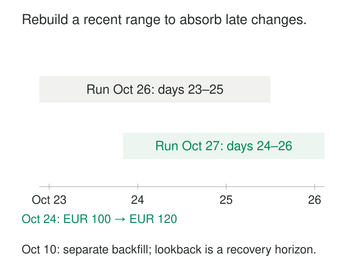

Yesterday’s dashboard is almost correct. A few events arrived overnight, a supplier corrected several records, and one transaction was assigned to the wrong day.

A pipeline that processes only dates newer than its last successful run misses those changes. Rebuilding several years of history every morning would repair them, but at an unnecessary cost.

**Lookback Recalculation repeatedly recomputes a recent stretch of history while preserving older results.** It gives recent outputs time to settle as delayed and corrected inputs become available.

The pattern trades bounded repeated work for better historical accuracy. Its boundary must remain explicit: corrections outside the lookback require another recovery path.

## Revisit a moving interval

A lookback policy defines a cutoff, a window length, and the outputs to rebuild.

For example, a daily job might recalculate the three completed UTC days before its midnight cutoff:

| Run cutoff | Recalculated output dates |
|---|---|
| October 26, 00:00 UTC | October 23–25 |
| October 27, 00:00 UTC | October 24–26 |

Each run overlaps the previous one. October 24 receives several opportunities to incorporate changes before it leaves routine recalculation.

dbt describes lookback windows as a way to capture late-arriving facts in incremental models, while explicitly noting that records arriving beyond the window can still be missed. See [incremental models in depth](https://docs.getdbt.com/best-practices/materializations/4-incremental-models#late-arriving-facts).

This is a transformation policy. Overlapping extraction windows help retrieve changes from a source; lookback recalculation determines which derived results are revisited. A pipeline may need both.

## A late sale repairs a daily total

Consider an illustrative October 24 sales total of 100 EUR. Another 20 EUR sale occurred that day but became available shortly before the October 26 run.

Because October 24 remains inside the lookback, the job rereads its complete relevant inputs and calculates 120 EUR. It replaces the previous total.

Recomputing from complete inputs matters. Summing only the newly arrived sale and overwriting the daily total would publish 20 EUR. Appending another daily row could make consumers count both versions.

The publication mechanism must match the model. A daily aggregate can replace its row by date and other grouping keys. A detailed daily dataset may replace the complete partition. dbt documents these alternatives in its [incremental strategy guide](https://docs.getdbt.com/docs/build/incremental-strategy).

Repeated delivery also needs handling. If the late sale appears twice, recalculation should recognize its stable event identity rather than count both copies.

Deletions require equal care. If recalculation leaves a group empty, publishing no replacement row may leave the obsolete target row intact. The declared output scope must support removing results that no longer exist.

## The output window may need a longer input history

An illustrative attribution model recalculates conversions from the last three days. Each conversion can depend on marketing touches from the preceding 30 days.

Reading only three days of touches would produce incomplete attribution. The earliest conversion in the output window may require activity roughly 33 days before the cutoff.

The pipeline therefore has two boundaries:

- **Output scope:** the conversion dates being replaced.
- **Input context:** all records needed to calculate those outputs correctly.

The same distinction applies to rolling averages, session boundaries, opening balances, and “first event” calculations. A narrow output window does not justify truncating every input to that window.

Corrections can also propagate forward. A revised earlier touch might affect several conversion dates. The lookback must cover the affected outputs, or dependency-driven recalculation must supplement it.

Framework filtering deserves attention here. dbt’s [microbatch documentation](https://docs.getdbt.com/docs/build/incremental-microbatch) explains how configured event times and batch boundaries filter upstream inputs. Those filters must fit the transformation’s dependency requirements.

## An old correction needs an exception path

Suppose an illustrative billing source corrects an October 10 record on October 26. A three-day lookback never revisits its affected output.

Increasing the routine window to four days would still miss it.

A dependable system pairs routine recalculation with a way to identify and repair older changes. That might be a correction feed carrying affected dates, a targeted backfill, periodic reconciliation, or an occasional full rebuild.

The important distinction is between “outside routine processing” and “known to be final.” A lookback boundary establishes the former. It does not prove the latter.

dbt’s microbatch implementation provides explicit start and end bounds for historical backfills, separate from ordinary lookback processing. See its [backfill documentation](https://docs.getdbt.com/docs/build/incremental-microbatch#backfills).

A rebuild remains possible only if the necessary source history and reference data still exist. A retention policy that discards inputs before the repair horizon can make older errors permanent.

## Choose the window from observed change behavior

The window should reflect when relevant information becomes available—not simply when source events occur.

Useful measurements include event-to-arrival delay, correction age, source publication schedules, processing frequency, and recovery time after outages. For revised records, measure how far back the correction affects outputs.

These distributions often differ by source and segment. Mobile events may be delayed by offline devices; supplier files may follow weekly correction cycles. One platform-wide number can be wasteful for some datasets and inadequate for others.

A percentile is useful evidence, but it is not a completeness guarantee. Rare late changes may carry disproportionate business importance.

Scheduling also matters. An event arriving shortly before its date leaves the window must still have a successful opportunity to be processed. Outages can consume that opportunity.

Select a routine window that meets the product’s correction expectations, then define how older exceptions are detected and repaired.

## A documented implementation: microbatch lookback

dbt’s `lookback` configuration reprocesses previous batches during microbatch incremental runs to capture late-arriving records. The setting counts batches; its time coverage depends on batch size and processing boundaries. See the [`lookback` reference](https://docs.getdbt.com/reference/resource-configs/lookback).

That distinction prevents off-by-one assumptions. “Three previous batches” and “exactly three completed calendar days” are not interchangeable policies in every implementation.

The scheduler must also recognize that useful new data exists. A late record can have an old event timestamp but a recent ingestion timestamp. Freshness or change-detection logic based only on event time may skip the recalculation that the lookback was intended to perform.

The job’s selection logic, scheduling conditions, and publication strategy must therefore agree.

## Keep progress and publication coherent

Each run should use explicit boundaries and identifiable input versions. Recalculating against a moving source without a consistent read boundary can produce results that are difficult to reproduce.

After publication, progress should record what actually succeeded. Following a long outage, resuming at “today minus three days” may skip unprocessed dates. Catch-up processing must account for the gap since confirmed progress, then resume the normal overlap.

Concurrent runs need coordination too. An older calculation can overwrite a newer result if it finishes later. Versioned publication or another ordering mechanism should prevent stale replacement.

A lookback also cannot automatically repair every changed dependency. Updating a customer crosswalk or classification rule may affect years of outputs. That is a broader restatement decision.

## Pay for bounded repair, and measure what it misses

Longer windows increase source reads, joins, aggregation, and target writes. Frequent runs repeatedly process much of the same data. Partition pruning and reusable intermediates can reduce costs, while wide dependency histories may dominate them.

Monitor revisions by output age, corrections outside the window, failed runs, and reconciliation differences. A job that finishes successfully can still leave old errors untouched.

The pattern fits data products whose recent history changes frequently but usually stabilizes within a manageable period. It is less suitable as the sole correction mechanism when old records change unpredictably or every revision must be applied promptly.

[[data-overlapping-extraction-windows|Overlapping Extraction Windows]] helps retrieve delayed changes. [[data-partition-replacement|Partition Replacement]] republishes complete recalculated slices. [[data-deterministic-transformations|Deterministic Transformations]] makes repeated calculation comparable. [[data-historical-restatement|Historical Restatement]] handles corrections beyond routine coverage.

A useful lookback policy states how far it repairs automatically—and how the system discovers what remains outside that promise.
