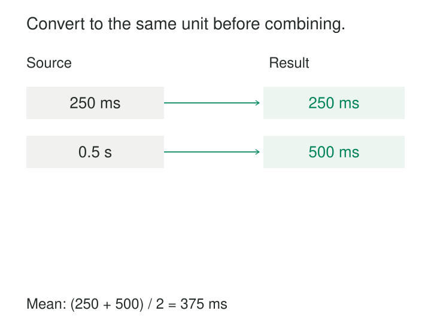

**What it is for**

Keep numerical values connected to their units, scales, and measurement meanings so that calculations remain valid as data crosses system boundaries.

A monitoring dashboard reports that response times improved after a deployment. One service sends durations in milliseconds. Its replacement sends seconds. Both populate a column called `duration`.

The new numbers are smaller. The software accepts them. The chart looks encouraging.

Nothing has established that the service became faster.

Make Units Explicit prevents this kind of silent reinterpretation. A measurement carries enough information to explain its magnitude, and conversions change its numerical representation through an explicit rule.

## A number needs a measurement meaning

The value `250` could describe milliseconds, seconds, grams, monetary minor units, or a count of items.

A useful measurement therefore needs more than a numeric storage type. It needs a quantity meaning and a unit or scale convention.

That convention can live in different places. A column called `duration_ms` can be sufficient when its schema guarantees milliseconds. A heterogeneous observation table may need separate value and unit fields. A monetary amount needs its currency and the API’s representation rules.

Repeating a unit on every row is unnecessary when the schema establishes it unambiguously. What matters is that the convention survives copying, exporting, joining, and interpretation.

The practical question is:

> What does one increment of this number represent?

That question should have an answer before anyone compares values or calculates a total.

## Two request durations, one common representation

Consider two illustrative records, each measuring one request’s duration.

Source A reports `250 ms`. Source B reports `0.5 s`.

An arithmetic mean of the bare numbers produces `125.25`. Attaching “milliseconds” afterward does not repair the calculation.

The measurements must first be expressed in compatible units.

After conversion, the mean is:

**(250 ms + 500 ms) ÷ 2 = 375 ms**

Changing the field name from `duration_seconds` to `duration_ms` without multiplying the value would merely mislabel the data.

A sensible ingestion design can retain the reported value and unit while publishing a normalized duration for downstream use. Consumers then avoid repeating conversions, and investigators can still inspect the original representation.

The example assumes both records measure the same kind of duration and each represents one observation. If one value measures server processing and the other includes network time, matching units do not make their meanings identical.

Likewise, if the inputs are already averages over different numbers of requests, averaging them equally may be wrong. Units establish compatibility; grain and aggregation rules still matter.

## Stripe: a monetary integer has a currency-dependent scale

Stripe’s API documents amounts in the currency’s minor unit, subject to its currency-specific rules.

For USD, an amount of `1000` represents 10 USD. For JPY, which Stripe treats as a zero-decimal currency, `1000` represents 1,000 JPY. [Stripe currency documentation](https://docs.stripe.com/currencies).

| API amount | Currency | Interpreted amount |
|---:|---|---:|
| 1000 | USD | 10.00 USD |
| 1000 | JPY | 1,000 JPY |

A universal “divide by one hundred” transformation would misinterpret the second record.

Even the currency code is not always sufficient without the operation’s contract. Stripe documents special representation rules and differences between some charge and payout amounts. Conversion logic must follow those rules rather than infer scale from a familiar currency name.

The model should preserve the original amount, currency, and representation convention. If a reporting layer publishes major-unit amounts, the transformation should make that distinction clear.

Combining currencies introduces another dependency. Adding 10 USD to 1,000 JPY does not produce a meaningful single-currency total. A reporting conversion needs a target currency, an exchange rate, and an explicit policy for the rate’s date, source, and rounding.

Unlike converting seconds to milliseconds, that conversion depends on contextual data rather than a fixed physical relationship.

## Mars Climate Orbiter: the boundary was the failure point

NASA’s Mars Climate Orbiter provides a documented example of unit assumptions crossing an engineering interface.

NASA’s technical account describes ground software producing thruster impulse information in pound-force seconds where the receiving trajectory calculations expected newton-seconds. The missing conversion introduced errors into the trajectory estimate. [NASA guidance, navigation, and control case study](https://ntrs.nasa.gov/api/citations/20230005922/downloads/20230005922.pdf).

The quantities concerned the same physical phenomenon. Their numeric representations used different units.

NASA/JPL’s contemporary account also emphasized the failure of engineering checks to detect and correct the mismatch. [JPL’s account of the loss](https://www.jpl.nasa.gov/news/mars-climate-orbiter-team-finds-likely-cause-of-loss/).

The lesson extends beyond choosing a preferred measurement system. A receiving system needs evidence that incoming values satisfy its unit contract. Documentation alone cannot enforce that agreement.

## Make conversion a visible operation

A robust model distinguishes the source representation from the normalized representation and defines how one becomes the other.

That can be simple: a documented transformation from seconds to milliseconds with a clearly named output column.

More varied measurements may benefit from governed unit codes and a conversion library. UCUM—the Unified Code for Units of Measure—provides a machine-oriented system for expressing units and their relationships. It also accommodates conversions requiring more than multiplication by a factor, including the offset between Celsius and kelvin. [UCUM specification](https://ucum.org/ucum).

The conversion mechanism should validate compatibility. A mass cannot be converted directly into a duration. Converting a volume into a mass requires additional information, such as density and its applicable conditions.

The same principle applies to business quantities. A case of products can be converted into individual items only when the relevant pack size is known. The word “case” does not establish a universal multiplier.

## What must remain true

**The unit convention must be authoritative and accessible.** It belongs in the schema, interface contract, or measurement record—not only in someone’s memory or a dashboard axis.

**The quantity must be identified.** A duration and an epoch timestamp can both use seconds while representing different things. Column names and definitions must preserve that distinction.

**Conversion must update value and metadata together.** A record must not claim milliseconds while retaining a value expressed in seconds. Reprocessing also needs to avoid converting an already normalized value again.

**Precision and rounding need policies.** Choose representations appropriate to the required range and precision. Early rounding can change downstream results, particularly when many values are aggregated.

**Missing units must remain unresolved.** Guessing from magnitude can fail when legitimate values overlap. Unknown or conflicting units need validation or quarantine rather than silent defaults.

**Boundary tests should exercise different representations.** Equivalent measurements expressed in different supported units should normalize consistently. Tests should also cover unsupported units, incompatible quantities, and values near rounding or range limits.

These checks establish more than whether a field contains a number. They establish whether that number can safely participate in the intended calculation.

## Explicit units have an operating cost

Unit-aware models require maintained contracts, conversion rules, and sometimes additional fields or software types. Retaining original and normalized values uses storage and introduces a responsibility to keep their relationship correct.

The effort is particularly useful when integrating external data, combining measurements from several systems, publishing reusable datasets, or supporting multiple currencies and measurement conventions.

A small homogeneous dataset may need only clear names and enforced schema documentation. A generic unit framework can add unnecessary complexity when one stable convention is sufficient.

Common mistakes include treating a display label as a conversion, assuming every monetary integer uses hundredths, and normalizing prefixes while ignoring measurement meaning.

Another is assuming unit agreement settles every analytical question. Kilograms of different products may be physically additive but commercially misleading. Two percentages may use the same scale while describing different populations.

Explicit units make numerical interpretation possible. The business definition still determines which comparisons and calculations are useful.

## Related patterns

[[data-shared-business-vocabulary|Shared Business Vocabulary]] defines the quantity being measured and the meaning of its name.

[[data-declare-the-grain|Declare the Grain]] establishes what each measurement represents and how observations can be aggregated.

[[data-separate-source-facts-from-derived-interpretations|Separate Source Facts from Derived Interpretations]] preserves reported values alongside normalized or converted outputs.

[[data-explicit-data-contracts|Explicit Data Contracts]] carries unit, scale, precision, and compatibility requirements across interfaces.

**Validate at Boundaries** detects missing or incompatible representations before they enter downstream calculations.
